<div align="center">

# AI Control Plane

### Observe, Govern, and Protect All Google Cloud AI from One Control Plane.

**Gemini Enterprise · Agent Platform (Gateway · Registry · Engine · Model Armor) · NotebookLM · Antigravity · FinOps**

[](https://github.com/ldu1225/ai-control-plane/actions/workflows/tests.yml)
[](https://github.com/ldu1225/ai-control-plane/releases/tag/v2.2.1)
[](LICENSE)
[](#3-quick-start-deploy-with-one-command)
[](#2-architecture)
[](#11-design-principles)

[🇰🇷 한국어 (README.md)](README.md) &nbsp;|&nbsp; **🇺🇸 English**

<br/>

[](https://ssh.cloud.google.com/cloudshell/editor?cloudshell_git_repo=https://github.com/ldu1225/ai-control-plane.git&cloudshell_tutorial=TUTORIAL.md)
&nbsp;
[](https://github.com/ldu1225/ai-control-plane/releases/download/v2.2.1/AI_Control_Plane_Feature_Tour.mp4)

[🎬 Feature Tour Video](#-feature-tour-video-252-full-walkthrough) &nbsp;·&nbsp;
[📸 Screenshots](#-screenshots-at-a-glance) &nbsp;·&nbsp;
[⚡ 1-Command Install](#-30-second-one-command-install) &nbsp;·&nbsp;
[🏗️ Architecture](#2-architecture) &nbsp;·&nbsp;
[📚 Table of Contents](#table-of-contents)

<br/>

<a href="https://github.com/ldu1225/ai-control-plane/releases/download/v2.2.1/AI_Control_Plane_Feature_Tour.mp4">
  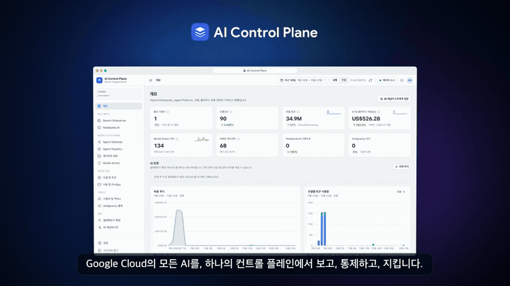
</a>

<sub>Animated highlight loop captured from real Google Cloud telemetry (only org name, project ID, and email are masked). Click to watch the full <b>1080p HD narrated Feature Tour (2:52)</b>.</sub>

</div>

<br/>

<table>
  <tr>
    <td width="25%" valign="top">
      <h4>👁️ Observe</h4>
      <sub>Track Gemini Enterprise, NotebookLM, Agent Platform, per-model tokens, and multi-project AI activity in a single real-time console.</sub>
    </td>
    <td width="25%" valign="top">
      <h4>🛡️ Protect</h4>
      <sub>Audit Model Armor prompt-injection &amp; DLP blocks (human vs automated), manage Agent Gateway IAP authorization, and detect idle agents.</sub>
    </td>
    <td width="25%" valign="top">
      <h4>🚦 Govern</h4>
      <sub>Enforce Antigravity per-user cost/token caps in real time via Pub/Sub, protected by 5 Safety Gates (G1–G5), allow/deny backends, and bulk GE feature controls.</sub>
    </td>
    <td width="25%" valign="top">
      <h4>💰 Optimize &amp; Analyze</h4>
      <sub>Combine Billing Export with official public price estimation, department/user chargeback, Gemini cost-spike analysis, and natural-language BigQuery SQL.</sub>
    </td>
  </tr>
</table>

> [!IMPORTANT]
> **There is no sample data, no demo mode and no fake data.** Every number in the UI is a value actually read from the connected Google Cloud project(s). When a BigQuery Billing Export table is not connected yet, cost metrics automatically fall back to **Token-Based Reverse Cost Estimation** (measured token usage × official Google Cloud public pricing × synced multi-currency exchange rates, clearly badged as estimated cost in the UI). Metrics whose underlying telemetry cannot be read are never fabricated — they are shown as `—` with the exact cause and remediation steps.

> [!NOTE]
> This repository is a management solution built to run in Google Cloud customer environments. It is not an officially supported Google product. Korean documentation: [README.md](README.md)

---

## ⚡ 30-Second One-Command Install

Run a **single command** in Google Cloud Shell (or macOS/Linux) on either a brand-new empty project or an existing enterprise project. The installer checks billing, enables required APIs, provisions least-privilege service accounts and custom roles, creates the settings bucket, BigQuery audit dataset, Log Router sink, Data Access audit logs, Gemini Enterprise prompt logging, builds the container image, deploys Cloud Run, and configures Cloud Scheduler + Pub/Sub real-time enforcement automatically.

```bash
# 1) Interactive one-click wizard (press Enter to accept smart defaults)
bash <(curl -fsSL https://github.com/ldu1225/ai-control-plane/raw/main/scripts/install.sh)

# 2) Direct single-project deploy (or add --link-projects for a unified multi-project hub)
bash <(curl -fsSL https://github.com/ldu1225/ai-control-plane/raw/main/scripts/install.sh) \
  --project YOUR_PROJECT_ID
```

> See [3. Quick start: deploy with one command](#3-quick-start-deploy-with-one-command) for multi-project hub deployment, `--read-only`, `--enforcement-backend iam_deny`, and automatic organization-policy handling.

---

## 🎬 Feature Tour Video (2:52 Full Walkthrough)

<div align="center">
  <a href="https://github.com/ldu1225/ai-control-plane/releases/download/v2.2.1/AI_Control_Plane_Feature_Tour.mp4">
    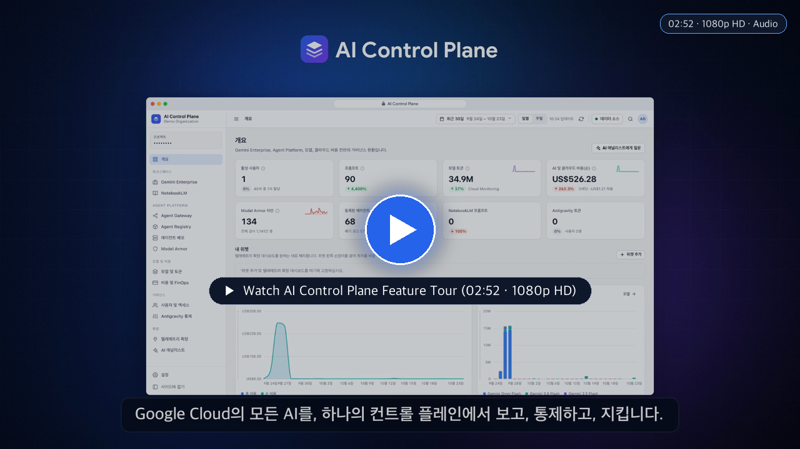
  </a>
  <p>
    <a href="https://github.com/ldu1225/ai-control-plane/releases/download/v2.2.1/AI_Control_Plane_Feature_Tour.mp4"><b>▶ Watch / Download Full Video (1080p HD · Korean Narration &amp; Subtitles, 2:52)</b></a>
    &nbsp;&nbsp;|&nbsp;&nbsp;
    <a href="https://github.com/ldu1225/ai-control-plane/releases/download/v2.2.1/AI_Control_Plane_Feature_Tour.srt">Subtitles (.srt)</a>
    &nbsp;&nbsp;|&nbsp;&nbsp;
    <a href="https://github.com/ldu1225/ai-control-plane/releases/tag/v2.2.1">Release Notes (v2.2.1)</a>
  </p>
</div>

<details>
<summary><b>📑 Full Video Chapter Guide (19 Chapters)</b></summary>

| Time | Chapter | Highlights |
|---|---|---|
| `0:00` | Intro | Observe, govern, and protect all Google Cloud AI from one control plane |
| `0:17` | 01 Sign-in &amp; Access Control | Google account sign-in (IAP / OAuth) and admin-approved RBAC |
| `0:23` | 02 Executive Overview | 8 core KPIs, cost &amp; token trends, security posture, and agent lifecycle |
| `0:36` | 03 Gemini Enterprise | Prompts, active users, agent share, and idle license seat discovery |
| `0:46` | 04 NotebookLM | Activity visibility from Cloud Audit Data Access logs |
| `0:51` | 05 Agent Gateway | AI API traffic, callers, authorization decisions, and denied/error monitoring |
| `0:57` | 06 Agent Registry | Unified agent catalog with automatic 50-day idle deprecation candidates |
| `1:03` | 07 Agent Deployments | Agent Engine runtimes, execution identities, call volume, and cost |
| `1:08` | 08 Model Armor | Prompt-injection &amp; DLP blocks separating human vs automated traffic |
| `1:19` | 09 Models &amp; Tokens | Zero-hardcoding auto-discovery of new models with token and spend breakdowns |
| `1:30` | 10 Cost &amp; FinOps | Credits, service &amp; SKU attribution, and Gemini root-cause spike analysis |
| `1:39` | 11 Users &amp; Access | User 360 cross-service usage and IAM governance actions |
| `1:46` | 12 Antigravity Controls | Per-user cost/token caps, auto-suspension, and 5 Safety Gates (G1–G5) |
| `2:04` | 13 Telemetry Extensions | Automatic log discovery and 1-click dynamic dashboards |
| `2:13` | 14 Custom Widgets | Per-user pinned dashboard widgets with drag-and-drop layouts |
| `2:17` | 15 AI Analyst | Natural language → verified read-only BigQuery SQL → instant charts &amp; tables |
| `2:28` | 16 Settings | White-label branding, model selection, governance policy, and access control |
| `2:34` | 17 Deployment &amp; Outro | One-command deployment directly into your Google Cloud project |

</details>

---

## 📸 Screenshots at a Glance

### Executive Overview

<p align="center">
  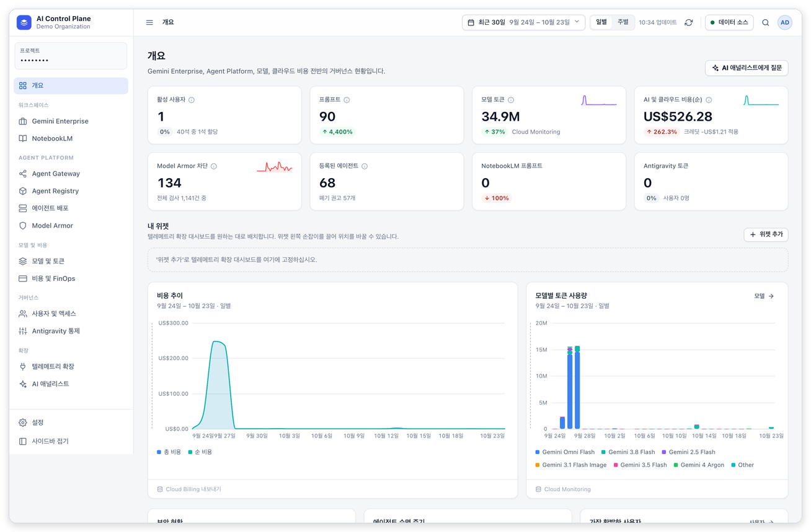
</p>

> Monitor active users, prompts, model tokens, net spend, Model Armor blocks, registered agents, NotebookLM, Antigravity KPIs, and live health across all 9 Google Cloud data sources at a glance (UI supports one-click English / Korean switching).

### Workspace, Agents &amp; Security

<table>
  <tr>
    <td width="50%" valign="top">
      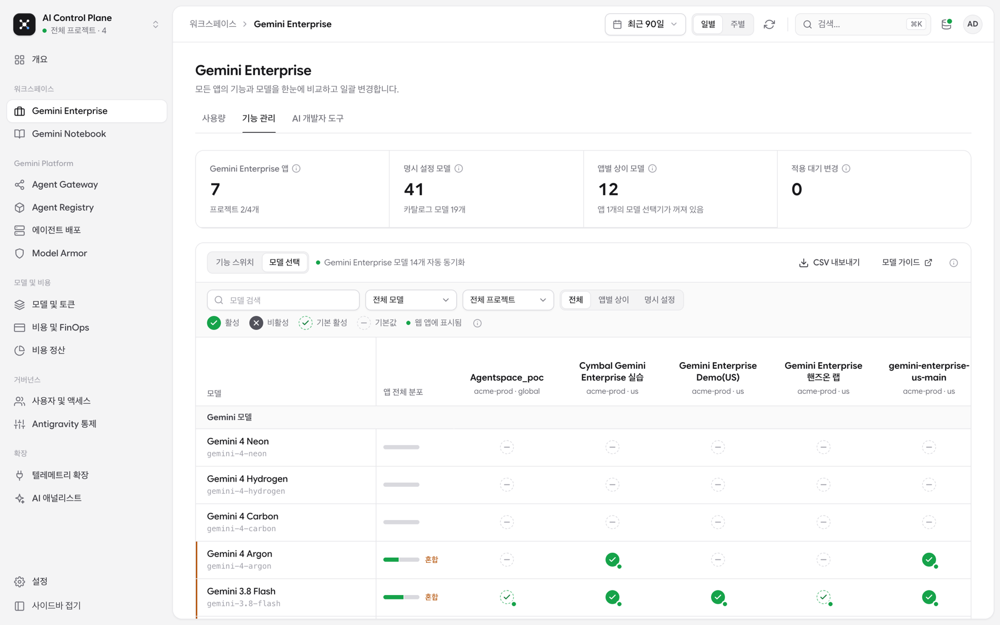
      <p><b>Gemini Enterprise &amp; Feature Management</b><br/><sub>Daily prompts, active users, per-agent share, idle license seat discovery, and bulk feature-switch matrix across apps</sub></p>
    </td>
    <td width="50%" valign="top">
      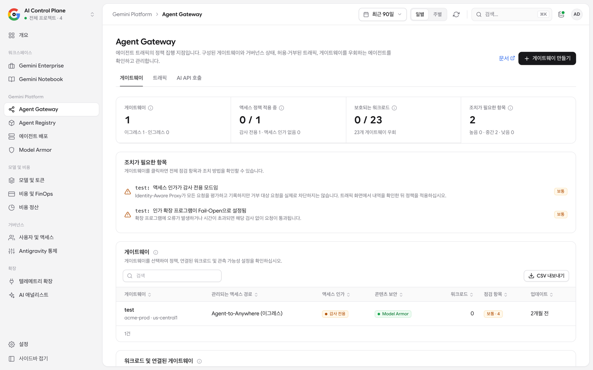
      <p><b>Agent Gateway</b><br/><sub>Inspect inbound AI API traffic, user &amp; service-account callers, error/denial trends, and IAP authorization posture</sub></p>
    </td>
  </tr>
  <tr>
    <td width="50%" valign="top">
      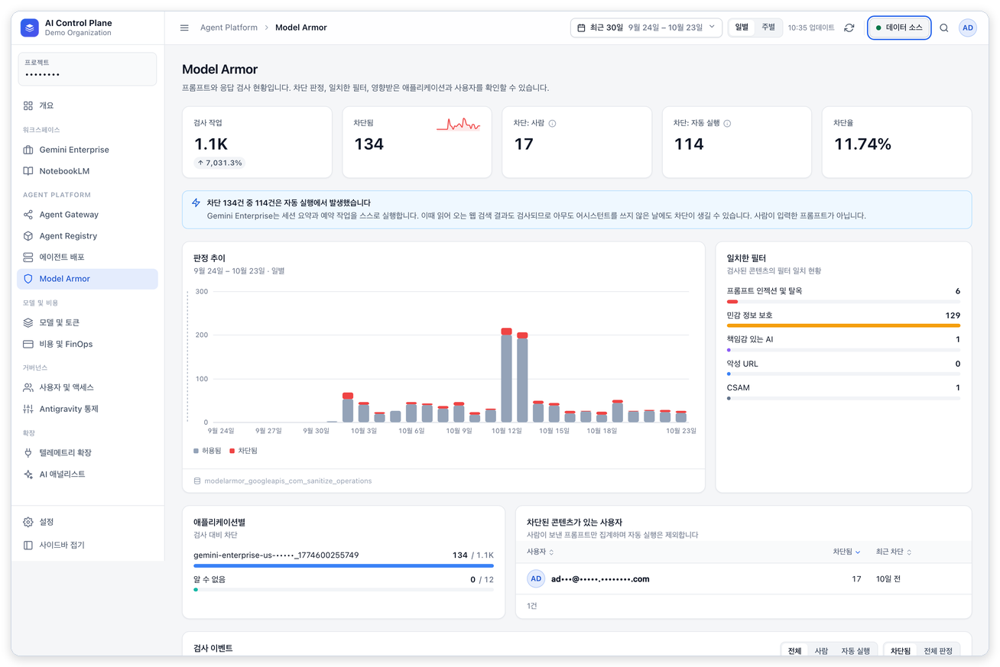
      <p><b>Model Armor Security</b><br/><sub>Track prompt-injection and sensitive-data (DLP) blocks by filter and isolate human prompts from automated background jobs</sub></p>
    </td>
    <td width="50%" valign="top">
      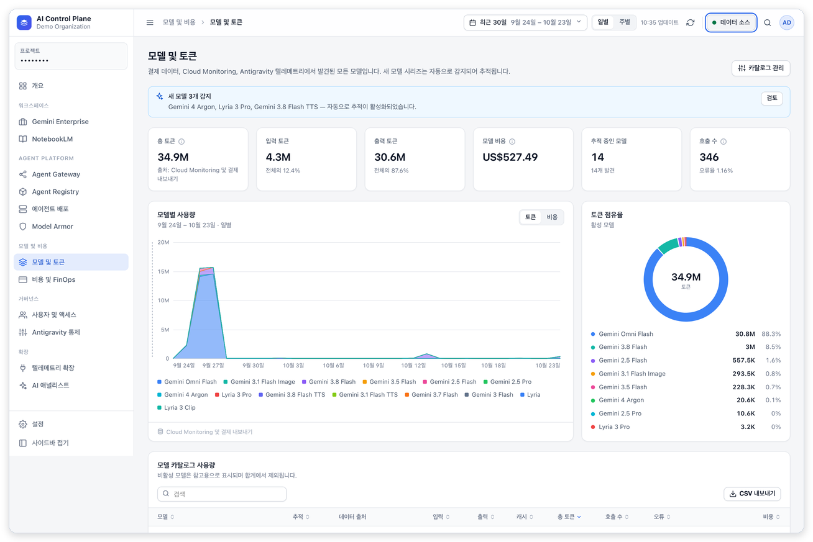
      <p><b>Models &amp; Tokens (Zero Hardcoding)</b><br/><sub>Automatically detect newly used models (Gemini 4 Argon, 3.8 Flash, Lyria 3 Pro) and track input/output/cached tokens and cost</sub></p>
    </td>
  </tr>
</table>

### FinOps, Antigravity Governance, Telemetry &amp; AI Analyst

<table>
  <tr>
    <td width="50%" valign="top">
      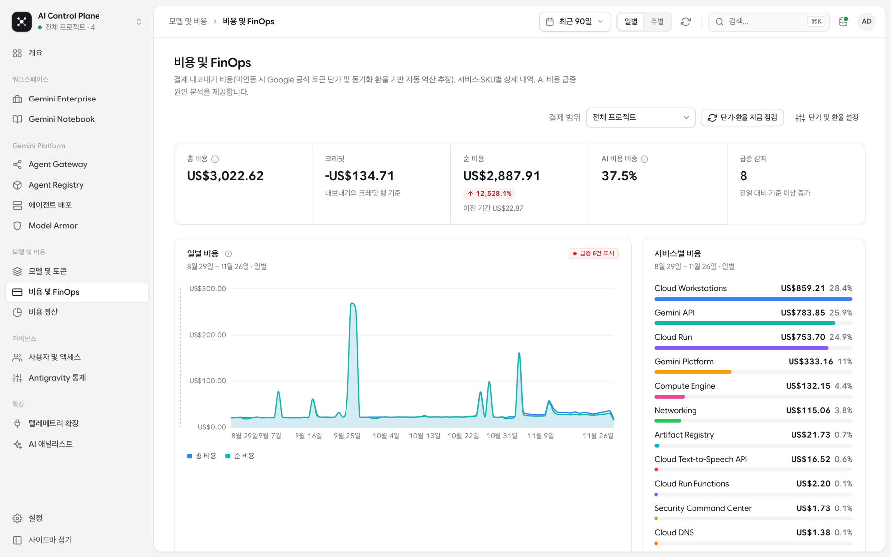
      <p><b>Cost &amp; FinOps + AI Spike Analysis</b><br/><sub>Analyze daily spend, services, top SKUs, credits, automatic public-price estimation without billing export, and Gemini root-cause analysis</sub></p>
    </td>
    <td width="50%" valign="top">
      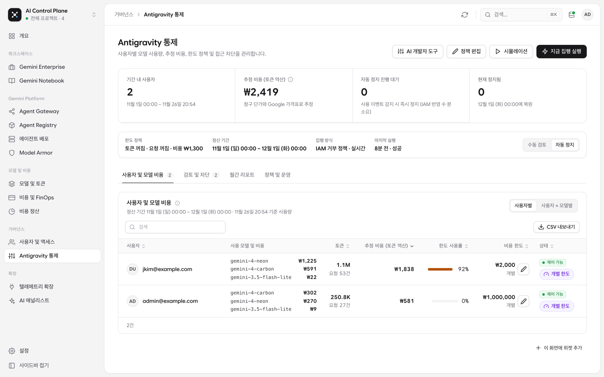
      <p><b>Antigravity Per-User Caps &amp; 5 Safety Gates</b><br/><sub>Configure per-user currency/token/request caps, real-time Pub/Sub suspension, automatic period-reset restore, and G1–G5 safety gates</sub></p>
    </td>
  </tr>
  <tr>
    <td width="50%" valign="top">
      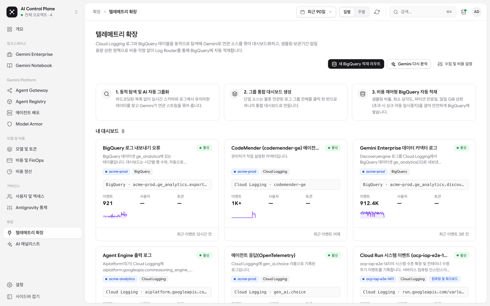
      <p><b>Telemetry Extensions</b><br/><sub>Auto-profile existing Cloud Logging &amp; BigQuery streams, group semantically with Gemini, and route logs with daily GiB budget guards</sub></p>
    </td>
    <td width="50%" valign="top">
      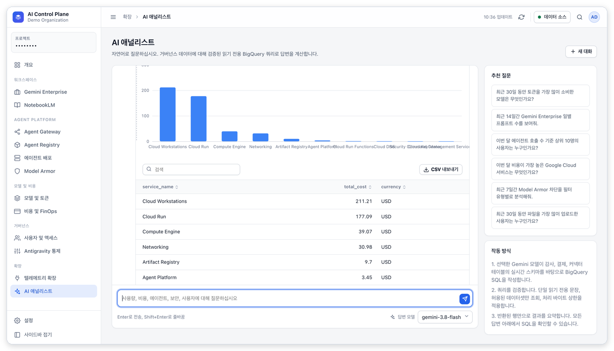
      <p><b>AI Analyst</b><br/><sub>Ask governance questions in natural language to generate verified read-only BigQuery SQL with instant charts, tables, and summaries</sub></p>
    </td>
  </tr>
</table>

---

## Table of contents

1. [What you can do](#1-what-you-can-do)
2. [Architecture](#2-architecture)
3. [Quick start: deploy with one command](#3-quick-start-deploy-with-one-command)
4. [All deploy.env settings](#4-all-deployenv-settings)
5. [Sign-in and permissions](#5-sign-in-and-permissions)
6. [Connecting data sources](#6-connecting-data-sources)
7. [Features and calculation methods by page](#7-features-and-calculation-methods-by-page)
8. [Antigravity per-user caps and suspension](#8-antigravity-per-user-caps-and-suspension)
9. [Configuration structure (config.yaml, environment variables, UI settings)](#9-configuration-structure-configyaml-environment-variables-ui-settings)
10. [Deploying with Terraform (optional)](#10-deploying-with-terraform-optional)
11. [Running locally](#11-running-locally)
12. [Security model](#12-security-model)
13. [Costs](#13-costs)
14. [Operations and troubleshooting](#14-operations-and-troubleshooting)
15. [Removal](#15-removal)
16. [Developer guide](#16-developer-guide)
17. [License](#17-license)

---

## 1. What you can do

### 1.1 Design principles

| Principle | Meaning |
|---|---|
| Measured data only | No sample values or demo data are ever injected. Without a billing export, measured token usage is valued with official Google Cloud public pricing (explicitly badged as estimated cost); unreadable metrics are shown as `—` with the cause. |
| No hardcoding | Model lists and versions are not kept in code. Models are discovered automatically from billing SKUs, Cloud Monitoring and Antigravity logs, so new models such as Gemini 4 Carbon and Gemini 4 Argon are tracked without a new deployment. |
| Schema-adaptive | BigQuery tables and columns are checked with `INFORMATION_SCHEMA`, and only the ones that exist are queried. Both date-sharded tables and partitioned tables are supported. |
| Everything can be turned on or off | Modules, models and connectors are turned on or off individually. Disabled modules do not query their data sources. |
| Safety first for controls | IAM changes go through dry runs, safety gates, a change budget, atomic etag-based updates and audit logs. |
| Least privilege | Read features use only read roles. IAM write roles are granted only when control features are turned on. Service account keys are not used. |

### 1.2 Modules

| Menu | Module ID | Features | Data sources |
|---|---|---|---|
| Overview | `overview` | Overall KPIs with change vs the previous period, spend trend, tokens by model, security posture, agent lifecycle, recent governance actions | Each module |
| Gemini Enterprise | `gemini_enterprise` | Active users, prompts, calls per agent, license seat assignment and idle seats, uploaded files. **Feature management**: a matrix of every app's feature switches across all projects and locations, app-to-app comparison and bulk changes to many apps (review, then apply; audit logged) | BigQuery (Gemini Enterprise logs), Discovery Engine API (`engines.list`, `engines.patch`) |
| NotebookLM | `notebooklm` | Active notebooks, users, prompts | BigQuery `cloudaudit_googleapis_com_data_access` |
| Agent Gateway | `agent_gateway` | Gateway inventory and governance posture, create/update/delete, Identity-Aware Proxy access authorization setup and audit-only ↔ enforced switching, bound workloads (Agent Runtime and Gemini Enterprise), gateway request/authorization/MCP traffic, AI API audit calls | Network Services API, Network Security API, Cloud Logging, Cloud Monitoring, BigQuery audit logs |
| Agent Registry | `agent_registry` | Unified catalog of Agent Engine and Gemini Enterprise agents, idle agents and deprecation candidates, creation history | Agent Platform API, Discovery Engine API, audit logs |
| Deployments | `agent_deployments` | Agent Engine runtimes, runtime identities (service accounts), invocation volume, model usage by identity, runtime cost. Per-agent details (telemetry, models and tools, traces, topology, revisions, evaluation, playground) | Agent Platform API, audit logs, billing export, Cloud Monitoring, Cloud Trace |
| Model Armor | `model_armor` | Verdicts over time, matched filters, blocks by application and user, event details | BigQuery `modelarmor_googleapis_com_sanitize_operations` |
| Models & Tokens | `model_usage` | Automatic model discovery, input/output/cached tokens per model, invocations, error rate, cost, catalog management | Cloud Monitoring, billing export, Antigravity logs, public price list |
| Cost & FinOps | `finops` | Gross cost, credits, net cost, cost by service/SKU or per-model token cost estimate, daily `00:00` (configurable) official pricing & multi-currency FX sync with change alerts, spike detection and AI root-cause analysis | Billing export or Token-Based Reverse Cost Estimation (Cloud Billing Catalog API + official pricing docs + live FX) |
| Chargeback | `chargeback` | Antigravity usage cost and seat cost allocated by person, project and organization unit (HR CSV tree), unassigned list, month close (immutable snapshot, optional BigQuery copy), monthly unit and project budgets, Google spend caps | Antigravity logs (same ledger as the monthly usage report), Discovery Engine license API, Resource Manager project labels, Cloud Billing Budget API |
| Users & Access | `users` | 360-degree user view (usage across all services), Antigravity IAM state, Antigravity allow and disallow, blocking and restoring all AI access | All sources, Resource Manager IAM |
| Antigravity Controls | `antigravity` | Per-user period caps (cost/token/request) or credit caps, automatic (real-time) or manual suspension, enforcement method (allow-policy swap, deny policy, notify only), exception rules, settlement periods, safety gates, monthly usage report, Agent activity in your cloud, audit log | Cloud Logging or BigQuery, Pub/Sub (real-time enforcement), IAM allow and deny policies, billing export, Cloud Billing Catalog API |
| Telemetry Extensions | `telemetry` | Dynamic schema/field-stats + Gemini profiling of logs and tables, multi-log group bundling dashboards, and cost-controlled Log Router -> BigQuery routing (sampling, min severity, exclusions, retention, daily GiB caps with auto-pause/resume) | BigQuery, Cloud Logging, Cloud Monitoring, Gemini on Agent Platform |
| AI Analyst | `analyst` | Natural language questions, validated read-only SQL, result tables and charts, summaries | BigQuery, Gemini on Agent Platform |

Common features: light/dark theme, Korean/English switching, unified multi-project selector (`All Projects` or per-project filter), currency switch on the cost pages (USD and the display currency), command palette (Ctrl/Cmd+K), date range selection (presets and custom range), table search/sort/CSV export, data source health panel.

Credits are shown only when the billing export contains actual credit rows. Gemini Code Assist and Duet AI SKUs are excluded from all totals.

---

## 2. Architecture

### 2.1 Components

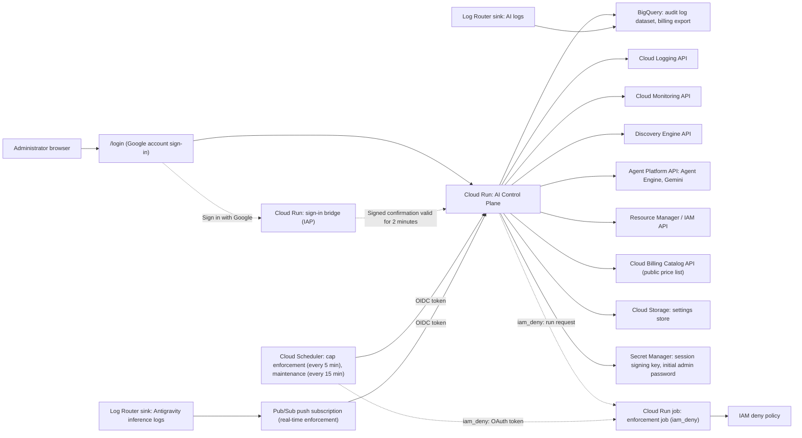

- **Single container**: A Python standard library HTTP server serves both the static SPA (`src/web`) and the REST API (`/api/v1`). There is no web framework and no frontend build step, so the code is easy to audit and change. There are 6 runtime dependencies (`requirements.txt`).
- **Frontend**: A dependency-free ES module SPA. It does not use `innerHTML` and renders only with text nodes.
- **Data access**: BigQuery is used only with parameterized queries, and every query has a cost cap set with `maximum_bytes_billed`. REST APIs are called with Application Default Credentials (the runtime service account) and a quota project header.
- **Settings store**: Settings changed in the UI, exception rules and suspension records are saved to a Cloud Storage bucket. Only the changes are saved. Multiple instances re-read them every 30 seconds to stay consistent. Personal widget layouts are saved in the same bucket under `users/`, one document per person, named by a hash rather than the email address.
- **Cache**: A TTL cache per endpoint and query parameters is used (120 seconds by default). It is invalidated immediately when settings change.
- **Scheduled work and real-time enforcement**: Cloud Scheduler calls Antigravity cap enforcement (`SERVICE_NAME-enforce`, every 5 minutes by default) and maintenance (`SERVICE_NAME-maintenance`, every 15 minutes by default: daily official pricing and FX sync, telemetry routing budget guard) with OIDC tokens. Antigravity inference logs arrive through Pub/Sub push, so automatic mode enforces caps as soon as they are reached ([8.2](#82-getting-started)). With deny-policy enforcement (`iam_deny`), the Cloud Run job `SERVICE_NAME-enforcer`, built from the same image, enforces instead ([8.9](#89-deny-policy-enforcement-and-the-enforcement-job)).

### 2.2 Repository structure

```text
.
|-- deploy.env.example          # deployment settings template (optional — CLI flags work directly)
|-- TUTORIAL.md                 # Open in Cloud Shell interactive walkthrough
|-- config.yaml                 # default settings (placeholders only)
|-- config.local.yaml.example   # local development settings template (copy to config.local.yaml, excluded from Git)
|-- requirements.txt            # pinned dependencies
|-- Dockerfile                  # container image that runs as a non-root user
|-- .dockerignore, .gcloudignore
|-- scripts/
|   |-- install.sh              # one-click / one-command bootstrap installer (single or multi-project hub)
|   |-- prepare.sh              # before deployment: start collecting logs (sink, Data Access, Gemini Enterprise logs)
|   |-- deploy.sh               # one-command resilient deployment (from empty project to live readiness probe)
|   |-- teardown.sh             # deletes the deployed resources
|   |-- test.sh                 # all offline checks, optional live checks (16.1)
|   |-- caps_drill.py           # Antigravity caps drill over one month (8.8)
|   |-- lib/common.sh           # shared automation helpers for install.sh, prepare.sh and deploy.sh
|   |-- prepublish_scan.py      # release gate: secrets and deployment identifiers (also runs in CI)
|   `-- git-hooks/pre-push      # opt-in hook that runs the scan before every push
|-- terraform/                  # Terraform deployment (IAP mode, optional)
|-- src/
|   |-- backend_server.py       # entry point
|   |-- controlplane/           # backend
|   |   |-- app.py              # route registration and server startup
|   |   |-- config.py           # defaults, layered loading, settings validation
|   |   |-- auth.py             # Google sign-in, sign-in bridge, sessions
|   |   |-- security.py         # auth modes, IAP/OIDC verification, permissions, rate limiting, PII masking
|   |   |-- identity.py         # principal identities (Google accounts, workforce identities, service accounts)
|   |   |-- httpkit.py          # response envelope, security headers, CSRF, static files
|   |   |-- schema.py           # schema-adaptive BigQuery access
|   |   |-- settings_store.py   # settings store (gcs, file, memory)
|   |   |-- enforce_job.py      # entry point of the deny-policy enforcement job (Cloud Run job, 8.9)
|   |   |-- caps_drill.py       # enforcement engine drill (8.8)
|   |   |-- gcp.py, ai.py, cache.py, timeutil.py
|   |   `-- services/           # per-module services
|   |       |-- governance.py   # Antigravity caps, settlement periods, safety gates, enforcement runs
|   |       |-- enforcers.py    # enforcement methods (allow-policy swap, deny policy, notify only)
|   |       |-- jobs.py         # enforcement job run requests and latest execution
|   |       |-- usage_events.py # real-time enforcement from Pub/Sub push
|   |       |-- budgets.py, spend_caps.py     # unit and project budgets, Google spend caps
|   |       |-- chargeback.py, org_model.py   # chargeback, organization CSV tree
|   |       |-- scope.py        # workspace scope (projects, folders, organization)
|   |       |-- agent_detail.py, agent_gateway.py, users.py, maintenance.py, pricing_sync.py
|   |       `-- ...             # the other modules (gemini_enterprise, telemetry, analyst and more)
|   `-- web/                    # frontend SPA (index.html, login.html, assets/)
|       `-- assets/fonts/       # Google Sans Flex web font and OFL.txt (section 17)
|-- eval/analyst/               # AI Analyst golden dataset and evaluation harness (16.1)
|-- tests/unit/                 # unit tests (1,000+)
`-- .github/workflows/tests.yml # unit tests, prepublish scan and dataset validation on every push
```

---

## 3. Quick start: deploy with one command

### 3.1 Prerequisites

| Item | Details |
|---|---|
| Google Cloud project | Any Google Cloud project **ID** (lowercase letters, digits and hyphens — not the display Name), including a brand-new empty project. If billing is not linked yet, the installer automatically links a single open billing account or sibling folder billing account (or pass `--billing-account ID`). |
| Permissions | Project `Owner` on the deploying account (or `Project IAM Admin` — missing operational deployment roles are self-bootstrapped automatically). When linking secondary projects (`--link-projects`), having IAM/admin access on those projects lets the installer grant cross-project read roles and enable log routing automatically. Granting the organization roles of deny-policy enforcement (`iam_deny`) also needs an Organization Administrator ([8.9](#89-deny-policy-enforcement-and-the-enforcement-job)). |
| Environment | **Google Cloud Shell recommended** (`gcloud`, `bq`, `python3`, `git` and `docker` are pre-installed). Works identically on macOS and Linux. |

### 3.2 Deploy (One-click / One-liner)

**Option A — Interactive wizard in Cloud Shell (zero config editing; picks host project & optional linked projects by menu number)**
```bash
bash <(curl -fsSL https://github.com/ldu1225/ai-control-plane/raw/main/scripts/install.sh)
```

**Option B — Single-project unattended deployment**
```bash
bash <(curl -fsSL https://github.com/ldu1225/ai-control-plane/raw/main/scripts/install.sh) \
  --project my-project-1 --admins admin@example.org --viewers viewer@example.org
```
*(When `--admins` is omitted, the active `gcloud` account becomes the initial administrator.)*

**Option C (Recommended for multi-project orgs) — Unified Multi-Project Hub (1 Cloud Run dashboard monitoring multiple projects together)**
```bash
bash <(curl -fsSL https://github.com/ldu1225/ai-control-plane/raw/main/scripts/install.sh) \
  --project my-hub-project \
  --link-projects my-project-2,my-project-3 \
  --admins admin@example.org --viewers viewer@example.org
```
- Deploys **one** Cloud Run dashboard in `my-hub-project`, grants its runtime service account least-privilege read roles on `my-project-2` and `my-project-3`, configures same-region BigQuery audit log sinks on the linked projects so `UNION ALL` queries work seamlessly, and aggregates all projects in the header project selector (`All Projects` or individual project filter).
- Even without `--link-projects`, other projects that the runtime service account can read are discovered automatically (at most 25 projects in total; `SCAN_ALL_PROJECTS=true` by default; pass `--no-auto-discover-projects` to restrict strictly to `--link-projects`).
- Need **completely isolated Cloud Run dashboards** per project instead of one shared hub? Use `--projects proj-a,proj-b`.
- If an older `~/ai-control-plane` clone or broken `deploy.env` exists in Cloud Shell, `install.sh` automatically updates or re-clones it cleanly, backs up `deploy.env` to `deploy.env.bak` and keeps the per-project settings snapshots (`deploy.<PROJECT_ID>.env`).

**Option D — Clone and run directly with CLI flags or `deploy.env`**
```bash
git clone https://github.com/ldu1225/ai-control-plane.git
cd ai-control-plane

scripts/deploy.sh --project my-hub-project --link-projects my-project-2,my-project-3 --admins admin@example.org
# or copy deploy.env.example -> deploy.env and run scripts/deploy.sh
```

What the script automates end-to-end on a brand-new project:

| Step | Details |
|---|---|
| 0. Preflight & billing | Bootstraps foundational control-plane APIs, verifies or self-grants missing caller IAM roles, verifies or auto-links Cloud Billing, and checks organization policies and VPC Service Controls ([14.4](#144-customer-project-preflight-organization-policies-vpc-service-controls)). |
| 1. APIs & service agents | Enables Cloud Run, Cloud Build, Artifact Registry, BigQuery, Logging, Monitoring, Cloud Trace, Discovery Engine, Agent Platform, Model Armor, Storage, Secret Manager, IAP, Cloud Scheduler, Cloud Billing Budget, Pub/Sub for real-time enforcement and more, and provisions the Google-managed service agents (`service-PROJECT_NUMBER@...`) immediately. |
| 2. Settings bucket | Creates a private (public access prevention), versioned Cloud Storage bucket. |
| 3. Dedicated service accounts & IAM | Creates the runtime SA, the sign-in bridge SA, a **dedicated Cloud Build SA** (never the Compute Engine default SA) and, with `iam_deny`, the enforcement job SA, each with least-privilege roles including `CustomAiControlPlaneLicenseReader` ([6.6](#66-runtime-service-account-permissions)). With the control features (`ENABLE_GOVERNANCE_ACTIONS=true`, the default) it grants the IAM write roles and creates the Antigravity marker roles (`CustomAntigravityCapBlocked`, `CustomAntigravityAdminBlocked`), the Gemini Enterprise feature manager role (`CustomAiControlPlaneGeFeatureManager`) and the Agent Gateway manager custom role (`CustomAiControlPlaneGatewayManager`). It grants read roles (and `CustomAiControlPlaneGeFeatureManager` when control features are enabled) on `--link-projects` projects and auto-detects a BigQuery billing export table. |
| 4. Container image | Creates the Artifact Registry repository and builds with Cloud Build as the dedicated builder SA (falls back from regional to global Cloud Build, then to Cloud Shell or local Docker). |
| 5. Secrets | Creates the session signing key, a random initial password for the built-in `admin` account and the slot for an OAuth client secret connected later in the UI (`google` and `password` modes), in Secret Manager and compliant with `constraints/gcp.resourceLocations`. |
| 6. Data sources | Creates the BigQuery dataset (`ge_analytics`) and the partitioned Log Router sink, **enables Data Access audit logs of the AI services**, turns on **Gemini Enterprise usage + prompt/user logging** for every app, onboards `--link-projects` projects (when permitted), and auto-detects the organization name and Agent Platform endpoints. |
| 7. Cloud Run & sign-in fallbacks | Deploys the IAP sign-in bridge and the dashboard and, with `ENFORCEMENT_BACKEND=iam_deny`, the enforcement job (Cloud Run job `SERVICE_NAME-enforcer`) from the same image. Under domain restricted sharing or policies that block unauthenticated entry it falls back automatically: `--no-invoker-iam-check` -> `--allow-unauthenticated` -> **Direct Cloud Run IAP** or built-in ID/password sign-in. |
| 8. Schedules, real-time enforcement & readiness | Creates the Cloud Scheduler jobs for cap enforcement (`SERVICE_NAME-enforce`, every 5 minutes; with `iam_deny`, `SERVICE_NAME-enforcer`, which runs the enforcement job) and maintenance (`SERVICE_NAME-maintenance`, every 15 minutes: daily official pricing and FX sync at `00:00` (configurable), telemetry BigQuery route budget guard with next-day auto-resume). Creates the Pub/Sub topic and log sink (`SERVICE_NAME-agy-usage`) and the push subscription (`SERVICE_NAME-agy-usage-push`) for real-time enforcement, checks the live response (`HTTP 200/302/401`) and prints the sign-in URL, the command that reads the admin password and the Antigravity readiness. In IAP mode the scheduler jobs and the push that call the dashboard are not created. |

- **Safe to re-run (idempotent).** Creates what is missing and updates what exists.
- On each deployment `install.sh` saves the settings in a git-ignored per-project snapshot, `deploy.<PROJECT_ID>.env` (region, administrators and viewers, linked projects in `SCAN_PROJECTS`, and the flags you gave). A later run of `install.sh` or `scripts/deploy.sh --project PROJECT_ID` uses the saved values unless a flag gives a new one. Only `install.sh` saves new values, and lines you added to the file by hand are kept ([14.3](#143-upgrading)).

### 3.3 First sign-in

1. Open `/login` at the printed URL and select **Sign in with Google** (or sign in directly through Google IAP when Direct Cloud Run IAP was selected automatically).
2. Accounts in `--admins` (`ADMIN_EMAILS`) sign in as administrators immediately; accounts in `--viewers` (`ALLOWED_USERS`) sign in as viewers immediately.
3. Additional users or domains can be added anytime in **Settings > Access control**.
4. The built-in `admin` account has no shared default password. The first deployment (while the secret has no version) generates a random initial password in Secret Manager (`SERVICE_NAME-admin-password`); the end of the deployment prints the command to read it (`gcloud secrets versions access latest --secret=ai-control-plane-admin-password --project=PROJECT_ID`). In organizations where Google sign-in is unavailable (automatic fallback to ID/password sign-in), sign in with it and change it in **Settings > Access control**. The sign-in page never shows account or password hints.

### 3.4 Post-deployment checks

1. Use the **Project selector** in the top bar to switch between the primary project, linked projects and discovered projects, or **All Projects**.
2. Select **Data sources** in the top bar to check connection status. Red items show the cause (permission, missing table and so on).
3. Even before a BigQuery Billing Export table is connected, **Overview**, **Models & Tokens** and **Cost & FinOps** show estimated costs from measured token usage, official Google Cloud pricing and synced exchange rates. When you later connect the billing export in **Settings > Workspace and data sources**, they switch automatically to invoiced SKU costs and credits.
4. If you created a new audit log sink, each BigQuery table is created when its first log entry arrives, so some metrics can stay empty for the first minutes to hours.
5. To use Antigravity per-user caps, follow [Section 8](#8-antigravity-per-user-caps-and-suspension).

### 3.5 Start collecting logs before deployment (optional)

Logs are collected from the moment they are turned on. To turn on log routing before deploying the dashboard, run one command in Cloud Shell:

```bash
bash <(curl -fsSL https://github.com/ldu1225/ai-control-plane/raw/main/scripts/install.sh) \
  --prepare-only --project PROJECT_ID
```

| Step | Details |
|---|---|
| 1. Enable APIs | Logging, BigQuery, Monitoring, Discovery Engine, Agent Platform, Model Armor and service identities |
| 2. Log routing | Creates the BigQuery dataset (`ge_analytics`) and the Log Router sink (`ai-control-plane-ai-logs`) ([6.1](#61-audit-log-sink-bigquery)). Antigravity logs are included automatically. |
| 3. Gemini Enterprise usage & prompt logs | Turns on observability (usage logs and user/prompt logging) by default for every Gemini Enterprise app in `global`, `us` and `eu` ([6.3](#63-gemini-enterprise-logs)). |
| 4. Data Access audit logs | Enables Data Access audit logs (`ADMIN_READ`, `DATA_READ`, `DATA_WRITE`) of 5 AI services (Agent Platform, Discovery Engine (Gemini Enterprise and NotebookLM), Model Armor, Antigravity, Gemini Data Analytics) by default ([6.2](#62-data-access-audit-logs); pass `--no-data-access-logs` to skip). |
| 5. Check | Shows whether Gemini Enterprise, Model Armor and Antigravity logs arrived in the last 30 days. |

- Safe to re-run, and `--dry-run` previews changes first. Pass `--projects proj-a,proj-b` (or `--project hub --link-projects spoke-a,spoke-b`) to prepare multiple projects at once.
- When you later run `install.sh` or `scripts/deploy.sh`, it reuses the dataset and sink automatically.
- `--prepare-only` uses only the log collection flags (`--dataset`, `--dataset-location`, `--ge-locations`, `--service-name`, `--[no-]data-access-logs`, `--[no-]log-prompts`), ignores the other deployment flags and saves no settings snapshot.

---

## 4. All deploy.env settings

`deploy.env` uses the `KEY="value"` format that bash reads. Put values that contain spaces in quotes. This file is listed in `.gitignore`, so it is not committed to Git. The template is `deploy.env.example`.

`scripts/deploy.sh` reads one settings file: the file given with `--config FILE`; otherwise, with `--project PROJECT_ID`, `deploy.<PROJECT_ID>.env` (only if it exists); otherwise `deploy.env`. Command-line flags win over file values, and anything not set uses the defaults below. `install.sh` takes the same flags and passes them to `deploy.sh`; except for `--config`, `--skip-preflight-blockers` and `--dry-run`, it also saves them in `deploy.<PROJECT_ID>.env` for later runs ([3.2](#32-deploy-one-click--one-liner)).

### 4.1 Required and multi-project

| Variable | Default / example | Description |
|---|---|---|
| `PROJECT_ID` | Active `gcloud` project (for example `my-project-id`) | Primary Google Cloud project that the dashboard is deployed to (`--project`) |
| `SCAN_PROJECTS` | Empty (for example `project-b,project-c`) | Additional project IDs aggregated into this one dashboard (`--link-projects`). `none` (any case) is an empty list and clears the list in `deploy.env` or the settings snapshot (an empty value is refused) |
| `SCAN_ALL_PROJECTS` | `true` | Discovers other projects the runtime service account can see and lists them in the project selector (at most 25 projects including the primary and linked ones; `--no-auto-discover-projects` sets `false`). Folder and organization scopes: [7.12](#712-chargeback-people-projects-organization) |
| `PREPARE_LINKED_PROJECTS` | `true` | During deployment, also sets up the audit log sink, Data Access logs, Gemini Enterprise logs and the real-time enforcement log sink on `SCAN_PROJECTS` where permitted (`--no-prepare-linked-projects` sets `false`) |
| `REGION` | `asia-northeast3` | Region for Cloud Run, Artifact Registry, the settings bucket, Secret Manager and Cloud Scheduler (`--region`) |
| `ADMIN_EMAILS` | Active `gcloud` account | Administrators (comma separated, `*@domain` supported, `--admins`) |

### 4.2 Service and display

| Variable | Default | Description |
|---|---|---|
| `SERVICE_NAME` | `ai-control-plane` | Cloud Run service name (`--service-name`). Also used in the names of the service accounts, bucket, secrets, sinks, Pub/Sub resources, scheduler jobs and the enforcement job. |
| `ORGANIZATION_NAME` | `Your Organization` (auto-detected from the Google Cloud organization or project name) | Organization name shown in the header and on the sign-in page (`--org-name`) |
| `DEFAULT_LOCALE` | `ko` | Default language, `ko` or `en`. Users can change it in the UI. |
| `WORKSPACE_TIMEZONE` | `Asia/Seoul` | Time zone for date display, daily totals, Antigravity settlement periods and the enforcement schedule |
| `PRODUCT_NAME` | Empty | Changes the product name (white label). If empty, `AI Control Plane` |
| `DISABLED_MODULES` | Empty | Modules hidden at deploy time (comma separated). Settings > Modules can switch them back on. Module IDs: `overview`, `gemini_enterprise`, `notebooklm`, `model_usage`, `agent_gateway`, `agent_registry`, `agent_deployments`, `model_armor`, `users`, `antigravity`, `finops`, `chargeback`, `telemetry`, `analyst` |

### 4.3 Sign-in method

| Variable | Default | Description |
|---|---|---|
| `ACCESS_MODE` | `google` | One of `google`, `google_oauth`, `iap` or `password` ([Section 5](#5-sign-in-and-permissions), `--access-mode`) |
| `ALLOWED_USERS` | Empty | Viewers to approve in advance for Google sign-in (`--viewers`; `none` clears the list). Example: `*@example.com,partner@example.org` |
| `IAP_MEMBERS` | Empty (the deploying account in `iap` mode) | Principals allowed to access the dashboard in `iap` mode. Example: `group:ai-governance@example.com,user:a@example.com` |
| `OAUTH_CLIENT_JSON` | Empty | Path to the OAuth client JSON downloaded for `google_oauth` mode (do not commit it) |
| `BRIDGE_MEMBERS` | `allAuthenticatedUsers` | Principals that can pass the sign-in bridge in `google` mode. Under the domain restricted sharing organization policy the deployment drops `allUsers` and `allAuthenticatedUsers` and allows the organization and administrator domains instead ([5.4](#54-when-google-sign-in-stops-at-the-iap-page)). Example: `domain:example.com` |
| `PUBLIC_BASE_URL` | Empty | Custom domain. Example: `https://ai-governance.example.com`. It is also the audience of the scheduler and Pub/Sub push tokens. |
| `GUEST_ACCESS` | `false` | Demo only. `true` lets anyone with the link browse read-only as a guest without signing in ([5.3](#53-guest-access-demo-only)). `google`, `google_oauth` and `password` only |
| `GUEST_REDACT_TERMS` | Terms in `.prepublish-terms` | Demo only. Comma-separated terms hidden from guests (project, organization or customer names) |

### 4.4 Data sources

| Variable | Default | Description |
|---|---|---|
| `AUDIT_DATASET` | `ge_analytics` | BigQuery dataset that receives the audit logs (`--dataset`) |
| `CREATE_LOG_SINK` | `true` | Creates the dataset and the Log Router sink, and updates an existing sink to the current filter. Use `false` if you manage a different sink yourself |
| `DATASET_LOCATION` | Empty (`REGION`) | Location of a newly created dataset (`--dataset-location`). Empty follows `REGION`; an existing dataset never moves. In an older settings snapshot, a value equal to that run's region follows a new `--region`; a different value such as `US`, or `--dataset-location`, is kept. |
| `ENABLE_DATA_ACCESS_LOGS` | `true` | Turns on Data Access audit logs of 5 AI services (Agent Platform, Discovery Engine, Model Armor, Antigravity, Gemini Data Analytics) ([6.2](#62-data-access-audit-logs); `--no-data-access-logs` sets `false`) |
| `ENABLE_GE_OBSERVABILITY` | `true` | Turns on usage logs (observability) for every Gemini Enterprise app in `DISCOVERY_ENGINE_LOCATIONS`. Needs Owner or Gemini Enterprise Admin; without it, only a warning is printed. |
| `GE_PROMPT_LOGGING` | `true` | Turns on `sensitiveLoggingEnabled` so user identities (`userIamPrincipal`), prompt/response text and uploaded file names are recorded instead of `<elided>` (`--no-log-prompts` sets `false`). |
| `BILLING_PROJECT_ID` | Empty (auto-detected) | Project that holds the billing export. If empty, the billing export table is looked up in `PROJECT_ID`. |
| `BILLING_DATASET` | Empty (auto-detected) | Billing export dataset. Example: `billing_detailed_usage` |
| `BILLING_TABLE` | Empty (auto-detected) | `gcp_billing_export_resource_v1_XXXXXX_XXXXXX_XXXXXX` (without it, token-based cost estimation is used automatically) |
| `BILLING_ACCOUNT_ID` | Empty (auto-detected from the project's billing link) | `XXXXXX-XXXXXX-XXXXXX` (same as `--billing-account`; an unbilled project is linked to this account) |
| `DISCOVERY_ENGINE_LOCATIONS` | Empty (detected) | Gemini Enterprise locations (comma separated, for example `global,us`, `--ge-locations`). When empty, deployment uses the locations among `global`, `us` and `eu` that have a Gemini Enterprise app or license, or `global` when there is none. |
| `AGENT_ENGINE_REGIONS` | Empty (detected) | Agent Engine regions (comma separated). When empty, the regions among `REGION` and `us-central1` that answer are used. |

You can also enter or update the billing values after deployment in **Settings > Workspace and data sources**.

### 4.5 Governance and schedules

| Variable | Default | Description |
|---|---|---|
| `ENABLE_GOVERNANCE_ACTIONS` | `true` | Grants IAM write roles (`--read-only` sets `false`, `--no-read-only` sets `true`). Required to suspend users over their cap, restore them, allow or disallow individual users, create marker roles, manage Gemini Enterprise features and manage Agent Gateways |
| `ENFORCEMENT_BACKEND` | `iam_allow_swap` | How suspensions take effect: `iam_allow_swap`, `iam_deny` or `notify_only` ([8.9](#89-deny-policy-enforcement-and-the-enforcement-job), `--enforcement-backend`) |
| `DENY_ATTACHMENT` | `projects` | Where the `iam_deny` deny policy is attached: `projects` or `scope` (`--deny-attachment`) |
| `ENFORCEMENT_JOB_REGION` | Empty (`REGION`) | Region of the `iam_deny` enforcement job and its schedule (`--enforcement-job-region`) |
| `GRANT_ORG_ROLES` | `false` | Whether the deployment grants the organization roles that `iam_deny` needs (Deny Admin, Deny Reviewer) (`--grant-org-roles`, `--no-grant-org-roles`). `false` prints the commands for an organization administrator |
| `ENFORCEMENT_SCHEDULE` | `*/5 * * * *` | Antigravity cap enforcement schedule (cron, in `WORKSPACE_TIMEZONE`, `--enforcement-schedule`). It restores suspended users when a settlement period ends and is the safety net for anything real-time events missed, so it is on by default. `off` (or `--no-enforcement-schedule`) turns it off and removes the scheduler job of an earlier deployment; then users get access back only when an administrator selects **Run enforcement now** after the period ends. `iam_allow_swap` and `notify_only` call the dashboard's enforcement endpoint, so the schedule is not created in IAP mode, and `iam_allow_swap` does not get it with `--read-only` either (in both cases an explicit value stops the deployment). `iam_deny` runs the enforcement job through the Cloud Run Admin API and gets it in IAP mode and with `--read-only` too. |
| `REALTIME_ENFORCEMENT` | `true` | Real-time enforcement. Routes Antigravity inference logs (`businessaicode.googleapis.com/inference_response`) through a Log Router sink, Pub/Sub and a push subscription to `POST /api/v1/governance/antigravity/usage-event`, so automatic mode enforces right away instead of waiting for the next scheduled run ([8.2](#82-getting-started)). `--no-realtime-enforcement` turns it off and removes the subscription, log sinks and topic of an earlier deployment. It is turned off automatically in IAP mode, with `notify_only`, and on `iam_allow_swap` installs with `--read-only`. |
| `MAINTENANCE_SCHEDULE` | `*/15 * * * *` | Schedule of the maintenance job `SERVICE_NAME-maintenance` (cron, UTC). Every run checks and resumes the daily GiB caps of telemetry BigQuery routes; once a day, at `PRICING_SYNC_TIME`, it syncs official prices and multi-currency exchange rates; it also hands over marker roles after an enforcement method change ([8.9](#89-deny-policy-enforcement-and-the-enforcement-job)). `--maintenance-schedule CRON` changes it; `off` (or `--no-maintenance-schedule`) skips the job and removes the one of an earlier deployment (so does the older `PRICING_SYNC_SCHEDULE="off"`). In IAP mode the job is not created and the work runs inside the instance while one is up. |
| `PRICING_SYNC_TIME` | Empty (`00:00`) | Time of the daily official price and exchange rate sync (`HH:MM`, in `WORKSPACE_TIMEZONE`). Also editable in Settings > Data collection and cost. |
| `PRICING_CURRENCY` | Empty (the Antigravity cost cap currency, else `USD`) | Display currency of token-based cost estimates (ISO 4217 code, for example `KRW`) |

### 4.6 Other

| Variable | Default | Description |
|---|---|---|
| `AI_DEFAULT_MODEL` | Empty | Default model for AI Analyst (if empty, the `config.yaml` value) |
| `AI_LOCATION` | Empty (detected) | Location of the Agent Platform model endpoint. When empty, `global`, or `REGION` when `global` does not answer |
| `TELEMETRY_AI_MODEL` | Empty (`gemini-4-argon`) | Gemini model that describes and groups telemetry sources |
| `TELEMETRY_DATASET` | Empty (`telemetry_routed`) | BigQuery dataset of telemetry routes (in `DATASET_LOCATION`) |
| `IMAGE` | Empty | Prebuilt image (`--image`, for one run only). If empty, the image is built with Cloud Build (local Docker fallback) |
| `BUILD_SOURCE` | `auto` | Where Cloud Build reads the source: `git` (Cloud Build fetches this checkout's commit from its public Git repository without uploading to Cloud Storage — passes VPC-SC perimeters that restrict Storage), `upload` (stages this folder in the settings bucket), `auto` (`git` for a clean clone of a public repository, `upload` for local changes or private pools) |
| `CLOUD_BUILD_WORKER_POOL` | Empty (default pool) | Cloud Build private pool for the image build (`--worker-pool`, `projects/P/locations/R/workerPools/NAME` or a pool name in `REGION`) |
| `MEMORY`, `CPU` | `1Gi`, `1` | Cloud Run resources (the enforcement job uses the same values) |
| `MIN_INSTANCES`, `MAX_INSTANCES` | `0`, `3` | Number of instances. With 0, instances stop when there are no requests and run briefly only for scheduled calls ([Section 13](#13-costs)). |
| `AR_REPOSITORY` | `ai-control-plane` | Artifact Registry repository name |
| `SERVICE_ACCOUNT_ID` | `SERVICE_NAME-sa` (first 27 characters of the service name) | Runtime service account ID |
| `SETTINGS_BUCKET` | `PROJECT_ID-SERVICE_NAME-settings` | Settings bucket name (globally unique, 63 characters or fewer) |
| `SESSION_SECRET_NAME` | `SERVICE_NAME-session-secret` | Name of the secret for the session signing key |
| `ADMIN_SECRET_NAME` | `SERVICE_NAME-admin-password` | Name of the secret for the initial password of the built-in `admin` account |
| `OAUTH_SECRET_NAME` | `SERVICE_NAME-oauth-client-secret` | Name of the secret for the OAuth client secret of `google_oauth` mode |
| `OAUTH_CONNECT_SECRET_NAME` | `SERVICE_NAME-oauth-connected-secret` | Name of the secret for an OAuth client connected in the UI ([5.4](#54-when-google-sign-in-stops-at-the-iap-page)) |
| `GOOGLE_OAUTH_CLIENT_ID`, `GOOGLE_OAUTH_REDIRECT_URI`, `GOOGLE_OAUTH_START_URL` | Empty | Advanced. Client ID of an existing OAuth client (its secret must be in the `OAUTH_SECRET_NAME` secret), and overrides of the redirect URI and the authorization start URL |
| `VPC_NETWORK`, `VPC_SUBNET` | Empty | VPC network and subnet for Cloud Run egress (`--vpc-network`, `--vpc-subnet`, [14.4](#144-customer-project-preflight-organization-policies-vpc-service-controls)) |
| `PREFLIGHT_STRICT` | `true` | `false` continues even when the organization policy preflight finds blockers (`--skip-preflight-blockers`) |
| `ENABLE_LINKED_TELEMETRY_ROUTING` | `true` | Grants `roles/logging.configWriter` on linked projects so their logs can be routed to BigQuery from the UI too |

Aliases are accepted too: `ADMIN_EMAILS` = `INITIAL_ADMINS`, `ADMINS`, `ADMIN_EMAIL` / `ALLOWED_USERS` = `INITIAL_VIEWERS`, `VIEWERS`, `VIEWER_EMAILS` / `SCAN_PROJECTS` = `LINKED_PROJECTS`, `WORKSPACE_PROJECTS` / `SCAN_ALL_PROJECTS` = `AUTO_DISCOVER_PROJECTS`.

---

## 5. Sign-in and permissions

### 5.1 Choosing a sign-in method

| `ACCESS_MODE` | Behavior | When to use it |
|---|---|---|
| `google` (recommended) | Users sign in with a Google account on the dashboard's own sign-in page (`/login`). You do not need to create an OAuth client. A small sign-in bridge service behind IAP verifies the Google account, and the dashboard lets in only approved accounts. To let accounts outside the organization (partners, affiliates in other organizations, Gmail) sign in with Google too, connect an OAuth client later in Settings > Access control (no redeployment, [5.4](#54-when-google-sign-in-stops-at-the-iap-page)). | Most cases |
| `google_oauth` | The same sign-in page runs with an OAuth client that you create. | When you do not want a bridge service, or you want to manage the OAuth consent screen yourself |
| `iap` | Identity-Aware Proxy handles sign-in in front of the dashboard. The app verifies the IAP signed header. IAP blocks the OIDC calls of Cloud Scheduler and Pub/Sub, so the enforcement schedule that calls the dashboard and real-time enforcement are not created (maintenance runs inside the instance). | Organizations that already use IAP and group-based access management |
| `password` | The dashboard's sign-in page with ID and password only. The built-in `admin` account gets a random initial password in Secret Manager at the first deployment ([3.3](#33-first-sign-in)). Connecting an OAuth client in the UI later turns on Google sign-in too. | Environments where Google sign-in or IAP cannot be used |

Other `security.auth_mode` values (set only in `config.yaml` or the `AUTH_MODE` environment variable, never in the UI):

- `local`: for development on one computer ([11](#11-running-locally)). Only direct requests from this computer (a loopback address) are accepted, as the administrator. Requests from other computers, and requests forwarded by a proxy (`X-Forwarded-For`, `Forwarded`, `X-Real-IP`), are refused. Cloud Run refuses this mode at startup. `auto` becomes `iap` on Cloud Run; elsewhere it falls back to `local` only when the server listens on a loopback address (`127.0.0.1`, `::1`, `localhost`), and a server bound to another address stops at startup and asks you to choose `google` or `iap`.

By default there is no anonymous mode: only approved Google accounts can open the dashboard. Demos can turn on guest access as an exception ([5.3](#53-guest-access-demo-only)).

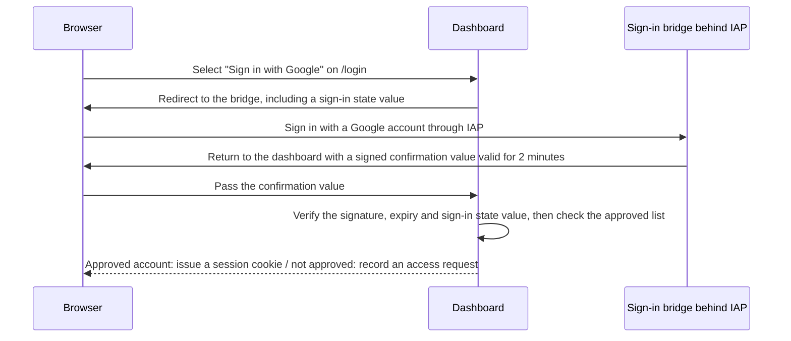

Preparing `google_oauth` mode (one time only):

1. Google Cloud console > Google Auth Platform > Branding: enter the app name and the support email.
2. Audience: `Internal` if you use only organization accounts, `External` if you also use external Google accounts (publish the app or add test users).
3. Clients > Create client > Web application. Add `https://DASHBOARD_HOST/auth/google/callback` to the authorized redirect URIs.
4. Download the JSON right after you create the client, and put its path in `OAUTH_CLIENT_JSON` (the client secret is shown only at this point). The script stores the client secret in Secret Manager and does not print it.

### 5.2 Roles

| Role | What it can do |
|---|---|
| admin | All pages, changing settings, approving users, cap policy, suspend/restore, exception rules, connector management |
| viewer | Views all pages. Emails are masked on the server (`ad***@example.com`), and Model Armor raw text and uploaded file names are not provided. AI Analyst is available only when an administrator allows it (`analyst.allow_viewers`). Settings are read-only, and deployment identifiers (settings bucket, OAuth client ID, IAP audience, billing account ID) are shown as `***`. Per-project Google spend caps (budget names, plan) and the user action buttons are not shown. |
| guest (demo only) | A visitor without a session when `GUEST_ACCESS=true`. Sees the same pages as a viewer with more hidden, and cannot change anything ([5.3](#53-guest-access-demo-only)). |

- Administrators = `ADMIN_EMAILS` + `security.admins` in `config.yaml` + administrators added in the UI.
- Viewers = `ALLOWED_USERS` + `security.allowed_users` + users approved in the UI.
- Accounts set in a settings file or environment variable cannot be removed in the UI (they are fixed). Accounts added in the UI can be removed in the UI. Removing an account also ends its existing sessions immediately.
- Sessions are valid for 12 hours by default (`SESSION_HOURS`, 1-168).

### 5.3 Guest access (demo only)

Turn it on only when anyone should be able to open a demo from a link. Keep it off for customer deployments (default `false`).

- To turn it on, set `GUEST_ACCESS="true"` in `deploy.env` and deploy again (`security.guest_access`; it cannot be changed in the UI). It works with `google`, `google_oauth` and `password` only (not `iap`).
- Visitors without a session go straight to the dashboard, and the sign-in page offers **Continue as guest**. Administrators still sign in at `/login`.
- Guests are read-only. Every change request (settings, widget layouts, policies) is refused; the only POST routes a guest may call are the cost spike AI analysis and the AI Analyst, and the AI Analyst only when an administrator allows viewers (`analyst.allow_viewers`). AI calls have a per-guest limit and a shared limit for all guests (30 per minute).
- On top of viewer masking, every response to a guest hides whole e-mail domains, billing account IDs, 12-digit project numbers, resident registration, phone and card number formats, and the terms in `GUEST_REDACT_TERMS` (case-insensitive). If the terms are empty, the deploy script uses the terms in `.prepublish-terms`.
- Real project data (metrics, agent names, costs) stays visible, so turn it on only for a demo project that may be shown publicly.

### 5.4 When Google sign-in stops at the IAP page

In `google` mode, Google sign-in first has to pass IAP (Identity-Aware Proxy) in front of the sign-in bridge. When IAP refuses an account, the user sees Google's "You don't have access" page instead of the dashboard, and the dashboard records no access request. IAP admits an account only when both of these hold:

1. **IAP allowlist**: `roles/iap.httpsResourceAccessor` on the bridge service covers the account (`allAuthenticatedUsers`, `domain:company-domain`, `user:email` or a group). With the domain restricted sharing organization policy (`iam.allowedPolicyMemberDomains`), IAM refuses `allAuthenticatedUsers` and accounts of customers (Workspace / Cloud Identity) that the policy does not allow.
2. **OAuth client**: Cloud Run IAP uses a Google-managed OAuth client by default, and that client signs in **only accounts of the organization the project belongs to**. Accounts of affiliates in another organization, partner accounts and personal Gmail accounts are stopped even when the allowlist names them.

What the deploy script does:

- Without domain restricted sharing, it allows `allAuthenticatedUsers` on the bridge (with the managed OAuth client this still admits organization accounts only).
- With domain restricted sharing, it allows `domain:` bindings for the organization's primary domain and for the domains of `ADMIN_EMAILS` / `ALLOWED_USERS`, of people on the project IAM policy and of Gemini Enterprise license holders (public mail domains and google.com excluded).
- `ADMIN_EMAILS` / `ALLOWED_USERS` are also allowed as `user:` bindings.
- Nothing is refused silently. The **Google sign-in (IAP) check** at the end of the deployment lists who can pass, what was refused and why, and which OAuth client IAP uses.
- The dashboard's service account gets `roles/iap.admin`, so accounts approved later in the UI are added to IAP automatically.

In the UI (Settings > Access control > **Google sign-in (Identity-Aware Proxy)**):

- Shows the domains and accounts IAP admits now and the OAuth client type (**Check again**).
- **Allow Google sign-in** admits a company domain (for example `cymbal.example.com`) or one account at IAP. Accounts of an allowed domain can sign in with Google, and the ones not approved yet show up as access requests.
- Approving an account also admits it at IAP, with a result per account: `Google sign-in ready`, `Not allowed at IAP` or `Blocked by organization policy`. **Sync approved accounts** applies every approved account again.
- Changes can take a few minutes to apply.
- The sign-in page says under the Google button which accounts work and what to do on "You don't have access" (choose another account, or ask for an ID and password).

When accounts outside the organization need access:

1. **Connect a Google OAuth client** (recommended, no redeployment): create an OAuth client in this project once and connect it to the dashboard. From then on Google sign-in uses this client instead of IAP, so any Google account on the approved list (an account or a `*@domain` rule) can sign in, whatever its organization (partners, affiliates in other organizations, Gmail, google.com). Google offers no API that creates such clients, so creating it is the only console step.
   1. Google Cloud console > Google Auth Platform > **Branding**: enter an app name (for example the dashboard name) and a support email, then save.
   2. **Audience**: choose `External` and select **Publish app** so the status is `In production`. `Internal` admits your organization only, and `Testing` admits listed test users only. Only the basic sign-in scopes (openid, email, profile) are used, so Google verification is not needed.
   3. **Clients** > Create client > Web application > add `https://DASHBOARD_HOST/auth/google/callback` to the authorized redirect URIs (the UI and the end of the deployment show the exact address) > Create. Copy the client ID and the client secret (the secret is shown only at this point).
   4. In the dashboard, Settings > Access control > **Google OAuth client** > **Connect OAuth client**: enter both values and select **Connect**. Before anything is stored, Google is asked whether the ID and secret are valid and whether the redirect URI is registered; when not, the dashboard says what to fix and nothing changes.
   - Every dashboard instance switches within about 30 seconds. Approve people in the account list as before.
   - The secret is stored only in Secret Manager (`<SERVICE_NAME>-oauth-connected-secret`), never in the UI, the API, the logs or the settings store. The dashboard's service account may add, read and destroy versions of this one secret only. Replacing or disconnecting the client destroys the previous version.
   - **Disconnect** goes back to sign-in through the IAP bridge. When the secret cannot be read (for example a removed permission), sign-in falls back to the IAP bridge automatically and the UI shows a warning.
   - Available on deployments with `ACCESS_MODE` `google` or `password` (on `password`, connecting turns Google sign-in on). The deploy script creates the secret and its permissions; environments deployed with a version without this feature run `scripts/deploy.sh` once more.
2. **ID/password account** (works immediately): Settings > Access control > Add account, create an ID and password and hand them over. Domain restricted sharing and the OAuth client rule do not apply.
3. **OAuth client set at deployment**: deploy with `ACCESS_MODE=google_oauth` and `OAUTH_CLIENT_JSON` (preparation steps in [5.1](#51-choosing-a-sign-in-method)). The Google OAuth client in the UI is then read-only. A custom OAuth client on IAP also exists, but with domain restricted sharing outside accounts cannot be added to the IAP allowlist, so it does not help.

When the dashboard itself runs behind IAP (domain restricted sharing together with `run.managed.requireInvokerIam`; the deployment says so at the end), the IAP allowlist is the access list. ID/password sign-in is not available, so add people in the UI or with `gcloud iap web add-iam-policy-binding`.

---

## 6. Connecting data sources

The more data sources you connect, the more pages you can use. Metrics from sources that are not connected are shown as `—`, with an explanation of the cause.

### 6.1 Audit log sink (BigQuery)

`scripts/prepare.sh` and `scripts/deploy.sh` (`CREATE_LOG_SINK=true`) create it automatically, and update an existing sink to the filter below. To create it yourself, open **Logging > Log Router > Create sink** in the console, choose a BigQuery dataset as the destination, select **Use partitioned tables**, and paste the text below as the inclusion filter.

```text
(
  (log_id("cloudaudit.googleapis.com/activity") OR log_id("cloudaudit.googleapis.com/data_access"))
  AND protoPayload.serviceName=("aiplatform.googleapis.com" OR "discoveryengine.googleapis.com" OR "modelarmor.googleapis.com" OR "businessaicode.googleapis.com" OR "notebooklm.googleapis.com" OR "geminidataanalytics.googleapis.com" OR "generativelanguage.googleapis.com")
)
OR log_id("discoveryengine.googleapis.com/gemini_enterprise_user_activity")
OR log_id("discoveryengine.googleapis.com/gen_ai_user_message")
OR log_id("modelarmor.googleapis.com/sanitize_operations")
OR log_id("businessaicode.googleapis.com/inference_response")
```

Cloud Logging binds `OR` more tightly than `AND`. Without the outer parentheses around the audit-log clause, the Gemini Enterprise, Model Armor and Antigravity logs would also have to be audit logs, and none of them would arrive. Sinks created by `deploy.sh` before v2.1.0 had this problem; running it again with `CREATE_LOG_SINK=true` fixes them.

To create it with commands, save the filter above as `ai-log-filter.txt` and run:

```bash
bq --location=US mk --dataset PROJECT_ID:ge_analytics

gcloud logging sinks create ai-control-plane-ai-logs \
  bigquery.googleapis.com/projects/PROJECT_ID/datasets/ge_analytics \
  --use-partitioned-tables --project=PROJECT_ID --log-filter="$(cat ai-log-filter.txt)"

gcloud logging sinks describe ai-control-plane-ai-logs --project=PROJECT_ID --format='value(writerIdentity)'
```

Grant the printed writer identity (usually the project's shared Logging service agent `service-PROJECT_NUMBER@gcp-sa-logging.iam.gserviceaccount.com`) the BigQuery Data Editor role **on this dataset only**. Grant it in the BigQuery console > dataset > Share > Permissions > Add principal. When an Owner creates the sink in the console, this permission is set automatically. `scripts/prepare.sh` and `scripts/deploy.sh` do this automatically at the dataset level and do not change project-level permissions.

Tables created by the sink and the pages that use them:

| Table | Used by |
|---|---|
| `cloudaudit_googleapis_com_activity` | Agent Registry (creation history), Agent Gateway, Agent activity in your cloud (changes) |
| `cloudaudit_googleapis_com_data_access` | Agent Gateway, NotebookLM, Deployments, Users, Agent activity in your cloud (reads) |
| `discoveryengine_googleapis_com_gen_ai_user_message` | Gemini Enterprise (prompts, uploaded file names) |
| `discoveryengine_googleapis_com_gemini_enterprise_user_activity` | Gemini Enterprise (prompts, agent calls, uploads), Model Armor user matching |
| `modelarmor_googleapis_com_sanitize_operations` | Model Armor |
| `businessaicode_googleapis_com_inference_response` | Antigravity (if it is missing, the data is read directly through the Cloud Logging API) |

Each table is created when its log is first written. If a table is missing, only its metrics are empty and a warning is shown.

### 6.2 Data Access audit logs

Agent Gateway, NotebookLM, Deployments and model usage by identity use Data Access audit logs. Run `scripts/prepare.sh --data-access-logs`, redeploy with `ENABLE_DATA_ACCESS_LOGS=true`, or turn on `Admin Read`, `Data Read` and `Data Write` for the services below in **IAM & Admin > Audit Logs** in the console. The scripts skip a service name that the project does not accept.

- Agent Platform API (`aiplatform.googleapis.com`)
- Discovery Engine API (`discoveryengine.googleapis.com`, Gemini Enterprise and NotebookLM)
- Model Armor API (`modelarmor.googleapis.com`)
- Antigravity (`businessaicode.googleapis.com`)
- Gemini Data Analytics API (`geminidataanalytics.googleapis.com`)

Data Access logs can be large and add Cloud Logging ingestion costs. The script updates the IAM policy with its etag, so if another change happens at the same time, the update fails instead of overwriting that change.

### 6.3 Gemini Enterprise logs

Usage is recorded only when observability (usage logs) is turned on for each Gemini Enterprise app. `scripts/prepare.sh` and `scripts/deploy.sh` (`ENABLE_GE_OBSERVABILITY=true`, `GE_PROMPT_LOGGING=true`) turn on both settings below for every app. To do it in the console, open **Gemini Enterprise > app > Configurations > Observability** and turn on both options:

- **Enable instrumentation of OpenTelemetry traces and logs**: usage logs (`observabilityEnabled`).
- **Enable logging of prompt inputs and response outputs**: user identity (`userIamPrincipal`), prompt/response text and uploaded file names (`sensitiveLoggingEnabled`). Without this option, Gemini Enterprise masks user identities and replies as `<elided>`.

License seats are distributed per location (`global`, `us`, `eu`), so they are read through the Discovery Engine API for every location in `DISCOVERY_ENGINE_LOCATIONS` and summed. Leave it empty and `scripts/deploy.sh` finds every location that has an app or license.

Counting rules (verified against real logs):

- Duplicate delivered rows with the same `insertId` and timestamp count as one.
- **Prompts**: If the message log exists, the message log is counted. Otherwise, assistant calls in the activity log (`StreamAssist` and others) that contain user input are counted. Session summaries that the product runs automatically (`session_to_summarize`), context injection and scheduled runs are not prompts.
- **Agent calls**: Assistant calls addressed to a specific agent (`agentsSpec`), including scheduled runs. Viewing or editing an agent page is not a call. Agent names are looked up from the name in the log first, then from the Discovery Engine agent list.
- **Uploads**: The activity log records one upload as two lines, a request and a response, so only responses with a file ID are counted.

### 6.4 Billing export

In **Billing > Billing export**, turn on the **Detailed usage cost** export to BigQuery. Put the name of the `gcp_billing_export_resource_v1_...` table it creates and the billing account ID in `deploy.env` (or the UI settings). The export collects data from the time you turn it on, and the first data can take a few hours to arrive.

Features that use the billing export: Cost & FinOps, cost per model, agent runtime cost (requires the resource-level export), and the actual unit prices for Antigravity per-person cost caps.

When a billing export is configured, Cost & FinOps, cost per model, agent runtime cost, and Antigravity per-person cost caps reflect actual billed unit prices and negotiated credits. When no billing export is configured, the control plane automatically estimates spend from observed token usage (Cloud Monitoring and inference logs) multiplied by official Google Cloud public token prices (Cloud Billing Catalog API + official pricing pages + model aliases/overrides) and synced multi-currency exchange rates, with a daily midnight (`00:00`, configurable) pricing & FX sync, manual sync, and change alerts.

### 6.5 Antigravity inference logs

Antigravity token usage per user is read from the `businessaicode.googleapis.com/inference_response` log that Antigravity for organizations writes to the project. **This log is written only when Metadata logging is on in Gemini Enterprise > Settings > AI developer tools > Compliance, which is off by default** ([official docs](https://cloud.google.com/gemini/enterprise/docs/ai-developer-tools-track-token-usage)). Prompts and responses logging is not needed. The deployment summary checks whether the log exists. Entries written after the log sink exists are kept in BigQuery (no expiry); earlier entries stay in Cloud Logging for 30 days by default. Usage is read from the BigQuery sink table. The time before the table existed (for example when Metadata logging was turned on before installation) and projects without a sink table are read from Cloud Logging and added (`usage_source: auto`; no entry is counted twice), so the first week's caps and the first month's report miss no calls. Entries from before installation that are older than the Cloud Logging retention (30 days by default) cannot be read. Without a sink table, only the Cloud Logging API is used. Users are counted by the email in the log's `labels.user_id` (an IAM principal such as `user:alice@example.com`, with `user:` removed), so they match the project's `user:` IAM bindings; service accounts and other non-user principals are left out of the user list and the caps. Google Cloud API calls that coding agents make with user credentials are shown under **Agent activity in your cloud** on the Antigravity Controls page, based on audit logs.

**What a developer's sign-in leaves behind depends on the sign-in method** (the ADC row was checked on a test project with Antigravity CLI 1.5.12):

| Developer sign-in | Calls go to | `inference_response` (tokens per person) | Stopped by denying the Antigravity permission |
|---|---|---|---|
| Subscription: **Use a Google Cloud project** (CLI) or **Use Business Account** (app), then a license | `businessaicode.googleapis.com` | Written (with Metadata logging on) | Yes |
| ADC (`AGY_ADC_AUTH=true`) or pay-as-you-go | Agent Platform directly (`aiplatform.googleapis.com`, `PredictionService.StreamGenerateContent`) | None | No |

- **Metadata logging is configured per location (`global`, `us`, `eu`).** Turning it on in `us` or `eu` alone does not log calls routed to `locations/global` (for example Gemini 4, preview models, and default Antigravity CLI routing). The Antigravity Prerequisites section checks `devToolsConfig` across `global`, `us`, and `eu` for each scanned project and warns when any location with AI developer tools enabled still has Metadata logging turned off.
- ADC and pay-as-you-go calls leave only the person and the model in the Agent Platform Data Access audit log, without token counts. The user agent (`protoPayload.requestMetadata.callerSuppliedUserAgent`) contains `antigravity/cli/...; auth_method=adc`, so Logs Explorer finds them with `protoPayload.serviceName="aiplatform.googleapis.com" AND protoPayload.requestMetadata.callerSuppliedUserAgent:"antigravity/"`.
- The Gemini Enterprise User role (`roles/discoveryengine.agentspaceUser`) has no `aiplatform.*` permission, so only people who were also granted Agent Platform calls (for example `roles/aiplatform.user`) can use the ADC path. To stop it, do not grant that permission to developers, or turn on `deny_agent_platform` (8.9) for suspended people.

### 6.6 Runtime service account permissions

`scripts/deploy.sh` grants these roles automatically. Terraform does not grant the secret access, `roles/bigquery.user`, `roles/logging.configWriter`, `roles/iap.admin` or the custom roles (license reader, Gemini Enterprise feature manager, Agent Gateway manager) ([Section 10](#10-deploying-with-terraform-optional)). Follow the same rules when you configure them yourself.

**Read (always required)**

| Role | Purpose |
|---|---|
| `roles/bigquery.jobUser`, `roles/bigquery.user` | Run parameterized queries, create the telemetry routing dataset |
| `roles/bigquery.dataViewer` | Read audit logs and the billing export. If the billing dataset is in a different project, read access is granted on that dataset only. |
| `roles/logging.viewer`, `roles/logging.privateLogViewer` | Antigravity inference logs, Data Access audit logs, governance audit log, log source discovery |
| `roles/logging.configWriter` | Create, pause and resume the Log Router → BigQuery routing sinks of Telemetry Extensions |
| `roles/monitoring.viewer` | Token and invocation metrics per model, log activity in Telemetry Extensions |
| `roles/discoveryengine.viewer` + `CustomAiControlPlaneLicenseReader` | Engines, assistants, agents and license assignments (the read-only custom role for `listUserLicenses` is created automatically) |
| `roles/aiplatform.user` | Read Agent Engine, call AI Analyst (Gemini), agent playground |
| `roles/iam.securityReviewer` | Read the project IAM policy (Antigravity state classification) |
| `roles/serviceusage.serviceUsageConsumer` | Use the quota project header on all calls |
| `roles/logging.logWriter` | Write the governance audit log (enforcement runs, dry runs, review decisions, exception changes), with or without the control features |
| `roles/storage.objectAdmin` (settings bucket only) | Store UI settings, exception rules, suspension records and personal widget layouts |
| `roles/secretmanager.secretAccessor` (secrets only) | Session signing key, initial admin password, OAuth client secret. The secret of an OAuth client connected in the UI also gets `roles/secretmanager.secretVersionManager`. |
| `roles/run.invoker` (the dashboard service only) | The maintenance schedule and the Pub/Sub push call the dashboard with OIDC tokens of the runtime service account |
| `roles/iap.admin` | Adds accounts approved in the UI to the IAP allowlist (`google` and `iap` modes) |
| Optional: `roles/modelarmor.viewer`, `roles/cloudtrace.user`, `roles/networkservices.viewer`, `roles/networksecurity.viewer` | Model Armor, agent traces and topology, Agent Gateway reads. The deployment continues if they cannot be granted. |

**Control features (only when `ENABLE_GOVERNANCE_ACTIONS=true`)**

| Role | Purpose |
|---|---|
| `roles/resourcemanager.projectIamAdmin` | Suspending and restoring users over their cap, allowing and disallowing individual users, blocking all AI access (etag-based `setIamPolicy`) |
| `roles/iam.roleAdmin` | Create and refresh the marker roles |
| `CustomAiControlPlaneGatewayManager` | Create, update and delete Agent Gateways and switch access authorization ([7.4](#74-agent-gateway)) |
| `CustomAiControlPlaneGeFeatureManager` | Change Gemini Enterprise app feature switches and model selection and read AI developer tools settings (`discoveryengine.engines.get/list/update`, `widgetConfigs.get`, `devToolsConfigs.get`, [7.2](#72-gemini-enterprise)); also granted in linked projects |

**Deny-policy enforcement (only when `ENFORCEMENT_BACKEND=iam_deny`)**: the runtime service account gets Deny Reviewer on the organization and `roles/run.jobsExecutor` and `roles/run.viewer` on the enforcement job; only the enforcement job's service account gets Deny Admin, which writes deny policies ([8.9](#89-deny-policy-enforcement-and-the-enforcement-job)).

**Linked projects (`SCAN_PROJECTS`, `scripts/deploy.sh`)**: `roles/bigquery.dataViewer`, `roles/logging.viewer`, `roles/logging.privateLogViewer`, `roles/monitoring.viewer`, `roles/aiplatform.viewer`, `roles/discoveryengine.viewer` with `CustomAiControlPlaneLicenseReader`, `roles/iam.securityReviewer`, `roles/modelarmor.viewer`, `roles/networkservices.viewer`, `roles/networksecurity.viewer` and `roles/cloudtrace.user`, plus `roles/logging.configWriter` with `ENABLE_LINKED_TELEMETRY_ROUTING=true` (the default) and `CustomAiControlPlaneGeFeatureManager` with `ENABLE_GOVERNANCE_ACTIONS=true` (the default). With `iam_deny` the enforcement job's service account gets read roles there too.

**Sign-in bridge (`google` mode)**: The bridge runs as its own service account (`SERVICE_NAME-signin`, at most 23 characters of the service name). It has no project roles and can read only the session signing key.

**Inherited binding check (optional)**: If you grant `roles/iam.securityReviewer` at the organization level, Antigravity access inherited from folders and the organization is also detected (Terraform `organization_id`). Without it, the users concerned are classified as `UNKNOWN / ANCESTOR_UNCHECKED` and are excluded from changes.

---

## 7. Features and calculation methods by page

### 7.1 Overview

Brings the key KPIs of each module together on one page and shows the change compared with the previous period of the same length. KPIs of disabled modules are shown as "Module disabled".

**My widgets**: pin dashboards created in Telemetry Extensions to the Overview and arrange them your way.

- Select **Add widget** and choose the dashboard, what it shows (summary, events per day, breakdown, status breakdown or latest entries) and its size (small, medium, wide). The **Add to Overview** button on a dashboard page pins it too.
- Drag a widget by its handle to change the order. With the keyboard, press the arrow keys on the handle, or use Move earlier / Move later in the widget menu.
- Other pages (Gemini Enterprise, Users & Access and so on) can hold widgets too, with **Add a widget to this page** at the bottom.
- Layouts are saved per person (`GET/POST /api/v1/layouts`) in `users/<user hash>.json` in the settings bucket; file names never contain email addresses. Every signed-in person saves only their own layout.
- Widget data uses the same API as the Telemetry Extensions dashboards, so the selected period, caching and viewer masking apply in the same way.

### 7.2 Gemini Enterprise

Shows active users, prompts, calls per agent, uploaded files and license seats (assigned, used and idle seats). Counting follows the rules in [6.3](#63-gemini-enterprise-logs). License seats are summed over every location in `DISCOVERY_ENGINE_LOCATIONS`; with more than one location the tables show a Location column.

**Feature management & model selection** (`#/gemini-enterprise/features`, `#/gemini-enterprise/features/models`, the **Feature management** tab at the top of the page): compare and bulk-update both **feature switches** (`Engine.features`) and **model selection** (`Engine.modelConfigs`) across every Gemini Enterprise app in one view.

- **Feature switches**: columns are every Gemini Enterprise app (`appType=APP_TYPE_INTRANET`, or an engine with feature or model overrides) of the selected projects in every location of `DISCOVERY_ENGINE_LOCATIONS`; rows cover every Discovery Engine v1 documented feature key (agent gallery, no-code agent builder, agent marketplace, scheduling, preview agents, plugins, skill security scan, model selector, NotebookLM, code extraction, Canvas & app sharing, music & speech generation, memory and more), plus any undocumented keys already set on an app under **Other features**.
- **Model selection**: switch to **Model selection** inside the card to manage per-app Gemini chat models (`Gemini 4 Neon/Hydrogen/Carbon/Argon`, `Gemini 3.8/3.7/3.6/3.5 Flash`, `Gemini 3.1 Pro`, `Gemini 2.5 Pro`), image generation models (`Gemini 3 Pro Image`, `Gemini 3.1 Flash Image`, `Gemini 2.5 Flash Image`), and third-party models (`Anthropic Claude Opus 5.5`, `Claude Sonnet 5.5`). Best-effort reads of `WidgetConfig.uiSettings.modelConfigInfo.resolvedModels` highlight models currently active in each web app's end-user model selector with a green dot, and newly released Gemini and Anthropic models are auto-discovered live from the Agent Platform Model Garden publisher catalog (`publishers/google/models`, `publishers/anthropic/models`) with zero manual model ID entry. Third-party Claude models require Pay-as-you-go usage above quota and one-time Terms of Service acceptance per project in Google Cloud Console.
- **States**: features show **On** (`FEATURE_STATE_ON`), **Off** (`FEATURE_STATE_OFF`) and **Default**; models show **Enabled** (`MODEL_ENABLED`), **Disabled** (`MODEL_DISABLED`) and **Default** (key absent = product default). Feature keys starting with `disable-` are **restrictions** (On blocks the capability; values are never inverted). An app with `*` (master switch) set ignores its other feature switches.
- **Find & bulk apply (administrators)**: search, category chips, **Mixed only**, **Explicit only**, project picker, and **Export CSV**. Stage changes cell by cell, per row across all shown apps, or by copying a baseline app across features and models together, then review the unified before → after diff and apply atomically (up to 100 apps per apply).
- **How it applies**: `POST /api/v1/gemini-enterprise/features/apply` re-reads each app (`GET .../engines/{id}`), merges only the changed feature keys and model IDs into the current maps, and sends one `PATCH https://{location}-discoveryengine.googleapis.com/v1/projects/{project}/locations/{location}/collections/default_collection/engines/{app}?updateMask=features,modelConfigs` (`global` uses `discoveryengine.googleapis.com`), including only maps that changed so concurrent console edits are preserved. Every apply writes one `ge_features_update` entry (including `modelChanges`) to the governance audit log. Viewers can only read.
- **New apps and refresh**: cached for 60 seconds; select **Refresh** to bypass the cache (`?refresh=1`). Applying changes clears the cache automatically.
- **Permissions**: reading needs `roles/discoveryengine.viewer`; changing needs `discoveryengine.engines.update`. Deployments with `ENABLE_GOVERNANCE_ACTIONS=true` (default) grant the least-privilege custom role `CustomAiControlPlaneGeFeatureManager` (`discoveryengine.engines.get`, `.list`, `.update`, `widgetConfigs.get`, `devToolsConfigs.get`) in the primary and linked projects.

**AI developer tools & Antigravity model selection** (`#/gemini-enterprise/dev-tools`, the **AI developer tools** tab at the top of the page, also linked from the **Antigravity Controls** header):

- **Live multi-project & multi-location audit**: reads Discovery Engine `v1alpha` `DevToolsConfig` across every workspace project and location (`global`, `us`, `eu`, plus any configured `DISCOVERY_ENGINE_LOCATIONS`).
- **Antigravity authorized models (`modelConfig`)**: compares Google (Gemini) model policies (**All Gemini (default)** when empty vs **Custom allowlist**) and opted-in third-party models (`Anthropic Claude Opus 5.5`, `Claude Sonnet 5.5`, PAYG) in both a **Policy summary** table and a full **Model matrix**.
- **AI developer tools settings**: compares enablement (`devToolsEnabled`), compliance logging (`metadataLoggingEnabled`, `promptAndResponseLoggingEnabled`), security policies (outside-workspace file access `Deny`/`Always ask`/`Allow`, terminal auto-execution `Require review`/`Proceed in sandbox`/`Always proceed`, sandbox mode), external web access (browser access, JavaScript auto-execution), MCP servers & `mcpAllowlist` JSON inspector modal, plugins/marketplace restrictions, and PAYG overage across locations, with drift filtering and CSV export.
- **Console-managed writes**: Google Cloud currently restricts `DevToolsConfigService.UpdateDevToolsConfig` writes to Google Cloud Console's first-party client (external REST callers receive `404 Method not found`). The dashboard therefore audits all projects and locations live as read-only and provides one-click **Edit in Console** links per project.

- **API summary**:

  | Endpoint | Access | Content |
  |---|---|---|
  | `GET /api/v1/gemini-enterprise/features[?project=ID][&refresh=1]` | Signed in | `apps[]` (metadata, `features{key: on\|off}`, `allFeatures`, `models{modelId: on\|off}`, `resolvedModels[]`, `defaultModelId`), `keys`, `modelKeys`, `resolvedModelMeta`, `otherEngines`, `complete`, `unreadableProjects` |
  | `POST /api/v1/gemini-enterprise/features/apply` | Administrator, CSRF, governance rate limit | Body `{"changes": [{"project", "location", "engineId", "set"?: {...}, "setModels"?: {"gemini-4-argon": "on", "claude-opus-5-5": "default"}}]}` (up to 100 apps, 64 feature keys & 64 models per app). Response `results[]`, `updated`, `unchanged`, `failed`, `auditLogged` |
  | `GET /api/v1/gemini-enterprise/dev-tools[?project=ID][&refresh=1]` | Signed in | `configs[]` (per project/location `devToolsEnabled`, `logging`, `agent`, `browser`, `mcp`, `plugins`, `models`, `overage`, `features`), `observedModels`, `observedThirdPartyModels`, `writeSupported: false`, `complete`, `unreadableProjects` |

### 7.3 NotebookLM

Counts active notebooks, users and prompts from NotebookLM Data Access audit logs.

### 7.4 Agent Gateway

Governs and monitors the policy enforcement points for agent traffic across three views (`#/gateway`, `#/gateway/traffic`, `#/gateway/api`):

- **Gateways (`#/gateway`)**: Lists Google-managed and self-managed `agentGateways` across the workspace together with their attached `authzPolicies`, `authzExtensions`, `telemetryPolicies`, bound and bypassing workloads (Agent Runtime agents and Gemini Enterprise apps), Log Router audit export sinks, and severity-ranked governance findings (default-deny egress without a policy, audit-only access authorization, fail-open extensions, missing or mismatched Agent Registry, and observability gaps). Administrators can create, update and delete Google-managed gateways, attach Identity-Aware Proxy (Unified Access Policies V2) authorization extensions and policies to `AGENT_TO_ANYWHERE` gateways, and switch enforcement between **audit-only (`DRY_RUN`)** and **enforced (`ENFORCED`)**. Before deleting policies, the service re-checks live workload bindings without caches so an active gateway is never stripped of its policies and turned default-deny.
- **Traffic (`#/gateway/traffic`)**: Combines gateway request logs (`networkservices.googleapis.com/gateway_requests`), Identity-Aware Proxy Data Access audit logs (`egressViaIAP`), Cloud Monitoring metrics (`https/request_count`, `https/total_latencies`, `extension/invocation_count`, `extension/failed_open_count`), and Model Armor / semantic governance verdict logs to show allow and deny trends, agent-identity-to-destination pairs that were denied or would be blocked once enforced, top destination hosts with Agent Registry match status, inspected MCP methods and tools, and recent denied requests with Cloud Trace links.
- **AI API calls (`#/gateway/api`)**: Shows the calling principals, services and methods, outcomes (success, denied, throttled, error), failure history and model invocations for the AI services registered in `gateway.services`, whether or not the call passed through an Agent Gateway.
- **APIs and IAM**: Reading gateways requires `networkservices.googleapis.com`, `networksecurity.googleapis.com`, `roles/networkservices.viewer` and `roles/networksecurity.viewer` (granted as optional roles by `scripts/deploy.sh` on the primary and linked projects). Creating, updating or deleting gateways and managing access authorization use the least-privilege custom role `CustomAiControlPlaneGatewayManager`, granted on the primary project when `ENABLE_GOVERNANCE_ACTIONS=true` (the default; also enable `iap.googleapis.com` and `agentregistry.googleapis.com`). For Terraform deployments or gateways in linked projects, grant those permissions (or `roles/networkservices.editor` and `roles/networksecurity.editor`) to the runtime service account on each target project.

### 7.5 Agent Registry and Deployments

- **Agent Registry**: Combines Agent Engine (Agent Platform) and Gemini Enterprise agents into one catalog. An agent is classified as idle when `agent_lifecycle.idle_days` (default 14 days) have passed since its last call, and as a deprecation candidate when `deprecation_days` (default 50 days) have passed.
- **Deployments**: Shows, for each Agent Engine runtime, the runtime identities (service accounts), invocation volume, model usage by identity and runtime cost (resource-level billing export).
- **Agent details**: open a row of the Deployments table (or an Agent Engine entry in Agent Registry) and select **Open agent details** to look at one deployment in seven views. The address is `#/deployments/<project>/<region>/<engine ID>/<view>`, and only engines the workspace lists can be opened.

| View | Contents | Data source |
|---|---|---|
| Telemetry | Requests, error rate, latency percentiles (p50/p95/p99), CPU and memory allocation, response codes, stored sessions. Invocations, latency and tokens reported by the agent itself | Cloud Monitoring `aiplatform.googleapis.com/reasoning_engine/*`, `prometheus.googleapis.com/gen_ai.*`, Agent Platform Sessions |
| Models and tools | Calls, error types, latency and tokens per model. Calls, failures and latency per tool. Model and tool calls per invocation | Cloud Monitoring `prometheus.googleapis.com/gen_ai.*` |
| Traces | The latest 100 traces and the span timeline of each (agent, model, tool) | Cloud Trace API |
| Topology | Call graph (client, agent, sub-agents, tools, models) drawn from the latest 25 traces, with calls per edge | Cloud Trace API |
| Revisions | Runtime revisions, their state and traffic split | Agent Platform API v1beta1 `runtimeRevisions` (preview) |
| Evaluation | Online monitors, average score and trend per metric, evaluation runs that called this agent | Agent Platform API `onlineEvaluators`, `evaluationRuns`, Cloud Monitoring `aiplatform.googleapis.com/online_evaluator/*` |
| Playground | Send a message to the deployed agent and see the answer, tool calls and tool results | Agent Platform API `streamQuery` |

  - **Agent-reported metrics** (invocations, models, tools, tokens) appear only when the agent is built with Agent Development Kit 2.6 or later and deployed with `GOOGLE_CLOUD_AGENT_ENGINE_ENABLE_TELEMETRY=true`. **Traces** are written only by agents deployed with that variable too. Without it, only runtime metrics (requests, latency, CPU and memory) are shown, and the page says why.
  - **Topology** works differently from the Topology tab of the Google Cloud console (App Topology API): it aggregates call relationships from the agent's traces, so it is drawn only when the selected period has traces.
  - **Prompts and responses are never shown.** From traces only timing, structure, agent, model and tool names, token counts and error types pass; message bodies and tool arguments and results never leave the server. User IDs follow the viewer masking setting.
  - **The playground is for administrators only.** A message runs the real deployment (model and tool calls), costs tokens and can change data in systems the agent is connected to. The signed-in administrator's account is passed as the user ID, the AI rate limit (20 per minute) applies, and every call is written to the governance audit log (`agent_playground_query`) without the message body, also when it fails (result `failed`). The dashboard does not screen messages, so prompt and response screening (Model Armor and others) follows the agent's own configuration. Only agents with a streaming query method (Agent Development Kit) can be called.
  - **Permissions**: metrics are read with `roles/monitoring.viewer`, revisions, evaluation and sessions with Agent Platform read access. Traces and topology need `roles/cloudtrace.user`; `scripts/deploy.sh` grants it on the primary project (as an optional role) and on linked projects, Terraform on the primary project. For agents in any other project, grant it there. The playground needs `aiplatform.reasoningEngines.query` (`roles/aiplatform.user`); linked projects get only the read role (`roles/aiplatform.viewer`), so agents there cannot be called. Views without permission stay empty with a data source notice.

### 7.6 Model Armor

Shows verdicts over time, matched filters (prompt injection, sensitive data and others), blocks by application and user, and event details. Viewers do not get the raw text.

### 7.7 Models & Tokens

- Models are discovered automatically from billing SKUs, Cloud Monitoring `model_user_id` and the `model` label of Antigravity inference logs (`model_id` in older entries). The SKU description is searched for a model family word (Gemini, Claude, Llama and others), and qualifiers such as region, modality, input/output and context tier are removed to group the SKUs under one key (for example, `gemini-3.8-flash`). The Agent Platform format (`Gemini 3.8 Flash Global Text Input`), the Gemini API format and the Monitoring model ID are merged into the same model.
- Tokens per model are based on Cloud Monitoring `publisher/online_serving/token_count` (Agent Platform), plus billed Gemini API tokens that Monitoring does not capture. For models without Monitoring metrics, token usage from billing SKUs is used. Invocations and error rate are calculated from `model_invocation_count`.
- When a product re-bills model usage under its own SKUs, that usage is shown separately in the "Usage by product" card. The same tokens are also billed to the underlying model, so they are not added to the model token total.
- When a new model such as Gemini 4 Carbon or Gemini 4 Argon is discovered for the first time, a "new models detected" notice appears. With `auto_enable_new_models: true`, the model is tracked immediately. With `false`, it is left out of totals until an administrator turns it on.
- You can turn off tracking for individual models in Manage catalog (or Settings > Model catalog).

### 7.8 Cost & FinOps

- **When a BigQuery Billing Export table is connected** (`costSource: "billing_export"`): Calculates exact gross cost, credits, net cost, cost by service and SKU, and the AI share of spend directly from invoiced SKUs.
- **When a Billing Export table is not connected yet** (`costSource: "token_estimate"`): Automatically computes **Token-Based Reverse Cost Estimation** from measured input/output token usage across Cloud Monitoring and audit logs × official Google Cloud public pricing (Cloud Billing Catalog SKUs + official pricing docs + model aliases/admin overrides) × synced `USD/<currency>` exchange rate, broken down per model and per day, with a transparent UI status badge indicating estimated cost.
- **Daily `00:00` (configurable) official pricing & multi-currency FX sync**: Cloud Scheduler (`${SERVICE_NAME}-maintenance`) syncs Google Cloud Billing Catalog SKUs, official generative AI pricing docs, BigQuery streaming/storage list prices, and multi-currency FX rates daily at midnight (`00:00` by default in `WORKSPACE_TIMEZONE`, configurable in **Settings > Data collection and cost**; administrators can also trigger an immediate sync). Any model rate change, FX shift, or unpriced model raises a review banner.
- **Spike detection**: A day is marked as a spike when cost rose by at least `finops.spike_threshold_pct` (default 50%) and by at least `spike_min_delta` compared with the previous day. When you select Explain with AI, Gemini summarizes the cause based on the SKU or model changes.

### 7.9 Users & Access

Brings each user's usage of all services, such as Gemini Enterprise, NotebookLM, Agent Gateway and Antigravity, into one row (by user, or by user and model). Select a user to open the details view. The action buttons below are shown to administrators only.

- **Usage**: activity over time per service, tokens and cost per model for Antigravity and Agent Platform, agents and uploaded files. Viewers get no raw text and no file names.
- **Antigravity access (IAM)**: IAM state and reason, exception rule, cap period, cap usage or the credit ledger, when access returns, **Allow Antigravity** (**Restore now** for a suspended user) and **Disallow Antigravity**. The Gemini Enterprise web chat stays available.
- **AI service and workspace access**: **Block all AI access** removes every direct AI IAM role of the user in this project (Gemini Enterprise, NotebookLM, Antigravity, Agent Platform and marker roles), ends their dashboard sessions and blocks future dashboard sign-ins. **Restore AI access** gives back the dashboard sign-in and the removed roles (or the default Gemini Enterprise access role). Dashboard administrators, your own account and users with `roles/owner`, `roles/editor` or `roles/resourcemanager.projectIamAdmin` are never blocked. Needs the control features (`ENABLE_GOVERNANCE_ACTIONS=true`).

### 7.10 Telemetry Extensions

Without any hardcoded log catalog, Telemetry Extensions inspects live Cloud Logging streams and BigQuery tables using real schemas, field-level statistics and Gemini profiling so administrators can bundle related logs into dashboards and route high-volume streams to BigQuery under strict cost controls.

1. **Dynamic discovery & field statistics**: Automatically discovers Cloud Logging streams and BigQuery tables (`workspace.audit_dataset`, `telemetry.routing.dataset`, `workspace.telemetry_datasets`), measuring 7-day entry counts and ingested bytes (`logging.googleapis.com/log_entry_count` and `byte_count`) plus observed field cardinality and candidate timestamp, actor, model, status, metric and message columns.
2. **Gemini profiling & semantic grouping**: Gemini (`gemini-4-argon` by default, configurable) profiles discovered schemas to generate plain-language titles/descriptions, recommended breakdown fields, sensitive-text warnings, and semantic **functional groups** cached in the settings store. Administrators can override any source's title, group, field mapping or visibility.
3. **Single-source & bundled group dashboards**: Add any source in one click or select **Bundle N logs into dashboard** on a group to aggregate multiple related logs into one unified dashboard (events per day, primary/status breakdowns, top users/models, and latest entries with viewer PII masking).
4. **Cost-controlled Log Router -> BigQuery routing**: Provision partitioned BigQuery sinks (`telemetry_routed` dataset by default) directly from a source or group with live monthly ingestion/storage cost estimates and full spend guardrails: **sampling %** (`sample(insertId, rate)`), **minimum severity**, **exclusion filters**, **partition retention days**, and **per-route + workspace daily GiB caps**. Routes that exceed their daily cap are automatically paused (`disabled=true`) and automatically resumed on the next day when budget resets (when IAM write roles are absent, ready-to-run `gcloud` / `bq` commands with the exact same filters and retention are generated).

### 7.11 AI Analyst

Converts natural language questions into BigQuery SQL, runs it, and shows tables, charts and a summary. The generated SQL is validated before it runs. After comments and strings are removed, the validator checks that it is a single `SELECT`/`WITH` statement, rejects DML/DDL, and checks that the referenced tables belong to allowed datasets (audit logs, billing, registered connectors). Execution is limited by `analyst.max_bytes_billed` and `analyst.max_rows`. The summary is based only on the result rows and does not follow instructions found inside the result data.

Query results can contain raw text columns such as prompts. Therefore, when viewer masking (`security.mask_pii_for_viewers`) is on, only administrators can use AI Analyst by default. To allow viewers, turn on **Allow viewers to use AI Analyst** in **Settings > Governance policy > AI Analyst limits** (`analyst.allow_viewers`). Viewer results mask only email addresses, so first check whether the datasets contain tables with raw text.

### 7.12 Chargeback (people, projects, organization)

Splits Antigravity usage cost by person, project and organization unit, and closes each month. The amounts are **computed** (tokens × unit price, the same ledger as 8.3), not invoice lines: Google bills per project and the bill has no user dimension. Because Google applies the included credit as a shared pool, the sum over people can be higher than or equal to the actual bill. The allocation, the project label that names a unit, seat prices and the month close dataset are set in **Settings > Chargeback**.

- **Allocation** (`chargeback.allocation_mode`): `credit_share` (default) charges each person what they used beyond their own included credit (the charged amount of the monthly usage report); `list` charges the list cost without credit.
- **Projects**: each person's amount is split over the projects they used (`logName` of the inference log); the credit is split in proportion to each project's Gemini cost.
- **Organization attribution**, in order: ① the person mapping of the organization CSV → ② a `project:` mapping in the CSV → ③ a project label (`chargeback.project_unit_label`) whose value equals a unit's cost center or unit id (spend attributed only this way never triggers a suspension or review, 8.10) → ④ unassigned. A person attributed to several units shows as `mixed`.
- **Organization CSV**: header `principal,unit_path,cost_center`; principal is an e-mail, `user:EMAIL`, a workforce principal URI, `project:PROJECT_ID`, or empty (defines a unit). Parent units are created automatically. Limits: 5 MB, 200,000 rows, depth 10, 20,000 units. A dry run lists errors with row numbers and the changes before you apply; the file itself is not stored, only its SHA-256.

  ```csv
  principal,unit_path,cost_center
  alice@example.com,Company/DivisionA/Team1,CC-1001
  project:division-b-ge,Company/DivisionB,CC-2000
  ```

- **Seat cost** (optional): with monthly prices per subscription tier in `chargeback.seat_prices` (USD, for example `SUBSCRIPTION_TIER_ENTERPRISE=21`), each person's current license assignments add a seat cost. Take the prices from your contract or billing export. The API has no assignment history, so past months use the current assignments (at close time).
- **Totals agree**: people = units = projects = total, to the cent; all are sums of the same integer-cent rows. A person who used a model without a price shows usage only, with `—` for amounts.
- **Month close**: only past months can be closed. A closed month shows its snapshot; closing again stores a new close id (earlier closes are kept and every close is audited). With `chargeback.close_dataset`, rows are also appended to `<dataset>.chargeback_close` (the runtime service account needs `roles/bigquery.dataEditor` on that dataset).
- **Unit and project budgets**: in **Chargeback > Monthly budgets**, give organization units and projects a monthly paid budget and choose what happens when it is used up (units: suspend, review or notify; projects: notify or hard cap, hard caps for workspace projects only) (8.10).
- **API**: `GET /api/v1/chargeback/summary?month=YYYY-MM`, `GET /api/v1/chargeback/report?month=YYYY-MM&level=user|unit|project`, `POST /api/v1/chargeback/close`, `GET /api/v1/org/tree`, `POST /api/v1/org/import`, `GET /api/v1/scope/projects`, `GET /api/v1/scope/candidates?kind=project|folder|organization&query=`, `GET` and `POST /api/v1/budgets`.

Foundations for many projects, external identity providers and editions:

- **Scope**: set `workspace.scope_type` to `folder` or `organization` and `workspace.scope_ids` to numeric ids to find every project below (nested folders included), up to `workspace.scope_max_projects` (default 300). `workspace.scope_filter: gemini_enterprise` (default) keeps projects with a Gemini Enterprise license configuration and never drops projects it cannot check. The runtime service account needs `roles/browser` on the folder or organization. Customers choose the scope themselves: in **Settings > Workspace and data sources > Workspace scope**, search the projects, folders and organizations the service account can see by name or ID and add them (up to 500 results at a time; narrow the search when there are more), or enter IDs directly.
- **Central audit dataset**: when an organization or folder aggregated sink writes every project's logs into one dataset, set `workspace.audit_project` (`AUDIT_PROJECT`) to that project. Only that dataset is read, filtered by `logName` when a project is selected. Inside a VPC Service Controls perimeter the sink's writer identity needs an ingress rule.
- **Workforce identity (external IdP) users**: usage and cost are counted. The default backend (`iam_allow_swap`) swaps direct `user:` bindings and cannot act on workforce principals, so they show as `NOT_ENFORCEABLE` (`WORKFORCE_IDENTITY`). With deny-policy enforcement (`iam_deny`, 8.9) they can be suspended. The deny policy then lists the principal exactly as logged (Google treats the subject as case-sensitive), and entries that older versions wrote in lower case are rewritten on the next run. Limits: a workforce identity with no usage in the window (for example an always-block rule for someone who has not used Antigravity yet) gets the lower-cased form until their first logged request, and subjects that differ only by case count as one person.
- **Monthly credit by edition**: with `governance.antigravity.credit_source: license` (default) each person's monthly credit follows the subscription tier of their assigned license (`credit_by_tier`, default Standard 10 / Plus 15 / Standard emerging markets and pay-as-you-go 0). Unknown tiers or unreadable licenses fall back to `credit_per_user_month`; an individual limit rule with a monthly credit wins. Caps and reports use the same value.
- **License read cap**: `workspace.license_max_pages` (default 200 pages × 500 = 100,000 per project and location).

One-time commands for an organization or folder administrator when running on a folder scope (for an organization use `--organization=ORG_ID` and `gcloud organizations add-iam-policy-binding`):

```bash
# Let the runtime service account find the projects below the folder (inherited instead of per project)
gcloud resource-manager folders add-iam-policy-binding FOLDER_ID \
  --member="serviceAccount:RUNTIME_SA_EMAIL" --role="roles/browser"
# Route the AI logs of every project below the folder into one central dataset (same filter text as 6.1)
gcloud logging sinks create ai-control-plane-org-logs \
  bigquery.googleapis.com/projects/AUDIT_PROJECT/datasets/ge_analytics \
  --folder=FOLDER_ID --include-children --use-partitioned-tables --log-filter="$(cat ai-log-filter.txt)"
gcloud logging sinks describe ai-control-plane-org-logs --folder=FOLDER_ID --format='value(writerIdentity)'
```

Grant the printed writer identity BigQuery Data Editor on that dataset and put `AUDIT_PROJECT` in `workspace.audit_project`. To grant the license read custom role (14.5) on a folder, define the role at the organization level.

---

## 8. Antigravity per-user caps and suspension

The default cap model is **fixed caps per period**. Each person has a cost, token and/or request cap for a settlement period (default: **monthly, from the 1st at 00:00 to the last day of the month**, in the workspace time zone). A person who uses up a cap before the period ends **stays suspended until the period ends** and is restored automatically when the next period starts. There is no weekly (for example Monday) reset, unless an administrator chooses the **Weekly** period.

Gemini Enterprise licenses include Antigravity credit (Standard USD 10, Plus USD 15 per user and month), and Google applies it **every 7 days as a quarter of the monthly credit**, as a shared pool. The credit is used **only by Gemini models**; **third-party models such as Claude are always pay-as-you-go** ([official documentation](https://cloud.google.com/gemini/enterprise/docs/quotas-and-pay-as-you-go-usage)). To follow that cycle instead, choose **Weekly free credit + monthly paid budget** (credit caps): the dashboard keeps a ledger in USD for every person, **the free credit stays usable every week, and only paid usage has a monthly budget**. Credit cap amounts are all **USD**.

### 8.1 How it works

#### Fixed caps per period (default)

| Item | Meaning |
|---|---|
| Settlement period | **Monthly** by default (the 1st at 00:00 to the last day). **Daily**, **Weekly** (choose the weekday), **Monthly** (start day `1–31`), **Custom cycle** (`1–92` days) and, under advanced options, a **Rolling window** are also available. |
| Caps | Estimated cost per person (`cost_cap`, for example `1,000,000 KRW`), tokens (`token_cap`), requests (`request_cap`). `0` turns a cap off (all are `0` after installation). |

- **Suspension**: when the usage in the period reaches a cap (automatic mode: the next enforcement run; manual review mode: the review queue).
- **Restore**: automatically **when the period ends** (the next period starts). It is not lifted on a Monday in between.
- Example (monthly from the 1st, cap KRW 1,000,000): KRW 1,000,000 used up on the 11th → suspended → stays suspended until the last day of the month → restored automatically on the 1st of the next month at 00:00 with a new KRW 1,000,000 cap.
- A higher cap or an **Allow for this period** exception rule restores the person in the next enforcement run, before the period ends.
- A **rolling window** (advanced option) has no fixed reset time. Usage over the last 24 hours, 7 days, 30 days or the cycle length (90 days for **Last 90 days**) is checked, and a person is restored in the next enforcement run once that usage is below the cap again.

#### Credit caps (optional)

Every person has two amounts.

| Item | Meaning |
|---|---|
| This week's free share | Monthly credit / 4 (Standard USD 2.50, Plus USD 3.75). Only Gemini usage draws on it, and what is left does not carry over. |
| Monthly paid budget | All Claude usage + Gemini usage beyond the free share. For example `USD 100`. `Credits only` (USD 0) and `No limit` (the default after installation) are also available. |

- **Suspension**: only when the monthly paid budget is spent **and nothing is free right now**: this week's free share is used up too, or the person pays again this week after the budget is spent (for example with Claude). The next enforcement run (within 5 minutes by default) suspends the person.
- **Restore**: automatically at the **weekly reset** (a new free share) or on the **1st of the month** (a new budget), whichever comes first and actually lifts the suspension. **Nobody is suspended permanently.**
- Example (USD 100 budget, Standard): free USD 2.50 + paid USD 100 in week 1 → suspended → restored automatically at the week 2 reset → suspended by the next run once the free USD 2.50 is used up or Claude is used → the same in weeks 3 and 4 → the USD 100 budget is back on the 1st of the next month.
- IAM cannot tell models apart (one permission, `businessaicode.locations.generateContent`). A suspension therefore stops all of Antigravity, and a person who uses Claude after spending the budget also loses the rest of that week's free credit. Ask people who have spent their budget to use Gemini only.
- **Organization paid budget per month** (optional): when everyone's paid usage together reaches it, everyone is credits only until the 1st.
- Google bills the project and applies the credit as a shared pool (unused credit of light users covers heavy users), so the invoice can be lower than the sum of per-person paid amounts. Per-person amounts are the basis for internal chargeback.

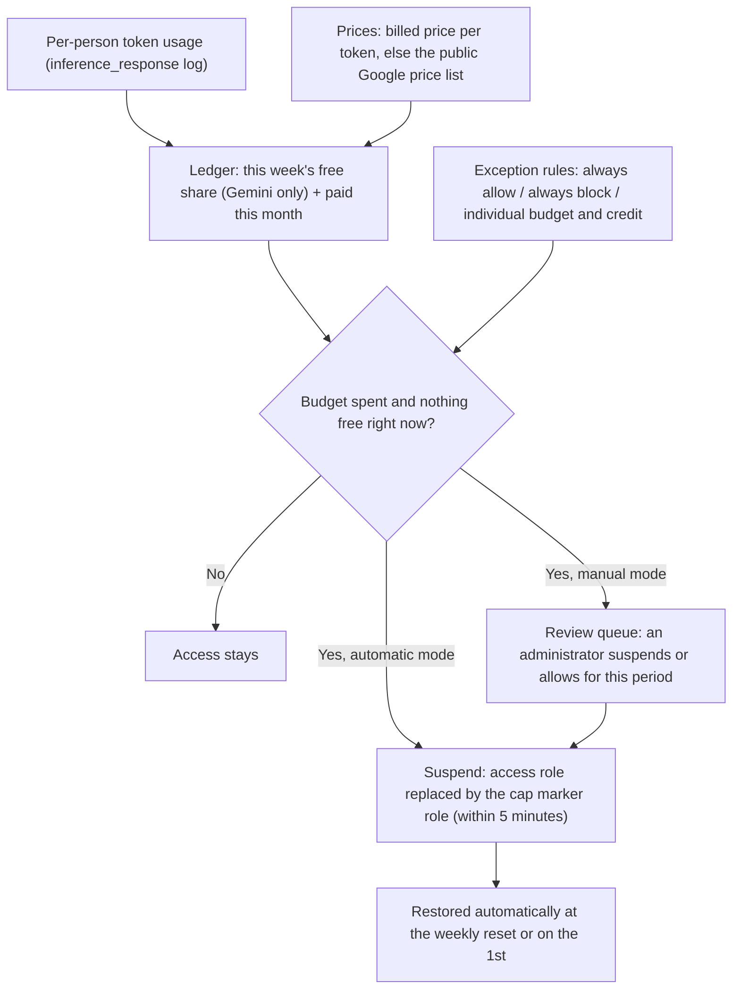

### 8.2 Getting started

1. The default installation (`ENABLE_GOVERNANCE_ACTIONS="true"`) prepares everything:
   - **Marker roles**: `CustomAntigravityCapBlocked` and `CustomAntigravityAdminBlocked`, the Gemini Enterprise User role without `businessaicode.*` (the same approach as the [official custom roles that restrict AI developer tools](https://cloud.google.com/gemini/enterprise/docs/ai-developer-tools-creating-custom-roles)). Suspended users keep the Gemini Enterprise app; only Antigravity is blocked.
   - **Real-time automatic enforcement (Pub/Sub push)**: enabled by default (`REALTIME_ENFORCEMENT="true"`). Routes Antigravity inference logs (`businessaicode.googleapis.com/inference_response`) through a Log Router sink (in the primary project, and in linked projects with `PREPARE_LINKED_PROJECTS`) → Pub/Sub topic → push subscription (`POST /api/v1/governance/antigravity/usage-event`, authenticated with the runtime service account's OIDC token) so **automatic mode starts enforcement as soon as someone exceeds their cap**. Manual review mode and `notify_only` receive the events but do not enforce. With `iam_deny` the dashboard asks for an enforcement job run; otherwise it runs enforcement once itself (at most once per 30 seconds per instance). In automatic mode, saving a policy or exception rule change also triggers immediate enforcement. The request that reaches the cap and requests in flight finish, and an IAM change usually takes 1–2 minutes, occasionally 7 or more, to take effect.
   - **Enforcement schedule**: an enforcement run every 5 minutes (`ENFORCEMENT_SCHEDULE` defaults to `*/5 * * * *`), which **restores suspended users automatically** after each reset (in manual review mode too) and acts as the safety net for anything missed by real-time events. Use `--no-enforcement-schedule` to turn it off or `--enforcement-schedule "CRON"` to change it. It is not created in IAP access mode, nor on `iam_allow_swap` installs with `--read-only` (`iam_deny` runs the enforcement job and always gets it, [8.9](#89-deny-policy-enforcement-and-the-enforcement-job)).
   - When no scheduled run has happened for two hours, the page shows **Automatic enforcement has stopped**.
2. A Gemini Enterprise administrator turns on **Metadata logging** (6.5). Usage is counted from then on.
3. Set the policy in **Cap policy > Edit policy**. Right after installation every cap is off (`0`), so nobody is suspended.
   - Caps: **Fixed caps per period** (default: monthly from the 1st to the last day; fixed cost, token, and/or request caps per period) or **Weekly free credit + monthly paid budget** (credit caps). An installation of an earlier version that never chose and set only a paid budget keeps credit caps until an administrator changes it. Switching from credit caps to fixed caps starts from the saved period (monthly by default); the weekly reset of the credit caps is not carried over.
   - **Customizable fixed-cap periods**: choose **Daily**, **Weekly** (selectable weekday), **Monthly** (the default; selectable reset day `1–31`, e.g., day 1 through month-end so hitting a $100 cap on the 11th blocks until month-end and restores on the 1st; shorter months automatically clamp to their last day), **Custom cycle** (`1–92` days anchored to a start date `YYYY-MM-DD`), or **Rolling window** under advanced options. The policy dialog displays a live server-computed preview (`GET /api/v1/governance/antigravity/period-preview`, computed from the unsaved values by the same rules as enforcement) of the current window, suspension end time, and next period.
   - Credit model settings: credit per person per month (`Standard $10` / `Plus $15`), paid budget per person per month (`No limit` / `Credits only` / `Monthly limit`), optional organization-wide monthly paid budget, weekly reset day/time/timezone, and optional weekly token/request caps.
4. To give someone a different limit, select the pencil button in the **People and limits** table: the **Cost cap** column with fixed caps, the **Paid budget** column with credit caps (`Default`, `Credits only`, `Individual limit`). With credit caps, for a person with a different credit, such as a Plus license, set the monthly credit to 15 in an **Individual limit** exception rule.
5. In the **Enforcement** card, choose **Automatic** or **Manual review** (default).
6. Preview with **Simulate** (no IAM change), then select **Run enforcement now**.

### 8.3 Amounts and prices

- Per-person amount = per model, (input tokens − cached tokens) x input price + cached tokens (`cachedContentTokenCount`) x cached price + other tokens (response, thinking) x output price. Most input in Antigravity sessions comes from the prompt cache (official example: 69,079 of 70,825 input tokens), so the amount would be inflated without the cached price. Models without a cached price use the input price so that amounts are never too low. Cache-write tokens are not logged separately and count as input.
- The free share covers Gemini amounts first, in the order they were used (models whose id starts with `gemini`, `credit_model_prefixes`). When a week spans two months (for example a Monday reset and the 1st on a Wednesday), both months share that week's free share, and paid amounts count in the month they happened in.
- Prices are found per model and direction (input/output), in this order:
  1. **Billed price**: `SUM(cost) / SUM(usage.amount)` of the model's standard text-token SKUs in the last 30 days of the billing export. Negotiated prices are included and credits are not subtracted. Variant SKUs (batch, flex, priority, cache, long context, tuning, audio/image/video) are excluded.
  2. **Public Google price list**: models without billed usage use the public prices of the Cloud Billing Catalog API (Agent Platform, Gemini API).
- Credit caps are calculated in USD. Other billing currencies are converted with the exchange rate Google publishes in the price list, shown as `1 USD = ₩1,359 (Google rate, date)`.
- Prices are cached for six hours. The **Prices of models used in this period** table of the policy card shows each model's price and source (billed price, Google price list, no price).
- A model without any price is shown as "no price"; when a person's amount cannot be calculated, the cap usage is shown as `—` and the person is not suspended.
- Billing exports carry no user information, so per-person amounts are calculated from tokens. The token counts themselves are what Google logged for every call.
- **Monthly usage report** (Antigravity Controls page): pick a month to see per person the requests, tokens, the Gemini amount, the amount for Claude and other third-party models, the free credit applied, the **amount to charge** (= Claude + Gemini beyond the weekly free share) and the paid budget, with CSV download (`GET /api/v1/governance/antigravity/billing-report?month=YYYY-MM`). It uses the same ledger as the suspension decisions, so the page and the report agree.
- Organizations that want to enter contract prices switch token prices to `Entered` in Settings > Governance policy or use `model_prices` in `config.yaml` (optional).

### 8.4 Enforcement modes

| Mode | When the suspension condition holds | Restore |
|---|---|---|
| Manual review (default) | The user enters the review queue. An administrator **suspends** or **allows for this period**, per user or in bulk. New queue entries are sent to the webhook. | Automatic at the configured reset (daily, weekly, monthly, or custom cycle) |
| Automatic | Starts enforcement immediately on real-time usage events (`REALTIME_ENFORCEMENT`) or policy changes, with Cloud Scheduler as the safety net. | Automatic at the configured reset (daily, weekly, monthly, or custom cycle) |

- An **enforcement run** is started by **real-time usage events (Pub/Sub push)**, **admin policy changes (in automatic mode)**, the **Run enforcement now** button, or the **Cloud Scheduler job (`ENFORCEMENT_SCHEDULE`)**. Scheduler and Pub/Sub push calls authenticate with Google OIDC tokens from their dedicated service accounts; the app verifies the issuer, audience (`PUBLIC_BASE_URL` + path), email verification, and allowlist (`SCHEDULER_INVOKERS` / `RUNTIME_SERVICE_ACCOUNT`). Unauthenticated calls or other tokens get 401/403. Enforcement always reads fresh logs (including the live Cloud Logging tail for the current minute), never cached ones.
- Suspension = one etag-based `setIamPolicy` call that replaces the access role (`roles/discoveryengine.agentspaceUser`) with the cap marker role (`CustomAntigravityCapBlocked`), or an IAM deny policy with the `iam_deny` backend. A suspension record (start, restore time, reason, actor) is kept in the settings bucket, and the first enforcement run after the restore time restores the user, even without telemetry. With the default schedule (5 minutes) this happens within 5 minutes of the reset; only when the schedule is turned off do you need to run enforcement after each reset.
- **Nobody is suspended permanently.** A cap suspension always ends at the next configured reset; only an **always block** rule set by an administrator keeps someone blocked. `teardown.sh` also stops enforcement first and then restores cap-suspended users when it removes the dashboard (section 15).

### 8.5 Exception rules

| Rule | Effect | Duration |
|---|---|---|
| Always allow | Never suspended for exceeding a cap. A suspended user is restored immediately. | This settlement period / no expiry |
| Individual limit | A different monthly paid budget (0 = credits only), monthly credit (for example Plus 15) or weekly token / request caps for this user. Empty fields keep the default. A higher budget restores the person in the next enforcement run. | This settlement period / no expiry |
| Always block | Blocked immediately with the admin block marker role (`CustomAntigravityAdminBlocked`) until the rule is deleted. | No expiry |

Rules apply in both enforcement modes. Every add, change and delete is written to the audit log.

### 8.6 IAM states and safety gates

| State | Meaning | Auto suspend | Auto restore |
|---|---|:---:|:---:|
| `ENFORCEABLE_ALLOWED` | Access only through a direct `user:` binding | Yes | - |
| `CAPPED_BY_TOOL` | Suspended for exceeding a cap | - | Yes |
| `BLOCKED_BY_ADMIN` | Blocked by an administrator | - | No |
| `NOT_ENFORCEABLE` | Access through a group, domain, inherited binding or broader role; cannot be controlled per user | No | No |
| `NO_ACCESS` | No access path | No | No |
| `UNKNOWN` | Undeterminable because the policy could not be read | No | No |

`NOT_ENFORCEABLE` and `UNKNOWN` users are never changed; they are listed under "Manual action required" with the remedy for each reason.

| Gate | Condition | Behavior |
|---|---|---|
| `G1_POLICY_READABLE` | The project IAM policy cannot be read | Abort |
| `G2_ANY_DETERMINATE` | No user has a determinate state | Abort |
| `G3_TELEMETRY_HEALTHY` | The usage query failed, returned nothing, or Cloud Logging reads were truncated at `max_log_entries` (default 20,000) | Suspensions only; usage-based restores are withheld (suspensions past their restore time are still restored). Truncated counts are lower bounds, so over-cap results stay valid. Route the inference log to BigQuery for many users. Nobody is suspended from a month whose usage could not be read. |
| `G4_CHANGE_BUDGET` | More people to suspend in one run than `max(change_budget_min, ceil(change_budget_ratio x population))` (default at least 10, 20%) | The people furthest over are suspended up to that number and the rest by the next runs (restores are never limited). Even when many people go over at once, such as when the organization budget runs out, all of them are suspended within a few runs (5 minutes apart), while one run with bad data cannot block many people at once. |
| `G5_NON_USER_GRANT_ABSENT` | Group or domain bindings on the access role | Warning |
| `G6_DENY_CAPACITY` (`iam_deny`) | 2,000 or more denied principals at an attachment point, or the run would go over 2,500 | Warning from 2,000; new suspensions that would go over 2,500 are held (restores go through). |
| `G7_SURGE_GUARD` (`iam_deny`) | One run would newly suspend at least `surge_guard_min` (default 10) people and at least `surge_guard_ratio` (default 50%) of the population | Every automatic suspension goes to the review queue instead (suspensions an administrator approved and always-block rules still apply). |

On an etag conflict from a concurrent change, the plan is recomputed and retried once.

### 8.7 Audit, notifications and persistence

- Every enforcement run, review decision, exception rule and allow/block is written to the Cloud Logging audit log (`projects/PROJECT_ID/logs/agy-admin%2Fadmin_actions`) and shown in the **Administrative audit log** card. The service account therefore always gets `roles/logging.logWriter`. If writing still fails, the change stands and the API response says `auditLogged: false`. The marker roles and the audit log are the same as [agy-admin-cli](https://github.com/terrychahn/agy-admin-cli), so the two tools can be used together; make sure their runs do not overlap.
- With `governance.antigravity.webhook_url` (Slack `hooks.slack.com` or Google Chat `chat.googleapis.com`, HTTPS only), new review queue entries and enforcement results are sent. In the text, `<` and `>` become the look-alikes `‹` and `›`, so names such as unit names from the organization CSV cannot form Slack or Google Chat mentions or links; other characters are sent as written.
- Exception rules and suspension records are stored in the settings bucket and survive restarts. On Cloud Run without a settings bucket they are kept in memory only, and the page shows a warning.

### 8.8 Automatic verification (drill)

So that nobody has to check by hand, the repository includes **a simulated month that runs the real enforcement engine**. It needs no Google Cloud access and finishes in seconds.

```bash
python3 scripts/caps_drill.py                                  # USD 100 paid budget, Standard credit (USD 10)
python3 scripts/caps_drill.py --budget 0                       # credits only
python3 scripts/caps_drill.py --org-budget 300 --crowd 30      # organization budget + 30 people going over at once
python3 scripts/caps_drill.py --weekday 2 --at 14:00 --tz America/Los_Angeles   # the project's 7-day cycle
python3 scripts/caps_drill.py --lang en                        # English report
python3 scripts/caps_drill.py --backend iam_deny               # deny-policy enforcement (8.9)
python3 scripts/caps_drill.py --backend iam_deny --unit-budget 60   # organization unit budget of USD 60 (8.10)
```

- A simulated clock calls enforcement every 5 minutes, as Cloud Scheduler does, against a simulated project IAM policy and an inference log with the official schema (BigQuery sink table). The dashboard code runs exactly as in production. Simulated people's calls succeed only while they hold the access role.
- The report shows each person's Gemini, Claude, free and paid amounts per week, every suspension and restore with its reason, and the rules checked after every run (PASS/FAIL):
  - R1 nobody is suspended while budget or free credit is left
  - R2 everybody who is over is suspended by the next run (a wave above the change budget within a few runs)
  - R3 every suspension ends at the weekly reset or the month start (no permanent suspension)
  - R4 spending beyond a budget stays within one interval (5 minutes) per restore, for people and the organization
  - R5 people with an allow rule or group access are never suspended
  - R6 the monthly report equals an independent call-by-call calculation (to the cent)
  - R7 a used-up organization unit budget stops its people in the same run (`--unit-budget`)
  - R8 the deny policy lists exactly the recorded suspensions and denies only Antigravity, with the right policy ID and attachment points (`--backend iam_deny`)
  - R9 nobody is left in the deny policy after their restore time
  - R10 the chargeback allocation adds up, and each person's chargeable amount equals the independent calculation (±1 cent)
- The same drill runs as unit tests (`tests/unit/test_caps_drill.py`) in `scripts/test.sh`. Engines broken on purpose (free credit never renewed, never suspending, Claude counted against the credit, nobody suspended above the change budget, unit budgets ignored, an extra denied permission, deny entries left after a restore) must make the drill fail, or the tests fail.

### 8.9 Deny-policy enforcement and the enforcement job

The default backend (`iam_allow_swap`) can only change direct `user:` bindings in the primary project's allow policy, so people who get access through a group, a parent folder or Workforce Identity Federation cannot be suspended (`NOT_ENFORCEABLE` in 8.6). **Deny-policy enforcement (`iam_deny`)** lists the people to suspend in an IAM deny policy instead. IAM checks deny policies **before** allow policies, so a denied person cannot use the permission however the role was granted (group, inheritance, Workforce) ([official documentation](https://cloud.google.com/iam/docs/deny-overview)).

| Backend (`enforcement_backend`) | Behavior | What it stops |
|---|---|---|
| `iam_allow_swap` (default) | The dashboard swaps the access role for the marker role (8.4). | Direct `user:` bindings |
| `iam_deny` | The enforcement job manages one deny policy with the fixed ID `ai-control-plane-caps` per attachment point, with one rule: suspended and blocked people × the allow-listed permission (`businessaicode.googleapis.com/locations.generateContent`). | Group, inherited and Workforce access too |
| `notify_only` | Plans and notifications only; access never changes. No write role is needed. | Nothing |

- Attachment point (`deny_attachment`): `projects` (default, every workspace project) or `scope` (the folder or organization when the workspace scope is one, otherwise every project). A deny policy is inherited by every resource below its attachment point.
- Extra denied permissions (optional, off by default): `deny_ge_app` also denies the Gemini Enterprise assistant (`discoveryengine.googleapis.com/assistants.assist`), and `deny_agent_platform` also denies Agent Platform model calls (`aiplatform.googleapis.com/endpoints.predict`). Antigravity signed in with ADC or pay-as-you-go calls Agent Platform directly, so the default permission does not stop it (6.5). With `deny_agent_platform` on, suspended people lose every Agent Platform model call at the attachment points, including their own apps and scripts.
- Only people (`principal://goog/subject/EMAIL`, and Workforce principals exactly as logged, 7.12) are listed, never service accounts or groups. An administrator's **Always block** rule is applied through the same policy.
- When one listed account cannot be found by IAM (a deleted account or a mistyped address), IAM rejects the whole write with 400 (`The principal ... was not found`), as checked on a test project. Such accounts are left out, the rest of the people are applied, and the left-out people are shown as failed with the reason.
- Before applying, the invariants are checked (policy ID prefix `ai-control-plane-`, permissions = allow list, principals = people, attachment points = the list computed from the settings, new suspensions ≤ change budget, current etag); if any fails, nothing changes.
- Additional gates of the deny backend: G1 (abort when the deny policy of any attachment point cannot be read, or a policy with our ID was changed outside the dashboard into a shape it never writes), G6 (warning from 2,000 principals per attachment point; new suspensions are held when 2,500 would be exceeded), G7 (when one run would newly suspend at least `surge_guard_min` people and at least `surge_guard_ratio` of the population, everyone goes to the review queue instead).

**Roles (organization only)**

Deny Admin (`roles/iam.denyAdmin`) and Deny Reviewer (`roles/iam.denyReviewer`) can be granted **on an organization only**. Projects without an organization therefore cannot use `iam_deny`, and the deployment says so. Only the enforcement job's service account gets Deny Admin.

| Account | Roles | Scope |
|---|---|---|
| Enforcement job (`ai-control-plane-enforcer@PROJECT_ID.iam.gserviceaccount.com`) | Deny Admin | Organization |
| | Reads usage, logs, BigQuery and licenses; writes audit entries (`roles/logging.logWriter`). No project IAM write role. | Primary and linked projects |
| | Storage Object Admin (settings and suspension records) | Settings bucket |
| Dashboard (runtime service account) | Deny Reviewer (enforcement status) | Organization |
| | Cloud Run Jobs Executor (`roles/run.jobsExecutor`, Run enforcement now), Cloud Run Viewer (`roles/run.viewer`, execution status) | The enforcement job only |
| Scheduler (`ai-control-plane-scheduler@PROJECT_ID.iam.gserviceaccount.com`) | Cloud Run Jobs Executor | The enforcement job only |

- With `GRANT_ORG_ROLES="true"` (or `--grant-org-roles`) the deployment grants both organization roles. The deploying account needs permission to change the organization's IAM policy (Organization Administrator, `resourcemanager.organizations.setIamPolicy`).
- With the default (`false`) nothing is granted and the deployment prints the commands for an organization administrator:

```bash
gcloud organizations add-iam-policy-binding ORGANIZATION_ID \
  --member=serviceAccount:ai-control-plane-enforcer@PROJECT_ID.iam.gserviceaccount.com \
  --role=roles/iam.denyAdmin --condition=None
gcloud organizations add-iam-policy-binding ORGANIZATION_ID \
  --member=serviceAccount:ai-control-plane-sa@PROJECT_ID.iam.gserviceaccount.com \
  --role=roles/iam.denyReviewer --condition=None
```

- Until the roles are granted, the enforcement job cannot read the deny policies, stops at G1 and changes nothing.

**Limits**

| Item | Limit | How this tool handles it |
|---|---|---|
| Denied principals per resource | 2,500 across all deny policies attached to the resource; every appearance of a principal counts ([IAM quotas and limits](https://cloud.google.com/iam/quotas)) | G6. Deny policies of other tools on the same resource use the same limit. |
| Deny policies and rules per resource | 500 policies, 500 rules in total | One policy with one rule per attachment point. |
| IAM policy API calls | Default quota: 10 policy reads and 10 policy writes per minute per quota project of the caller (Service Usage, `iam.googleapis.com` "Policy Read/Write Requests"). Checked on a test project, where two attachment points already met one 429. | Every run reads each attachment point. Transient 429 and 5xx answers are read again after 1 and 2 seconds. Before that, the enforcement job waits 20 and then 40 seconds after a 429, which carries the read into the next quota minute (dashboard pages never wait); this was added after a scheduled run on the deployed test environment read in the same minute as the dashboard and stopped at G1. The enforcement status page is cached for 60 seconds, and more than 5 attachment points raise a warning. **With many projects, use the `scope` (folder or organization) attachment.** For example, 24 projects attached with `projects` cannot all be read at once within the default quota, so runs can stop at G1 (a higher quota can be requested). |
| Time to take effect | Eventually consistent: a suspension or restore can take several minutes to apply ([access change propagation](https://cloud.google.com/iam/docs/access-change-propagation)). | Usage in the meantime is still logged and counts in the next run. |

**The enforcement job and its schedule**

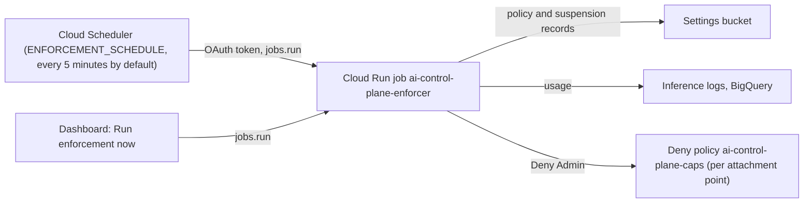

- With `ENFORCEMENT_BACKEND="iam_deny"`, `scripts/deploy.sh` creates the Cloud Run job `ai-control-plane-enforcer` from the same image (`python -m controlplane.enforce_job`, task timeout 600 seconds, no retries) and runs it as its own service account. It uses the service's configuration and settings bucket; it serves no requests, so it gets no secrets.
- The Cloud Scheduler job `ai-control-plane-enforcer` calls `POST https://run.googleapis.com/v2/projects/PROJECT_ID/locations/REGION/jobs/ai-control-plane-enforcer:run` with an OAuth token of the scheduler service account on `ENFORCEMENT_SCHEDULE` (default `*/5 * * * *`). It never calls the dashboard, so it is created in IAP access mode and with `--read-only` too.
- The scheduler that calls the web enforcement endpoint (`ai-control-plane-enforce`) is not created, and is removed if an earlier deployment made it. There is always exactly one enforcer.
- **Run enforcement now** in the dashboard asks Cloud Run to run the job, and the enforcement status card shows the latest execution (start and completion time, success or failure). Installations without a job (such as local runs) apply the change from the dashboard itself, so the account running the dashboard needs Deny Admin.
- Every execution writes one JSON line to Cloud Logging (counts only, no e-mail addresses). Exit codes: `0` (applied, nothing to do, dry run, or stopped by a safety gate), `1` (a change failed or an unexpected error; the next run tries again), `2` (configuration error such as an unconfigured workspace, the Antigravity module turned off, no settings bucket or the `iam_allow_swap` backend; `reason` says which).
- Run it once now: `gcloud run jobs execute ai-control-plane-enforcer --region REGION --project PROJECT_ID --wait`

**Settings and switching**

| deploy.env (installer flag) | UI setting key | Default | Description |
|---|---|---|---|
| `ENFORCEMENT_BACKEND` (`--enforcement-backend`) | `governance.antigravity.enforcement_backend` | `iam_allow_swap` | `iam_allow_swap` / `iam_deny` / `notify_only` |
| `DENY_ATTACHMENT` (`--deny-attachment`) | `governance.antigravity.deny_attachment` | `projects` | `projects` / `scope` |
| `ENFORCEMENT_JOB_REGION` (`--enforcement-job-region`) | - | `REGION` | Region of the job and its schedule |
| `GRANT_ORG_ROLES` (`--grant-org-roles`) | - | `false` | Whether the deployment grants the two organization roles |
| `ENFORCEMENT_SCHEDULE` | - | `*/5 * * * *` | How often the job runs (`off`: only with Run enforcement now) |
| Set by the deployment (`ENFORCEMENT_JOB`) | `governance.antigravity.enforcement_job` (not editable in the UI) | - | The job the dashboard asks to run |

- The policy ID is `governance.antigravity.deny_policy_id` (default `ai-control-plane-caps`); it can be changed in `config.yaml` only and must start with `ai-control-plane-`.
- A value saved in the UI (Settings > Governance policy) wins over deploy.env (9.1). When you change one, set the other to the same value (in the UI, resetting to the default also works). Only a deployment creates the job, the schedule and the organization roles, so deploy first when switching to `iam_deny`.
- When switching away from `iam_allow_swap`, people already suspended or blocked with a marker role are handed over by the dashboard's maintenance run (every 15 minutes by default). They get their access role back once the new method no longer needs the marker: with `iam_deny` when the deny policy lists them, or when no always-block rule or running suspension applies and they are within their limits; with `notify_only` when their running suspension has ended and no always-block rule applies. This uses the dashboard service account's project IAM write role (`ENABLE_GOVERNANCE_ACTIONS="true"`), so keep that role until everyone is handed over. The people still waiting and any error are shown in the enforcement status, and everyone released is written to the audit log (`marker_release`).

```bash
scripts/deploy.sh --project PROJECT_ID --enforcement-backend iam_deny                    # prints the organization role commands
scripts/deploy.sh --project PROJECT_ID --enforcement-backend iam_deny --grant-org-roles  # when an organization administrator deploys
```

- `scripts/install.sh` takes the same flags and saves them in `deploy.PROJECT_ID.env` for later deployments.
- Terraform (section 10): `enforcement_backend = "iam_deny"`; the organization roles are granted with `grant_org_roles = true` and `organization_id`, otherwise an organization administrator runs the commands in the output `organization_role_commands`.

**Rollback**

1. Release the suspensions while the backend is still `iam_deny`. Cap suspensions end when the settlement period ends (the 1st of the month by default; with credit caps at the weekly reset or on the 1st); to end them now, give an **Always allow** rule or a higher individual limit, and delete **Always block** rules. When nobody is left in the policy, the next job run deletes the managed policy (it never leaves an empty policy behind).
2. Switch the backend back: choose `iam_allow_swap` in the UI and deploy again with `ENFORCEMENT_BACKEND="iam_allow_swap"` (or `--enforcement-backend iam_allow_swap`). The deployment removes the job's schedule, brings back the web enforcement scheduler, and the dashboard stops calling the job. The job and its service account stay unused until `teardown.sh` removes them. Between the UI change and the deployment, job runs end with exit code 2 (`backend_not_supported`) and change nothing.
3. To release everyone at once, delete the managed policy yourself (needs Deny Admin on the organization). Deleting it ends every suspension and block it lists; with `iam_allow_swap`, the next enforcement run suspends people who are still over their limit through the allow policy. Run it for every attachment point (primary project, linked projects, and with `scope` the folder or organization).

```bash
gcloud iam policies get ai-control-plane-caps \
  --attachment-point=cloudresourcemanager.googleapis.com/projects/PROJECT_ID --kind=denypolicies --format=json
gcloud iam policies delete ai-control-plane-caps \
  --attachment-point=cloudresourcemanager.googleapis.com/projects/PROJECT_ID --kind=denypolicies
# scope attachment: cloudresourcemanager.googleapis.com/folders/FOLDER_ID or .../organizations/ORGANIZATION_ID
```

- `teardown.sh` first removes the job's schedule and the job, then deletes the managed policy on the primary and linked projects, the projects added in the dashboard and the folders or organization of the workspace scope (administrator blocks end too), and removes the organization roles or prints the commands to remove them (section 15). Policies it cannot delete, or that are attached elsewhere, are deleted with the printed command.

### 8.10 Unit and project budgets, administrator decisions, notify only

**Monthly budgets per organization unit and project** (Chargeback > Monthly budgets)

On top of the personal caps and the organization-wide budget (`org_paid_budget_month`), every organization unit (the organization structure of 7.12) and every project can have a monthly paid budget in USD. It lets you manage many projects split by division the same way from one page.

| Target | Action | When the budget is used up |
|---|---|---|
| Unit | Suspend people (`suspend`) | The people attributed to the unit or a unit below it are suspended while nothing is free for them, until the 1st of the next month (the same rule as the organization budget). With weekly free credit, the credit that returns each week can still be used; with fixed caps per period, people with paid usage this month are suspended until the 1st. |
| Unit | Send to review (`review`) | Those people go to the review queue, in automatic mode too, and wait for an administrator decision. |
| Unit, project | Notify only (`notify`) | Threshold alerts only. |
| Project | Hard cap (`hard_cap`, workspace projects only) | Alerts, and with Google spend caps turned on, Google stops the project's Agent Platform usage (below). |

- **Spend**: the chargeable amounts (beyond the free credit) of the month's chargeback rows, in integer cents. A unit covers its sub-units; a project counts the usage recorded in it. A budget is used up when its spend reaches it; 0 allows no paid usage at all.
- **How it is measured**: with weekly free credit, from the enforcement ledgers (8.3) on every run; with fixed caps per period, from the month's chargeback report (cached for 5 minutes). Budgets are in USD, so they only apply to a USD report; otherwise a warning is shown.
- The suspension reason is `unit_budget`, and the safety gates and the change budget (8.6, 8.9) apply as usual. People with an always-allow rule are never suspended.
- Spend attributed to a unit only through a project label (`chargeback.project_unit_label`) counts in the status, reports and alerts but never triggers a suspension or a review: project owners set labels, so suspensions and reviews follow only the person and `project:` mappings of the organization CSV.
- **Alerts**: each threshold (default 50, 80, 100%) is announced once per month to the webhook (`AI Control Plane budgets: ...`, no e-mail addresses) and written to the audit log (`budget_alert`). Applying runs (the schedule, Run enforcement now) send them, so they are sent with notify only too.
- At most 5,000 budgets, one per unit and per project. A save replaces the whole list and is audited (`budgets_save`, counts only).
- API: `GET /api/v1/budgets`, `POST /api/v1/budgets` (administrators, `{"nodes": [...]}`).

**Google spend caps (project hard caps)**

- Uses spend cap budgets of the Cloud Billing Budget API. When the project's Agent Platform cost reaches the amount, Google pauses new Agent Platform usage in that project for the rest of the month and lifts the cap at the start of the next month. An administrator can lift it earlier (**Lift cap**; Google says usage resumes within about an hour).
- Google's constraints: one project, one service, calendar month, credits excluded, thresholds fixed at 50, 80 and 100%. It is not instant, so usage can go a little over.
- **Measurement differs**: Google measures all Agent Platform usage of the project at list price (before credits), while the dashboard budget counts the paid share attributed to the project. Usage billed under Agent Platform is therefore stopped no later than the dashboard budget is used up. **Usage billed under other services (for example the Gemini API) and subscription costs are not covered. Check in the billing export which service your Antigravity usage is billed under first.**
- Setup: turn on **Manage Google spend caps** (`governance.antigravity.spend_caps`) in Settings > Governance policy > Enforcement and enter the billing account ID (`workspace.billing.account_id`). The Cloud Billing Budget API (`billingbudgets.googleapis.com`) must be enabled on the dashboard project (`scripts/deploy.sh` tries to enable it), and the runtime service account needs budget permissions on the billing account including `billing.budgets.configureSpendCap` (for example Billing Account Administrator, `roles/billing.admin`, or a custom role with that permission). The deployment never grants billing account roles. Reseller billing accounts are not supported.
- **Scope**: hard caps are allowed only for workspace projects (the primary project, configured projects and projects found by auto-discovery or in the scope). Saving a hard cap for another project fails validation; an existing cap outside the workspace shows **Not in this workspace** and is never created or changed (lifting still works). If the project list cannot be read, nothing is created or changed and hard-cap saves are refused.
- Apply: in Chargeback > Monthly budgets > **Google spend caps**, check with **Preview changes**, then select **Apply spend caps**. Enforcement runs never change spend caps. Only budgets the dashboard created (display name `AI Control Plane cap: PROJECT_ID`) are changed; caps that are no longer needed are reported, not deleted (delete them in the Cloud console). Before an update or a lift, the budget must cover exactly that project (by project number) and Agent Platform and have a spend cap; otherwise it shows **Not managed by the control plane** (`not_owned`) and is left alone. The check reads the project number (Resource Manager) and the service (Cloud Billing Catalog), cached for 24 hours, so a lift also needs `resourcemanager.projects.get` on the project for the runtime service account. An applied run writes the counts per status and the per-project changes (project, operation, status, amount; at most 200) to the audit log (`spend_caps_apply`). On a billing account whose currency is not USD, no cap is created, so that an exchange rate cannot move the point where Google stops usage.
- API: `GET /api/v1/budgets/spend-caps`, `POST /api/v1/budgets/spend-caps/apply` (`{"dryRun": true}` by default), `POST /api/v1/budgets/spend-caps/lift` (`{"project": "PROJECT_ID"}`).
- Checked on a test environment: the product code created a spend cap budget (high amount) for the test project. Google stored one project (project number), the Agent Platform service (`services/C7E2-9256-1C43`), `EXCLUDE_ALL_CREDITS`, the calendar month, thresholds 0.5, 0.8 and 1.0, and `spendCap.outputState=CONFIGURED`. Planning again gave no change (`none`), and the budget was deleted afterwards. The moment Google stops usage (ENFORCED) was not observed.

**Administrator decisions with the deny policy**

With `iam_deny`, administrator decisions (suspend and allow in the review queue, always-allow and always-block rules, allow and block on the user page) are recorded in the settings bucket first, and an enforcement run writes the deny policy. With an enforcement job, the dashboard only asks the job to run and shows the result as `queued`; the dashboard service account never writes deny policies. Without a job, the dashboard runs once right away. Either way IAM can take a few minutes to put it into effect (the limits table of 8.9).

- A suspension approved in the review queue applies in manual mode too and lasts for the current settlement period (with weekly free credit, until the next weekly reset). An approved suspension that is not applied yet is cancelled by **Allow**.
- When an always-block rule is deleted with access restored, the next run removes the deny entry (unless the person is over a cap again by then). Without restoring access, the person stays suspended until the current settlement period ends.
- Allowing a person suspended by a cap creates an always-allow rule for the current settlement period.

**Notify only (`notify_only`)**

- Computes like manual review mode, shows the review queue and sends budget alerts and the webhook, but suspends and restores nobody: it never reads or changes the allow policy and writes no deny entries. No write role is needed. The only exception is the cleanup of deny policies left from an earlier `iam_deny` period (below).
- Suspension decisions and allow or block on the user page are refused (with a hint to change the enforcement method in Settings > Governance policy); exception rules are only recorded.
- After switching away from `iam_deny`, deny policies written earlier are shown as a warning in the enforcement status while they remain, and applying runs try to delete them (every administrator run, at most hourly for scheduled runs). Without Deny Admin for the account running the dashboard they cannot be deleted, so delete them with the commands of 8.9. Do the same after changing the policy ID.

**Enforcement status API**: `GET /api/v1/governance/antigravity/enforcement` returns the enforcement method, attachment, policy ID, denied permissions, surge guard settings, the enforcement job's latest execution, the denied principals per attachment point (share of the 2,500 limit, read errors, outside changes), leftover policies, the marker role holders left by the allow-policy method (8.9) and the spend cap status. It only reads and is cached for 60 seconds. Administrator decisions and Run enforcement now clear the cache, but what the enforcement job applies afterwards can show up to 60 seconds later.

---

## 9. Configuration structure (config.yaml, environment variables, UI settings)

### 9.1 Load order

Later values override earlier values.

1. Built-in defaults
2. `config.yaml` (the path can be set with `CONFIG_PATH`)
3. `config.local.yaml` (same directory, optional, excluded from Git)
4. Environment variables (set by `scripts/deploy.sh` from `deploy.env`)
5. Settings saved in the UI (settings bucket)

Items changed in the UI are marked "Customized", and you can use **Reset to defaults** for each section. Items the deployment decides (`security.auth_mode`, `iap_audience`, `google_client_id`, `public_base_url`, `sign_in_bridge_url`, `bridge_return_url`, `guest_access`, `guest_redact_terms` and `governance.antigravity.scheduler_invokers`, `enforcement_job`, `deny_policy_id`, `usage_events_subscription`) cannot be changed in the UI, only in a settings file or environment variable.

### 9.2 Main settings

| Section | Keys | Description |
|---|---|---|
| `product` | `name`, `tagline` | Product name and tagline (white label) |
| `branding` | `organization_name`, `logo_url`, `accent_color`, `default_locale`, `default_theme` | Organization identity. The logo is an HTTPS URL or an `/assets/` path |
| `workspace` | `project_id`, `projects`, `scan_all_projects`, `quota_project_id`, `timezone`, `default_range_days`, `audit_dataset` | Primary and linked projects, auto-discovery and default query settings |
| `workspace` | `scope_type` (`projects` default / `folder` / `organization`), `scope_ids`, `scope_max_projects` (default 300), `scope_filter`, `audit_project`, `license_max_pages` | Folder and organization scopes and the central audit dataset ([7.12](#712-chargeback-people-projects-organization)) |
| `workspace.billing` | `project_id`, `dataset`, `table`, `account_id` | Billing export location |
| `workspace` | `discovery_engine_locations`, `agent_engine_regions`, `telemetry_datasets` | API locations and additional telemetry datasets |
| `security` | `auth_mode`, `admins`, `allowed_users`, `google_client_id`, `public_base_url`, `session_hours`, `sign_in_bridge_url`, `bridge_return_url`, `iap_audience`, `mask_pii_for_viewers`, `guest_access`, `guest_redact_terms` | Authentication and permissions |
| `storage` | `backend`, `gcs_bucket`, `gcs_object`, `file_path` | Settings store |
| `bigquery` | `max_bytes_billed` | Cost cap per query (default 20 GB) |
| `ai_engine` | `default_model`, `models`, `fallback_models`, `discover_models`, `restrict_to_allowed`, `location` | Models for AI Analyst and spike analysis |
| `modules` | `true`/`false` per module ID | Turn modules on or off |
| `model_catalog` | `auto_enable_new_models`, `disabled_models`, `excluded_sku_patterns`, `ai_grouping` | Model tracking policy |
| `gateway` | `services` | Services to monitor in Agent Gateway |
| `agent_lifecycle` | `idle_days`, `deprecation_days` | Thresholds for idle agents and deprecation candidates |
| `finops` | `spike_threshold_pct`, `spike_min_delta` | Cost spike thresholds |
| `pricing` | `currency`, `sync_time` (default `00:00`), `sync_timezone`, `model_aliases`, `model_overrides`, `alert_price_change_pct`, `alert_fx_change_pct`, `public_sources`, `fx_sources` | Official price and exchange rate sync, token-based cost estimates |
| `governance.antigravity` | `cap_model` (`period` default / `credit_budget`). Period caps: `period` (`daily` / `weekly` / `monthly` default / `custom` / `all` = last 90 days), `window` (`calendar` default / `rolling`), `reset_day` (default `1`), `reset_weekday` (default `0` = Monday), `reset_time` (default `00:00`), `reset_timezone` (empty = workspace time zone), `cycle_days`, `cycle_start`, `cost_cap`, `token_cap`, `request_cap` (`0` = off), `currency`. Credit caps: `credit_per_user_month`, `credit_source` (`license` default), `credit_by_tier`, `paid_budget_month` (-1 no limit, 0 credits only), `org_paid_budget_month`, `credit_model_prefixes`. Common: `enforcement_mode` (`manual` default / `auto`), `pricing_source`, `model_prices`, marker roles, change budget (`change_budget_min` 10, `change_budget_ratio` 0.2), `max_log_entries`, `webhook_url`, the enforcement method `enforcement_backend`, `deny_attachment`, `deny_policy_id`, `deny_ge_app`, `deny_agent_platform`, `surge_guard_min`, `surge_guard_ratio` (8.9), `spend_caps` (8.10), deployment settings `scheduler_invokers`, `enforcement_job`, `usage_events_subscription` | Antigravity cap policy |
| `chargeback` | `allocation_mode` (`credit_share` default / `list`), `project_unit_label`, `seat_prices`, `close_dataset` | Chargeback ([7.12](#712-chargeback-people-projects-organization)) |
| `telemetry` | `discovery.*`, `ai.*` (`model` default `gemini-4-argon`), `inference.*`, `routing.*` (dataset `telemetry_routed`, sampling, minimum severity, retention, daily GiB caps) | Telemetry Extensions |
| `analyst` | `max_bytes_billed`, `max_rows`, `allow_viewers` | AI Analyst query limits (default 10 GB, 500 rows), and whether viewers may use it (default `false`) |

### 9.3 Environment variables

Values that `scripts/deploy.sh` sets on Cloud Run, and that you set when you run the server yourself.

| Variable | Maps to |
|---|---|
| `PROJECT_ID`, `QUOTA_PROJECT_ID` | `workspace.project_id`, `workspace.quota_project_id` |
| `SCAN_PROJECTS`, `SCAN_ALL_PROJECTS` | `workspace.projects` (comma separated), `workspace.scan_all_projects` (`true`/`false`) |
| `SCOPE_TYPE`, `SCOPE_IDS`, `AUDIT_PROJECT` | `workspace.scope_type`, `workspace.scope_ids` (comma separated), `workspace.audit_project` |
| `AUDIT_DATASET_ID` | `workspace.audit_dataset` |
| `BILLING_PROJECT_ID`, `BILLING_DATASET_ID`, `BILLING_TABLE_ID`, `BILLING_ACCOUNT_ID` | `workspace.billing.*` |
| `WORKSPACE_TIMEZONE` | `workspace.timezone` |
| `DISCOVERY_ENGINE_LOCATIONS`, `AGENT_ENGINE_REGIONS` | Comma-separated lists |
| `DISABLED_MODULES` | Turns the listed modules off (`modules.<module ID>: false`) |
| `ORGANIZATION_NAME`, `PRODUCT_NAME`, `DEFAULT_LOCALE` | `branding.organization_name`, `product.name`, `branding.default_locale` |
| `AUTH_MODE`, `ADMIN_EMAILS`, `ALLOWED_USERS` | `security.auth_mode`, `security.admins`, `security.allowed_users` |
| `GOOGLE_OAUTH_CLIENT_ID`, `GOOGLE_OAUTH_CLIENT_SECRET` | Google sign-in (OAuth client mode). The client secret is injected from Secret Manager |
| `GOOGLE_OAUTH_REDIRECT_URI`, `GOOGLE_OAUTH_START_URL` | Overrides of the OAuth redirect URI and authorization start URL (advanced) |
| `OAUTH_CONNECT_SECRET` | Secret Manager secret (`projects/PROJECT_ID/secrets/NAME`) that holds the secret of an OAuth client connected in the UI |
| `ADMIN_INITIAL_PASSWORD` | Initial password of the built-in `admin` account (injected from Secret Manager). Without it, the account cannot sign in with a password until one is set in the UI. |
| `PUBLIC_BASE_URL`, `SESSION_HOURS`, `SESSION_SECRET` | Public dashboard URL, session length, session signing key (injected from Secret Manager, 32 characters or more) |
| `SIGN_IN_BRIDGE_URL`, `BRIDGE_RETURN_URL` | Sign-in bridge URL (dashboard side), dashboard URL to return to (bridge side) |
| `IAP_AUDIENCE` | Audience of the IAP signed header |
| `IAP_ACCESS_RESOURCE`, `IAP_ORG_DOMAIN`, `IAP_OAUTH_CLIENT` | IAP resource managed from the UI (the sign-in bridge), primary domain of the organization, IAP OAuth client type (set by the deployment) |
| `GUEST_ACCESS`, `GUEST_REDACT_TERMS` | `security.guest_access`, `security.guest_redact_terms` |
| `SETTINGS_BUCKET` | `storage.gcs_bucket` |
| `SCHEDULER_INVOKERS` | `governance.antigravity.scheduler_invokers`: service accounts that may call the scheduler routes (enforcement, maintenance, pricing sync, routing guard, usage events) with an OIDC token (comma separated) |
| `RUNTIME_SERVICE_ACCOUNT` | The deployment's runtime service account, also accepted on the maintenance, pricing sync, routing guard and usage event routes (if unset, the Cloud Run metadata server value) |
| `ENFORCEMENT_BACKEND`, `DENY_ATTACHMENT` | `governance.antigravity.enforcement_backend`, `governance.antigravity.deny_attachment` |
| `ENFORCEMENT_JOB`, `USAGE_EVENTS_SUBSCRIPTION` | `governance.antigravity.enforcement_job` (`projects/P/locations/R/jobs/J`), `governance.antigravity.usage_events_subscription` (`projects/P/subscriptions/S`) |
| `PRICING_CURRENCY`, `PRICING_SYNC_TIME` | `pricing.currency`, `pricing.sync_time` |
| `TELEMETRY_AI_MODEL`, `TELEMETRY_DATASET`, `TELEMETRY_DATASET_LOCATION` | `telemetry.ai.model`, `telemetry.routing.dataset`, `telemetry.routing.dataset_location` |
| `AI_DEFAULT_MODEL`, `AI_LOCATION` | `ai_engine.default_model`, `ai_engine.location` |
| `HOST`, `PORT` | `server.host`, `server.port` |
| `CONFIG_PATH`, `LOG_LEVEL` | Path of `config.yaml`, log level (default `INFO`) |

If `workspace.project_id` is empty or starts with `your-`, the data APIs return `not_configured` and the UI shows setup guidance.

### 9.4 UI settings

| Tab | Contents |
|---|---|
| General | Product name, organization name, logo, accent color, default language and theme |
| Access control | Approved accounts and roles, approving and dismissing access requests, ID/password accounts, Google sign-in (IAP) allowlist, connecting a Google OAuth client |
| Workspace and data sources | Project, workspace scope (searchable picker of projects, folders and organizations), time zone, audit log dataset, billing export, API locations, data source health |
| Modules | Turn modules on or off (applies to every user immediately) |
| Model catalog | Automatic tracking of new models, turning off tracking for individual models |
| AI engine | Default model, fallback model order, allowed models, connection test |
| Data collection and cost | Pricing/FX sync schedule & currency, manual model rates & aliases, telemetry discovery limits, Gemini telemetry analysis settings, field hints & display renames, BigQuery routing cost controls |
| Governance policy | Antigravity cap policy (cap model, settlement period, enforcement mode), enforcement method (allow-policy swap, deny policy, notify only) and Google spend caps, marker roles, change budget, webhook, AI Analyst limits, agent lifecycle, cost spike thresholds |
| Chargeback | Allocation, project label that names an organization unit, seat price per edition, BigQuery dataset for month close copies |
| About | Version, workspace project, Cloud Run service and revision, whether the settings store is durable and its last change, data handling |

---

## 10. Deploying with Terraform (optional)

`terraform/` is provided for organizations that manage infrastructure as code. In IAP mode (`auth_mode = "iap"`), it creates the service account, least-privilege IAM, the required APIs, a private settings bucket, Cloud Run and direct IAP on Cloud Run, and with `enforcement_backend = "iam_deny"` also the enforcement job and its Cloud Scheduler job. It requires Google provider 7.x. Google sign-in mode and its secrets, the enforcement schedule of `iam_allow_swap` and `notify_only`, and the maintenance schedule are created only by `scripts/deploy.sh`; turn on the audit log sink, Data Access logs and Gemini Enterprise logs with `scripts/prepare.sh`. It does not create the custom roles (marker roles: **Create marker roles** on the Antigravity Controls page; the license reader; the Agent Gateway manager; the Gemini Enterprise feature manager `CustomAiControlPlaneGeFeatureManager`) or grants on linked projects and workspace scopes either. Without the feature manager role, the feature matrix is read-only. Without the license reader role, Gemini Enterprise seats stay hidden ([14.5](#145-when-gemini-enterprise-lives-in-another-project)).

```bash
# 1. build the image
gcloud artifacts repositories create ai-control-plane --repository-format=docker --location=REGION --project=PROJECT_ID
gcloud builds submit --project=PROJECT_ID --region=REGION \
  --tag REGION-docker.pkg.dev/PROJECT_ID/ai-control-plane/ai-control-plane:2.2.0 .

# 2. write the variables file, then apply (terraform.tfvars is excluded from Git)
cd terraform
cp terraform.tfvars.example terraform.tfvars
terraform init
terraform plan
terraform apply
```

| Main variables | Default | Description |
|---|---|---|
| `project_id`, `region`, `service_name` | -, `us-central1`, `ai-control-plane` | Deployment location and service name |
| `container_image` | - | The built image |
| `audit_dataset_id`, `billing_*`, `quota_project_id` | `ge_analytics` and others | Data sources |
| `organization_name`, `product_name`, `default_locale`, `workspace_timezone` | `Your Organization`, `AI Control Plane`, `en`, `UTC` | Display |
| `discovery_engine_locations`, `agent_engine_regions` | `["global"]`, `["us-central1"]` | API locations |
| `auth_mode`, `enable_iap`, `iap_members`, `iap_audience` | `iap` (only `iap` or `auto` are accepted), `true`, `[]`, computed automatically | Authentication |
| `admin_emails` | `[]` | Administrators |
| `ai_default_model`, `ai_location` | `gemini-3.8-flash`, `global` | AI engine |
| `enable_governance_actions` | `false` | Write roles for control features |
| `organization_id` | `""` | Organization ID for the inherited binding check and the organization roles |
| `enforcement_backend`, `deny_attachment`, `enforcement_job_region`, `enforcement_schedule` | `iam_allow_swap`, `projects`, `""` (`region`), `*/5 * * * *` | Enforcement method and the `iam_deny` enforcement job ([8.9](#89-deny-policy-enforcement-and-the-enforcement-job)) |
| `grant_org_roles` | `false` | Grants the `iam_deny` organization roles (`false`: an organization administrator runs the commands of the output `organization_role_commands`) |
| `realtime_enforcement` | `false` | Real-time enforcement (Pub/Sub push). Created only with `enable_iap = false` (behind an external load balancer with IAP) and `enable_governance_actions = true` or `iam_deny`. Linked projects get no log sink. |
| `public_base_url` | `""` (the run.app URL) | Public URL of the dashboard, for example the load balancer's. When set, or when real-time enforcement is on, it becomes `PUBLIC_BASE_URL`, the audience of the Pub/Sub push token. |
| `enable_optional_apis` | `true` | Also enables the Cloud Trace, Model Armor, Network Services, Network Security and Cloud Billing Budget APIs. `false` when an organization policy blocks one of them |
| `settings_bucket_name`, `settings_bucket_location` | `""` (`PROJECT_ID-control-plane-settings`), `""` (`region`) | Settings bucket. The default name differs from `scripts/deploy.sh` (`PROJECT_ID-SERVICE_NAME-settings`). |
| `cpu`, `memory`, `min_instances`, `max_instances`, `ingress` | `1`, `1Gi`, `0`, `3`, `INGRESS_TRAFFIC_ALL` | Runtime resources |

Outputs: `service_url`, `service_account_email`, `settings_bucket`, `iap_audience`, `enforcement_job`, `enforcer_service_account_email`, `usage_events_subscription`, `organization_role_commands`. A project without an organization cannot create the OAuth client in code. For such a project, turn on IAP once in the Security tab of the Cloud Run console first, then apply.

---

## 11. Running locally

```bash
python3 -m venv .venv
source .venv/bin/activate
pip install -r requirements.txt

cp config.local.yaml.example config.local.yaml   # enter real values such as project_id (excluded from Git)
gcloud auth application-default login            # read real data with your own account

python3 src/backend_server.py
```

Open `http://127.0.0.1:8088`. In local mode (`auth_mode: auto`, outside Cloud Run), only connections from this computer (a loopback address) are accepted, as the administrator. Locally, too, the UI shows only real data from the connected project. Settings are saved in `data/settings.json` (excluded from Git).

Running as a container (to check that the image starts):

```bash
docker build -t ai-control-plane .
docker run --rm -p 127.0.0.1:8080:8080 -e PROJECT_ID=my-project -e AUTH_MODE=local \
  -e GOOGLE_APPLICATION_CREDENTIALS=/creds/adc.json \
  -v "$HOME/.config/gcloud/application_default_credentials.json:/creds/adc.json:ro" \
  ai-control-plane
```

Check it with `curl http://127.0.0.1:8080/healthz`, which returns `{"status": "ok"}`. For an uptime check on Cloud Run, use `/health`: Cloud Run does not pass paths ending in `z` (such as `/healthz`) to the app. Inside a container, browser requests do not come from a loopback address, so local mode refuses them; use the dashboard through the `python3` run above or a Cloud Run deployment. `-p 127.0.0.1:8080:8080` publishes the port on this computer only.

---

## 12. Security model

- **Authentication**: Uses one of Google sign-in (bridge or OAuth client), IAP signed header (JWT) verification, or a loopback administrator for local development (refused on Cloud Run; there is no anonymous mode). Sessions are tokens signed with HMAC-SHA256 using purpose-derived keys, stored in a `__Host-` cookie (HttpOnly, Secure, SameSite=Lax). Sessions of accounts removed from the approved list become invalid immediately.
- **Authorization**: There are two roles, admin and viewer (guests of demos: [5.3](#53-guest-access-demo-only)). All write APIs are for administrators only; the only exceptions are the scheduler and Pub/Sub routes, which authenticate with OIDC tokens ([16.2](#162-api-contract)).
- **CSRF**: A double-submit cookie (`__Host-cp_csrf`, HttpOnly, SameSite=Strict) and the `X-CSRF-Token` header are verified with a constant-time comparison. Write requests with `Sec-Fetch-Site: cross-site` are rejected. Only the scheduler and Pub/Sub routes (enforcement, maintenance, pricing sync, routing guard, usage events) authenticate with a Google OIDC token (issuer, audience URL, verified e-mail, allowed service account) instead of CSRF, and the usage event route cannot be called with a session.
- **Browser protection**: Nonce-based Content-Security-Policy (no inline scripts or styles), `frame-ancestors 'none'`, `nosniff`, `Referrer-Policy`, `Permissions-Policy`, and HSTS over HTTPS.
- **Personal data minimization**: For viewers, emails are masked on the server, and Model Armor raw text and uploaded file names are not provided. The last octet of caller IPs is hidden. Tokens, cookies, CSRF values and raw prompt text are not written to logs, and upstream error messages are logged only with quoted literals and email addresses removed. Viewers see settings read-only, without deployment identifiers. In the enforcement status, viewers and guests see only whether Google spend caps are on, configured and any error; per-project caps, budget names (which contain the billing account ID) and the plan are for administrators only. Viewers do not get the access actions of user details (`iam.actions`).
- **Query safety**: All BigQuery values are passed as parameters, and table and column identifiers are used only after regex validation. `maximum_bytes_billed` is applied to every query.
- **Rate limits**: Per user, 240 general requests per minute, 20 AI requests per minute, 10 governance writes per minute and 6 forced data source re-checks per minute; 120 sign-in attempts per minute per IP address, 30 AI requests per minute for all guests together and 6,000 Pub/Sub usage events per minute.
- **Agent details**: the project, region and engine ID are validated and matched against the engines the workspace lists, so the dashboard's service account cannot be used to read projects or engines outside that list. Traces return allow-listed attributes only (no prompts, responses, tool arguments or results), and trace IDs of other workloads are answered with "not found". The playground is for administrators only, and every call is audited.
- **IAM change protection**: Safety gates (G1 to G7), change budget, atomic etag-based updates, no changes to users that cannot be controlled, audit log. Only the enforcement job's service account writes deny policies, and invariants (policy ID prefix `ai-control-plane-`, allow-listed permissions, people only) are checked before applying ([8.9](#89-deny-policy-enforcement-and-the-enforcement-job)).
- **Secrets**: No service account keys are used. The session signing key, the initial admin password and the OAuth client secret are in Secret Manager, and customer values are kept in `deploy.env`, `config.local.yaml` (both excluded from Git) or environment variables. The container runs as a non-root user (UID 10001).

---

## 13. Costs

Most of the costs that this dashboard creates are small. Actual amounts depend on usage.

| Item | Where the cost comes from | How to reduce it |
|---|---|---|
| Cloud Run | While requests are handled. The enforcement schedule (every 5 minutes by default), maintenance (every 15 minutes by default) and real-time usage events also run an instance briefly. | With `MIN_INSTANCES=0` (default), instances stop when there are no requests. Longer `ENFORCEMENT_SCHEDULE` and `MAINTENANCE_SCHEDULE` intervals mean fewer calls. |
| Cloud Run job (`iam_deny`) | Every enforcement job run (every 5 minutes by default) | Adjust `ENFORCEMENT_SCHEDULE` |
| BigQuery | Bytes scanned by page queries, ingestion and storage of telemetry routes | Per-query cap `bigquery.max_bytes_billed` (default 20 GB), 120-second result cache, partition expiration on audit log tables, per-route sampling, retention and daily GiB caps |
| Cloud Logging | Data Access audit log ingestion volume | Turn on only the services you need (`ENABLE_DATA_ACCESS_LOGS`) |
| Pub/Sub | Real-time enforcement: one message per Antigravity request | `REALTIME_ENFORCEMENT=false` skips it |
| Cloud Build, Artifact Registry | Build time during deployment, image storage | Clean up old images |
| Cloud Scheduler, Secret Manager, Cloud Storage | Jobs (cap enforcement, maintenance), secrets, settings files | Very small |
| Gemini on Agent Platform | AI Analyst questions, spike cause analysis, telemetry source analysis, agent playground (runs the deployed agent) | No cost when not used; the modules or `telemetry.ai.enabled` can be turned off |

Example of limiting the retention period of audit log tables (120 days):

```bash
bq update --time_partitioning_expiration 10368000 PROJECT_ID:ge_analytics.discoveryengine_googleapis_com_gen_ai_user_message
bq update --time_partitioning_expiration 10368000 PROJECT_ID:ge_analytics.discoveryengine_googleapis_com_gemini_enterprise_user_activity
bq update --time_partitioning_expiration 10368000 PROJECT_ID:ge_analytics.modelarmor_googleapis_com_sanitize_operations
```

---

## 14. Operations and troubleshooting

### 14.1 Data source health

**Data sources** in the top bar shows the connection status and latency of the BigQuery audit logs, billing export, Discovery Engine, Agent Engine, Cloud Monitoring, Cloud Logging, IAM policy, AI engine and settings store. The notice at the top of each page tells you which values are empty because of which source.

### 14.2 Common issues

| Symptom | What to check |
|---|---|
| `deploy.sh` is restricted at the Cloud Build step | The script builds as the dedicated builder SA (`SERVICE_NAME-build`) and falls back from regional Cloud Build to global Cloud Build, then to Cloud Shell or local Docker. If all three are blocked, set a prebuilt image in `IMAGE`. |
| Granting IAP access on the sign-in bridge fails | The **Google sign-in (IAP) check** at the end of the deployment lists what was refused and why. When domain restricted sharing blocks `allAuthenticatedUsers`, the organization, administrator, project member and Gemini Enterprise user domains are allowed instead. Add more in Settings > Access control > Google sign-in, or set `BRIDGE_MEMBERS="domain:example.com"` ([5.4](#54-when-google-sign-in-stops-at-the-iap-page)). |
| Google sign-in shows Google's "You don't have access" page | IAP refused the account. Check that the account (or its domain) is in the Google sign-in list under Settings > Access control, and whether it is an account outside the organization (an affiliate in another organization, a partner, personal Gmail). Connect a Google OAuth client in Settings > Access control for outside accounts (no redeployment), or give them an ID and password ([5.4](#54-when-google-sign-in-stops-at-the-iap-page)). If the browser is signed in to another Google account, select **Use another Google account** on the sign-in page. |
| Deployment with `--no-invoker-iam-check` fails | The organization policy `run.managed.requireInvokerIam` is turned on. `deploy.sh` automatically tries `--allow-unauthenticated` and Direct Cloud Run IAP (`ACCESS_MODE=iap`). |
| IAP deployment fails (project without an organization) | Turn on IAP once in the Security tab of the Cloud Run console, then run again, or use `ACCESS_MODE=password`. |
| "Access is not approved yet" after sign-in | An administrator approves the request in Settings > Access control, or adds the account to `ALLOWED_USERS`. |
| Every request returns 401 (`iap` mode) | Check that the user has `roles/iap.httpsResourceAccessor` (`IAP_MEMBERS`). |
| The UI shows only setup guidance | `PROJECT_ID` is empty or still an example value. |
| Only some metrics are empty | Whether the BigQuery table exists (sink filter, whether the log has been written) and whether Data Access audit logs are turned on |
| Only the Gemini Enterprise and Model Armor pages are empty | The filter of a sink created by `deploy.sh` before v2.1.0 ([6.1](#61-audit-log-sink-bigquery)). Run `deploy.sh` again with `CREATE_LOG_SINK=true`, or run `scripts/prepare.sh`; the logs arrive from then on. |
| Warning that Gemini Enterprise usage logs could not be turned on | The running account needs Owner or Gemini Enterprise Admin (`roles/discoveryengine.agentspaceAdmin`). You can also turn them on in the console ([6.3](#63-gemini-enterprise-logs)). |
| Tokens by model are empty | `roles/monitoring.viewer`, and whether token SKUs exist in the billing export |
| Agent Gateways cannot be read or management actions are denied | Whether `networkservices.googleapis.com` and `networksecurity.googleapis.com` are enabled in the project, and whether the runtime service account has `roles/networkservices.viewer`, `roles/networksecurity.viewer`, and (for management) `CustomAiControlPlaneGatewayManager` |
| "Reported by the agent" and Models and tools are empty in agent details | Whether the agent is built with Agent Development Kit 2.6 or later and deployed with `GOOGLE_CLOUD_AGENT_ENGINE_ENABLE_TELEMETRY=true` ([7.5](#75-agent-registry-and-deployments)). The Telemetry column of the Revisions view shows the setting per revision. |
| Access denied notices on Traces and Topology in agent details | Whether the runtime service account has `roles/cloudtrace.user` in the agent's project and the Cloud Trace API is enabled |
| "The agent could not be called" in the playground | Whether the runtime service account has `roles/aiplatform.user` in that project (linked projects get read roles only) |
| A Gemini Enterprise app you just created is missing from Feature management | The list is cached for 60 seconds: select **Refresh** at the top. If it is still missing, check that the app's location is in `DISCOVERY_ENGINE_LOCATIONS`, that its project is in the workspace (primary, linked or discovered), and whether a "linked project(s) could not be read" notice is shown ([7.2](#72-gemini-enterprise)) |
| Apply results show **Failed** (permission) | The runtime service account lacks `discoveryengine.engines.update` in that project. Run `scripts/deploy.sh` again with `ENABLE_GOVERNANCE_ACTIONS=true` to grant `CustomAiControlPlaneGeFeatureManager`, or grant Discovery Engine Editor |
| License seats are empty or too low | `roles/discoveryengine.viewer` and the license reader custom role `CustomAiControlPlaneLicenseReader` (in the primary and every linked project), and whether every location your subscriptions are distributed to is in `DISCOVERY_ENGINE_LOCATIONS` (leave it empty in `deploy.env` and run `scripts/deploy.sh` again to detect them) |
| Access denied on `discoveryengine.*` (licenseConfigs, userLicenses, engines) or on the `user_activity` table | The runtime service account has no access to the project where Gemini Enterprise runs, usually because the dashboard was installed into another project. Install into the Gemini Enterprise project or link it with `--link-projects`; for a dashboard that is already installed, run the grant commands in [14.5](#145-when-gemini-enterprise-lives-in-another-project). |
| 0 Antigravity users | Whether the `inference_response` log exists in the project (Antigravity for organizations). Agents in a personal setup do not write this log. |
| All Antigravity states are `UNKNOWN` | The `resourcemanager.projects.getIamPolicy` permission (`roles/iam.securityReviewer`) |
| Suspend/restore buttons are refused | Whether you redeployed with `ENABLE_GOVERNANCE_ACTIONS=true`, whether the marker roles exist, and the gate results |
| The cost cap is not applied | Whether Token prices in the Cap policy card show "no prices found", or a model shows "No price". Check that `cloudbilling.googleapis.com` is enabled and that the billing export is connected. |
| Suspended users are not restored after the settlement period ends | With the enforcement schedule (`ENFORCEMENT_SCHEDULE`) off or in IAP mode, select **Run enforcement now** after the period ends. When no scheduled run has happened for two hours, the page shows **Automatic enforcement has stopped**. |
| People over a cap are suspended only at scheduled runs, not right away | Check that the enforcement mode is **Automatic** (manual review and `notify_only` have no real-time enforcement), that the Pub/Sub subscription `SERVICE_NAME-agy-usage-push` and the log sink `SERVICE_NAME-agy-usage` exist, and that the access mode is not IAP. The Antigravity Controls page shows the last usage event and how often real-time enforcement started. If the schedule or the real-time setup fails, or the deployment falls back to IAP, the deployment removes `USAGE_EVENTS_SUBSCRIPTION` and `SCHEDULER_INVOKERS` from the service and prints what it removed, so the dashboard shows them as not configured. |
| Deny-policy enforcement stops at `G1_POLICY_READABLE` (permission denied) | Check the organization roles (Deny Admin for the enforcement job's service account, Deny Reviewer for the runtime service account). An organization administrator runs the `gcloud organizations add-iam-policy-binding` commands printed at the end of the deployment ([8.9](#89-deny-policy-enforcement-and-the-enforcement-job)). |
| Deny-policy enforcement stops at `G1_POLICY_READABLE` (429, `RESOURCE_EXHAUSTED`) | The default IAM policy API quota (10 policy reads per minute per quota project of the caller) was exceeded. With many attachment points use `DENY_ATTACHMENT=scope` (folder or organization), or request a higher `iam.googleapis.com` Policy Read Requests quota in Service Usage (the limits table of [8.9](#89-deny-policy-enforcement-and-the-enforcement-job)). |
| Some suspensions fail with `The principal ... was not found` | A deleted account or a mistyped address. The dashboard leaves that account out, applies the rest and shows the failure with its reason. For a mistyped always-block rule, delete it and create it again with the right address. |
| The enforcement job ends with exit code 2 | A configuration error (`reason`: workspace not configured, Antigravity module off, no settings bucket, the `iam_allow_swap` backend and others). Make the enforcement method in the UI match `ENFORCEMENT_BACKEND` and deploy again. |
| Cloud Billing Budget API error on the Google spend caps card | Enable `billingbudgets.googleapis.com` in the dashboard project (the quota project): `gcloud services enable billingbudgets.googleapis.com --project PROJECT_ID`. On a permission error, check that the runtime service account has budget permissions on the billing account including `billing.budgets.configureSpendCap` ([8.10](#810-unit-and-project-budgets-administrator-decisions-notify-only)). |
| "Exception rules are not stored durably" warning | There is no `SETTINGS_BUCKET`. Deploying with `deploy.sh` creates it automatically. |

### 14.3 Upgrading

Run the one-liner again (`bash <(curl -fsSL https://github.com/ldu1225/ai-control-plane/raw/main/scripts/install.sh) --project PROJECT_ID`), or update the repository and run `scripts/deploy.sh --project PROJECT_ID`. Both reuse the saved `deploy.<PROJECT_ID>.env` (linked projects, region, administrators, enforcement options and so on), so add only the flags you want to change. Flags given to `install.sh` are saved in that file for later runs; flags given to `scripts/deploy.sh` apply to that run only. To clear the saved linked projects or viewers, add `--link-projects none` or `--viewers none` (any case); an empty value is refused. UI settings, exception rules, suspension records and widget layouts are in the settings bucket and are kept.

A project you unlink (`none` or a shorter list) keeps the runtime service account's read roles and two log sinks: `SERVICE_NAME-ai-logs` keeps writing to that project's `ge_analytics` dataset, and `SERVICE_NAME-agy-usage` keeps sending to the primary project's topic. `teardown.sh` only cleans the projects it is told about and removes the whole deployment, so unless that project has its own dashboard, clean it up by hand (default service name):

```bash
DROPPED=DROPPED_PROJECT_ID; HUB=HUB_PROJECT_ID
SA="serviceAccount:ai-control-plane-sa@${HUB}.iam.gserviceaccount.com"
# The real-time sink's writer identity was allowed to publish to the primary project's topic: revoke that first.
WRITER="$(gcloud logging sinks describe ai-control-plane-agy-usage --project "$DROPPED" --format='value(writerIdentity)')"
gcloud pubsub topics remove-iam-policy-binding ai-control-plane-agy-usage --project "$HUB" \
  --member "$WRITER" --role roles/pubsub.publisher
gcloud logging sinks delete ai-control-plane-agy-usage --project "$DROPPED" --quiet
gcloud logging sinks delete ai-control-plane-ai-logs --project "$DROPPED" --quiet   # the dataset and its logs stay
for role in roles/bigquery.dataViewer roles/logging.viewer roles/logging.privateLogViewer roles/monitoring.viewer \
    roles/aiplatform.viewer roles/discoveryengine.viewer roles/iam.securityReviewer roles/modelarmor.viewer \
    roles/networkservices.viewer roles/networksecurity.viewer roles/cloudtrace.user roles/logging.configWriter \
    "projects/${DROPPED}/roles/CustomAiControlPlaneLicenseReader" \
    "projects/${DROPPED}/roles/CustomAiControlPlaneGeFeatureManager"; do
  gcloud projects remove-iam-policy-binding "$DROPPED" --member "$SA" --role "$role" --condition=None
done
```

With `iam_deny`, revoke `roles/bigquery.dataViewer`, `roles/logging.viewer`, `roles/logging.privateLogViewer`, `roles/discoveryengine.viewer` and the license reader role of the enforcement job's service account (`ai-control-plane-enforcer@HUB_PROJECT_ID.iam.gserviceaccount.com`) the same way. If you created telemetry routes for that project in the dashboard, also delete its sinks described as `AI Control Plane telemetry route` in Logging > Log Router.

### 14.4 Customer project preflight (organization policies, VPC Service Controls)

Before creating anything (step 0/8), `deploy.sh` and `install.sh` read the project's effective organization policies. They adapt automatically, or, when the deployment cannot work as is, stop without creating any dashboard resources and print the fix.

- Check only, change nothing: `scripts/deploy.sh --project PROJECT_ID --dry-run`
- If a blank project cannot read its policies, run the printed `gcloud services enable cloudresourcemanager.googleapis.com orgpolicy.googleapis.com --project PROJECT_ID` and check again; without permission to read policies, ask for `roles/orgpolicy.policyViewer`.

| Organization policy | What the script does | Fix |
|---|---|---|
| `gcp.resourceLocations` | Allowed region: Secret Manager, bucket, BigQuery, Artifact Registry and Cloud Run are all created there. Not allowed: **stops** | Re-run with `--region <allowed region>` (and `--dataset-location <allowed location>` if you set the BigQuery location separately; the finding names the flag) |
| `iam.allowedPolicyMemberDomains` (domain restricted sharing) | Automatic: skips `allUsers`/`allAuthenticatedUsers` bindings and publishes the dashboard with its own sign-in (`--no-invoker-iam-check`) | Accounts outside the customer domains may be refused by the IAP sign-in bridge; sign in as `admin` with the Secret Manager password |
| `run.managed.requireInvokerIam` | Automatic: `allUsers` invoker, or Cloud Run IAP directly when combined with domain restricted sharing | With IAP, scheduled work runs inside the instance instead of Cloud Scheduler |
| `run.allowedIngress` (internal only) | **Stops** (no browser access) | Ask for an `all` exception for this project, or put it behind an external HTTPS load balancer + IAP |
| `run.allowedVPCEgress` (all-traffic) | Automatic with `--vpc-network`/`--vpc-subnet`, otherwise **stops** | Pass a subnet with Private Google Access |
| `run.allowedBinaryAuthorizationPolicies` | Automatic: deploys with `--binary-authorization=<policy>` | If the policy rejects the image, ask security for an exception |
| `gcp.restrictNonCmekServices` | **Stops** (CMEK is not supported) | Ask for an exception for this project |
| `serviceuser.services` | Required APIs (Run, Artifact Registry, Storage, Secret Manager, BigQuery, Logging, IAM) denied: **stops**; other APIs: warns and only those pages lose data | Ask for the APIs to be allowed |
| `cloudbuild.allowedWorkerPools` | Uses `--worker-pool` if given, else Docker in Cloud Shell (**stops** if neither is available) | Pass `--worker-pool` or `--image`, or run from a machine with Docker (Cloud Shell) |
| `storage.publicAccessPrevention`, `storage.uniformBucketLevelAccess`, `iam.disableServiceAccountKeyCreation`, `iam.automaticIamGrantsForDefaultServiceAccounts` | Already compliant | None |
| VPC Service Controls perimeter (installer blocked) | **Stops** | Add an ingress rule (or access level) for the deploying account, or run inside the perimeter |
| VPC Service Controls perimeter (installer admitted) | **Automatic**: builds from public Git without uploading to Cloud Storage for a clean checkout, and inspects Policy Denied audit logs after deploy to print any ingress rule the dashboard needs | Add the printed runtime service account ingress rule if denials are reported (see below) |

Use `--skip-preflight-blockers` only when you are sure a finding is wrong.

**Installing into a project inside a VPC Service Controls perimeter**

1. **Container image build**: Cloud Build's default pool runs outside VPC Service Controls perimeters, so when the perimeter restricts Cloud Storage (`storage.googleapis.com`), uploading a source archive to the settings bucket is refused. On a clean checkout of the public repository (as `install.sh` creates), the default `BUILD_SOURCE=auto` has Cloud Build fetch the exact commit directly from Git with no Cloud Storage upload, so no ingress exception for the build service account (`ai-control-plane-build`) is needed. If the perimeter also restricts Cloud Build or Artifact Registry, or you are building local changes, use `--worker-pool` (a private pool inside the perimeter), `--image` (an image built and pushed with Docker), or the build service account ingress rule printed by the script.
2. **Dashboard runtime calls**: Cloud Run without VPC egress can be treated as outside the perimeter when calling restricted APIs (Cloud Storage settings bucket, BigQuery, Discovery Engine, Agent Platform). At the end of deployment, the script checks `cloudaudit.googleapis.com/policy` audit logs for denials of the runtime service account (`ai-control-plane-sa@PROJECT_ID.iam.gserviceaccount.com`) and, if any occur, prints a single **ingress rule YAML** covering every restricted service the dashboard calls. Once a perimeter administrator adds that rule in the console (**Security > VPC Service Controls > perimeter > Edit > Ingress policy > Add rule**), the dashboard starts working without redeployment (perimeter propagation takes up to 30 minutes). Because `gcloud ... perimeters update --set-ingress-policies` replaces the entire rule list, include existing rules when updating via CLI.

### 14.5 When Gemini Enterprise lives in another project

If the dashboard was installed into a new project while Gemini Enterprise runs in an existing one, the runtime service account has no access to that project: the Gemini Enterprise pages stay empty and show access-denied notices for `discoveryengine.*` and `user_activity`. The final deployment summary then warns `No Gemini Enterprise app or seats found`.

- **Recommended: install into the Gemini Enterprise project itself.** Antigravity governance (suspending and restoring over-cap users, individual allow and block), the marker roles and all IAM actions act on the primary project's IAM policy, and the Antigravity users' access role (`roles/discoveryengine.agentspaceUser`) lives in the Gemini Enterprise project.

  ```bash
  scripts/deploy.sh --project GE_PROJECT_ID
  ```

- **Alternative: link it read-only.** Keep the current project as the primary project and link the Gemini Enterprise project with `--link-projects` to see its usage, license seats and logs. Controls still act on the primary project only. The deploying account needs Owner on the Gemini Enterprise project.

  ```bash
  scripts/deploy.sh --project HUB_PROJECT_ID --link-projects GE_PROJECT_ID
  ```

> [!IMPORTANT]
> By default the installer turns on observability (usage logs) **and prompt/response logging** (`sensitiveLoggingEnabled`) for every Gemini Enterprise app in the primary and linked projects, and enables Data Access audit logs. For a Gemini Enterprise project in production, get the customer's consent first, or run with `--no-log-prompts` and `--no-data-access-logs`.

To add only the permissions to a dashboard that is already installed, an Owner of the Gemini Enterprise project runs the following (the runtime service account defaults to `ai-control-plane-sa`):

```bash
GE=GE_PROJECT_ID; HUB=HUB_PROJECT_ID
SA="serviceAccount:ai-control-plane-sa@${HUB}.iam.gserviceaccount.com"
# Read-only license seat reader (roles/discoveryengine.viewer has neither licenseConfigs.list nor listUserLicenses).
# If the role already exists, use update instead of create.
gcloud iam roles create CustomAiControlPlaneLicenseReader --project "$GE" \
  --title "AI Control Plane License Reader" --stage GA \
  --permissions discoveryengine.licenseConfigs.get,discoveryengine.licenseConfigs.list,discoveryengine.userStores.get,discoveryengine.userStores.listUserLicenses
gcloud projects add-iam-policy-binding "$GE" --member "$SA" \
  --role "projects/${GE}/roles/CustomAiControlPlaneLicenseReader" --condition=None
# (Optional) Also grant this role if administrators should change Gemini Enterprise feature switches and model selection in this project.
gcloud iam roles create CustomAiControlPlaneGeFeatureManager --project "$GE" \
  --title "AI Control Plane GE Feature Manager" --stage GA \
  --permissions discoveryengine.engines.get,discoveryengine.engines.list,discoveryengine.engines.update,discoveryengine.widgetConfigs.get,discoveryengine.devToolsConfigs.get
gcloud projects add-iam-policy-binding "$GE" --member "$SA" \
  --role "projects/${GE}/roles/CustomAiControlPlaneGeFeatureManager" --condition=None
for role in roles/discoveryengine.viewer roles/bigquery.dataViewer roles/bigquery.jobUser roles/bigquery.user \
    roles/logging.viewer roles/logging.privateLogViewer roles/logging.configWriter roles/monitoring.viewer \
    roles/aiplatform.viewer roles/iam.securityReviewer roles/modelarmor.viewer roles/serviceusage.serviceUsageConsumer \
    roles/cloudtrace.user roles/networkservices.viewer roles/networksecurity.viewer; do
  gcloud projects add-iam-policy-binding "$GE" --member "$SA" --role "$role" --condition=None
done
```

Then add the Gemini Enterprise project under **Settings > Workspace and data sources > Additional projects to scan**. If that project has no audit log sink (`ge_analytics`) yet, create it with `scripts/prepare.sh --project GE_PROJECT_ID` (it takes the same `--no-log-prompts` and `--no-data-access-logs` options).

## 15. Removal

```bash
scripts/teardown.sh --project PROJECT_ID                 # deletes scheduler jobs, real-time enforcement Pub/Sub, the enforcement job, services, telemetry route sinks, IAM bindings, service accounts and secrets
scripts/teardown.sh --project PROJECT_ID --delete-data   # also deletes the settings bucket (UI settings, exception rules, suspension records, widget layouts), the audit log sink and the telemetry dataset the dashboard created
scripts/teardown.sh --project PROJECT_ID --delete-roles  # also deletes the custom roles no binding uses any more
scripts/teardown.sh --project PROJECT_ID --dry-run       # only prints what would be deleted
```

`teardown.sh` reads `deploy.<PROJECT_ID>.env` (else a `deploy.env` for the same project, or `--config`), the linked projects (`SCAN_PROJECTS` or `--link-projects`; `none` cleans no linked project) and the settings saved in the settings bucket (projects added in the dashboard, workspace scope, deny policy ID, marker roles), and removes in this order. It asks for the project ID once more before it starts (`--yes` skips the question). `--region` and `--enforcement-job-region` override the regions of the services and the enforcement job.

1. **Enforcement stops first**, so nobody can be suspended again: Cloud Scheduler jobs (`SERVICE_NAME-enforcer`, `SERVICE_NAME-enforce`, `SERVICE_NAME-maintenance`, the older `SERVICE_NAME-pricing-sync`), real-time enforcement (the Pub/Sub subscription, the log sink `SERVICE_NAME-agy-usage` in the primary and linked projects, the topic), the enforcement job (Cloud Run job `SERVICE_NAME-enforcer`) and the Cloud Run services (dashboard, sign-in bridge).
2. **Users suspended by caps are restored**: the access role is given back first, then the marker role is removed. Administrator blocks are kept and listed; add `--restore-blocked-users` to restore them too.
3. **Deny policies** (when deployed with `iam_deny` or when the enforcement job's service account exists): the managed deny policy (`ai-control-plane-caps`) is deleted on the primary and linked projects, the projects added in the dashboard and the folders or organization of the workspace scope (administrator blocks end too). Policies it cannot delete, or that are attached elsewhere, are deleted with the printed command.
4. **Telemetry route sinks** (sinks described as `AI Control Plane telemetry route`, in the primary and linked projects).
5. **IAM bindings** in the primary, linked and billing projects, the sharing entries on the billing and audit datasets, and the **organization roles** of deny-policy enforcement (Deny Admin, Deny Reviewer; without permission the removal commands are printed).
6. **Service accounts** (runtime, builder, scheduler, sign-in bridge, enforcement job) and **secrets** (session signing key, OAuth client secret, connected OAuth client secret, admin password).
7. With `--delete-roles`, the **custom roles** no binding uses any more (marker roles, `CustomAiControlPlaneGatewayManager`, and `CustomAiControlPlaneLicenseReader` and `CustomAiControlPlaneGeFeatureManager` in the primary and linked projects). The marker roles stay while another dashboard in the same project still uses the license reader role.
8. With `--delete-data`, the settings bucket, the audit log sink (`SERVICE_NAME-ai-logs`) and the telemetry dataset the dashboard created (only when it has the `managed-by=ai-control-plane` label).

The BigQuery audit log dataset, the Artifact Registry repository, the Data Access audit log settings and Agent Gateway resources created from the dashboard are not deleted; the script prints the delete commands or where to find them. The observability setting of Gemini Enterprise apps is kept too; turn it off in the console under the app > Configurations > Observability if needed. Roles that the preflight (step 0) granted to the deploying account are not revoked either; remove them in IAM if needed. Without `--delete-roles` the custom roles are kept and the delete commands are printed, because a deleted role ID cannot be created again for up to 37 days, so a reinstall in that time could not create its marker roles.

---

## 16. Developer guide

### 16.1 Tests

```bash
./scripts/test.sh                                          # all offline suites (unit tests, bash -n, prepublish scan, AI Analyst validate, Antigravity caps drill)
./scripts/test.sh --live --project PROJECT_ID --mutate     # live Cloud Run end-to-end verification (including connector & route mutations)
python3 -m unittest discover -s tests/unit -v              # unit tests only
python3 scripts/caps_drill.py --lang en                    # Antigravity credit caps drill, one month (8.8)
```

The unit tests verify code behavior and do not connect to Google Cloud. Test inputs use only reserved domains (`example.com` and others), and the tests are not included in the container image. GitHub Actions (`.github/workflows/tests.yml`) runs them on every push and pull request, together with `bash -n` on the scripts, the prepublish scan and the offline validation of the AI Analyst golden dataset.

**Prepublish scan (release gate).** Run it before every push:

```bash
python3 scripts/prepublish_scan.py
```

To run it automatically before each push, enable the bundled hook once per clone: `git config core.hooksPath scripts/git-hooks`.

It scans the files Git would publish and fails on secrets (private keys, API keys, OAuth client secrets, tokens, webhooks), on values from your git-ignored `deploy.env`, `config.local.yaml` and `terraform/terraform.tfvars`, on e-mail addresses outside the example domains, on Cloud Run URLs that contain a project number and on home directory paths. Put other words that must never be published (for example personal account names) in a git-ignored `.prepublish-terms` file, one per line. Public phrases that may contain such a word, such as the repository URL, go on lines that start with `!` (for example `!github.com/OWNER/REPO`).

**AI Analyst evaluation.** `eval/analyst/` holds a 4-tier golden dataset (happy path, traps, hallucination baits, out of scope) and a harness that runs it against any deployment with an administrator session. Ground truth is computed from your own BigQuery data at run time, and the outputs stay in the git-ignored `eval/analyst/out/`. See [eval/analyst/README.md](eval/analyst/README.md).

### 16.2 API contract

- Every response has the format `{"data": ..., "meta": {"generatedAt", "cached", "range", "sources", "warnings"}}`. Errors are `{"error": {"code", "message"}}` and do not contain stack traces or raw SQL error text.
- Fields whose data could not be read are `null`, and the cause goes into `meta.warnings`. 0 and "unknown" are kept distinct.
- Role column: **Public** without sign-in, **Signed in** any approved account (guests too for GET when guest access is on), **Admin** administrators only, **OIDC** a Google OIDC token of an allowed service account (`SCHEDULER_INVOKERS` on the enforcement route; the runtime service account too on the other OIDC routes). Routes of a disabled module return `module_disabled`.
- Every route registered in `src/controlplane/app.py`:

| Path | Role | Description |
|---|---|---|
| `GET /api/v1/auth/state`, `POST /api/v1/auth/login` | Public | Sign-in state (also the deployment's readiness check), ID/password sign-in |
| `POST /api/v1/auth/logout` | Signed in | Sign out |
| `GET /api/v1/bootstrap`, `GET /api/v1/session` | Signed in | UI startup data (project list and currencies included), session and CSRF token |
| `GET /api/v1/health` | Signed in | Data source health |
| `GET /api/v1/settings` | Signed in | Read settings (viewers get a read-only view without deployment identifiers) |
| `POST /api/v1/settings`, `POST /api/v1/settings/reset` | Admin | Save settings, reset a section |
| `GET /api/v1/ai/models` | Signed in | Models available to the AI engine |
| `POST /api/v1/ai/test` | Admin | AI engine connection test |
| `GET /api/v1/access` | Admin | Accounts, roles, access requests, Google sign-in settings |
| `POST /api/v1/access/users`, `.../users/delete`, `.../requests/dismiss` | Admin | Account approval and roles, removal, dismissing access requests |
| `POST /api/v1/access/iap`, `.../iap/sync`, `.../oauth`, `.../oauth/delete` | Admin | Allow Google sign-in (IAP), sync approved accounts, connect and disconnect an OAuth client |
| `GET /api/v1/layouts`, `POST /api/v1/layouts` | Signed in | Personal widget layouts (your own layout only) |
| `GET /api/v1/overview/summary` | Signed in | Overview |
| `GET /api/v1/gemini-enterprise/summary`, `/licenses`, `/file-uploads` | Signed in | Gemini Enterprise |
| `GET /api/v1/gemini-enterprise/features` (`?refresh=1` skips the cache) | Signed in | Feature switches of every Gemini Enterprise app |
| `POST /api/v1/gemini-enterprise/features/apply` | Administrator | Bulk feature switch changes (`engines.patch`, `updateMask=features`) |
| `GET /api/v1/notebooklm/summary` | Signed in | NotebookLM |
| `GET /api/v1/models/usage`, `/catalog` | Signed in | Models & Tokens |
| `GET /api/v1/agent-platform/gateway`, `/registry`, `/deployments` | Signed in | AI API audit calls, Agent Registry, Deployments |
| `GET /api/v1/agent-platform/gateways`, `/gateways/traffic` | Signed in | Agent Gateway inventory and governance posture, traffic |
| `GET /api/v1/agent-platform/gateways/operation`, `POST /api/v1/agent-platform/gateways`, `/gateways/update`, `/gateways/delete`, `/gateways/access` | Admin | Operation status, creating, updating and deleting gateways, access authorization |
| `GET /api/v1/agent-platform/agent`, `/agent/telemetry`, `/agent/models`, `/agent/revisions`, `/agent/traces`, `/agent/trace`, `/agent/topology`, `/agent/evaluation` | Signed in | Agent details (one deployment selected with `project`, `region` and `engine`) |
| `POST /api/v1/agent-platform/agent/playground` | Admin | Agent playground |
| `GET /api/v1/model-armor/summary`, `/events` | Signed in | Model Armor |
| `GET /api/v1/users`, `/users/detail` | Signed in | User list and details (an address without any activity returns 404, also with `part`; viewers get no access actions) |
| `POST /api/v1/users/access-action` | Admin | Block and restore all AI access |
| `GET /api/v1/governance/antigravity/status`, `/billing-report`, `/enforcement`, `/period-preview` | Signed in | Antigravity cap status (prices, review queue, suspensions, exception rules), monthly usage report, enforcement status, settlement period preview |
| `GET /api/v1/governance/audit-log`, `GET /api/v1/governance/antigravity/agent-activity` | Signed in | Audit log, agent activity in your cloud |
| `POST /api/v1/governance/antigravity/cap`, `/user-action`, `/setup`, `/review`, `/exceptions`, `/exceptions/delete` | Admin | Bulk suspension, individual allow and disallow, marker role setup, review decisions, exception rules |
| `POST /api/v1/governance/antigravity/enforce` | Admin or OIDC | Enforcement run (Run enforcement now, enforcement schedule) |
| `POST /api/v1/governance/antigravity/usage-event` | OIDC | Real-time usage events from Pub/Sub push (cannot be called with a session) |
| `GET /api/v1/finops/summary`, `GET /api/v1/finops/pricing` | Signed in | Cost & FinOps, official price and exchange rate status |
| `POST /api/v1/finops/pricing/sync` | Admin or OIDC | Official price and exchange rate sync |
| `POST /api/v1/finops/pricing/ack` | Admin | Acknowledge price and exchange rate alerts |
| `POST /api/v1/finops/spikes/analyze` | Signed in (guests too) | AI analysis of a cost spike |
| `GET /api/v1/chargeback/summary`, `GET /api/v1/chargeback/report`, `GET /api/v1/org/tree`, `GET /api/v1/budgets` | Signed in | Chargeback, organization tree, budget status |
| `POST /api/v1/chargeback/close`, `POST /api/v1/org/import`, `POST /api/v1/budgets` | Admin | Month close, organization CSV import (body up to 8 MB), saving budgets |
| `GET /api/v1/budgets/spend-caps`, `POST /api/v1/budgets/spend-caps/apply`, `POST /api/v1/budgets/spend-caps/lift` | Admin | Google spend caps: read, apply, lift |
| `GET /api/v1/scope/projects` | Signed in | Projects of the workspace scope |
| `GET /api/v1/scope/candidates` | Admin | Search of projects, folders and organizations for the scope picker |
| `GET /api/v1/telemetry/discover`, `/connectors`, `/connectors/data`, `/routing` | Signed in | Telemetry Extensions source discovery, dashboards, data, routing status |
| `POST /api/v1/telemetry/connectors`, `/connectors/delete`, `/sources/override`, `/profiles/refresh`, `/groups/dashboard`, `/sinks`, `/routing/estimate`, `/routing/routes`, `/routing/routes/action` | Admin | Managing dashboards and sources, refreshing the Gemini analysis, routing cost estimates and creating or changing routes |
| `POST /api/v1/telemetry/routing/enforce` | Admin or OIDC | Daily budget guard of the routes |
| `POST /api/v1/system/maintenance` | Admin or OIDC | Maintenance run |
| `POST /api/v1/analyst/chat` | Admin (viewers and guests when `analyst.allow_viewers` is on) | AI Analyst |

Page paths (`/login`, `/auth/google/start`, `/auth/google/callback`) and the liveness paths (`/health`, and `/healthz` locally) are outside the API.

### 16.3 Adding pages and localization

- The frontend has no build step. Pages are modules in `src/web/assets/js/pages/` and are registered in `ROUTES` in `main.js`.
- Strings use the English source text as the key, and the Korean text is added to `src/web/assets/js/i18n/ko.js`.
- The API always responds in English to keep logs and support consistent. In the UI, `src/web/assets/js/core/messages.js` translates fixed sentences with the dictionary and sentences that contain numbers or identifiers with patterns. When you add a new message to the backend, also add it to `ko.js` (and to the `messages.js` patterns if needed).
- White label: Change the product name, organization name, logo, colors, default language and theme in Settings > General. To change the favicon, replace `src/web/assets/img/favicon.svg`.

---

## 17. License

[Apache License 2.0](LICENSE)

The web font Google Sans Flex that the dashboard self-hosts (variable weight 400-700, latin and latin-ext WOFF2, `src/web/assets/fonts/`) is licensed under the SIL Open Font License 1.1 ([OFL.txt](src/web/assets/fonts/OFL.txt)); the project's own code stays under the Apache License 2.0 above.
