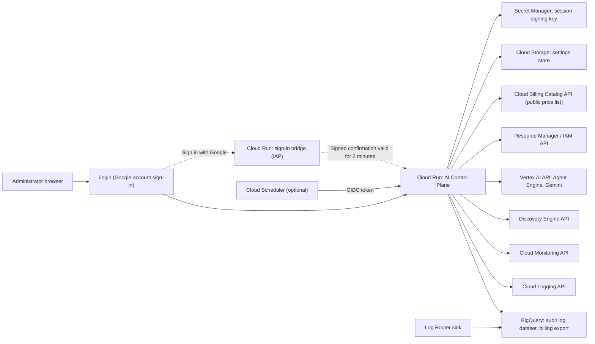
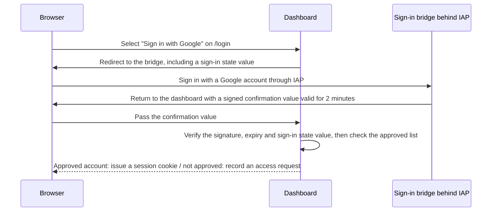
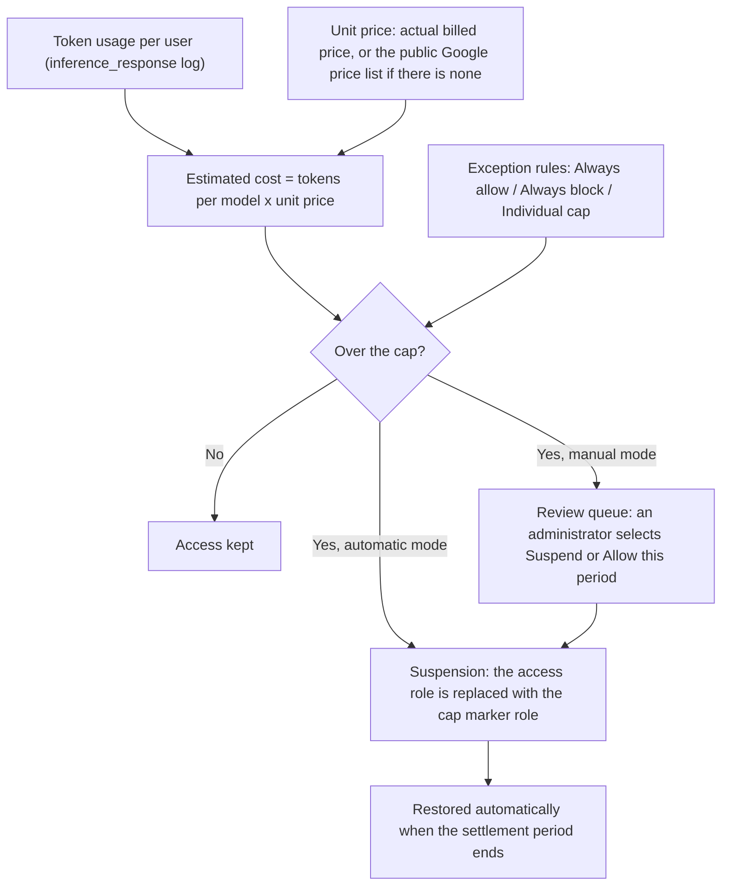

# AI Control Plane

This is an AI governance dashboard for viewing and controlling Gemini Enterprise, Gemini Enterprise Agent Platform (Agent Gateway, Agent Registry, Agent Engine deployments, Model Armor), token usage per model, NotebookLM, Antigravity and cloud costs in **one management console**.

Download this repository, fill in one settings file (`deploy.env`) and run one script (`scripts/deploy.sh`). The dashboard is then deployed directly to your Google Cloud project. You do not need to change any code. The product name, organization name, logo, colors, language, modules to use and models to track can all be changed in settings.

> [!IMPORTANT]
> **There is no sample data, no demo mode and no fake data.** Every number in the UI is a value actually read from the connected Google Cloud project. If a data source is missing or access is denied, the value is not estimated or filled in. It is left empty as `—`, and the notice at the top of the page and the data source health panel show the cause and how to fix it.

> [!NOTE]
> This repository is a management solution built to run in Google Cloud customer environments. It is not an officially supported Google product. Korean: [README.md](README.md)

---

## Table of contents

1. [What you can do](#1-what-you-can-do)
2. [Architecture](#2-architecture)
3. [Quick start: deploy with one command](#3-quick-start-deploy-with-one-command)
4. [All deploy.env settings](#4-all-deployenv-settings)
5. [Sign-in and permissions](#5-sign-in-and-permissions)
6. [Connecting data sources](#6-connecting-data-sources)
7. [Features and calculation methods by page](#7-features-and-calculation-methods-by-page)
8. [Antigravity per-user caps and suspension](#8-antigravity-per-user-caps-and-suspension)
9. [Configuration structure (config.yaml, environment variables, UI settings)](#9-configuration-structure-configyaml-environment-variables-ui-settings)
10. [Deploying with Terraform (optional)](#10-deploying-with-terraform-optional)
11. [Running locally](#11-running-locally)
12. [Security model](#12-security-model)
13. [Costs](#13-costs)
14. [Operations and troubleshooting](#14-operations-and-troubleshooting)
15. [Removal](#15-removal)
16. [Developer guide](#16-developer-guide)
17. [License](#17-license)

---

## 1. What you can do

### 1.1 Design principles

| Principle | Meaning |
|---|---|
| Measured data only | No estimates, example values or demo data are added. Values that cannot be read are shown as `—` with the cause. |
| No hardcoding | Model lists and versions are not kept in code. Models are discovered automatically from billing SKUs, Cloud Monitoring and Antigravity logs, so new models are tracked without a new deployment. |
| Schema-adaptive | BigQuery tables and columns are checked with `INFORMATION_SCHEMA`, and only the ones that exist are queried. Both date-sharded tables and partitioned tables are supported. |
| Everything can be turned on or off | Modules, models and connectors are turned on or off individually. Disabled modules do not query their data sources. |
| Safety first for controls | IAM changes go through dry runs, safety gates, a change budget, atomic etag-based updates and audit logs. |
| Least privilege | Read features use only read roles. IAM write roles are granted only when control features are turned on. Service account keys are not used. |

### 1.2 Modules

| Menu | Module ID | Features | Data sources |
|---|---|---|---|
| Overview | `overview` | Overall KPIs with change vs the previous period, spend trend, tokens by model, security posture, agent lifecycle, recent governance actions | Each module |
| Gemini Enterprise | `gemini_enterprise` | Active users, prompts, calls per agent, license seat assignment and idle seats, uploaded files | BigQuery (Gemini Enterprise logs), Discovery Engine API |
| NotebookLM | `notebooklm` | Active notebooks, users, prompts | BigQuery `cloudaudit_googleapis_com_data_access` |
| Agent Gateway | `agent_gateway` | Principals calling AI services, services and methods, success/denied/throttled/error, failure history, model invocations | BigQuery audit logs, Cloud Monitoring |
| Agent Registry | `agent_registry` | Unified catalog of Agent Engine and Gemini Enterprise agents, idle agents and deprecation candidates, creation history | Vertex AI API, Discovery Engine API, audit logs |
| Deployments | `agent_deployments` | Agent Engine runtimes, runtime identities (service accounts), invocation volume, model usage by identity, runtime cost | Vertex AI API, audit logs, billing export |
| Model Armor | `model_armor` | Verdicts over time, matched filters, blocks by application and user, event details | BigQuery `modelarmor_googleapis_com_sanitize_operations` |
| Models & Tokens | `model_usage` | Automatic model discovery, input/output/cached tokens per model, invocations, error rate, cost, catalog management | Cloud Monitoring, billing export, Antigravity logs |
| Cost & FinOps | `finops` | Gross cost, credits, net cost, cost by service and SKU, spike detection and AI root-cause analysis | Billing export |
| Users & Access | `users` | 360-degree user view (usage across all services), Antigravity IAM state, individual allow and disallow | All sources, Resource Manager IAM |
| Antigravity Controls | `antigravity` | Per-user cost/token/request caps, automatic or manual suspension, exception rules, settlement periods, safety gates, Agent activity in your cloud, audit log | Cloud Logging or BigQuery, IAM, billing export, Cloud Billing Catalog API |
| Telemetry Extensions | `telemetry` | Automatic discovery of logs and tables with plain-language descriptions, one-click standard dashboards, BigQuery export commands | BigQuery, Cloud Logging, Cloud Monitoring |
| AI Analyst | `analyst` | Natural language questions, validated read-only SQL, result tables and charts, summaries | BigQuery, Vertex AI Gemini |

Common features: light/dark theme, Korean/English switching, command palette (Ctrl/Cmd+K), date range selection (presets and custom range), table search/sort/CSV export, data source health panel.

Credits are shown only when the billing export contains actual credit rows. Gemini Code Assist and Duet AI SKUs are excluded from all totals.

---

## 2. Architecture

### 2.1 Components



- **Single container**: A Python standard library HTTP server serves both the static SPA (`src/web`) and the REST API (`/api/v1`). There is no web framework and no frontend build step, so the code is easy to audit and change. There are 6 runtime dependencies (`requirements.txt`).
- **Frontend**: A dependency-free ES module SPA. It does not use `innerHTML` and renders only with text nodes.
- **Data access**: BigQuery is used only with parameterized queries, and every query has a cost cap set with `maximum_bytes_billed`. REST APIs are called with Application Default Credentials (the runtime service account) and a quota project header.
- **Settings store**: Settings changed in the UI, exception rules and suspension records are saved to a Cloud Storage bucket. Only the changes are saved. Multiple instances re-read them every 30 seconds to stay consistent. Personal widget layouts are saved in the same bucket under `users/`, one document per person, named by a hash rather than the email address.
- **Cache**: A TTL cache per endpoint and query parameters is used (120 seconds by default). It is invalidated immediately when settings change.

### 2.2 Repository structure

```text
.
|-- deploy.env.example          # deployment settings template (copy to deploy.env, excluded from Git)
|-- config.yaml                 # default settings (placeholders only)
|-- config.local.yaml.example   # local development settings template (copy to config.local.yaml, excluded from Git)
|-- requirements.txt            # pinned dependencies
|-- Dockerfile                  # container image that runs as a non-root user
|-- .dockerignore, .gcloudignore
|-- scripts/
|   |-- deploy.sh               # one-command deployment (safe to re-run)
|   |-- teardown.sh             # deletes the deployed resources
|   |-- prepublish_scan.py      # release gate: secrets and deployment identifiers (also runs in CI)
|   `-- git-hooks/pre-push      # opt-in hook that runs the scan before every push
|-- terraform/                  # Terraform deployment (IAP mode, optional)
|-- src/
|   |-- backend_server.py       # entry point
|   |-- controlplane/           # backend
|   |   |-- app.py              # route registration and server startup
|   |   |-- config.py           # defaults, layered loading, settings validation
|   |   |-- auth.py             # Google sign-in, sign-in bridge, sessions
|   |   |-- security.py         # auth modes, IAP/OIDC verification, permissions, rate limiting, PII masking
|   |   |-- httpkit.py          # response envelope, security headers, CSRF, static files
|   |   |-- schema.py           # schema-adaptive BigQuery access
|   |   |-- settings_store.py   # settings store (gcs, file, memory)
|   |   |-- gcp.py, ai.py, cache.py, timeutil.py
|   |   `-- services/           # per-module services (governance, pricing, gemini_enterprise, ...)
|   `-- web/                    # frontend SPA (index.html, login.html, assets/)
|-- eval/analyst/               # AI Analyst golden dataset and evaluation harness (16.1)
|-- tests/unit/                 # unit tests (269)
`-- .github/workflows/tests.yml # unit tests, prepublish scan and dataset validation on every push
```

---

## 3. Quick start: deploy with one command

### 3.1 Prerequisites

| Item | Details |
|---|---|
| Google Cloud project | The project to monitor. Billing must be linked to it. |
| Permissions | Project `Owner` on the deploying account (or admin permissions for enabling services, IAM, Cloud Run, Cloud Build, Artifact Registry, Storage, Secret Manager, Logging and BigQuery) |
| Tools | The latest [Google Cloud SDK](https://cloud.google.com/sdk/docs/install) (including `gcloud` and `bq`), `python3`, `bash` |
| Sign-in | `gcloud auth login`, then `gcloud config set project PROJECT_ID` |

It runs as is on macOS, Linux and Cloud Shell. Cloud Shell already has all the required tools.

### 3.2 Deploy

```bash
git clone https://github.com/ldu1225/ai-control-plane.git
cd ai-control-plane

cp deploy.env.example deploy.env
# change at least 3 values in deploy.env: PROJECT_ID, REGION, ADMIN_EMAILS

scripts/deploy.sh --dry-run    # preview the commands that would run (changes nothing)
scripts/deploy.sh              # real deployment (usually 3-8 minutes)
```

What the script does:

| Step | Details |
|---|---|
| 1. Enable APIs | Cloud Run, Cloud Build, Artifact Registry, BigQuery, Logging, Monitoring, Discovery Engine, Vertex AI, Resource Manager, IAM, Storage, Secret Manager, Cloud Billing (price list), Service Usage, and IAP and Cloud Scheduler when needed |
| 2. Container image | Creates an Artifact Registry repository (`ai-control-plane`) and builds the image with Cloud Build. If `IMAGE` is set, the build is skipped. |
| 3. Runtime service account | Creates a dedicated service account and grants it read roles plus the audit log writer. If `ENABLE_GOVERNANCE_ACTIONS=true`, IAM write roles are added ([6.6](#66-runtime-service-account-permissions)). In `google` mode, the sign-in bridge gets its own service account that can read only the session signing key. |
| 4. Settings bucket | Creates a private (public access prevention), versioned Cloud Storage bucket. It stores settings changed in the UI, exception rules, suspension records and personal widget layouts. |
| 5. Session signing key | Creates a random key in Secret Manager and gives the service account read access to it. |
| 6. Audit log routing | Creates a BigQuery dataset and a Log Router sink (`CREATE_LOG_SINK=true`). Optionally, also turns on Data Access audit logs. |
| 7. Cloud Run deployment | Deploys the dashboard and configures the sign-in method (`ACCESS_MODE`). |
| 8. Automatic enforcement schedule | If `ENFORCEMENT_SCHEDULE` is set, creates a Cloud Scheduler job. |

- **It is safe to re-run.** It creates what is missing and updates what exists. If you change settings and run it again, the changes are applied.
- `deploy.env` is the source of truth for the service configuration. Each run rewrites the Cloud Run environment variables and secrets from `deploy.env`.
- When it finishes, it prints the URL. The default URL has the format `https://SERVICE_NAME-PROJECT_NUMBER.REGION.run.app`.

### 3.3 First sign-in

1. Open `/login` at the printed URL and select **Sign in with Google**.
2. Accounts in `ADMIN_EMAILS` sign in as administrators right away.
3. Accounts that are not approved are recorded as access requests. An administrator approves them as viewer or admin in **Settings > Access control**.

### 3.4 Post-deployment checks

1. Select **Data sources** in the top bar to check the connection status. Red items show the cause (permissions, missing table and so on).
2. In **Settings > Workspace and data sources**, check or change the billing export, the audit log dataset and the Gemini Enterprise locations.
3. If you created a new audit log sink, each table is created when its log is first written. Some metrics can be empty for the first few minutes to a few hours.
4. To use Antigravity per-user caps, follow [Section 8](#8-antigravity-per-user-caps-and-suspension).

---

## 4. All deploy.env settings

`deploy.env` uses the `KEY="value"` format that bash reads. Put values that contain spaces in quotes. This file is listed in `.gitignore`, so it is not committed to Git.

### 4.1 Required

| Variable | Example | Description |
|---|---|---|
| `PROJECT_ID` | `my-project` | Project to monitor and deploy to |
| `REGION` | `asia-northeast3` | Region for Cloud Run, Artifact Registry, the settings bucket and Scheduler |
| `ADMIN_EMAILS` | `admin@example.com,*@security.example.com` | Administrators. Separate entries with commas. You can use the `*@domain` format. |

### 4.2 Service and display

| Variable | Default | Description |
|---|---|---|
| `SERVICE_NAME` | `ai-control-plane` | Cloud Run service name. Also used in the names of the service account, bucket, secrets, sink and scheduler job. |
| `ORGANIZATION_NAME` | `Your Organization` | Organization name shown in the header and on the sign-in page |
| `DEFAULT_LOCALE` | `en` (`ko` in the template) | Default language, `ko` or `en`. Users can change it in the UI. |
| `WORKSPACE_TIMEZONE` | `UTC` (`Asia/Seoul` in the template) | Time zone for date display, daily totals and the scheduler |
| `PRODUCT_NAME` | Empty | Changes the product name (white label). If empty, `AI Control Plane` |

### 4.3 Sign-in method

| Variable | Default | Description |
|---|---|---|
| `ACCESS_MODE` | `google` | One of `google`, `google_oauth` or `iap` ([Section 5](#5-sign-in-and-permissions)) |
| `ALLOWED_USERS` | Empty | Viewers to approve in advance for Google sign-in. Example: `*@example.com,partner@example.org` |
| `IAP_MEMBERS` | Empty | Principals allowed to access the dashboard in `iap` mode. Example: `group:ai-governance@example.com,user:a@example.com` |
| `OAUTH_CLIENT_JSON` | Empty | Path to the OAuth client JSON downloaded for `google_oauth` mode (do not commit it) |
| `BRIDGE_MEMBERS` | `allAuthenticatedUsers` | Principals that can pass the sign-in bridge in `google` mode. If an organization policy blocks this, use `domain:example.com` |
| `PUBLIC_BASE_URL` | Empty | Custom domain. Example: `https://ai-governance.example.com` |

### 4.4 Data sources

| Variable | Default | Description |
|---|---|---|
| `AUDIT_DATASET` | `ge_analytics` | BigQuery dataset that receives the audit logs |
| `CREATE_LOG_SINK` | `true` | Creates the dataset and the Log Router sink. Use `false` if a sink already exists |
| `DATASET_LOCATION` | `US` | Location of the new dataset |
| `ENABLE_DATA_ACCESS_LOGS` | `false` | Turns on Data Access audit logs for Vertex AI, Discovery Engine and Model Armor (more log volume and cost) |
| `BILLING_PROJECT_ID` | Empty | Project that holds the billing export (if empty, `PROJECT_ID`) |
| `BILLING_DATASET` | Empty | Billing export dataset. Example: `billing_detailed_usage` |
| `BILLING_TABLE` | Empty | `gcp_billing_export_resource_v1_XXXXXX_XXXXXX_XXXXXX` |
| `BILLING_ACCOUNT_ID` | Empty | `XXXXXX-XXXXXX-XXXXXX` |
| `DISCOVERY_ENGINE_LOCATIONS` | `global` | Gemini Enterprise locations (comma separated: `global,us,eu`) |
| `AGENT_ENGINE_REGIONS` | `REGION` | Agent Engine regions (comma separated) |

You can also enter the billing values after deployment in **Settings > Workspace and data sources**.

### 4.5 Governance

| Variable | Default | Description |
|---|---|---|
| `ENABLE_GOVERNANCE_ACTIONS` | `false` | Grants IAM write roles. Required to suspend users over their cap, restore them, allow or disallow individual users and create marker roles |
| `ENFORCEMENT_SCHEDULE` | Empty | Automatic enforcement schedule (cron). Example: `*/15 * * * *`. Requires `ENABLE_GOVERNANCE_ACTIONS=true` and the `google` or `google_oauth` mode. Suspended users are restored by enforcement runs, so without a schedule they get access back only when an administrator runs enforcement after the period resets. The script and the Antigravity page warn about this. |

### 4.6 Other

| Variable | Default | Description |
|---|---|---|
| `AI_DEFAULT_MODEL` | Empty | Default model for AI Analyst (if empty, the `config.yaml` value) |
| `IMAGE` | Empty | Prebuilt image. If empty, the image is built with Cloud Build |
| `MEMORY`, `CPU` | `1Gi`, `1` | Cloud Run resources |
| `MIN_INSTANCES`, `MAX_INSTANCES` | `0`, `3` | Number of instances. With 0, there is no cost when there are no requests. |
| `AR_REPOSITORY` | `ai-control-plane` | Artifact Registry repository name |
| `SERVICE_ACCOUNT_ID` | `SERVICE_NAME-sa` | Runtime service account ID |
| `SETTINGS_BUCKET` | `PROJECT_ID-SERVICE_NAME-settings` | Settings bucket name (globally unique, 63 characters or fewer) |
| `SESSION_SECRET_NAME` | `SERVICE_NAME-session-secret` | Name of the secret for the session signing key |
| `OAUTH_SECRET_NAME` | `SERVICE_NAME-oauth-client-secret` | Name of the secret for the OAuth client secret |

---

## 5. Sign-in and permissions

### 5.1 Choosing a sign-in method

| `ACCESS_MODE` | Behavior | When to use it |
|---|---|---|
| `google` (recommended) | Users sign in with a Google account on the dashboard's own sign-in page (`/login`). You do not need to create an OAuth client. A small sign-in bridge service behind IAP verifies the Google account, and the dashboard lets in only approved accounts. | Most cases |
| `google_oauth` | The same sign-in page runs with an OAuth client that you create. | When you do not want a bridge service, or you want to manage the OAuth consent screen yourself |
| `iap` | Identity-Aware Proxy handles sign-in in front of the dashboard. The app verifies the IAP signed header. | Organizations that already use IAP and group-based access management |

Other `security.auth_mode` values (set only in `config.yaml` or the `AUTH_MODE` environment variable, never in the UI):

- `local`: for development on one computer ([11](#11-running-locally)). Only direct requests from this computer (a loopback address) are accepted, as the administrator. Requests from other computers, and requests forwarded by a proxy (`X-Forwarded-For`, `Forwarded`, `X-Real-IP`), are refused. Cloud Run refuses this mode at startup. `auto` falls back to `local` only when the server listens on a loopback address (`127.0.0.1`, `::1`, `localhost`); a server bound to another address stops at startup and asks you to choose `google` or `iap`.

There is no anonymous mode: on every deployment, only approved Google accounts can open the dashboard.



Preparing `google_oauth` mode (one time only):

1. Google Cloud console > Google Auth Platform > Branding: enter the app name and the support email.
2. Audience: `Internal` if you use only organization accounts, `External` if you also use external Google accounts (publish the app or add test users).
3. Clients > Create client > Web application. Add `https://DASHBOARD_HOST/auth/google/callback` to the authorized redirect URIs.
4. Download the JSON right after you create the client, and put its path in `OAUTH_CLIENT_JSON` (the client secret is shown only at this point). The script stores the client secret in Secret Manager and does not print it.

### 5.2 Roles

| Role | What it can do |
|---|---|
| admin | All pages, changing settings, approving users, cap policy, suspend/restore, exception rules, connector management |
| viewer | Views all pages. Emails are masked on the server (`ad***@example.com`), and Model Armor raw text and uploaded file names are not provided. AI Analyst is available only when an administrator allows it (`analyst.allow_viewers`). Settings are read-only, and deployment identifiers (settings bucket, OAuth client ID, IAP audience, billing account ID) are shown as `***`. |

- Administrators = `ADMIN_EMAILS` + `security.admins` in `config.yaml` + administrators added in the UI.
- Viewers = `ALLOWED_USERS` + `security.allowed_users` + users approved in the UI.
- Accounts set in a settings file or environment variable cannot be removed in the UI (they are fixed). Accounts added in the UI can be removed in the UI. Removing an account also ends its existing sessions immediately.
- Sessions are valid for 12 hours by default (`SESSION_HOURS`, 1-168).

---

## 6. Connecting data sources

The more data sources you connect, the more pages you can use. Metrics from sources that are not connected are shown as `—`, with an explanation of the cause.

### 6.1 Audit log sink (BigQuery)

`scripts/deploy.sh` creates it automatically when `CREATE_LOG_SINK=true`. To create it yourself, use the commands below.

```bash
bq --location=US mk --dataset PROJECT_ID:ge_analytics

gcloud logging sinks create ai-control-plane-ai-logs \
  bigquery.googleapis.com/projects/PROJECT_ID/datasets/ge_analytics \
  --use-partitioned-tables --project=PROJECT_ID \
  --log-filter='
(
  logName="projects/PROJECT_ID/logs/cloudaudit.googleapis.com%2Fdata_access" OR
  logName="projects/PROJECT_ID/logs/cloudaudit.googleapis.com%2Factivity"
) AND protoPayload.serviceName=(
  "aiplatform.googleapis.com" OR "discoveryengine.googleapis.com" OR
  "modelarmor.googleapis.com" OR "businessaicode.googleapis.com" OR
  "notebooklm.googleapis.com" OR "geminidataanalytics.googleapis.com" OR
  "generativelanguage.googleapis.com"
)
OR logName="projects/PROJECT_ID/logs/discoveryengine.googleapis.com%2Fgemini_enterprise_user_activity"
OR logName="projects/PROJECT_ID/logs/discoveryengine.googleapis.com%2Fgen_ai_user_message"
OR logName="projects/PROJECT_ID/logs/modelarmor.googleapis.com%2Fsanitize_operations"
OR logName="projects/PROJECT_ID/logs/businessaicode.googleapis.com%2Finference_response"'

gcloud logging sinks describe ai-control-plane-ai-logs --project=PROJECT_ID --format='value(writerIdentity)'
```

Grant the printed writer identity (usually the project's shared Logging service agent `service-PROJECT_NUMBER@gcp-sa-logging.iam.gserviceaccount.com`) the BigQuery Data Editor role **on this dataset only**. Grant it in the BigQuery console > dataset > Share > Permissions > Add principal. `scripts/deploy.sh` does this automatically at the dataset level and does not change project-level permissions.

Tables created by the sink and the pages that use them:

| Table | Used by |
|---|---|
| `cloudaudit_googleapis_com_activity` | Agent Registry (creation history), Agent Gateway, Agent activity in your cloud (changes) |
| `cloudaudit_googleapis_com_data_access` | Agent Gateway, NotebookLM, Deployments, Users, Agent activity in your cloud (reads) |
| `discoveryengine_googleapis_com_gen_ai_user_message` | Gemini Enterprise (prompts, uploaded file names) |
| `discoveryengine_googleapis_com_gemini_enterprise_user_activity` | Gemini Enterprise (prompts, agent calls, uploads), Model Armor user matching |
| `modelarmor_googleapis_com_sanitize_operations` | Model Armor |
| `businessaicode_googleapis_com_inference_response` | Antigravity (if it is missing, the data is read directly through the Cloud Logging API) |

Each table is created when its log is first written. If a table is missing, only its metrics are empty and a warning is shown.

### 6.2 Data Access audit logs

Agent Gateway, NotebookLM, Deployments and model usage by identity use Data Access audit logs. Redeploy with `ENABLE_DATA_ACCESS_LOGS=true`, or turn on `Data Read` and `Data Write` for the services below in **IAM & Admin > Audit Logs** in the console.

- Vertex AI API (`aiplatform.googleapis.com`)
- Discovery Engine API (`discoveryengine.googleapis.com`)
- Model Armor API (`modelarmor.googleapis.com`)

Data Access logs can be large and add Cloud Logging ingestion costs. The script updates the IAM policy with its etag, so if another change happens at the same time, the update fails instead of overwriting that change.

### 6.3 Gemini Enterprise logs

In the Gemini Enterprise admin console, turn on **User activity logging** and **Message (prompt) logging**. With only the activity log, you can see prompt counts, agent calls and upload counts, but not uploaded file names (the activity log does not record file names). License seats are read through the Discovery Engine API, so put the actual locations (`global`, `us`, `eu`) in `DISCOVERY_ENGINE_LOCATIONS`.

Counting rules (verified against real logs):

- Duplicate delivered rows with the same `insertId` and timestamp count as one.
- **Prompts**: If the message log exists, the message log is counted. Otherwise, assistant calls in the activity log (`StreamAssist` and others) that contain user input are counted. Session summaries that the product runs automatically (`session_to_summarize`), context injection and scheduled runs are not prompts.
- **Agent calls**: Assistant calls addressed to a specific agent (`agentsSpec`), including scheduled runs. Viewing or editing an agent page is not a call. Agent names are looked up from the name in the log first, then from the Discovery Engine agent list.
- **Uploads**: The activity log records one upload as two lines, a request and a response, so only responses with a file ID are counted.

### 6.4 Billing export

In **Billing > Billing export**, turn on the **Detailed usage cost** export to BigQuery. Put the name of the `gcp_billing_export_resource_v1_...` table it creates and the billing account ID in `deploy.env` (or the UI settings). The export collects data from the time you turn it on, and the first data can take a few hours to arrive.

Features that use the billing export: Cost & FinOps, cost per model, agent runtime cost (requires the resource-level export), and the actual unit prices for Antigravity per-person cost caps.

### 6.5 Antigravity inference logs

Antigravity token usage per user is read from the `businessaicode.googleapis.com/inference_response` log that Antigravity for organizations writes to the project. If a BigQuery sink table exists, BigQuery is used. Otherwise, the Cloud Logging API is used (`usage_source: auto`). Coding agents used from a personal setup (for example, Jetski) do not write this log. Google Cloud API calls that such agents make with user credentials are shown under **Agent activity in your cloud** on the Antigravity Controls page, based on audit logs.

### 6.6 Runtime service account permissions

`scripts/deploy.sh` and Terraform grant these roles automatically. Follow the same rules when you configure them yourself.

**Read (always required)**

| Role | Purpose |
|---|---|
| `roles/bigquery.jobUser` | Run parameterized queries |
| `roles/bigquery.dataViewer` | Read audit logs and the billing export. If the billing dataset is in a different project, read access is granted on that dataset only. |
| `roles/logging.viewer` | Antigravity inference logs, governance audit log, log source discovery |
| `roles/monitoring.viewer` | Token and invocation metrics per model, log activity in Telemetry Extensions |
| `roles/discoveryengine.viewer` | Licenses, engines, assistants, agents |
| `roles/aiplatform.user` | Read Agent Engine, call AI Analyst (Gemini) |
| `roles/iam.securityReviewer` | Read the project IAM policy (Antigravity state classification) |
| `roles/serviceusage.serviceUsageConsumer` | Use the quota project header on all calls |
| `roles/logging.logWriter` | Write the governance audit log (enforcement runs, dry runs, review decisions, exception changes), with or without the control features |
| `roles/storage.objectAdmin` (settings bucket only) | Store UI settings, exception rules, suspension records and personal widget layouts |
| `roles/secretmanager.secretAccessor` (secrets only) | Session signing key, OAuth client secret |

**Control features (only when `ENABLE_GOVERNANCE_ACTIONS=true`)**

| Role | Purpose |
|---|---|
| `roles/resourcemanager.projectIamAdmin` | Suspending and restoring users over their cap, allowing and disallowing individual users (etag-based `setIamPolicy`) |
| `roles/iam.roleAdmin` | Create marker roles (once, the first time) |

**Sign-in bridge (`google` mode)**: The bridge runs as its own service account (`SERVICE_NAME-signin`, at most 23 characters of the service name). It has no project roles and can read only the session signing key.

**Inherited binding check (optional)**: If you grant `roles/iam.securityReviewer` at the organization level, Antigravity access inherited from folders and the organization is also detected (Terraform `organization_id`). Without it, the users concerned are classified as `UNKNOWN / ANCESTOR_UNCHECKED` and are excluded from changes.

---

## 7. Features and calculation methods by page

### 7.1 Overview

Brings the key KPIs of each module together on one page and shows the change compared with the previous period of the same length. KPIs of disabled modules are shown as "Module disabled".

**My widgets**: pin dashboards created in Telemetry Extensions to the Overview and arrange them your way.

- Select **Add widget** and choose the dashboard, what it shows (summary, events per day, breakdown, status breakdown or latest entries) and its size (small, medium, wide). The **Add to Overview** button on a dashboard page pins it too.
- Drag a widget by its handle to change the order. With the keyboard, press the arrow keys on the handle, or use Move earlier / Move later in the widget menu.
- Other pages (Gemini Enterprise, Users & Access and so on) can hold widgets too, with **Add a widget to this page** at the bottom.
- Layouts are saved per person (`GET/POST /api/v1/layouts`) in `users/<user hash>.json` in the settings bucket; file names never contain email addresses. Every signed-in person saves only their own layout.
- Widget data uses the same API as the Telemetry Extensions dashboards, so the selected period, caching and viewer masking apply in the same way.

### 7.2 Gemini Enterprise

Shows active users, prompts, calls per agent, uploaded files and license seats (assigned, used and idle seats). Counting follows the rules in [6.3](#63-gemini-enterprise-logs).

### 7.3 NotebookLM

Counts active notebooks, users and prompts from NotebookLM Data Access audit logs.

### 7.4 Agent Gateway

Shows the calling principals, services and methods, outcomes (success, denied, throttled, error), failure history and model invocations for the AI services registered in `gateway.services`, based on audit logs and Cloud Monitoring.

### 7.5 Agent Registry and Deployments

- **Agent Registry**: Combines Agent Engine (Vertex AI) and Gemini Enterprise agents into one catalog. An agent is classified as idle when `agent_lifecycle.idle_days` (default 14 days) have passed since its last call, and as a deprecation candidate when `deprecation_days` (default 50 days) have passed.
- **Deployments**: Shows, for each Agent Engine runtime, the runtime identities (service accounts), invocation volume, model usage by identity and runtime cost (resource-level billing export).

### 7.6 Model Armor

Shows verdicts over time, matched filters (prompt injection, sensitive data and others), blocks by application and user, and event details. Viewers do not get the raw text.

### 7.7 Models & Tokens

- Models are discovered automatically from billing SKUs, Cloud Monitoring `model_user_id` and Antigravity `model_id`. The SKU description is searched for a model family word (Gemini, Claude, Llama and others), and qualifiers such as region, modality, input/output and context tier are removed to group the SKUs under one key (for example, `gemini-3.8-flash`). The Vertex AI format (`Gemini 3.8 Flash Global Text Input`), the Gemini API format and the Monitoring model ID are merged into the same model.
- Tokens per model are based on Cloud Monitoring `publisher/online_serving/token_count` (Vertex AI), plus billed Gemini API tokens that Monitoring does not capture. For models without Monitoring metrics, token usage from billing SKUs is used. Invocations and error rate are calculated from `model_invocation_count`.
- When a product re-bills model usage under its own SKUs, that usage is shown separately in the "Usage by product" card. The same tokens are also billed to the underlying model, so they are not added to the model token total.
- When a new model is discovered for the first time, a "new models detected" notice appears. With `auto_enable_new_models: true`, the model is tracked immediately. With `false`, it is left out of totals until an administrator turns it on.
- You can turn off tracking for individual models in Manage catalog (or Settings > Model catalog).

### 7.8 Cost & FinOps

Calculates gross cost, credits, net cost, cost by service and SKU, and the AI share of spend from the billing export. A day is marked as a spike when cost rose by at least `finops.spike_threshold_pct` (default 50%) and by at least `spike_min_delta` compared with the previous day. When you select Explain with AI, Gemini summarizes the cause based on the SKU changes.

### 7.9 Users & Access

Brings each user's usage of all services, such as Gemini Enterprise, NotebookLM, Agent Gateway and Antigravity, into one row. Select a user to open the details view, which shows usage by service, Antigravity IAM state, cap usage, suspension information and individual allow/disallow buttons.

### 7.10 Telemetry Extensions

Pick logs and tables that the project already collects but the built-in pages do not show, and get a ready-made dashboard with one click. Nothing needs to be typed.

1. **Found automatically**: Lists the Cloud Logging logs of the project and the BigQuery tables of the audit log dataset (and `workspace.telemetry_datasets`). The entries written per log over the last 7 days come from the Cloud Monitoring metric `logging.googleapis.com/log_entry_count` (one API call regardless of the number of logs).
2. **Plain-language cards**: Each source says what it is, what its dashboard shows (for example counts by service, by HTTP status, top users), its recent volume and its full technical name (never truncated). Cards are grouped into AI and agents, Security and audit, and Operations, sorted by recent volume; sources without data in the last 7 days are folded away. The text comes from the catalog in [`telemetry_catalog.py`](src/controlplane/services/telemetry_catalog.py); logs that are not in the catalog get an honest generic description based on the product name.
3. **Add to dashboard**: One button creates the connector. The catalog decides which fields to chart, and for tables exported to BigQuery the paths are resolved against the real schema (`protoPayload` -> `protopayload_auditlog`, typed `jsonpayload_*` columns, case). A log routed to BigQuery is shown once, as its table (complete history, no read cap). Sources that contain prompt or response text ask for confirmation first.
4. **Standard dashboard**: Events per day, the main breakdown (named by the catalog), a status breakdown, top users and models (when mapped) and the latest 20 entries with a message column. Raw entries and messages are hidden from viewers (`security.mask_pii_for_viewers`).
5. **Already shown on the built-in pages**: Sources used by the built-in pages, such as the audit logs, Gemini Enterprise activity and Model Armor, are listed separately with links to the pages that show them.

Dashboards that read Cloud Logging directly cover its retention period (30 days by default) and count at most 5,000 entries per view. Busy logs show a note on their card, and **Export logs to BigQuery** builds the `gcloud logging sinks create` command. To chart only part of a log or change the mapping, use **Custom setup** (the manual connector form).

### 7.11 AI Analyst

Converts natural language questions into BigQuery SQL, runs it, and shows tables, charts and a summary. The generated SQL is validated before it runs. After comments and strings are removed, the validator checks that it is a single `SELECT`/`WITH` statement, rejects DML/DDL, and checks that the referenced tables belong to allowed datasets (audit logs, billing, registered connectors). Execution is limited by `analyst.max_bytes_billed` and `analyst.max_rows`. The summary is based only on the result rows and does not follow instructions found inside the result data.

Query results can contain raw text columns such as prompts. Therefore, when viewer masking (`security.mask_pii_for_viewers`) is on, only administrators can use AI Analyst by default. To allow viewers, turn on **Allow viewers to use AI Analyst** in **Settings > Governance policy > AI Analyst limits** (`analyst.allow_viewers`). Viewer results mask only email addresses, so first check whether the datasets contain tables with raw text.

---

## 8. Antigravity per-user caps and suspension

Set a per-person cap on cost (for example, KRW 1,000,000 per person), tokens or number of requests. Users who go over it lose Antigravity access until the settlement period ends. Administrators **only need to set the amount.** The system finds the token prices and exchange rates.

### 8.1 How it works



### 8.2 Getting started

1. Deploy with `ENABLE_GOVERNANCE_ACTIONS="true"`. To use automatic suspension and automatic restores at the end of each period, also set `ENFORCEMENT_SCHEDULE="*/15 * * * *"`.
2. In **Antigravity Controls > Enforcement prerequisites**, check the marker roles and permissions. If the marker roles are missing, select **Create marker roles**.
3. Set the following in **Cap policy > Edit policy**.
   - Cost cap per person: the `₩1M`, `₩2M` or `₩3M` preset (shown as `₩100만`, `₩200만`, `₩300만` in Korean), or a custom amount
   - Currency: the billing account currency by default. If you choose `KRW`, amounts are shown and compared in Korean won.
   - Settlement period: Daily, Weekly, Monthly, Last 90 days / Window: Calendar (fixed reset) or Rolling / Reset time zone (for example, the 1st of every month at 00:00 Asia/Seoul)
   - Token cap, Request cap (0 disables it)
4. To give a person a different amount, select the pencil button in the **Cost cap** column of the **Usage against cap** table (`Use default`, `No cost cap`, presets, custom amount).
5. In the **Enforcement** card at the top, choose **Automatic suspension** or **Manual review**. The default is manual review.
6. Use **Dry run** to preview the result without changing IAM, then select **Run enforcement now**.

### 8.3 Estimated cost and unit prices

- Cost per user = for each model, input (prompt) tokens x input price + remaining tokens (response, thinking) x output price.
- Unit prices are looked up per model and per direction (input/output) in the following order.
  1. **Actual billed price**: `SUM(cost) / SUM(usage.amount)` for the model's standard text token SKUs in the billing export over the last 30 days. Negotiated prices are reflected, and credits are not subtracted. Variant SKUs such as batch, flex, priority, cache, long context, tuning and audio/image/video are excluded.
  2. **Public Google price list**: Models without billing records use the public prices from the Cloud Billing Catalog API (Vertex AI, Gemini API).
- If the currency is different, amounts are converted with the exchange rate that Google publishes in its price list. The UI shows the basis, for example `1 USD = ₩1,359 (Google rate, date)`.
- Unit prices are cached for 6 hours. The **Prices of models used in this period** table in the Cap policy card shows the price of each model and its source (Billed price, Google price list, No price).
- Models with no price from either source are shown as "No price", and their tokens are not included in the cost. When only the cost cap is on, users whose cost cannot be calculated show `—` for cap usage instead of 0%, and they are not suspended.
- The billing export has no user information, so per-person cost is a token-based estimate, not the actual billed amount. The UI also labels it as estimated cost.
- Organizations that want to enter their contract prices can change Token prices to `Enter prices` in Settings > Governance policy, or use `model_prices` in `config.yaml` (optional).

### 8.4 Enforcement modes

| Mode | When a user goes over the cap | Restore |
|---|---|---|
| Manual review (default) | The user is added to the review queue. An administrator selects **Suspend** or **Allow this period** for each user (or in bulk). A webhook notification is sent when new users are waiting. | Automatic when the settlement period ends |
| Automatic suspension | The user is suspended by each enforcement run. | Automatic when the settlement period ends |

- An **enforcement run** is started by the **Run enforcement now** button or by the Cloud Scheduler job (`ENFORCEMENT_SCHEDULE`). The scheduler job calls `POST /api/v1/governance/antigravity/enforce` with a Google OIDC token from a dedicated service account that has no permissions. The app checks the issuer, the audience (`PUBLIC_BASE_URL` + path), email verification and the allowlist (`SCHEDULER_INVOKERS`). Calls without authentication and calls with other tokens get 401.
- Suspension = one etag-based `setIamPolicy` call that replaces the access role (`roles/discoveryengine.agentspaceUser`) with the cap marker role (`CustomAntigravityCapBlocked`). A suspension record (start, scheduled end, reason, actor) is kept in the settings bucket, and the first enforcement run after the period ends restores the user, even without telemetry. With `ENFORCEMENT_SCHEDULE` this happens within one interval; without it, run enforcement after each reset. However, the suspension stays if the user's usage in the new period is already over the cap.

### 8.5 Exception rules

| Rule | Effect | Duration |
|---|---|---|
| Always allow | The user is not suspended, even above the cap. A suspended user is restored immediately. | This settlement period only / No expiry |
| Individual cap | Applies different cost/token/request caps to this user only. Fields left empty keep the default cap. | This settlement period only / No expiry |
| Always block | Blocks the user immediately with the administrative block marker role (`CustomAntigravityAdminBlocked`) and keeps the block until the rule is deleted. | No expiry |

Rules apply in both enforcement modes. Every addition, change and deletion is recorded in the audit log.

### 8.6 IAM states and safety gates

| State | Meaning | Automatic suspension | Automatic restore |
|---|---|:---:|:---:|
| `ENFORCEABLE_ALLOWED` | Has access only through direct `user:` bindings | Yes | - |
| `CAPPED_BY_TOOL` | Suspended for exceeding the cap | - | Yes |
| `BLOCKED_BY_ADMIN` | Blocked by an administrator | - | No |
| `NOT_ENFORCEABLE` | Has access through a group, domain, inherited binding, privileged role or similar, so it cannot be controlled per user | No | No |
| `NO_ACCESS` | No access path | No | No |
| `UNKNOWN` | Cannot be determined because the policy could not be read | No | No |

`NOT_ENFORCEABLE` and `UNKNOWN` users are never changed. They are shown in the "Manual action required" list with remediation steps for each reason.

| Gate | Condition | Action |
|---|---|---|
| `G1_POLICY_READABLE` | The project IAM policy cannot be read | Abort the run |
| `G2_ANY_DETERMINATE` | No user can be classified | Abort the run |
| `G3_TELEMETRY_HEALTHY` | The usage query fails, returns 0 records, or the Cloud Logging read was truncated at `max_log_entries` (default 20,000) | Apply suspensions only and withhold usage-based restores (restores at the end of the period still proceed). Truncated counts are lower bounds, so over-cap results stay valid. Export the inference log to BigQuery when there are many users. |
| `G4_CHANGE_BUDGET` | Planned changes exceed `max(change_budget_min, ceil(change_budget_ratio x users in scope))` | Abort the run |
| `G5_NON_USER_GRANT_ABSENT` | The access role has a group or domain binding | Warning |

If the etag conflicts because of a concurrent change, the plan is recalculated and retried once.

### 8.7 Audit, notifications and persistence

- Every enforcement run, review decision, exception rule and allow/disallow action is written to the Cloud Logging audit log (`projects/PROJECT_ID/logs/agy-admin%2Fadmin_actions`) and shown in the **Administrative audit log** card. The service account always has `roles/logging.logWriter` for this. If a write still fails, the change is kept and the API response reports `auditLogged: false`. It uses the same marker roles and audit log as [agy-admin-cli](https://github.com/terrychahn/agy-admin-cli), so you can run both together. When you do, make sure the run times of the two tools do not overlap.
- If you set `governance.antigravity.webhook_url` (Slack `hooks.slack.com` or Google Chat `chat.googleapis.com`, HTTPS only), new users awaiting review and enforcement results are sent to it.
- Exception rules and suspension records are stored in the settings bucket and are kept after a restart. If you run on Cloud Run without a settings bucket, they are kept only in memory and the UI shows a warning.

---

## 9. Configuration structure (config.yaml, environment variables, UI settings)

### 9.1 Load order

Later values override earlier values.

1. Built-in defaults
2. `config.yaml` (the path can be set with `CONFIG_PATH`)
3. `config.local.yaml` (same directory, optional, excluded from Git)
4. Environment variables (set by `scripts/deploy.sh` from `deploy.env`)
5. Settings saved in the UI (settings bucket)

Items changed in the UI are marked "Customized", and you can use **Reset to defaults** for each section. Some security items (for example, the scheduler allowlist) cannot be changed in the UI. They can be changed only in a settings file or environment variable.

### 9.2 Main settings

| Section | Keys | Description |
|---|---|---|
| `product` | `name`, `tagline` | Product name and tagline (white label) |
| `branding` | `organization_name`, `logo_url`, `accent_color`, `default_locale`, `default_theme` | Organization identity. The logo is an HTTPS URL or an `/assets/` path |
| `workspace` | `project_id`, `quota_project_id`, `timezone`, `default_range_days`, `audit_dataset` | Monitored project and default query settings |
| `workspace.billing` | `project_id`, `dataset`, `table`, `account_id` | Billing export location |
| `workspace` | `discovery_engine_locations`, `agent_engine_regions`, `telemetry_datasets` | API locations and additional telemetry datasets |
| `security` | `auth_mode`, `admins`, `allowed_users`, `google_client_id`, `public_base_url`, `session_hours`, `sign_in_bridge_url`, `iap_audience`, `mask_pii_for_viewers` | Authentication and permissions |
| `storage` | `backend`, `gcs_bucket`, `gcs_object`, `file_path` | Settings store |
| `bigquery` | `max_bytes_billed` | Cost cap per query (default 20 GB) |
| `ai_engine` | `default_model`, `models`, `discover_models`, `restrict_to_allowed`, `location` | Models for AI Analyst and spike analysis |
| `modules` | `true`/`false` per module ID | Turn modules on or off |
| `model_catalog` | `auto_enable_new_models`, `disabled_models`, `excluded_sku_patterns` | Model tracking policy |
| `gateway` | `services` | Services to monitor in Agent Gateway |
| `agent_lifecycle` | `idle_days`, `deprecation_days` | Thresholds for idle agents and deprecation candidates |
| `finops` | `spike_threshold_pct`, `spike_min_delta` | Cost spike thresholds |
| `governance.antigravity` | `cost_cap`, `currency`, `pricing_source`, `token_cap`, `request_cap`, `period`, `window`, `reset_timezone`, `enforcement_mode`, marker roles, change budget, `webhook_url` | Antigravity cap policy |
| `analyst` | `max_bytes_billed`, `max_rows`, `allow_viewers` | AI Analyst query limits, and whether viewers may use it (default `false`) |

### 9.3 Environment variables

| Variable | Maps to |
|---|---|
| `PROJECT_ID`, `QUOTA_PROJECT_ID` | `workspace.project_id`, `workspace.quota_project_id` |
| `AUDIT_DATASET_ID` | `workspace.audit_dataset` |
| `BILLING_PROJECT_ID`, `BILLING_DATASET_ID`, `BILLING_TABLE_ID`, `BILLING_ACCOUNT_ID` | `workspace.billing.*` |
| `WORKSPACE_TIMEZONE` | `workspace.timezone` |
| `DISCOVERY_ENGINE_LOCATIONS`, `AGENT_ENGINE_REGIONS` | Comma-separated lists |
| `ORGANIZATION_NAME`, `PRODUCT_NAME`, `DEFAULT_LOCALE` | `branding.organization_name`, `product.name`, `branding.default_locale` |
| `AUTH_MODE`, `ADMIN_EMAILS`, `ALLOWED_USERS` | `security.auth_mode`, `security.admins`, `security.allowed_users` |
| `GOOGLE_OAUTH_CLIENT_ID`, `GOOGLE_OAUTH_CLIENT_SECRET` | Google sign-in (OAuth client mode). The client secret is injected from Secret Manager |
| `PUBLIC_BASE_URL`, `SESSION_HOURS`, `SESSION_SECRET` | Public dashboard URL, session length, session signing key (injected from Secret Manager, 32 characters or more) |
| `SIGN_IN_BRIDGE_URL`, `BRIDGE_RETURN_URL` | Sign-in bridge URL (dashboard side), dashboard URL to return to (bridge side) |
| `IAP_AUDIENCE` | Audience of the IAP signed header |
| `SETTINGS_BUCKET` | `storage.gcs_bucket` |
| `SCHEDULER_INVOKERS` | Service accounts that can call the enforcement endpoint (comma separated) |
| `AI_DEFAULT_MODEL`, `AI_LOCATION` | `ai_engine.default_model`, `ai_engine.location` |
| `HOST`, `PORT` | `server.host`, `server.port` |

If `workspace.project_id` is empty or starts with `your-`, the data APIs return `not_configured` and the UI shows setup guidance.

### 9.4 UI settings

| Tab | Contents |
|---|---|
| General | Product name, organization name, logo, accent color, default language and theme |
| Workspace and data sources | Project, time zone, audit log dataset, billing export, API locations, data source health |
| Modules | Turn modules on or off (applies to every user immediately) |
| Model catalog | Automatic tracking of new models, turning off tracking for individual models |
| AI engine | Default model, allowed models, connection test |
| Governance policy | Antigravity cap policy, marker roles, change budget, webhook, agent lifecycle, cost spike thresholds |
| Access control | Approved accounts, roles, approving and dismissing access requests |
| About | Version, workspace project, Cloud Run service and revision, whether the settings store is durable and its last change, data handling |

---

## 10. Deploying with Terraform (optional)

`terraform/` is provided for organizations that manage infrastructure as code. In IAP mode (`auth_mode = "iap"`), it creates the service account, least-privilege IAM, the required APIs, a private settings bucket, Cloud Run and direct IAP on Cloud Run. It requires Google provider 7.x. For Google sign-in mode and the automatic enforcement scheduler, use `scripts/deploy.sh`.

```bash
# 1. build the image
gcloud artifacts repositories create ai-control-plane --repository-format=docker --location=REGION --project=PROJECT_ID
gcloud builds submit --project=PROJECT_ID --region=REGION \
  --tag REGION-docker.pkg.dev/PROJECT_ID/ai-control-plane/ai-control-plane:2.0.0 .

# 2. write the variables file, then apply (terraform.tfvars is excluded from Git)
cd terraform
cp terraform.tfvars.example terraform.tfvars
terraform init
terraform plan
terraform apply
```

| Main variables | Default | Description |
|---|---|---|
| `project_id`, `region`, `service_name` | -, `us-central1`, `ai-control-plane` | Deployment location and service name |
| `container_image` | - | The built image |
| `audit_dataset_id`, `billing_*`, `quota_project_id` | `ge_analytics` and others | Data sources |
| `organization_name`, `product_name`, `default_locale`, `workspace_timezone` | `Your Organization`, `AI Control Plane`, `en`, `UTC` | Display |
| `discovery_engine_locations`, `agent_engine_regions` | `["global"]`, `["us-central1"]` | API locations |
| `auth_mode`, `enable_iap`, `iap_members`, `iap_audience` | `iap` (only `iap` or `auto` are accepted), `true`, `[]`, computed automatically | Authentication |
| `admin_emails` | `[]` | Administrators |
| `ai_default_model`, `ai_location` | `gemini-3.8-flash`, `global` | AI engine |
| `enable_governance_actions` | `false` | Write roles for control features |
| `organization_id` | `""` | Organization ID for the inherited binding check |
| `cpu`, `memory`, `min_instances`, `max_instances`, `ingress` | `1`, `1Gi`, `0`, `3`, `INGRESS_TRAFFIC_ALL` | Runtime resources |

Outputs: `service_url`, `service_account_email`, `settings_bucket`, `iap_audience`. A project without an organization cannot create the OAuth client in code. For such a project, turn on IAP once in the Security tab of the Cloud Run console first, then apply.

---

## 11. Running locally

```bash
python3 -m venv .venv
source .venv/bin/activate
pip install -r requirements.txt

cp config.local.yaml.example config.local.yaml   # enter real values such as project_id (excluded from Git)
gcloud auth application-default login            # read real data with your own account

python3 src/backend_server.py
```

Open `http://127.0.0.1:8088`. In local mode (`auth_mode: auto`, outside Cloud Run), only connections from this computer (a loopback address) are accepted, as the administrator. Locally, too, the UI shows only real data from the connected project. Settings are saved in `data/settings.json` (excluded from Git).

Running as a container (to check that the image starts):

```bash
docker build -t ai-control-plane .
docker run --rm -p 127.0.0.1:8080:8080 -e PROJECT_ID=my-project -e AUTH_MODE=local \
  -e GOOGLE_APPLICATION_CREDENTIALS=/creds/adc.json \
  -v "$HOME/.config/gcloud/application_default_credentials.json:/creds/adc.json:ro" \
  ai-control-plane
```

Check it with `curl http://127.0.0.1:8080/healthz`, which returns `{"status": "ok"}`. Inside a container, browser requests do not come from a loopback address, so local mode refuses them; use the dashboard through the `python3` run above or a Cloud Run deployment. `-p 127.0.0.1:8080:8080` publishes the port on this computer only.

---

## 12. Security model

- **Authentication**: Uses one of Google sign-in (bridge or OAuth client), IAP signed header (JWT) verification, or a loopback administrator for local development (refused on Cloud Run; there is no anonymous mode). Sessions are tokens signed with HMAC-SHA256 using purpose-derived keys, stored in a `__Host-` cookie (HttpOnly, Secure, SameSite=Lax). Sessions of accounts removed from the approved list become invalid immediately.
- **Authorization**: There are two roles, admin and viewer. All write APIs are for administrators only.
- **CSRF**: A double-submit cookie (`__Host-cp_csrf`, HttpOnly, SameSite=Strict) and the `X-CSRF-Token` header are verified with a constant-time comparison. Write requests with `Sec-Fetch-Site: cross-site` are rejected. Only the scheduler path authenticates with a Google OIDC token instead of CSRF.
- **Browser protection**: Nonce-based Content-Security-Policy (no inline scripts or styles), `frame-ancestors 'none'`, `nosniff`, `Referrer-Policy`, `Permissions-Policy`, and HSTS over HTTPS.
- **Personal data minimization**: For viewers, emails are masked on the server, and Model Armor raw text and uploaded file names are not provided. The last octet of caller IPs is hidden. Tokens, cookies, CSRF values and raw prompt text are not written to logs, and upstream error messages are logged only with quoted literals and email addresses removed. Viewers see settings read-only, without deployment identifiers.
- **Query safety**: All BigQuery values are passed as parameters, and table and column identifiers are used only after regex validation. `maximum_bytes_billed` is applied to every query.
- **Rate limits**: Per user, 240 general requests per minute, 20 AI requests per minute, 10 governance writes per minute and 6 forced data source re-checks per minute.
- **IAM change protection**: Safety gates, change budget, atomic etag-based updates, no changes to users that cannot be controlled, audit log.
- **Secrets**: No service account keys are used. The session signing key and the OAuth client secret are in Secret Manager, and customer values are kept in `deploy.env`, `config.local.yaml` (both excluded from Git) or environment variables. The container runs as a non-root user (UID 10001).

---

## 13. Costs

Most of the costs that this dashboard creates are small. Actual amounts depend on usage.

| Item | Where the cost comes from | How to reduce it |
|---|---|---|
| Cloud Run | While requests are handled | With `MIN_INSTANCES=0` (default), there is no cost when it is not used |
| BigQuery | Bytes scanned by page queries | Per-query cap `bigquery.max_bytes_billed` (default 20 GB), 120-second result cache, partition expiration on audit log tables |
| Cloud Logging | Data Access audit log ingestion volume | Turn on only the services you need (`ENABLE_DATA_ACCESS_LOGS`) |
| Cloud Build, Artifact Registry | Build time during deployment, image storage | Clean up old images |
| Cloud Scheduler, Secret Manager, Cloud Storage | Jobs, secrets, settings files | Very small |
| Vertex AI Gemini | AI Analyst questions, spike cause analysis | No cost when not used; the module can be turned off |

Example of limiting the retention period of audit log tables (120 days):

```bash
bq update --time_partitioning_expiration 10368000 PROJECT_ID:ge_analytics.discoveryengine_googleapis_com_gen_ai_user_message
bq update --time_partitioning_expiration 10368000 PROJECT_ID:ge_analytics.discoveryengine_googleapis_com_gemini_enterprise_user_activity
bq update --time_partitioning_expiration 10368000 PROJECT_ID:ge_analytics.modelarmor_googleapis_com_sanitize_operations
```

---

## 14. Operations and troubleshooting

### 14.1 Data source health

**Data sources** in the top bar shows the connection status and latency of the BigQuery audit logs, billing export, Discovery Engine, Agent Engine, Cloud Monitoring, Cloud Logging, IAM policy, AI engine and settings store. The notice at the top of each page tells you which values are empty because of which source.

### 14.2 Common issues

| Symptom | What to check |
|---|---|
| `deploy.sh` fails at the Cloud Build step | New projects build with the Compute Engine default service account. Grant `roles/cloudbuild.builds.builder` with the command that the script prints, then run it again. |
| Granting IAP access on the sign-in bridge fails | An organization policy (domain restricted sharing) blocks `allAuthenticatedUsers`. Change it to `BRIDGE_MEMBERS="domain:example.com"`. |
| Deployment with `--no-invoker-iam-check` fails | The organization policy `run.managed.requireInvokerIam` is turned on. Get an exception or use `ACCESS_MODE=iap`. |
| IAP deployment fails (project without an organization) | Turn on IAP once in the Security tab of the Cloud Run console, then run again. |
| "Access is not approved yet" after sign-in | An administrator approves the request in Settings > Access control, or adds the account to `ALLOWED_USERS`. |
| Every request returns 401 (`iap` mode) | Check that the user has `roles/iap.httpsResourceAccessor` (`IAP_MEMBERS`). |
| The UI shows only setup guidance | `PROJECT_ID` is empty or still an example value. |
| Only some metrics are empty | Whether the BigQuery table exists (sink filter, whether the log has been written) and whether Data Access audit logs are turned on |
| Tokens by model are empty | `roles/monitoring.viewer`, and whether token SKUs exist in the billing export |
| License seats are empty | `roles/discoveryengine.viewer`, `DISCOVERY_ENGINE_LOCATIONS` |
| 0 Antigravity users | Whether the `inference_response` log exists in the project (Antigravity for organizations). Agents in a personal setup do not write this log. |
| All Antigravity states are `UNKNOWN` | The `resourcemanager.projects.getIamPolicy` permission (`roles/iam.securityReviewer`) |
| Suspend/restore buttons are refused | Whether you redeployed with `ENABLE_GOVERNANCE_ACTIONS=true`, whether the marker roles exist, and the gate results |
| The cost cap is not applied | Whether Token prices in the Cap policy card show "no prices found", or a model shows "No price". Check that `cloudbilling.googleapis.com` is enabled and that the billing export is connected. |
| "Exception rules are not stored durably" warning | There is no `SETTINGS_BUCKET`. Deploying with `deploy.sh` creates it automatically. |

### 14.3 Upgrading

Get the new version, then run `scripts/deploy.sh` again with the same `deploy.env`. UI settings, exception rules, suspension records and widget layouts are in the settings bucket, so they are kept.

---

## 15. Removal

```bash
scripts/teardown.sh                 # deletes the service, scheduler, service accounts, IAM bindings and secrets
scripts/teardown.sh --delete-data   # also deletes the settings bucket (UI settings, exception rules, suspension records, widget layouts) and the log sink
```

The BigQuery audit log dataset, the Artifact Registry repository and the Data Access audit log settings are not deleted automatically. The script only shows the commands to delete them. The marker roles are also kept, because suspended users still hold them; the script prints the commands to delete them. If the dashboard has suspended any users, restore them on the Antigravity Controls page before removal.

---

## 16. Developer guide

### 16.1 Tests

```bash
python3 -m unittest discover -s tests/unit -v
```

The unit tests verify code behavior and do not connect to Google Cloud. Test inputs use only reserved domains (`example.com` and others), and the tests are not included in the container image. GitHub Actions (`.github/workflows/tests.yml`) runs them on every push and pull request, together with `bash -n` on the scripts, the prepublish scan and the offline validation of the AI Analyst golden dataset.

**Prepublish scan (release gate).** Run it before every push:

```bash
python3 scripts/prepublish_scan.py
```

To run it automatically before each push, enable the bundled hook once per clone: `git config core.hooksPath scripts/git-hooks`.

It scans the files Git would publish and fails on secrets (private keys, API keys, OAuth client secrets, tokens, webhooks), on values from your git-ignored `deploy.env`, `config.local.yaml` and `terraform/terraform.tfvars`, on e-mail addresses outside the example domains, on Cloud Run URLs that contain a project number and on home directory paths. Put other words that must never be published (for example personal account names) in a git-ignored `.prepublish-terms` file, one per line.

**AI Analyst evaluation.** `eval/analyst/` holds a 4-tier golden dataset (happy path, traps, hallucination baits, out of scope) and a harness that runs it against any deployment with an administrator session. Ground truth is computed from your own BigQuery data at run time, and the outputs stay in the git-ignored `eval/analyst/out/`. See [eval/analyst/README.md](eval/analyst/README.md).

### 16.2 API contract

- Every response has the format `{"data": ..., "meta": {"generatedAt", "cached", "range", "sources", "warnings"}}`. Errors are `{"error": {"code", "message"}}` and do not contain stack traces or raw SQL error text.
- Fields whose data could not be read are `null`, and the cause goes into `meta.warnings`. 0 and "unknown" are kept distinct.
- Main endpoints:

| Path | Description |
|---|---|
| `GET /api/v1/bootstrap`, `GET /api/v1/session` | UI startup data, session and CSRF token |
| `GET /api/v1/health` | Data source health |
| `GET/POST /api/v1/settings`, `POST /api/v1/settings/reset` | Read, save and reset settings |
| `GET /api/v1/access`, `POST /api/v1/access/users`, `.../users/delete`, `.../requests/dismiss` | Account approval and roles |
| `GET /api/v1/overview/summary` | Overview |
| `GET /api/v1/gemini-enterprise/summary`, `/licenses`, `/file-uploads` | Gemini Enterprise |
| `GET /api/v1/notebooklm/summary` | NotebookLM |
| `GET /api/v1/models/usage`, `/catalog` | Models & Tokens |
| `GET /api/v1/agent-platform/gateway`, `/registry`, `/deployments` | Agent Platform |
| `GET /api/v1/model-armor/summary`, `/events` | Model Armor |
| `GET /api/v1/users`, `/users/detail` | Users |
| `GET /api/v1/governance/antigravity/status` | Antigravity cap status, unit prices, review queue, suspensions, exception rules |
| `POST /api/v1/governance/antigravity/cap`, `/enforce`, `/review`, `/exceptions`, `/exceptions/delete`, `/user-action`, `/setup` | Antigravity Controls (administrator) |
| `GET /api/v1/governance/audit-log`, `/governance/antigravity/agent-activity` | Audit log, agent activity |
| `GET /api/v1/finops/summary`, `POST /api/v1/finops/spikes/analyze` | FinOps |
| `GET /api/v1/telemetry/discover`, `/connectors`, `/connectors/data`, `POST /connectors`, `/connectors/delete` | Telemetry Extensions |
| `GET /api/v1/layouts`, `POST /api/v1/layouts` | Personal widget layouts (Overview and other pages) |
| `POST /api/v1/analyst/chat` | AI Analyst |

### 16.3 Adding pages and localization

- The frontend has no build step. Pages are modules in `src/web/assets/js/pages/` and are registered in `ROUTES` in `main.js`.
- Strings use the English source text as the key, and the Korean text is added to `src/web/assets/js/i18n/ko.js`.
- The API always responds in English to keep logs and support consistent. In the UI, `src/web/assets/js/core/messages.js` translates fixed sentences with the dictionary and sentences that contain numbers or identifiers with patterns. When you add a new message to the backend, also add it to `ko.js` (and to the `messages.js` patterns if needed).
- White label: Change the product name, organization name, logo, colors, default language and theme in Settings > General. To change the favicon, replace `src/web/assets/img/favicon.svg`.

---

## 17. License

[Apache License 2.0](LICENSE)
