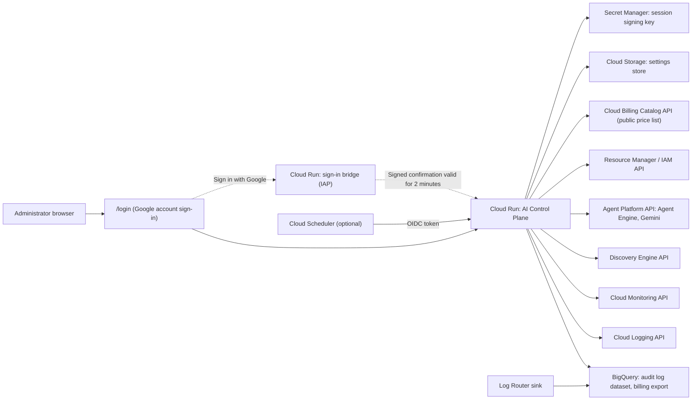
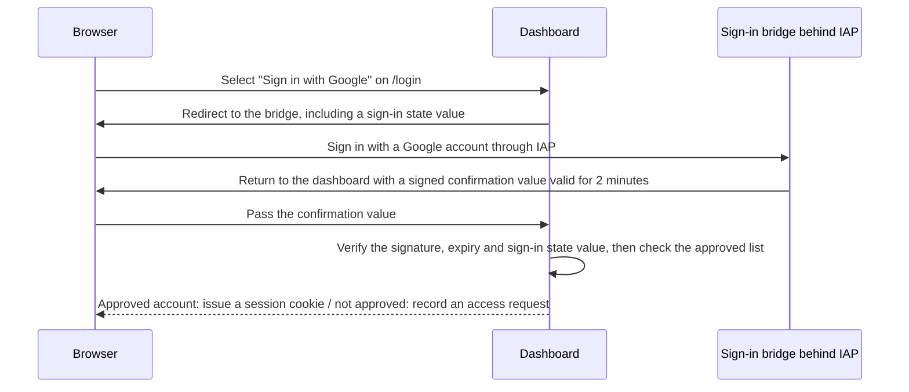
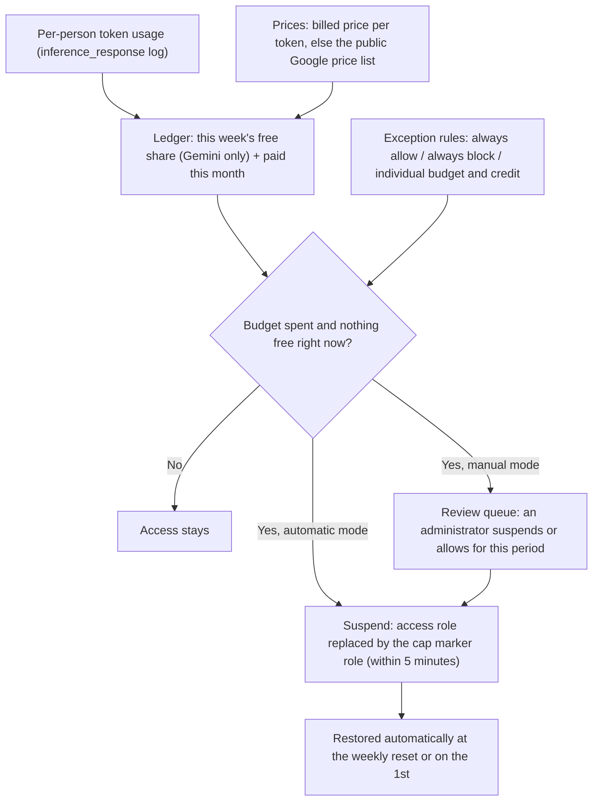

# AI Control Plane

[](https://ssh.cloud.google.com/cloudshell/editor?cloudshell_git_repo=https://github.com/ldu1225/ai-control-plane.git&cloudshell_tutorial=TUTORIAL.md)

This is an AI governance dashboard for viewing and controlling Gemini Enterprise, Gemini Enterprise Agent Platform (Agent Gateway, Agent Registry, Agent Engine deployments, Model Armor), token usage per model, NotebookLM, Antigravity and cloud costs in **one management console**.

Click **Open in Cloud Shell** above or run `scripts/install.sh` in Cloud Shell to enable all required APIs, provision service agents and least-privilege identities, configure audit log routing, Data Access audit logs and Gemini Enterprise prompt logging, and deploy the dashboard to Cloud Run in one step. The product name, organization name, logo, colors, language, modules to use and models to track can all be changed in settings.

> [!IMPORTANT]
> **There is no sample data, no demo mode and no fake data.** Every number in the UI is a value actually read from the connected Google Cloud project(s). When a BigQuery Billing Export table is not connected yet, cost metrics automatically fall back to **Token-Based Reverse Cost Estimation** (measured token usage × official Google Cloud public pricing × synced multi-currency exchange rates, clearly badged as estimated cost in the UI). Metrics whose underlying telemetry cannot be read are never fabricated — they are shown as `—` with the exact cause and remediation steps.

> [!NOTE]
> This repository is a management solution built to run in Google Cloud customer environments. It is not an officially supported Google product. Korean: [README.md](README.md)

---

## Table of contents

1. [What you can do](#1-what-you-can-do)
2. [Architecture](#2-architecture)
3. [Quick start: deploy with one command](#3-quick-start-deploy-with-one-command)
4. [All deploy.env settings](#4-all-deployenv-settings)
5. [Sign-in and permissions](#5-sign-in-and-permissions)
6. [Connecting data sources](#6-connecting-data-sources)
7. [Features and calculation methods by page](#7-features-and-calculation-methods-by-page)
8. [Antigravity per-user caps and suspension](#8-antigravity-per-user-caps-and-suspension)
9. [Configuration structure (config.yaml, environment variables, UI settings)](#9-configuration-structure-configyaml-environment-variables-ui-settings)
10. [Deploying with Terraform (optional)](#10-deploying-with-terraform-optional)
11. [Running locally](#11-running-locally)
12. [Security model](#12-security-model)
13. [Costs](#13-costs)
14. [Operations and troubleshooting](#14-operations-and-troubleshooting)
15. [Removal](#15-removal)
16. [Developer guide](#16-developer-guide)
17. [License](#17-license)

---

## 1. What you can do

### 1.1 Design principles

| Principle | Meaning |
|---|---|
| Measured data only | No sample values or demo data are ever injected. Without a billing export, measured token usage is valued with official Google Cloud public pricing (explicitly badged as estimated cost); unreadable metrics are shown as `—` with the cause. |
| No hardcoding | Model lists and versions are not kept in code. Models are discovered automatically from billing SKUs, Cloud Monitoring and Antigravity logs, so new models such as Gemini 4 Carbon and Gemini 4 Argon are tracked without a new deployment. |
| Schema-adaptive | BigQuery tables and columns are checked with `INFORMATION_SCHEMA`, and only the ones that exist are queried. Both date-sharded tables and partitioned tables are supported. |
| Everything can be turned on or off | Modules, models and connectors are turned on or off individually. Disabled modules do not query their data sources. |
| Safety first for controls | IAM changes go through dry runs, safety gates, a change budget, atomic etag-based updates and audit logs. |
| Least privilege | Read features use only read roles. IAM write roles are granted only when control features are turned on. Service account keys are not used. |

### 1.2 Modules

| Menu | Module ID | Features | Data sources |
|---|---|---|---|
| Overview | `overview` | Overall KPIs with change vs the previous period, spend trend, tokens by model, security posture, agent lifecycle, recent governance actions | Each module |
| Gemini Enterprise | `gemini_enterprise` | Active users, prompts, calls per agent, license seat assignment and idle seats, uploaded files | BigQuery (Gemini Enterprise logs), Discovery Engine API |
| NotebookLM | `notebooklm` | Active notebooks, users, prompts | BigQuery `cloudaudit_googleapis_com_data_access` |
| Agent Gateway | `agent_gateway` | Principals calling AI services, services and methods, success/denied/throttled/error, failure history, model invocations | BigQuery audit logs, Cloud Monitoring |
| Agent Registry | `agent_registry` | Unified catalog of Agent Engine and Gemini Enterprise agents, idle agents and deprecation candidates, creation history | Agent Platform API, Discovery Engine API, audit logs |
| Deployments | `agent_deployments` | Agent Engine runtimes, runtime identities (service accounts), invocation volume, model usage by identity, runtime cost | Agent Platform API, audit logs, billing export |
| Model Armor | `model_armor` | Verdicts over time, matched filters, blocks by application and user, event details | BigQuery `modelarmor_googleapis_com_sanitize_operations` |
| Models & Tokens | `model_usage` | Automatic model discovery, input/output/cached tokens per model, invocations, error rate, cost, catalog management | Cloud Monitoring, billing export, Antigravity logs |
| Cost & FinOps | `finops` | Gross cost, credits, net cost, cost by service/SKU or per-model token cost estimate, daily `00:00` (configurable) official pricing & multi-currency FX sync with change alerts, spike detection and AI root-cause analysis | Billing export or Token-Based Reverse Cost Estimation (Cloud Billing Catalog API + official pricing docs + live FX) |
| Users & Access | `users` | 360-degree user view (usage across all services), Antigravity IAM state, individual allow and disallow | All sources, Resource Manager IAM |
| Antigravity Controls | `antigravity` | Per-user cost/token/request caps, automatic or manual suspension, exception rules, settlement periods, safety gates, Agent activity in your cloud, audit log | Cloud Logging or BigQuery, IAM, billing export, Cloud Billing Catalog API |
| Telemetry Extensions | `telemetry` | Dynamic schema/field-stats + Gemini profiling of logs and tables, multi-log group bundling dashboards, and cost-controlled Log Router -> BigQuery routing (sampling, min severity, exclusions, retention, daily GiB caps with auto-pause/resume) | BigQuery, Cloud Logging, Cloud Monitoring, Gemini on Agent Platform |
| AI Analyst | `analyst` | Natural language questions, validated read-only SQL, result tables and charts, summaries | BigQuery, Gemini on Agent Platform |

Common features: light/dark theme, Korean/English switching, unified multi-project selector (`All Projects` or per-project filter), currency selector (`KRW`/`USD`), command palette (Ctrl/Cmd+K), date range selection (presets and custom range), table search/sort/CSV export, data source health panel.

Credits are shown only when the billing export contains actual credit rows. Gemini Code Assist and Duet AI SKUs are excluded from all totals.

---

## 2. Architecture

### 2.1 Components



- **Single container**: A Python standard library HTTP server serves both the static SPA (`src/web`) and the REST API (`/api/v1`). There is no web framework and no frontend build step, so the code is easy to audit and change. There are 6 runtime dependencies (`requirements.txt`).
- **Frontend**: A dependency-free ES module SPA. It does not use `innerHTML` and renders only with text nodes.
- **Data access**: BigQuery is used only with parameterized queries, and every query has a cost cap set with `maximum_bytes_billed`. REST APIs are called with Application Default Credentials (the runtime service account) and a quota project header.
- **Settings store**: Settings changed in the UI, exception rules and suspension records are saved to a Cloud Storage bucket. Only the changes are saved. Multiple instances re-read them every 30 seconds to stay consistent. Personal widget layouts are saved in the same bucket under `users/`, one document per person, named by a hash rather than the email address.
- **Cache**: A TTL cache per endpoint and query parameters is used (120 seconds by default). It is invalidated immediately when settings change.

### 2.2 Repository structure

```text
.
|-- deploy.env.example          # deployment settings template (optional — CLI flags work directly)
|-- TUTORIAL.md                 # Open in Cloud Shell interactive walkthrough
|-- config.yaml                 # default settings (placeholders only)
|-- config.local.yaml.example   # local development settings template (copy to config.local.yaml, excluded from Git)
|-- requirements.txt            # pinned dependencies
|-- Dockerfile                  # container image that runs as a non-root user
|-- .dockerignore, .gcloudignore
|-- scripts/
|   |-- install.sh              # one-click / one-command bootstrap installer (single or multi-project hub)
|   |-- prepare.sh              # before deployment: start collecting logs (sink, Data Access, Gemini Enterprise logs)
|   |-- deploy.sh               # one-command resilient deployment (from empty project to live readiness probe)
|   |-- teardown.sh             # deletes the deployed resources
|   |-- lib/common.sh           # shared automation helpers for install.sh, prepare.sh and deploy.sh
|   |-- prepublish_scan.py      # release gate: secrets and deployment identifiers (also runs in CI)
|   `-- git-hooks/pre-push      # opt-in hook that runs the scan before every push
|-- terraform/                  # Terraform deployment (IAP mode, optional)
|-- src/
|   |-- backend_server.py       # entry point
|   |-- controlplane/           # backend
|   |   |-- app.py              # route registration and server startup
|   |   |-- config.py           # defaults, layered loading, settings validation
|   |   |-- auth.py             # Google sign-in, sign-in bridge, sessions
|   |   |-- security.py         # auth modes, IAP/OIDC verification, permissions, rate limiting, PII masking
|   |   |-- httpkit.py          # response envelope, security headers, CSRF, static files
|   |   |-- schema.py           # schema-adaptive BigQuery access
|   |   |-- settings_store.py   # settings store (gcs, file, memory)
|   |   |-- gcp.py, ai.py, cache.py, timeutil.py
|   |   `-- services/           # per-module services (governance, pricing, pricing_sync, gemini_enterprise, ...)
|   `-- web/                    # frontend SPA (index.html, login.html, assets/)
|-- eval/analyst/               # AI Analyst golden dataset and evaluation harness (16.1)
|-- tests/unit/                 # unit tests
`-- .github/workflows/tests.yml # unit tests, prepublish scan and dataset validation on every push
```

---

## 3. Quick start: deploy with one command

### 3.1 Prerequisites

| Item | Details |
|---|---|
| Google Cloud project | Any Google Cloud project **ID** (lowercase letters, digits and hyphens — not the display Name), including a brand-new empty project. If billing is not linked yet, the installer automatically links a single open billing account or sibling folder billing account (or pass `--billing-account ID`). |
| Permissions | Project `Owner` on the deploying account (or `Project IAM Admin` — missing operational deployment roles are self-bootstrapped automatically). When linking secondary projects (`--link-projects`), having IAM/admin access on those projects lets the installer grant cross-project read roles and enable log routing automatically. |
| Environment | **Google Cloud Shell recommended** (`gcloud`, `bq`, `python3`, `git` and `docker` are pre-installed). Works identically on macOS and Linux. |

### 3.2 Deploy (One-click / One-liner)

**Option A — Interactive wizard in Cloud Shell (zero config editing; picks host project & optional linked projects by menu number)**
```bash
bash <(curl -fsSL https://github.com/ldu1225/ai-control-plane/raw/main/scripts/install.sh)
```

**Option B — Single-project unattended deployment**
```bash
bash <(curl -fsSL https://github.com/ldu1225/ai-control-plane/raw/main/scripts/install.sh) \
  --project my-project-1 --admins admin@example.org --viewers viewer@example.org
```
*(When `--admins` is omitted, the active `gcloud` account becomes the initial administrator.)*

**Option C (Recommended for multi-project orgs) — Unified Multi-Project Hub (1 Cloud Run dashboard monitoring multiple projects together)**
```bash
bash <(curl -fsSL https://github.com/ldu1225/ai-control-plane/raw/main/scripts/install.sh) \
  --project my-hub-project \
  --link-projects my-project-2,my-project-3 \
  --admins admin@example.org --viewers viewer@example.org
```
- Deploys **one** Cloud Run dashboard in `my-hub-project`, grants its runtime service account least-privilege read roles on `my-project-2` and `my-project-3`, configures same-region BigQuery audit log sinks on the linked projects so `UNION ALL` queries work seamlessly, and aggregates all projects in the header project selector (`All Projects` or individual project filter).
- Even without `--link-projects`, any other project in the **same Google Cloud Organization** that the runtime service account can read is discovered automatically (`SCAN_ALL_PROJECTS=true` by default; pass `--no-auto-discover-projects` to restrict strictly to `--link-projects`).
- Need **completely isolated Cloud Run dashboards** per project instead of one shared hub? Use `--projects proj-a,proj-b`.
- If an older `~/ai-control-plane` clone or broken `deploy.env` exists in Cloud Shell, `install.sh` automatically updates or re-clones it cleanly and backs up `deploy.env` to `deploy.env.bak`.

**Option D — Clone and run directly with CLI flags or `deploy.env`**
```bash
git clone https://github.com/ldu1225/ai-control-plane.git
cd ai-control-plane

scripts/deploy.sh --project my-hub-project --link-projects my-project-2,my-project-3 --admins admin@example.org
# or copy deploy.env.example -> deploy.env and run scripts/deploy.sh
```

What the script automates end-to-end on a brand-new project:

| Step | Details |
|---|---|
| 0. Preflight & Billing | Bootstraps foundational control-plane APIs, verifies/self-grants missing caller IAM roles, and verifies or auto-links Cloud Billing. |
| 1. Enable APIs & Service Agents | Enables Cloud Run, Cloud Build, Artifact Registry, BigQuery, Logging, Monitoring, Discovery Engine, Agent Platform, Model Armor, Storage, Secret Manager, Cloud Scheduler, IAP and provisions all Google-managed service agents (`service-PROJECT_NUMBER@...`) immediately. |
| 2. Settings bucket | Creates a private (public access prevention), versioned Cloud Storage bucket. |
| 3. Dedicated SAs & IAM | Creates the runtime SA, sign-in bridge SA, and a **dedicated Cloud Build SA** (never relies on the legacy Compute Engine default SA), grants least-privilege roles on the host project and any `--link-projects` projects, and auto-detects any BigQuery billing export table. |
| 4. Container image | Creates the Artifact Registry repository and builds with Cloud Build using the dedicated builder SA (automatically falls back to local/Cloud Shell Docker if Cloud Build is restricted). |
| 5. Session signing key | Creates a regional Secret Manager secret compliant with `constraints/gcp.resourceLocations` org policies. |
| 6. Full data-source onboarding | Creates the BigQuery dataset (`ge_analytics`) and partitioned Log Router sink, **enables Data Access audit logs across AI services**, turns on **Gemini Enterprise usage + prompt/user logging**, onboards `--link-projects` secondary projects in the same BigQuery region, and auto-detects org name and Agent Platform endpoints. |
| 7. Resilient Cloud Run, Auth & Scheduled Maintenance | Deploys the IAP sign-in bridge and dashboard (adapting automatically to enterprise org policies: `--no-invoker-iam-check` -> `--allow-unauthenticated` -> **Direct Cloud Run IAP** or built-in ID/Password sign-in) and provisions the `${SERVICE_NAME}-maintenance` Cloud Scheduler job for daily `00:00` (configurable) official pricing & FX sync and telemetry BigQuery budget enforcement/auto-resume. |
| 8. Live readiness probe | Verifies live HTTP response from the deployed Cloud Run URL and prints the exact login link. |

- **Safe to re-run (idempotent).** Creates what is missing and updates what exists.
- `install.sh` saves a git-ignored `deploy.<PROJECT_ID>.env` snapshot (including `SCAN_PROJECTS`) so future upgrades preserve your linked projects automatically.

### 3.3 First sign-in

1. Open `/login` at the printed URL and select **Sign in with Google** (or sign in directly through Google IAP when Direct Cloud Run IAP was selected automatically).
2. Accounts in `--admins` (`ADMIN_EMAILS`) sign in as administrators immediately; accounts in `--viewers` (`ALLOWED_USERS`) sign in as viewers immediately.
3. Additional users or domains can be added anytime in **Settings > Access control**.
4. The built-in `admin` account has no shared default password. Every deployment generates a random initial password in Secret Manager (`SERVICE_NAME-admin-password`); the last line of the deployment prints the command to read it (`gcloud secrets versions access latest --secret=ai-control-plane-admin-password --project=PROJECT_ID`). In organizations where Google sign-in is unavailable (automatic fallback to ID/password sign-in), sign in with it and change it in **Settings > Access control**. The sign-in page never shows account or password hints.

### 3.4 Post-deployment checks

1. Use the **Project selector** (`All Projects` or individual project) and **Currency selector** (`KRW` / `USD`) in the top header bar to verify unified visibility.
2. Select **Data sources** in the top bar to check connection status. Even before a BigQuery Billing Export table is connected, **Overview**, **Models & Tokens** and **Cost & FinOps** automatically calculate estimated costs from measured token usage, official Google Cloud pricing and synced exchange rates. When you later export Cloud Billing to BigQuery, connect the table in **Settings > Workspace and data sources** to switch automatically to exact invoiced SKU costs and credits.
3. If you created a new audit log sink, each BigQuery table is created automatically when its first log entry arrives.
4. To use Antigravity per-user caps, follow [Section 8](#8-antigravity-per-user-caps-and-suspension).

### 3.5 Start collecting logs before deployment (optional)

Logs are collected from the moment they are turned on. To turn on log routing before deploying the dashboard, run one command in Cloud Shell:

```bash
bash <(curl -fsSL https://github.com/ldu1225/ai-control-plane/raw/main/scripts/install.sh) \
  --prepare-only --project PROJECT_ID
```

| Step | Details |
|---|---|
| 1. Enable APIs | Logging, BigQuery, Monitoring, Discovery Engine, Agent Platform, Model Armor and service identities |
| 2. Log routing | Creates the BigQuery dataset (`ge_analytics`) and the Log Router sink (`ai-control-plane-ai-logs`) ([6.1](#61-audit-log-sink-bigquery)). Antigravity logs are included automatically. |
| 3. Gemini Enterprise usage & prompt logs | Turns on observability (usage logs and user/prompt logging) by default for every Gemini Enterprise app in `global`, `us` and `eu` ([6.3](#63-gemini-enterprise-logs)). |
| 4. Data Access audit logs | Enables Data Access audit logs across AI services by default (pass `--no-data-access-logs` to skip). |
| 5. Check | Shows whether Gemini Enterprise, Model Armor and Antigravity logs arrived in the last 30 days. |

- Safe to re-run, and `--dry-run` previews changes first. Pass `--projects proj-a,proj-b` (or `--project hub --link-projects spoke-a,spoke-b`) to prepare multiple projects at once.
- When you later run `install.sh` or `scripts/deploy.sh`, it reuses the dataset and sink automatically.

---

## 4. All deploy.env settings

`deploy.env` uses the `KEY="value"` format that bash reads. Put values that contain spaces in quotes. This file is listed in `.gitignore`, so it is not committed to Git.

### 4.1 Required

| Variable | Example | Description |
|---|---|---|
| `PROJECT_ID` | `my-project` | Host project to deploy Cloud Run to and primary project to monitor |
| `REGION` | `asia-northeast3` | Region for Cloud Run, Artifact Registry, the settings bucket and Scheduler |
| `ADMIN_EMAILS` | `admin@example.com,*@security.example.com` | Administrators (defaults to active `gcloud` account when omitted). Separate entries with commas; `*@domain` is supported. |

### 4.2 Service and display

| Variable | Default | Description |
|---|---|---|
| `SERVICE_NAME` | `ai-control-plane` | Cloud Run service name. Also used in the names of the service account, bucket, secrets, sink and scheduler jobs. |
| `ORGANIZATION_NAME` | Auto-detected (`Your Organization` fallback) | Organization name shown in the header and on the sign-in page |
| `DEFAULT_LOCALE` | `en` (`ko` in `deploy.env.example`) | Default language, `ko` or `en`. Users can change it in the UI. |
| `WORKSPACE_TIMEZONE` | `Asia/Seoul` | Time zone for date display, daily totals and Cloud Scheduler jobs |
| `PRODUCT_NAME` | Empty | Changes the product name (white label). If empty, `AI Control Plane` |
| `DISABLED_MODULES` | Empty | Modules hidden at deploy time (comma separated). Settings > Modules can switch them back on. Module IDs: `overview`, `gemini_enterprise`, `notebooklm`, `model_usage`, `agent_gateway`, `agent_registry`, `agent_deployments`, `model_armor`, `users`, `antigravity`, `finops`, `telemetry`, `analyst` |

### 4.3 Sign-in method

| Variable | Default | Description |
|---|---|---|
| `ACCESS_MODE` | `google` | One of `google`, `google_oauth`, `iap` or `password` ([Section 5](#5-sign-in-and-permissions)) |
| `ALLOWED_USERS` | Empty | Viewers to approve in advance for Google sign-in. Example: `*@example.com,partner@example.org` |
| `IAP_MEMBERS` | Empty | Principals allowed to access the dashboard in `iap` mode. Example: `group:ai-governance@example.com,user:a@example.com` |
| `OAUTH_CLIENT_JSON` | Empty | Path to the OAuth client JSON downloaded for `google_oauth` mode (do not commit it) |
| `BRIDGE_MEMBERS` | `allAuthenticatedUsers` | Principals that can pass the sign-in bridge in `google` mode. If an organization policy blocks this, `deploy.sh` falls back automatically or you can set `domain:example.com` |
| `PUBLIC_BASE_URL` | Empty | Custom domain. Example: `https://ai-governance.example.com` |
| `GUEST_ACCESS` | `false` | Demo only. `true` lets anyone with the link browse read-only as a guest without signing in ([5.3](#53-guest-access-demo-only)). `google` and `google_oauth` only |
| `GUEST_REDACT_TERMS` | Terms in `.prepublish-terms` | Demo only. Comma-separated terms hidden from guests (project, organization or customer names) |

### 4.4 Data sources and multi-project scanning

| Variable | Default | Description |
|---|---|---|
| `SCAN_PROJECTS` | Empty | Additional project IDs (comma separated, `--link-projects`) to aggregate into this single hub dashboard alongside `PROJECT_ID` |
| `SCAN_ALL_PROJECTS` | `true` | Automatically discovers and includes readable projects within the same Google Cloud Organization (`--no-auto-discover-projects` sets `false`) |
| `PREPARE_LINKED_PROJECTS` | `true` | Automatically enables core observability APIs, same-region `ge_analytics` dataset, Log Router sink and Data Access logs on `SCAN_PROJECTS` during `deploy.sh` (`--no-prepare-linked-projects` skips) |
| `AUDIT_DATASET` | `ge_analytics` | BigQuery dataset that receives the audit logs |
| `CREATE_LOG_SINK` | `true` | Creates the dataset and the Log Router sink, and updates an existing sink to the current filter. Use `false` if you manage a different sink yourself |
| `DATASET_LOCATION` | `REGION` | Location of newly created BigQuery audit datasets (aligned across hub and linked projects so `UNION ALL` queries succeed) |
| `ENABLE_DATA_ACCESS_LOGS` | `true` | Turns on Data Access audit logs across AI services (`--no-data-access-logs` sets `false`) |
| `ENABLE_GE_OBSERVABILITY` | `true` | Turns on usage logs (observability) for every Gemini Enterprise app in `DISCOVERY_ENGINE_LOCATIONS`. Needs Owner or Gemini Enterprise Admin; without it, only a warning is printed. |
| `GE_PROMPT_LOGGING` | `true` | Turns on `sensitiveLoggingEnabled` so user identities (`userIamPrincipal`), prompt/response text and uploaded file names are recorded instead of `<elided>` (`--no-log-prompts` sets `false`). |
| `BILLING_PROJECT_ID` | Empty | Project that holds the billing export (if empty, auto-detected or `PROJECT_ID`) |
| `BILLING_DATASET` | Empty | Billing export dataset. Example: `billing_detailed_usage` |
| `BILLING_TABLE` | Empty | `gcp_billing_export_resource_v1_XXXXXX_XXXXXX_XXXXXX` |
| `BILLING_ACCOUNT_ID` | Empty | `XXXXXX-XXXXXX-XXXXXX` |
| `DISCOVERY_ENGINE_LOCATIONS` | detected | Gemini Enterprise locations (comma separated, for example `global,us`). When empty, deployment uses the locations among `global`, `us` and `eu` that have a Gemini Enterprise app or license, or `global` when there is none. |
| `AGENT_ENGINE_REGIONS` | Auto-detected + `REGION` | Agent Engine regions (comma separated) |

You can also enter or update the billing values after deployment in **Settings > Workspace and data sources**.

### 4.5 Governance and automated pricing sync

| Variable | Default | Description |
|---|---|---|
| `ENABLE_GOVERNANCE_ACTIONS` | `false` | Grants IAM write roles. Required to suspend users over their cap, restore them, allow or disallow individual users and create marker roles |
| `ENFORCEMENT_SCHEDULE` | `*/5 * * * *` | Antigravity cap enforcement schedule (cron). It suspends people over their limits within 5 minutes and restores them after each reset, so it is on by default. `off` turns it off (then users get access back only when an administrator runs enforcement after the reset). It is not created with `--read-only` or in IAP mode. |
| `MAINTENANCE_SCHEDULE` | `0 * * * *` | Cloud Scheduler cron for `${SERVICE_NAME}-maintenance`: runs daily official pricing & multi-currency FX sync at `PRICING_SYNC_TIME` (default `00:00` in `WORKSPACE_TIMEZONE`) and enforces/resumes Telemetry BigQuery route daily GiB caps (`off` or `none` disables the job) |
| `PRICING_SYNC_TIME`, `PRICING_CURRENCY` | `00:00`, `KRW` | Daily pricing/FX sync time (in `WORKSPACE_TIMEZONE`) and default display currency when no billing export is connected |

### 4.6 Other

| Variable | Default | Description |
|---|---|---|
| `AI_DEFAULT_MODEL` | Empty | Default model for AI Analyst (if empty, the `config.yaml` value) |
| `IMAGE` | Empty | Prebuilt image. If empty, the image is built with Cloud Build |
| `MEMORY`, `CPU` | `1Gi`, `1` | Cloud Run resources |
| `MIN_INSTANCES`, `MAX_INSTANCES` | `0`, `3` | Number of instances. With 0, there is no cost when there are no requests. |
| `AR_REPOSITORY` | `ai-control-plane` | Artifact Registry repository name |
| `SERVICE_ACCOUNT_ID` | `SERVICE_NAME-sa` | Runtime service account ID |
| `SETTINGS_BUCKET` | `PROJECT_ID-SERVICE_NAME-settings` | Settings bucket name (globally unique, 63 characters or fewer) |
| `SESSION_SECRET_NAME` | `SERVICE_NAME-session-secret` | Name of the secret for the session signing key |
| `OAUTH_SECRET_NAME` | `SERVICE_NAME-oauth-client-secret` | Name of the secret for the OAuth client secret |

---

## 5. Sign-in and permissions

### 5.1 Choosing a sign-in method

| `ACCESS_MODE` | Behavior | When to use it |
|---|---|---|
| `google` (recommended) | Users sign in with a Google account on the dashboard's own sign-in page (`/login`). You do not need to create an OAuth client. A small sign-in bridge service behind IAP verifies the Google account, and the dashboard lets in only approved accounts. | Most cases |
| `google_oauth` | The same sign-in page runs with an OAuth client that you create. | When you do not want a bridge service, or you want to manage the OAuth consent screen yourself |
| `iap` | Identity-Aware Proxy handles sign-in in front of the dashboard. The app verifies the IAP signed header. | Organizations that already use IAP and group-based access management |

Other `security.auth_mode` values (set only in `config.yaml` or the `AUTH_MODE` environment variable, never in the UI):

- `local`: for development on one computer ([11](#11-running-locally)). Only direct requests from this computer (a loopback address) are accepted, as the administrator. Requests from other computers, and requests forwarded by a proxy (`X-Forwarded-For`, `Forwarded`, `X-Real-IP`), are refused. Cloud Run refuses this mode at startup. `auto` falls back to `local` only when the server listens on a loopback address (`127.0.0.1`, `::1`, `localhost`); a server bound to another address stops at startup and asks you to choose `google` or `iap`.

By default there is no anonymous mode: only approved Google accounts can open the dashboard. Demos can turn on guest access as an exception ([5.3](#53-guest-access-demo-only)).



Preparing `google_oauth` mode (one time only):

1. Google Cloud console > Google Auth Platform > Branding: enter the app name and the support email.
2. Audience: `Internal` if you use only organization accounts, `External` if you also use external Google accounts (publish the app or add test users).
3. Clients > Create client > Web application. Add `https://DASHBOARD_HOST/auth/google/callback` to the authorized redirect URIs.
4. Download the JSON right after you create the client, and put its path in `OAUTH_CLIENT_JSON` (the client secret is shown only at this point). The script stores the client secret in Secret Manager and does not print it.

### 5.2 Roles

| Role | What it can do |
|---|---|
| admin | All pages, changing settings, approving users, cap policy, suspend/restore, exception rules, connector management |
| viewer | Views all pages. Emails are masked on the server (`ad***@example.com`), and Model Armor raw text and uploaded file names are not provided. AI Analyst is available only when an administrator allows it (`analyst.allow_viewers`). Settings are read-only, and deployment identifiers (settings bucket, OAuth client ID, IAP audience, billing account ID) are shown as `***`. |
| guest (demo only) | A visitor without a session when `GUEST_ACCESS=true`. Sees the same pages as a viewer with more hidden, and cannot change anything ([5.3](#53-guest-access-demo-only)). |

- Administrators = `ADMIN_EMAILS` + `security.admins` in `config.yaml` + administrators added in the UI.
- Viewers = `ALLOWED_USERS` + `security.allowed_users` + users approved in the UI.
- Accounts set in a settings file or environment variable cannot be removed in the UI (they are fixed). Accounts added in the UI can be removed in the UI. Removing an account also ends its existing sessions immediately.
- Sessions are valid for 12 hours by default (`SESSION_HOURS`, 1-168).

### 5.3 Guest access (demo only)

Turn it on only when anyone should be able to open a demo from a link. Keep it off for customer deployments
(default `false`).

- To turn it on, set `GUEST_ACCESS="true"` in `deploy.env` and deploy again (`security.guest_access`; it cannot be changed in the UI). It works with `google` and `google_oauth` only.
- Visitors without a session go straight to the dashboard, and the sign-in page offers **Continue as guest**. Administrators still sign in at `/login`.
- Guests are read-only. Every change request (settings, widget layouts, policies) is refused; the only POST routes a guest may call are the cost spike AI analysis and the AI Analyst, and the AI Analyst only when an administrator allows viewers (`analyst.allow_viewers`). AI calls have a per-guest limit and a shared limit for all guests (30 per minute).
- On top of viewer masking, every response to a guest hides whole e-mail domains, billing account IDs, 12-digit project numbers, resident registration, phone and card number formats, and the terms in `GUEST_REDACT_TERMS` (case-insensitive). If the terms are empty, the deploy script uses the terms in `.prepublish-terms`.
- Real project data (metrics, agent names, costs) stays visible, so turn it on only for a demo project that may be shown publicly.

---

## 6. Connecting data sources

The more data sources you connect, the more pages you can use. Metrics from sources that are not connected are shown as `—`, with an explanation of the cause.

### 6.1 Audit log sink (BigQuery)

`scripts/prepare.sh` and `scripts/deploy.sh` (`CREATE_LOG_SINK=true`) create it automatically, and update an existing sink to the filter below. To create it yourself, open **Logging > Log Router > Create sink** in the console, choose a BigQuery dataset as the destination, select **Use partitioned tables**, and paste the text below as the inclusion filter.

```text
(
  (log_id("cloudaudit.googleapis.com/activity") OR log_id("cloudaudit.googleapis.com/data_access"))
  AND protoPayload.serviceName=("aiplatform.googleapis.com" OR "discoveryengine.googleapis.com" OR "modelarmor.googleapis.com" OR "businessaicode.googleapis.com" OR "notebooklm.googleapis.com" OR "geminidataanalytics.googleapis.com" OR "generativelanguage.googleapis.com")
)
OR log_id("discoveryengine.googleapis.com/gemini_enterprise_user_activity")
OR log_id("discoveryengine.googleapis.com/gen_ai_user_message")
OR log_id("modelarmor.googleapis.com/sanitize_operations")
OR log_id("businessaicode.googleapis.com/inference_response")
```

Cloud Logging binds `OR` more tightly than `AND`. Without the outer parentheses around the audit-log clause, the Gemini Enterprise, Model Armor and Antigravity logs would also have to be audit logs, and none of them would arrive. Sinks created by `deploy.sh` before v2.1.0 had this problem; running it again with `CREATE_LOG_SINK=true` fixes them.

To create it with commands, save the filter above as `ai-log-filter.txt` and run:

```bash
bq --location=US mk --dataset PROJECT_ID:ge_analytics

gcloud logging sinks create ai-control-plane-ai-logs \
  bigquery.googleapis.com/projects/PROJECT_ID/datasets/ge_analytics \
  --use-partitioned-tables --project=PROJECT_ID --log-filter="$(cat ai-log-filter.txt)"

gcloud logging sinks describe ai-control-plane-ai-logs --project=PROJECT_ID --format='value(writerIdentity)'
```

Grant the printed writer identity (usually the project's shared Logging service agent `service-PROJECT_NUMBER@gcp-sa-logging.iam.gserviceaccount.com`) the BigQuery Data Editor role **on this dataset only**. Grant it in the BigQuery console > dataset > Share > Permissions > Add principal. When an Owner creates the sink in the console, this permission is set automatically. `scripts/prepare.sh` and `scripts/deploy.sh` do this automatically at the dataset level and do not change project-level permissions.

Tables created by the sink and the pages that use them:

| Table | Used by |
|---|---|
| `cloudaudit_googleapis_com_activity` | Agent Registry (creation history), Agent Gateway, Agent activity in your cloud (changes) |
| `cloudaudit_googleapis_com_data_access` | Agent Gateway, NotebookLM, Deployments, Users, Agent activity in your cloud (reads) |
| `discoveryengine_googleapis_com_gen_ai_user_message` | Gemini Enterprise (prompts, uploaded file names) |
| `discoveryengine_googleapis_com_gemini_enterprise_user_activity` | Gemini Enterprise (prompts, agent calls, uploads), Model Armor user matching |
| `modelarmor_googleapis_com_sanitize_operations` | Model Armor |
| `businessaicode_googleapis_com_inference_response` | Antigravity (if it is missing, the data is read directly through the Cloud Logging API) |

Each table is created when its log is first written. If a table is missing, only its metrics are empty and a warning is shown.

### 6.2 Data Access audit logs

Agent Gateway, NotebookLM, Deployments and model usage by identity use Data Access audit logs. Run `scripts/prepare.sh --data-access-logs`, redeploy with `ENABLE_DATA_ACCESS_LOGS=true`, or turn on `Data Read` and `Data Write` for the services below in **IAM & Admin > Audit Logs** in the console.

- Agent Platform API (`aiplatform.googleapis.com`)
- Discovery Engine API (`discoveryengine.googleapis.com`)
- Model Armor API (`modelarmor.googleapis.com`)

Data Access logs can be large and add Cloud Logging ingestion costs. The script updates the IAM policy with its etag, so if another change happens at the same time, the update fails instead of overwriting that change.

### 6.3 Gemini Enterprise logs

Usage is recorded only when observability (usage logs) is turned on for each Gemini Enterprise app. `scripts/prepare.sh` and `scripts/deploy.sh` (`ENABLE_GE_OBSERVABILITY=true`, `GE_PROMPT_LOGGING=true`) turn on both settings below for every app. To do it in the console, open **Gemini Enterprise > app > Configurations > Observability** and turn on both options:

- **Enable instrumentation of OpenTelemetry traces and logs**: usage logs (`observabilityEnabled`).
- **Enable logging of prompt inputs and response outputs**: user identity (`userIamPrincipal`), prompt/response text and uploaded file names (`sensitiveLoggingEnabled`). Without this option, Gemini Enterprise masks user identities and replies as `<elided>`.

License seats are distributed per location (`global`, `us`, `eu`), so they are read through the Discovery Engine API for every location in `DISCOVERY_ENGINE_LOCATIONS` and summed. Leave it empty and `scripts/deploy.sh` finds every location that has an app or license.

Counting rules (verified against real logs):

- Duplicate delivered rows with the same `insertId` and timestamp count as one.
- **Prompts**: If the message log exists, the message log is counted. Otherwise, assistant calls in the activity log (`StreamAssist` and others) that contain user input are counted. Session summaries that the product runs automatically (`session_to_summarize`), context injection and scheduled runs are not prompts.
- **Agent calls**: Assistant calls addressed to a specific agent (`agentsSpec`), including scheduled runs. Viewing or editing an agent page is not a call. Agent names are looked up from the name in the log first, then from the Discovery Engine agent list.
- **Uploads**: The activity log records one upload as two lines, a request and a response, so only responses with a file ID are counted.

### 6.4 Billing export

In **Billing > Billing export**, turn on the **Detailed usage cost** export to BigQuery. Put the name of the `gcp_billing_export_resource_v1_...` table it creates and the billing account ID in `deploy.env` (or the UI settings). The export collects data from the time you turn it on, and the first data can take a few hours to arrive.

Features that use the billing export: Cost & FinOps, cost per model, agent runtime cost (requires the resource-level export), and the actual unit prices for Antigravity per-person cost caps.

When a billing export is configured, Cost & FinOps, cost per model, agent runtime cost, and Antigravity per-person cost caps reflect actual billed unit prices and negotiated credits. When no billing export is configured, the control plane automatically estimates spend from observed token usage (Cloud Monitoring and inference logs) multiplied by official Google Cloud public token prices (Cloud Billing Catalog API + official pricing pages + model aliases/overrides) and synced multi-currency exchange rates, with a daily midnight (`00:00`, configurable) pricing & FX sync, manual sync, and change alerts.

### 6.5 Antigravity inference logs

Antigravity token usage per user is read from the `businessaicode.googleapis.com/inference_response` log that Antigravity for organizations writes to the project. **This log is written only when Metadata logging is on in Gemini Enterprise > Settings > AI developer tools > Compliance, which is off by default** ([official docs](https://cloud.google.com/gemini/enterprise/docs/ai-developer-tools-track-token-usage)). Prompts and responses logging is not needed. The deployment summary checks whether the log exists. Entries written after the log sink exists are kept in BigQuery (no expiry); earlier entries stay in Cloud Logging for 30 days by default. Usage is read from the BigQuery sink table. The time before the table existed (for example when Metadata logging was turned on before installation) and projects without a sink table are read from Cloud Logging and added (`usage_source: auto`; no entry is counted twice), so the first week's caps and the first month's report miss no calls. Entries from before installation that are older than the Cloud Logging retention (30 days by default) cannot be read. Without a sink table, only the Cloud Logging API is used. Users are counted by the email in the log's `labels.user_id` (an IAM principal such as `user:alice@example.com`, with `user:` removed), so they match the project's `user:` IAM bindings; service accounts and other non-user principals are left out of the user list and the caps. Google Cloud API calls that coding agents make with user credentials are shown under **Agent activity in your cloud** on the Antigravity Controls page, based on audit logs.

### 6.6 Runtime service account permissions

`scripts/deploy.sh` and Terraform grant these roles automatically. Follow the same rules when you configure them yourself.

**Read (always required)**

| Role | Purpose |
|---|---|
| `roles/bigquery.jobUser` | Run parameterized queries |
| `roles/bigquery.dataViewer` | Read audit logs and the billing export. If the billing dataset is in a different project, read access is granted on that dataset only. |
| `roles/logging.viewer` | Antigravity inference logs, governance audit log, log source discovery |
| `roles/monitoring.viewer` | Token and invocation metrics per model, log activity in Telemetry Extensions |
| `roles/discoveryengine.viewer` | Licenses, engines, assistants, agents |
| `roles/aiplatform.user` | Read Agent Engine, call AI Analyst (Gemini) |
| `roles/iam.securityReviewer` | Read the project IAM policy (Antigravity state classification) |
| `roles/serviceusage.serviceUsageConsumer` | Use the quota project header on all calls |
| `roles/logging.logWriter` | Write the governance audit log (enforcement runs, dry runs, review decisions, exception changes), with or without the control features |
| `roles/storage.objectAdmin` (settings bucket only) | Store UI settings, exception rules, suspension records and personal widget layouts |
| `roles/secretmanager.secretAccessor` (secrets only) | Session signing key, OAuth client secret |

**Control features (only when `ENABLE_GOVERNANCE_ACTIONS=true`)**

| Role | Purpose |
|---|---|
| `roles/resourcemanager.projectIamAdmin` | Suspending and restoring users over their cap, allowing and disallowing individual users (etag-based `setIamPolicy`) |
| `roles/iam.roleAdmin` | Create marker roles (once, the first time) |

**Sign-in bridge (`google` mode)**: The bridge runs as its own service account (`SERVICE_NAME-signin`, at most 23 characters of the service name). It has no project roles and can read only the session signing key.

**Inherited binding check (optional)**: If you grant `roles/iam.securityReviewer` at the organization level, Antigravity access inherited from folders and the organization is also detected (Terraform `organization_id`). Without it, the users concerned are classified as `UNKNOWN / ANCESTOR_UNCHECKED` and are excluded from changes.

---

## 7. Features and calculation methods by page

### 7.1 Overview

Brings the key KPIs of each module together on one page and shows the change compared with the previous period of the same length. KPIs of disabled modules are shown as "Module disabled".

**My widgets**: pin dashboards created in Telemetry Extensions to the Overview and arrange them your way.

- Select **Add widget** and choose the dashboard, what it shows (summary, events per day, breakdown, status breakdown or latest entries) and its size (small, medium, wide). The **Add to Overview** button on a dashboard page pins it too.
- Drag a widget by its handle to change the order. With the keyboard, press the arrow keys on the handle, or use Move earlier / Move later in the widget menu.
- Other pages (Gemini Enterprise, Users & Access and so on) can hold widgets too, with **Add a widget to this page** at the bottom.
- Layouts are saved per person (`GET/POST /api/v1/layouts`) in `users/<user hash>.json` in the settings bucket; file names never contain email addresses. Every signed-in person saves only their own layout.
- Widget data uses the same API as the Telemetry Extensions dashboards, so the selected period, caching and viewer masking apply in the same way.

### 7.2 Gemini Enterprise

Shows active users, prompts, calls per agent, uploaded files and license seats (assigned, used and idle seats). Counting follows the rules in [6.3](#63-gemini-enterprise-logs). License seats are summed over every location in `DISCOVERY_ENGINE_LOCATIONS`; with more than one location the tables show a Location column.

### 7.3 NotebookLM

Counts active notebooks, users and prompts from NotebookLM Data Access audit logs.

### 7.4 Agent Gateway

Shows the calling principals, services and methods, outcomes (success, denied, throttled, error), failure history and model invocations for the AI services registered in `gateway.services`, based on audit logs and Cloud Monitoring.

### 7.5 Agent Registry and Deployments

- **Agent Registry**: Combines Agent Engine (Agent Platform) and Gemini Enterprise agents into one catalog. An agent is classified as idle when `agent_lifecycle.idle_days` (default 14 days) have passed since its last call, and as a deprecation candidate when `deprecation_days` (default 50 days) have passed.
- **Deployments**: Shows, for each Agent Engine runtime, the runtime identities (service accounts), invocation volume, model usage by identity and runtime cost (resource-level billing export).

### 7.6 Model Armor

Shows verdicts over time, matched filters (prompt injection, sensitive data and others), blocks by application and user, and event details. Viewers do not get the raw text.

### 7.7 Models & Tokens

- Models are discovered automatically from billing SKUs, Cloud Monitoring `model_user_id` and the `model` label of Antigravity inference logs (`model_id` in older entries). The SKU description is searched for a model family word (Gemini, Claude, Llama and others), and qualifiers such as region, modality, input/output and context tier are removed to group the SKUs under one key (for example, `gemini-3.8-flash`). The Agent Platform format (`Gemini 3.8 Flash Global Text Input`), the Gemini API format and the Monitoring model ID are merged into the same model.
- Tokens per model are based on Cloud Monitoring `publisher/online_serving/token_count` (Agent Platform), plus billed Gemini API tokens that Monitoring does not capture. For models without Monitoring metrics, token usage from billing SKUs is used. Invocations and error rate are calculated from `model_invocation_count`.
- When a product re-bills model usage under its own SKUs, that usage is shown separately in the "Usage by product" card. The same tokens are also billed to the underlying model, so they are not added to the model token total.
- When a new model such as Gemini 4 Carbon or Gemini 4 Argon is discovered for the first time, a "new models detected" notice appears. With `auto_enable_new_models: true`, the model is tracked immediately. With `false`, it is left out of totals until an administrator turns it on.
- You can turn off tracking for individual models in Manage catalog (or Settings > Model catalog).

### 7.8 Cost & FinOps

- **When a BigQuery Billing Export table is connected** (`costSource: "billing_export"`): Calculates exact gross cost, credits, net cost, cost by service and SKU, and the AI share of spend directly from invoiced SKUs.
- **When a Billing Export table is not connected yet** (`costSource: "token_estimate"`): Automatically computes **Token-Based Reverse Cost Estimation** from measured input/output token usage across Cloud Monitoring and audit logs × official Google Cloud public pricing (Cloud Billing Catalog SKUs + official pricing docs + model aliases/admin overrides) × synced `USD/<currency>` exchange rate, broken down per model and per day, with a transparent UI status badge indicating estimated cost.
- **Daily `00:00` (configurable) official pricing & multi-currency FX sync**: Cloud Scheduler (`${SERVICE_NAME}-maintenance`) syncs Google Cloud Billing Catalog SKUs, official generative AI pricing docs, BigQuery streaming/storage list prices, and multi-currency FX rates daily at midnight (`00:00` by default in `WORKSPACE_TIMEZONE`, configurable in **Settings > Data collection and cost**; administrators can also trigger an immediate sync). Any model rate change, FX shift, or unpriced model raises a review banner.
- **Spike detection**: A day is marked as a spike when cost rose by at least `finops.spike_threshold_pct` (default 50%) and by at least `spike_min_delta` compared with the previous day. When you select Explain with AI, Gemini summarizes the cause based on the SKU or model changes.

### 7.9 Users & Access

Brings each user's usage of all services, such as Gemini Enterprise, NotebookLM, Agent Gateway and Antigravity, into one row. Select a user to open the details view, which shows usage by service, Antigravity IAM state, cap usage, suspension information and individual allow/disallow buttons.

### 7.10 Telemetry Extensions

Without any hardcoded log catalog, Telemetry Extensions inspects live Cloud Logging streams and BigQuery tables using real schemas, field-level statistics and Gemini profiling so administrators can bundle related logs into dashboards and route high-volume streams to BigQuery under strict cost controls.

1. **Dynamic discovery & field statistics**: Automatically discovers Cloud Logging streams and BigQuery tables (`workspace.audit_dataset`, `telemetry.routing.dataset`, `workspace.telemetry_datasets`), measuring 7-day entry counts and ingested bytes (`logging.googleapis.com/log_entry_count` and `byte_count`) plus observed field cardinality and candidate timestamp, actor, model, status, metric and message columns.
2. **Gemini profiling & semantic grouping**: Gemini (`gemini-4-argon` by default, configurable) profiles discovered schemas to generate plain-language titles/descriptions, recommended breakdown fields, sensitive-text warnings, and semantic **functional groups** cached in the settings store. Administrators can override any source's title, group, field mapping or visibility.
3. **Single-source & bundled group dashboards**: Add any source in one click or select **Bundle N logs into dashboard** on a group to aggregate multiple related logs into one unified dashboard (events per day, primary/status breakdowns, top users/models, and latest entries with viewer PII masking).
4. **Cost-controlled Log Router -> BigQuery routing**: Provision partitioned BigQuery sinks (`telemetry_routed` dataset by default) directly from a source or group with live monthly ingestion/storage cost estimates and full spend guardrails: **sampling %** (`sample(insertId, rate)`), **minimum severity**, **exclusion filters**, **partition retention days**, and **per-route + workspace daily GiB caps**. Routes that exceed their daily cap are automatically paused (`disabled=true`) and automatically resumed on the next day when budget resets (when IAM write roles are absent, ready-to-run `gcloud` / `bq` commands with the exact same filters and retention are generated).

### 7.11 AI Analyst

Converts natural language questions into BigQuery SQL, runs it, and shows tables, charts and a summary. The generated SQL is validated before it runs. After comments and strings are removed, the validator checks that it is a single `SELECT`/`WITH` statement, rejects DML/DDL, and checks that the referenced tables belong to allowed datasets (audit logs, billing, registered connectors). Execution is limited by `analyst.max_bytes_billed` and `analyst.max_rows`. The summary is based only on the result rows and does not follow instructions found inside the result data.

Query results can contain raw text columns such as prompts. Therefore, when viewer masking (`security.mask_pii_for_viewers`) is on, only administrators can use AI Analyst by default. To allow viewers, turn on **Allow viewers to use AI Analyst** in **Settings > Governance policy > AI Analyst limits** (`analyst.allow_viewers`). Viewer results mask only email addresses, so first check whether the datasets contain tables with raw text.

---

## 8. Antigravity per-user caps and suspension

Gemini Enterprise licenses include Antigravity credit (Standard USD 10, Plus USD 15 per user and month), and Google applies it **every 7 days as a quarter of the monthly credit**, as a shared pool. The credit is used **only by Gemini models**; **third-party models such as Claude are always pay-as-you-go** ([official documentation](https://cloud.google.com/gemini/enterprise/docs/quotas-and-pay-as-you-go-usage)). The dashboard keeps a ledger in USD for every person: **the free credit stays usable every week, and only paid usage has a monthly budget**. All amounts are **USD**.

### 8.1 How it works

Every person has two amounts.

| Item | Meaning |
|---|---|
| This week's free share | Monthly credit / 4 (Standard USD 2.50, Plus USD 3.75). Only Gemini usage draws on it, and what is left does not carry over. |
| Monthly paid budget | All Claude usage + Gemini usage beyond the free share. For example `USD 100`. `Credits only` (USD 0) and `No limit` (the default after installation) are also available. |

- **Suspension**: only when the monthly paid budget is spent **and nothing is free right now**: this week's free share is used up too, or the person pays again this week after the budget is spent (for example with Claude). The next enforcement run (within 5 minutes by default) suspends the person.
- **Restore**: automatically at the **weekly reset** (a new free share) or on the **1st of the month** (a new budget), whichever comes first and actually lifts the suspension. **Nobody is suspended permanently.**
- Example (USD 100 budget, Standard): free USD 2.50 + paid USD 100 in week 1 → suspended → restored automatically at the week 2 reset → suspended by the next run once the free USD 2.50 is used up or Claude is used → the same in weeks 3 and 4 → the USD 100 budget is back on the 1st of the next month.
- IAM cannot tell models apart (one permission, `businessaicode.locations.generateContent`). A suspension therefore stops all of Antigravity, and a person who uses Claude after spending the budget also loses the rest of that week's free credit. Ask people who have spent their budget to use Gemini only.
- **Organization paid budget per month** (optional): when everyone's paid usage together reaches it, everyone is credits only until the 1st.
- Google bills the project and applies the credit as a shared pool (unused credit of light users covers heavy users), so the invoice can be lower than the sum of per-person paid amounts. Per-person amounts are the basis for internal chargeback.



### 8.2 Getting started

1. The default installation (`ENABLE_GOVERNANCE_ACTIONS="true"`) prepares everything:
   - **Marker roles**: `CustomAntigravityCapBlocked` and `CustomAntigravityAdminBlocked`, the Gemini Enterprise User role without `businessaicode.*` (the same approach as the [official custom roles that restrict AI developer tools](https://cloud.google.com/gemini/enterprise/docs/ai-developer-tools-creating-custom-roles)). Suspended users keep the Gemini Enterprise app; only Antigravity is blocked.
   - **Enforcement schedule**: an enforcement run every 5 minutes (`ENFORCEMENT_SCHEDULE` defaults to `*/5 * * * *`), which suspends people over their limits within 5 minutes and **restores suspended users automatically** after each reset, in manual review mode too. Use `--no-enforcement-schedule` to turn it off or `--enforcement-schedule "CRON"` to change it. It is not created in IAP access mode or with `--read-only`.
   - When no scheduled run has happened for two hours, the page shows **Automatic enforcement has stopped**.
2. A Gemini Enterprise administrator turns on **Metadata logging** (6.5). Usage is counted from then on.
3. Set the policy in **Cap policy > Edit policy**. Right after installation it is `No limit`, so nobody is suspended.
   - Caps: **Weekly free credit + monthly paid budget** (recommended, default). The earlier fixed cost / token / request caps per period remain available. An installation that already used fixed caps keeps them after an upgrade until this choice is changed.
   - Credit per person per month (USD): the `Standard $10` / `Plus $15` buttons.
   - Paid budget per person per month: `No limit` / `Credits only` / `Monthly limit` (for example 100).
   - Paid budget for everyone per month (optional, empty = no limit).
   - Weekly reset day, time and time zone: match the project's 7-day credit cycle (it starts when the project first used Antigravity). The monthly budget resets on the 1st at 00:00 in the same time zone.
   - Weekly token and request caps (optional, 0 = off).
4. To give someone a different budget, select the pencil button in the **Paid budget** column of the **People and limits** table (`Default`, `Credits only`, `Individual limit`). For a person with a different credit, such as a Plus license, set the monthly credit to 15 in an **Individual limit** exception rule.
5. In the **Enforcement** card, choose **Automatic** or **Manual review** (default).
6. Preview with **Simulate** (no IAM change), then select **Run enforcement now**.

### 8.3 Amounts and prices

- Per-person amount = per model, (input tokens − cached tokens) x input price + cached tokens (`cachedContentTokenCount`) x cached price + other tokens (response, thinking) x output price. Most input in Antigravity sessions comes from the prompt cache (official example: 69,079 of 70,825 input tokens), so the amount would be inflated without the cached price. Models without a cached price use the input price so that amounts are never too low. Cache-write tokens are not logged separately and count as input.
- The free share covers Gemini amounts first, in the order they were used (models whose id starts with `gemini`, `credit_model_prefixes`). When a week spans two months (for example a Monday reset and the 1st on a Wednesday), both months share that week's free share, and paid amounts count in the month they happened in.
- Prices are found per model and direction (input/output), in this order:
  1. **Billed price**: `SUM(cost) / SUM(usage.amount)` of the model's standard text-token SKUs in the last 30 days of the billing export. Negotiated prices are included and credits are not subtracted. Variant SKUs (batch, flex, priority, cache, long context, tuning, audio/image/video) are excluded.
  2. **Public Google price list**: models without billed usage use the public prices of the Cloud Billing Catalog API (Agent Platform, Gemini API).
- Credit caps are calculated in USD. Other billing currencies are converted with the exchange rate Google publishes in the price list, shown as `1 USD = ₩1,359 (Google rate, date)`.
- Prices are cached for six hours. The **Prices of models used in this period** table of the policy card shows each model's price and source (billed price, Google price list, no price).
- A model without any price is shown as "no price"; when a person's amount cannot be calculated, the cap usage is shown as `—` and the person is not suspended.
- Billing exports carry no user information, so per-person amounts are calculated from tokens. The token counts themselves are what Google logged for every call.
- **Monthly usage report** (Antigravity Controls page): pick a month to see per person the requests, tokens, the Gemini amount, the amount for Claude and other third-party models, the free credit applied, the **amount to charge** (= Claude + Gemini beyond the weekly free share) and the paid budget, with CSV download (`GET /api/v1/governance/antigravity/billing-report?month=YYYY-MM`). It uses the same ledger as the suspension decisions, so the page and the report agree.
- Organizations that want to enter contract prices switch token prices to `Entered` in Settings > Governance policy or use `model_prices` in `config.yaml` (optional).

### 8.4 Enforcement modes

| Mode | When the suspension condition holds | Restore |
|---|---|---|
| Manual review (default) | The user enters the review queue. An administrator **suspends** or **allows for this period**, per user or in bulk. New queue entries are sent to the webhook. | Automatic at the weekly reset or on the 1st |
| Automatic | Every enforcement run suspends the user. | Automatic at the weekly reset or on the 1st |

- An **enforcement run** is started by the **Run enforcement now** button or by the Cloud Scheduler job (`ENFORCEMENT_SCHEDULE`). The scheduler job calls `POST /api/v1/governance/antigravity/enforce` with a Google OIDC token from a dedicated service account that has no permissions. The app checks the issuer, the audience (`PUBLIC_BASE_URL` + path), email verification and the allowlist (`SCHEDULER_INVOKERS`). Calls without authentication and calls with other tokens get 401. Enforcement always reads the latest logs, never cached ones.
- Suspension = one etag-based `setIamPolicy` call that replaces the access role (`roles/discoveryengine.agentspaceUser`) with the cap marker role (`CustomAntigravityCapBlocked`). A suspension record (start, restore time, reason, actor) is kept in the settings bucket, and the first enforcement run after the restore time restores the user, even without telemetry. With the default schedule (5 minutes) this happens within 5 minutes of the reset; only when the schedule is turned off do you need to run enforcement after each reset.
- **Nobody is suspended permanently.** A cap suspension always ends at the next weekly reset or on the 1st; only an **always block** rule set by an administrator keeps someone blocked. `teardown.sh` also restores cap-suspended users before it removes the dashboard (section 15).

### 8.5 Exception rules

| Rule | Effect | Duration |
|---|---|---|
| Always allow | Never suspended for exceeding a cap. A suspended user is restored immediately. | This settlement period / no expiry |
| Individual limit | A different monthly paid budget (0 = credits only), monthly credit (for example Plus 15) or weekly token / request caps for this user. Empty fields keep the default. A higher budget restores the person in the next enforcement run. | This settlement period / no expiry |
| Always block | Blocked immediately with the admin block marker role (`CustomAntigravityAdminBlocked`) until the rule is deleted. | No expiry |

Rules apply in both enforcement modes. Every add, change and delete is written to the audit log.

### 8.6 IAM states and safety gates

| State | Meaning | Auto suspend | Auto restore |
|---|---|:---:|:---:|
| `ENFORCEABLE_ALLOWED` | Access only through a direct `user:` binding | Yes | - |
| `CAPPED_BY_TOOL` | Suspended for exceeding a cap | - | Yes |
| `BLOCKED_BY_ADMIN` | Blocked by an administrator | - | No |
| `NOT_ENFORCEABLE` | Access through a group, domain, inherited binding or broader role; cannot be controlled per user | No | No |
| `NO_ACCESS` | No access path | No | No |
| `UNKNOWN` | Undeterminable because the policy could not be read | No | No |

`NOT_ENFORCEABLE` and `UNKNOWN` users are never changed; they are listed under "Manual action required" with the remedy for each reason.

| Gate | Condition | Behavior |
|---|---|---|
| `G1_POLICY_READABLE` | The project IAM policy cannot be read | Abort |
| `G2_ANY_DETERMINATE` | No user has a determinate state | Abort |
| `G3_TELEMETRY_HEALTHY` | The usage query failed, returned nothing, or Cloud Logging reads were truncated at `max_log_entries` (default 20,000) | Suspensions only; usage-based restores are withheld (suspensions past their restore time are still restored). Truncated counts are lower bounds, so over-cap results stay valid. Route the inference log to BigQuery for many users. Nobody is suspended from a month whose usage could not be read. |
| `G4_CHANGE_BUDGET` | More people to suspend in one run than `max(change_budget_min, ceil(change_budget_ratio x population))` (default at least 10, 20%) | The people furthest over are suspended up to that number and the rest by the next runs (restores are never limited). Even when many people go over at once, such as when the organization budget runs out, all of them are suspended within a few runs (5 minutes apart), while one run with bad data cannot block many people at once. |
| `G5_NON_USER_GRANT_ABSENT` | Group or domain bindings on the access role | Warning |

On an etag conflict from a concurrent change, the plan is recomputed and retried once.

### 8.7 Audit, notifications and persistence

- Every enforcement run, review decision, exception rule and allow/block is written to the Cloud Logging audit log (`projects/PROJECT_ID/logs/agy-admin%2Fadmin_actions`) and shown in the **Administrative audit log** card. The service account therefore always gets `roles/logging.logWriter`. If writing still fails, the change stands and the API response says `auditLogged: false`. The marker roles and the audit log are the same as [agy-admin-cli](https://github.com/terrychahn/agy-admin-cli), so the two tools can be used together; make sure their runs do not overlap.
- With `governance.antigravity.webhook_url` (Slack `hooks.slack.com` or Google Chat `chat.googleapis.com`, HTTPS only), new review queue entries and enforcement results are sent.
- Exception rules and suspension records are stored in the settings bucket and survive restarts. On Cloud Run without a settings bucket they are kept in memory only, and the page shows a warning.

### 8.8 Automatic verification (drill)

So that nobody has to check by hand, the repository includes **a simulated month that runs the real enforcement engine**. It needs no Google Cloud access and finishes in seconds.

```bash
python3 scripts/caps_drill.py                                  # USD 100 paid budget, Standard credit (USD 10)
python3 scripts/caps_drill.py --budget 0                       # credits only
python3 scripts/caps_drill.py --org-budget 300 --crowd 30      # organization budget + 30 people going over at once
python3 scripts/caps_drill.py --weekday 2 --at 14:00 --tz America/Los_Angeles   # the project's 7-day cycle
python3 scripts/caps_drill.py --lang en                        # English report
```

- A simulated clock calls enforcement every 5 minutes, as Cloud Scheduler does, against a simulated project IAM policy and an inference log with the official schema (BigQuery sink table). The dashboard code runs exactly as in production. Simulated people's calls succeed only while they hold the access role.
- The report shows each person's Gemini, Claude, free and paid amounts per week, every suspension and restore with its reason, and the rules checked after every run (PASS/FAIL):
  - R1 nobody is suspended while budget or free credit is left
  - R2 everybody who is over is suspended by the next run (a wave above the change budget within a few runs)
  - R3 every suspension ends at the weekly reset or the month start (no permanent suspension)
  - R4 spending beyond a budget stays within one interval (5 minutes) per restore, for people and the organization
  - R5 people with an allow rule or group access are never suspended
  - R6 the monthly report equals an independent call-by-call calculation (to the cent)
- The same drill runs as unit tests (`tests/unit/test_caps_drill.py`) in `scripts/test.sh`. Engines broken on purpose (free credit never renewed, never suspending, Claude counted against the credit, nobody suspended above the change budget) must make the drill fail, or the tests fail.

---

## 9. Configuration structure (config.yaml, environment variables, UI settings)

### 9.1 Load order

Later values override earlier values.

1. Built-in defaults
2. `config.yaml` (the path can be set with `CONFIG_PATH`)
3. `config.local.yaml` (same directory, optional, excluded from Git)
4. Environment variables (set by `scripts/deploy.sh` from `deploy.env`)
5. Settings saved in the UI (settings bucket)

Items changed in the UI are marked "Customized", and you can use **Reset to defaults** for each section. Some security items (for example, the scheduler allowlist) cannot be changed in the UI. They can be changed only in a settings file or environment variable.

### 9.2 Main settings

| Section | Keys | Description |
|---|---|---|
| `product` | `name`, `tagline` | Product name and tagline (white label) |
| `branding` | `organization_name`, `logo_url`, `accent_color`, `default_locale`, `default_theme` | Organization identity. The logo is an HTTPS URL or an `/assets/` path |
| `workspace` | `project_id`, `projects`, `scan_all_projects`, `quota_project_id`, `timezone`, `default_range_days`, `audit_dataset` | Host project, linked multi-project list, same-org auto-discovery and default query settings |
| `workspace.billing` | `project_id`, `dataset`, `table`, `account_id` | Billing export location |
| `workspace` | `discovery_engine_locations`, `agent_engine_regions`, `telemetry_datasets` | API locations and additional telemetry datasets |
| `security` | `auth_mode`, `admins`, `allowed_users`, `google_client_id`, `public_base_url`, `session_hours`, `sign_in_bridge_url`, `iap_audience`, `mask_pii_for_viewers` | Authentication and permissions |
| `storage` | `backend`, `gcs_bucket`, `gcs_object`, `file_path` | Settings store |
| `bigquery` | `max_bytes_billed` | Cost cap per query (default 20 GB) |
| `ai_engine` | `default_model`, `models`, `discover_models`, `restrict_to_allowed`, `location` | Models for AI Analyst and spike analysis |
| `modules` | `true`/`false` per module ID | Turn modules on or off |
| `model_catalog` | `auto_enable_new_models`, `disabled_models`, `excluded_sku_patterns` | Model tracking policy |
| `gateway` | `services` | Services to monitor in Agent Gateway |
| `agent_lifecycle` | `idle_days`, `deprecation_days` | Thresholds for idle agents and deprecation candidates |
| `finops` | `spike_threshold_pct`, `spike_min_delta` | Cost spike thresholds |
| `governance.antigravity` | `cap_model` (`credit_budget` default / `period`), `credit_per_user_month`, `paid_budget_month` (-1 no limit, 0 credits only), `org_paid_budget_month`, `credit_model_prefixes`, `reset_timezone`, `reset_weekday`, `reset_time`, `token_cap`, `request_cap`, `enforcement_mode`, `pricing_source`, the period caps `cost_cap`, `currency`, `period`, `window`, marker roles, change budget, `webhook_url` | Antigravity cap policy |
| `analyst` | `max_bytes_billed`, `max_rows`, `allow_viewers` | AI Analyst query limits, and whether viewers may use it (default `false`) |

### 9.3 Environment variables

| Variable | Maps to |
|---|---|
| `PROJECT_ID`, `QUOTA_PROJECT_ID` | `workspace.project_id`, `workspace.quota_project_id` |
| `SCAN_PROJECTS`, `SCAN_ALL_PROJECTS` | `workspace.projects` (comma-separated linked project IDs), `workspace.scan_all_projects` (`true`/`false`) |
| `AUDIT_DATASET_ID` | `workspace.audit_dataset` |
| `BILLING_PROJECT_ID`, `BILLING_DATASET_ID`, `BILLING_TABLE_ID`, `BILLING_ACCOUNT_ID` | `workspace.billing.*` |
| `WORKSPACE_TIMEZONE` | `workspace.timezone` |
| `DISCOVERY_ENGINE_LOCATIONS`, `AGENT_ENGINE_REGIONS` | Comma-separated lists |
| `ORGANIZATION_NAME`, `PRODUCT_NAME`, `DEFAULT_LOCALE` | `branding.organization_name`, `product.name`, `branding.default_locale` |
| `AUTH_MODE`, `ADMIN_EMAILS`, `ALLOWED_USERS` | `security.auth_mode`, `security.admins`, `security.allowed_users` |
| `GOOGLE_OAUTH_CLIENT_ID`, `GOOGLE_OAUTH_CLIENT_SECRET` | Google sign-in (OAuth client mode). The client secret is injected from Secret Manager |
| `PUBLIC_BASE_URL`, `SESSION_HOURS`, `SESSION_SECRET` | Public dashboard URL, session length, session signing key (injected from Secret Manager, 32 characters or more) |
| `SIGN_IN_BRIDGE_URL`, `BRIDGE_RETURN_URL` | Sign-in bridge URL (dashboard side), dashboard URL to return to (bridge side) |
| `IAP_AUDIENCE` | Audience of the IAP signed header |
| `SETTINGS_BUCKET` | `storage.gcs_bucket` |
| `SCHEDULER_INVOKERS` | Service accounts that can call the enforcement and pricing sync endpoints (comma separated) |
| `AI_DEFAULT_MODEL`, `AI_LOCATION` | `ai_engine.default_model`, `ai_engine.location` |
| `HOST`, `PORT` | `server.host`, `server.port` |

If `workspace.project_id` is empty or starts with `your-`, the data APIs return `not_configured` and the UI shows setup guidance.

### 9.4 UI settings

| Tab | Contents |
|---|---|
| General | Product name, organization name, logo, accent color, default language and theme |
| Workspace and data sources | Project, time zone, audit log dataset, billing export, API locations, data source health |
| Modules | Turn modules on or off (applies to every user immediately) |
| Model catalog | Automatic tracking of new models, turning off tracking for individual models |
| Data collection and cost | Pricing/FX sync schedule & currency, manual model rates & aliases, telemetry discovery limits, Gemini telemetry analysis settings, field hints & display renames, BigQuery routing cost controls |
| AI engine | Default model, fallback model order, allowed models, connection test |
| Governance policy | Antigravity cap policy, marker roles, change budget, webhook, agent lifecycle, cost spike thresholds |
| Access control | Approved accounts, roles, approving and dismissing access requests |
| About | Version, workspace project, Cloud Run service and revision, whether the settings store is durable and its last change, data handling |

---

## 10. Deploying with Terraform (optional)

`terraform/` is provided for organizations that manage infrastructure as code. In IAP mode (`auth_mode = "iap"`), it creates the service account, least-privilege IAM, the required APIs, a private settings bucket, Cloud Run and direct IAP on Cloud Run. It requires Google provider 7.x. For Google sign-in mode and the automatic enforcement scheduler, use `scripts/deploy.sh`.

```bash
# 1. build the image
gcloud artifacts repositories create ai-control-plane --repository-format=docker --location=REGION --project=PROJECT_ID
gcloud builds submit --project=PROJECT_ID --region=REGION \
  --tag REGION-docker.pkg.dev/PROJECT_ID/ai-control-plane/ai-control-plane:2.1.0 .

# 2. write the variables file, then apply (terraform.tfvars is excluded from Git)
cd terraform
cp terraform.tfvars.example terraform.tfvars
terraform init
terraform plan
terraform apply
```

| Main variables | Default | Description |
|---|---|---|
| `project_id`, `region`, `service_name` | -, `us-central1`, `ai-control-plane` | Deployment location and service name |
| `container_image` | - | The built image |
| `audit_dataset_id`, `billing_*`, `quota_project_id` | `ge_analytics` and others | Data sources |
| `organization_name`, `product_name`, `default_locale`, `workspace_timezone` | `Your Organization`, `AI Control Plane`, `en`, `UTC` | Display |
| `discovery_engine_locations`, `agent_engine_regions` | `["global"]`, `["us-central1"]` | API locations |
| `auth_mode`, `enable_iap`, `iap_members`, `iap_audience` | `iap` (only `iap` or `auto` are accepted), `true`, `[]`, computed automatically | Authentication |
| `admin_emails` | `[]` | Administrators |
| `ai_default_model`, `ai_location` | `gemini-3.8-flash`, `global` | AI engine |
| `enable_governance_actions` | `false` | Write roles for control features |
| `organization_id` | `""` | Organization ID for the inherited binding check |
| `cpu`, `memory`, `min_instances`, `max_instances`, `ingress` | `1`, `1Gi`, `0`, `3`, `INGRESS_TRAFFIC_ALL` | Runtime resources |

Outputs: `service_url`, `service_account_email`, `settings_bucket`, `iap_audience`. A project without an organization cannot create the OAuth client in code. For such a project, turn on IAP once in the Security tab of the Cloud Run console first, then apply.

---

## 11. Running locally

```bash
python3 -m venv .venv
source .venv/bin/activate
pip install -r requirements.txt

cp config.local.yaml.example config.local.yaml   # enter real values such as project_id (excluded from Git)
gcloud auth application-default login            # read real data with your own account

python3 src/backend_server.py
```

Open `http://127.0.0.1:8088`. In local mode (`auth_mode: auto`, outside Cloud Run), only connections from this computer (a loopback address) are accepted, as the administrator. Locally, too, the UI shows only real data from the connected project. Settings are saved in `data/settings.json` (excluded from Git).

Running as a container (to check that the image starts):

```bash
docker build -t ai-control-plane .
docker run --rm -p 127.0.0.1:8080:8080 -e PROJECT_ID=my-project -e AUTH_MODE=local \
  -e GOOGLE_APPLICATION_CREDENTIALS=/creds/adc.json \
  -v "$HOME/.config/gcloud/application_default_credentials.json:/creds/adc.json:ro" \
  ai-control-plane
```

Check it with `curl http://127.0.0.1:8080/healthz`, which returns `{"status": "ok"}`. For an uptime check on Cloud Run, use `/health`: Cloud Run does not pass paths ending in `z` (such as `/healthz`) to the app. Inside a container, browser requests do not come from a loopback address, so local mode refuses them; use the dashboard through the `python3` run above or a Cloud Run deployment. `-p 127.0.0.1:8080:8080` publishes the port on this computer only.

---

## 12. Security model

- **Authentication**: Uses one of Google sign-in (bridge or OAuth client), IAP signed header (JWT) verification, or a loopback administrator for local development (refused on Cloud Run; there is no anonymous mode). Sessions are tokens signed with HMAC-SHA256 using purpose-derived keys, stored in a `__Host-` cookie (HttpOnly, Secure, SameSite=Lax). Sessions of accounts removed from the approved list become invalid immediately.
- **Authorization**: There are two roles, admin and viewer. All write APIs are for administrators only.
- **CSRF**: A double-submit cookie (`__Host-cp_csrf`, HttpOnly, SameSite=Strict) and the `X-CSRF-Token` header are verified with a constant-time comparison. Write requests with `Sec-Fetch-Site: cross-site` are rejected. Only the scheduler path authenticates with a Google OIDC token instead of CSRF.
- **Browser protection**: Nonce-based Content-Security-Policy (no inline scripts or styles), `frame-ancestors 'none'`, `nosniff`, `Referrer-Policy`, `Permissions-Policy`, and HSTS over HTTPS.
- **Personal data minimization**: For viewers, emails are masked on the server, and Model Armor raw text and uploaded file names are not provided. The last octet of caller IPs is hidden. Tokens, cookies, CSRF values and raw prompt text are not written to logs, and upstream error messages are logged only with quoted literals and email addresses removed. Viewers see settings read-only, without deployment identifiers.
- **Query safety**: All BigQuery values are passed as parameters, and table and column identifiers are used only after regex validation. `maximum_bytes_billed` is applied to every query.
- **Rate limits**: Per user, 240 general requests per minute, 20 AI requests per minute, 10 governance writes per minute and 6 forced data source re-checks per minute.
- **IAM change protection**: Safety gates, change budget, atomic etag-based updates, no changes to users that cannot be controlled, audit log.
- **Secrets**: No service account keys are used. The session signing key and the OAuth client secret are in Secret Manager, and customer values are kept in `deploy.env`, `config.local.yaml` (both excluded from Git) or environment variables. The container runs as a non-root user (UID 10001).

---

## 13. Costs

Most of the costs that this dashboard creates are small. Actual amounts depend on usage.

| Item | Where the cost comes from | How to reduce it |
|---|---|---|
| Cloud Run | While requests are handled | With `MIN_INSTANCES=0` (default), there is no cost when it is not used |
| BigQuery | Bytes scanned by page queries | Per-query cap `bigquery.max_bytes_billed` (default 20 GB), 120-second result cache, partition expiration on audit log tables |
| Cloud Logging | Data Access audit log ingestion volume | Turn on only the services you need (`ENABLE_DATA_ACCESS_LOGS`) |
| Cloud Build, Artifact Registry | Build time during deployment, image storage | Clean up old images |
| Cloud Scheduler, Secret Manager, Cloud Storage | Jobs, secrets, settings files | Very small |
| Gemini on Agent Platform | AI Analyst questions, spike cause analysis | No cost when not used; the module can be turned off |

Example of limiting the retention period of audit log tables (120 days):

```bash
bq update --time_partitioning_expiration 10368000 PROJECT_ID:ge_analytics.discoveryengine_googleapis_com_gen_ai_user_message
bq update --time_partitioning_expiration 10368000 PROJECT_ID:ge_analytics.discoveryengine_googleapis_com_gemini_enterprise_user_activity
bq update --time_partitioning_expiration 10368000 PROJECT_ID:ge_analytics.modelarmor_googleapis_com_sanitize_operations
```

---

## 14. Operations and troubleshooting

### 14.1 Data source health

**Data sources** in the top bar shows the connection status and latency of the BigQuery audit logs, billing export, Discovery Engine, Agent Engine, Cloud Monitoring, Cloud Logging, IAM policy, AI engine and settings store. The notice at the top of each page tells you which values are empty because of which source.

### 14.2 Common issues

| Symptom | What to check |
|---|---|
| `deploy.sh` fails at the Cloud Build step | `deploy.sh` creates a dedicated Cloud Build service account (it never depends on the legacy Compute Engine default SA) and falls back automatically to local/Cloud Shell Docker if Cloud Build is restricted by org policy. If both fail, verify billing and `cloudbuild.googleapis.com` / `artifactregistry.googleapis.com` permissions. |
| Granting IAP access on the sign-in bridge fails | An organization policy (domain restricted sharing) blocks `allAuthenticatedUsers`. `deploy.sh` automatically falls back, or you can set `BRIDGE_MEMBERS="domain:example.com"`. |
| Deployment with `--no-invoker-iam-check` fails | The organization policy `run.managed.requireInvokerIam` is turned on. `deploy.sh` automatically tries `--allow-unauthenticated` and Direct Cloud Run IAP (`ACCESS_MODE=iap`). |
| IAP deployment fails (project without an organization) | Turn on IAP once in the Security tab of the Cloud Run console, then run again. |
| "Access is not approved yet" after sign-in | An administrator approves the request in Settings > Access control, or adds the account to `ALLOWED_USERS`. |
| Every request returns 401 (`iap` mode) | Check that the user has `roles/iap.httpsResourceAccessor` (`IAP_MEMBERS`). |
| The UI shows only setup guidance | `PROJECT_ID` is empty or still an example value. |
| Only some metrics are empty | Whether the BigQuery table exists (sink filter, whether the log has been written) and whether Data Access audit logs are turned on |
| Only the Gemini Enterprise and Model Armor pages are empty | The filter of a sink created by `deploy.sh` before v2.1.0 ([6.1](#61-audit-log-sink-bigquery)). Run `deploy.sh` again with `CREATE_LOG_SINK=true`, or run `scripts/prepare.sh`; the logs arrive from then on. |
| Warning that Gemini Enterprise usage logs could not be turned on | The running account needs Owner or Gemini Enterprise Admin (`roles/discoveryengine.agentspaceAdmin`). You can also turn them on in the console ([6.3](#63-gemini-enterprise-logs)). |
| Tokens by model are empty | `roles/monitoring.viewer`, and whether token SKUs exist in the billing export |
| License seats are empty or too low | `roles/discoveryengine.viewer` and the license reader custom role `CustomAiControlPlaneLicenseReader` (in the primary and every linked project), and whether every location your subscriptions are distributed to is in `DISCOVERY_ENGINE_LOCATIONS` (leave it empty in `deploy.env` and run `scripts/deploy.sh` again to detect them) |
| Access denied on `discoveryengine.*` (licenseConfigs, userLicenses, engines) or on the `user_activity` table | The runtime service account has no access to the project where Gemini Enterprise runs, usually because the dashboard was installed into another project. Install into the Gemini Enterprise project or link it with `--link-projects`; for a dashboard that is already installed, run the grant commands in [14.5](#145-when-gemini-enterprise-lives-in-another-project). |
| 0 Antigravity users | Whether the `inference_response` log exists in the project (Antigravity for organizations). Agents in a personal setup do not write this log. |
| All Antigravity states are `UNKNOWN` | The `resourcemanager.projects.getIamPolicy` permission (`roles/iam.securityReviewer`) |
| Suspend/restore buttons are refused | Whether you redeployed with `ENABLE_GOVERNANCE_ACTIONS=true`, whether the marker roles exist, and the gate results |
| The cost cap is not applied | Whether Token prices in the Cap policy card show "no prices found", or a model shows "No price". Check that `cloudbilling.googleapis.com` is enabled and that the billing export is connected. |
| "Exception rules are not stored durably" warning | There is no `SETTINGS_BUCKET`. Deploying with `deploy.sh` creates it automatically. |

### 14.3 Upgrading

Run the one-liner again (`bash <(curl -fsSL https://github.com/ldu1225/ai-control-plane/raw/main/scripts/install.sh) --project PROJECT_ID`) or `git pull && scripts/deploy.sh --project PROJECT_ID`. Saved `deploy.<PROJECT_ID>.env` files (including `SCAN_PROJECTS`) and all UI settings, exception rules, suspension records and widget layouts in the settings bucket are preserved automatically.

---


### 14.4 Customer project preflight (organization policies, VPC Service Controls)

Before creating anything (step 0/8), `deploy.sh` and `install.sh` read the project's effective organization policies. They adapt automatically, or, when the deployment cannot work as is, stop without creating any dashboard resources and print the fix.

- Check only, change nothing: `scripts/deploy.sh --project PROJECT_ID --dry-run`
- If a blank project cannot read its policies, run the printed `gcloud services enable cloudresourcemanager.googleapis.com orgpolicy.googleapis.com --project PROJECT_ID` and check again; without permission to read policies, ask for `roles/orgpolicy.policyViewer`.

| Organization policy | What the script does | Fix |
|---|---|---|
| `gcp.resourceLocations` | Allowed region: Secret Manager, bucket, BigQuery, Artifact Registry and Cloud Run are all created there. Not allowed: **stops** | Re-run with `--region <allowed region>` |
| `iam.allowedPolicyMemberDomains` (domain restricted sharing) | Automatic: skips `allUsers`/`allAuthenticatedUsers` bindings and publishes the dashboard with its own sign-in (`--no-invoker-iam-check`) | Accounts outside the customer domains may be refused by the IAP sign-in bridge; sign in as `admin` with the Secret Manager password |
| `run.managed.requireInvokerIam` | Automatic: `allUsers` invoker, or Cloud Run IAP directly when combined with domain restricted sharing | With IAP, scheduled work runs inside the instance instead of Cloud Scheduler |
| `run.allowedIngress` (internal only) | **Stops** (no browser access) | Ask for an `all` exception for this project, or put it behind an external HTTPS load balancer + IAP |
| `run.allowedVPCEgress` (all-traffic) | Automatic with `--vpc-network`/`--vpc-subnet`, otherwise **stops** | Pass a subnet with Private Google Access |
| `run.allowedBinaryAuthorizationPolicies` | Automatic: deploys with `--binary-authorization=<policy>` | If the policy rejects the image, ask security for an exception |
| `gcp.restrictNonCmekServices` | **Stops** (CMEK is not supported) | Ask for an exception for this project |
| `serviceuser.services` | Required APIs (Run, Artifact Registry, Storage, Secret Manager, BigQuery, Logging, IAM) denied: **stops**; other APIs: warns and only those pages lose data | Ask for the APIs to be allowed |
| `cloudbuild.allowedWorkerPools` | Automatic: builds with Docker in Cloud Shell instead of Cloud Build (**stops** without Docker) | Run from Cloud Shell |
| `storage.publicAccessPrevention`, `storage.uniformBucketLevelAccess`, `iam.disableServiceAccountKeyCreation`, `iam.automaticIamGrantsForDefaultServiceAccounts` | Already compliant | None |
| VPC Service Controls perimeter | **Stops** | Add an ingress rule (or access level) for the deploying account, or run inside the perimeter |

Use `--skip-preflight-blockers` only when you are sure a finding is wrong.

### 14.5 When Gemini Enterprise lives in another project

If the dashboard was installed into a new project while Gemini Enterprise runs in an existing one, the runtime service account has no access to that project: the Gemini Enterprise pages stay empty and show access-denied notices for `discoveryengine.*` and `user_activity`. The final deployment summary then warns `No Gemini Enterprise app or seats found`.

- **Recommended: install into the Gemini Enterprise project itself.** Antigravity governance (suspending and restoring over-cap users, individual allow and block), the marker roles and all IAM actions act on the primary project's IAM policy, and the Antigravity users' access role (`roles/discoveryengine.agentspaceUser`) lives in the Gemini Enterprise project.

  ```bash
  scripts/deploy.sh --project GE_PROJECT_ID
  ```

- **Alternative: link it read-only.** Keep the current project as the primary project and link the Gemini Enterprise project with `--link-projects` to see its usage, license seats and logs. Controls still act on the primary project only. The deploying account needs Owner on the Gemini Enterprise project.

  ```bash
  scripts/deploy.sh --project HUB_PROJECT_ID --link-projects GE_PROJECT_ID
  ```

> [!IMPORTANT]
> By default the installer turns on observability (usage logs) **and prompt/response logging** (`sensitiveLoggingEnabled`) for every Gemini Enterprise app in the primary and linked projects, and enables Data Access audit logs. For a Gemini Enterprise project in production, get the customer's consent first, or run with `--no-log-prompts` and `--no-data-access-logs`.

To add only the permissions to a dashboard that is already installed, an Owner of the Gemini Enterprise project runs the following (the runtime service account defaults to `ai-control-plane-sa`):

```bash
GE=GE_PROJECT_ID; HUB=HUB_PROJECT_ID
SA="serviceAccount:ai-control-plane-sa@${HUB}.iam.gserviceaccount.com"
# Read-only license seat reader (roles/discoveryengine.viewer has neither licenseConfigs.list nor listUserLicenses).
# If the role already exists, use update instead of create.
gcloud iam roles create CustomAiControlPlaneLicenseReader --project "$GE" \
  --title "AI Control Plane License Reader" --stage GA \
  --permissions discoveryengine.licenseConfigs.get,discoveryengine.licenseConfigs.list,discoveryengine.userStores.get,discoveryengine.userStores.listUserLicenses
gcloud projects add-iam-policy-binding "$GE" --member "$SA" \
  --role "projects/${GE}/roles/CustomAiControlPlaneLicenseReader" --condition=None
for role in roles/discoveryengine.viewer roles/bigquery.dataViewer roles/bigquery.jobUser roles/bigquery.user \
    roles/logging.viewer roles/logging.privateLogViewer roles/logging.configWriter roles/monitoring.viewer \
    roles/aiplatform.viewer roles/iam.securityReviewer roles/modelarmor.viewer roles/serviceusage.serviceUsageConsumer; do
  gcloud projects add-iam-policy-binding "$GE" --member "$SA" --role "$role" --condition=None
done
```

Then add the Gemini Enterprise project under **Settings > Workspace and data sources > Additional projects to scan**. If that project has no audit log sink (`ge_analytics`) yet, create it with `scripts/prepare.sh --project GE_PROJECT_ID` (it takes the same `--no-log-prompts` and `--no-data-access-logs` options).

## 15. Removal

```bash
scripts/teardown.sh --project PROJECT_ID                 # deletes Cloud Run services, enforcement & pricing-sync schedulers, SAs, host & linked-project IAM bindings, and secrets
scripts/teardown.sh --project PROJECT_ID --delete-data   # also deletes the settings bucket and the Log Router sink (add --dry-run to preview first)
```

If `deploy.<PROJECT_ID>.env` contains `SCAN_PROJECTS` (or you pass `--link-projects PROJ_B,PROJ_C`), `teardown.sh` also removes the runtime service account's cross-project IAM bindings from those linked projects. The BigQuery audit log dataset, the Artifact Registry repository and the Data Access audit log settings are not deleted automatically; the script prints the exact commands to delete them if desired. **Users suspended by caps are restored automatically before removal** (the access role is given back first, then the marker role is removed). Administrator blocks are kept and listed; add `--restore-blocked-users` to restore them too. The observability setting of Gemini Enterprise apps and the Antigravity marker roles are kept, because blocked users may still hold the marker roles. The license reader custom role (`CustomAiControlPlaneLicenseReader`) loses its bindings in the primary and linked projects but the role itself is kept, because another dashboard in the same project may use it; the script prints the delete commands.

---

## 16. Developer guide

### 16.1 Tests

```bash
./scripts/test.sh                                          # all offline suites (unit tests, bash -n, prepublish scan, AI Analyst validate)
./scripts/test.sh --live --project PROJECT_ID --mutate     # live Cloud Run end-to-end verification (including connector & route mutations)
python3 -m unittest discover -s tests/unit -v              # unit tests only
python3 scripts/caps_drill.py --lang en                    # Antigravity credit caps drill, one month (8.8)
```

The unit tests verify code behavior and do not connect to Google Cloud. Test inputs use only reserved domains (`example.com` and others), and the tests are not included in the container image. GitHub Actions (`.github/workflows/tests.yml`) runs them on every push and pull request, together with `bash -n` on the scripts, the prepublish scan and the offline validation of the AI Analyst golden dataset.

**Prepublish scan (release gate).** Run it before every push:

```bash
python3 scripts/prepublish_scan.py
```

To run it automatically before each push, enable the bundled hook once per clone: `git config core.hooksPath scripts/git-hooks`.

It scans the files Git would publish and fails on secrets (private keys, API keys, OAuth client secrets, tokens, webhooks), on values from your git-ignored `deploy.env`, `config.local.yaml` and `terraform/terraform.tfvars`, on e-mail addresses outside the example domains, on Cloud Run URLs that contain a project number and on home directory paths. Put other words that must never be published (for example personal account names) in a git-ignored `.prepublish-terms` file, one per line. Public phrases that may contain such a word, such as the repository URL, go on lines that start with `!` (for example `!github.com/OWNER/REPO`).

**AI Analyst evaluation.** `eval/analyst/` holds a 4-tier golden dataset (happy path, traps, hallucination baits, out of scope) and a harness that runs it against any deployment with an administrator session. Ground truth is computed from your own BigQuery data at run time, and the outputs stay in the git-ignored `eval/analyst/out/`. See [eval/analyst/README.md](eval/analyst/README.md).

### 16.2 API contract

- Every response has the format `{"data": ..., "meta": {"generatedAt", "cached", "range", "sources", "warnings"}}`. Errors are `{"error": {"code", "message"}}` and do not contain stack traces or raw SQL error text.
- Fields whose data could not be read are `null`, and the cause goes into `meta.warnings`. 0 and "unknown" are kept distinct.
- Main endpoints:

| Path | Description |
|---|---|
| `GET /api/v1/bootstrap`, `GET /api/v1/session` | UI startup data, session and CSRF token |
| `GET /api/v1/health` | Data source health |
| `GET/POST /api/v1/settings`, `POST /api/v1/settings/reset` | Read, save and reset settings |
| `GET /api/v1/access`, `POST /api/v1/access/users`, `.../users/delete`, `.../requests/dismiss` | Account approval and roles |
| `GET /api/v1/overview/summary` | Overview |
| `GET /api/v1/gemini-enterprise/summary`, `/licenses`, `/file-uploads` | Gemini Enterprise |
| `GET /api/v1/notebooklm/summary` | NotebookLM |
| `GET /api/v1/models/usage`, `/catalog` | Models & Tokens |
| `GET /api/v1/agent-platform/gateway`, `/registry`, `/deployments` | Agent Platform |
| `GET /api/v1/model-armor/summary`, `/events` | Model Armor |
| `GET /api/v1/users`, `/users/detail` | Users |
| `GET /api/v1/governance/antigravity/status` | Antigravity cap status, unit prices, review queue, suspensions, exception rules |
| `POST /api/v1/governance/antigravity/cap`, `/enforce`, `/review`, `/exceptions`, `/exceptions/delete`, `/user-action`, `/setup` | Antigravity Controls (administrator) |
| `GET /api/v1/governance/audit-log`, `/governance/antigravity/agent-activity` | Audit log, agent activity |
| `GET /api/v1/finops/summary`, `GET /api/v1/finops/pricing`, `POST /api/v1/finops/pricing/sync`, `POST /api/v1/finops/pricing/alerts/ack`, `POST /api/v1/finops/spikes/analyze` | Cost & FinOps, automated daily pricing/FX sync and spike analysis |
| `GET /api/v1/telemetry/discover`, `/connectors`, `/connectors/data`, `POST /connectors`, `/connectors/delete` | Telemetry Extensions |
| `GET /api/v1/layouts`, `POST /api/v1/layouts` | Personal widget layouts (Overview and other pages) |
| `POST /api/v1/analyst/chat` | AI Analyst |

### 16.3 Adding pages and localization

- The frontend has no build step. Pages are modules in `src/web/assets/js/pages/` and are registered in `ROUTES` in `main.js`.
- Strings use the English source text as the key, and the Korean text is added to `src/web/assets/js/i18n/ko.js`.
- The API always responds in English to keep logs and support consistent. In the UI, `src/web/assets/js/core/messages.js` translates fixed sentences with the dictionary and sentences that contain numbers or identifiers with patterns. When you add a new message to the backend, also add it to `ko.js` (and to the `messages.js` patterns if needed).
- White label: Change the product name, organization name, logo, colors, default language and theme in Settings > General. To change the favicon, replace `src/web/assets/img/favicon.svg`.

---

## 17. License

[Apache License 2.0](LICENSE)
