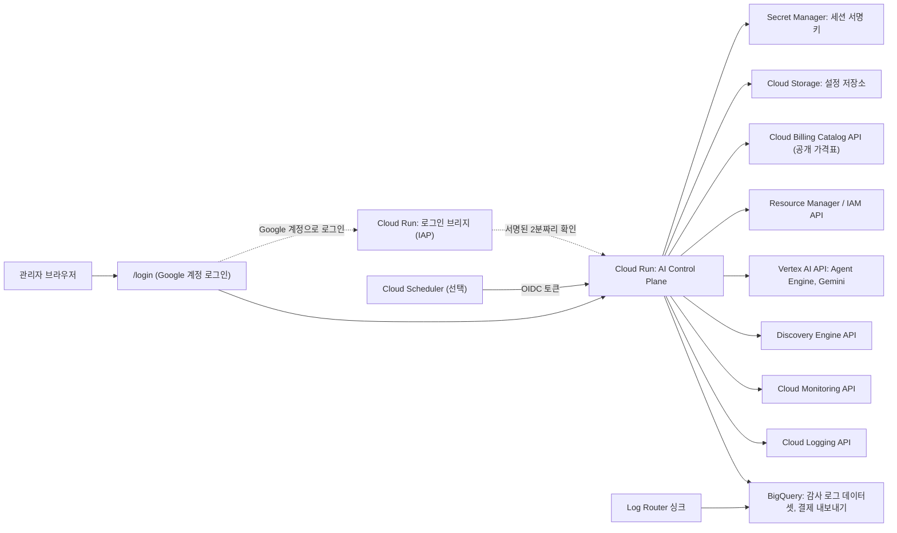
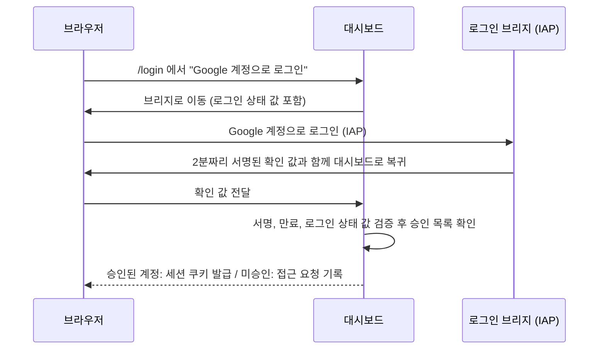
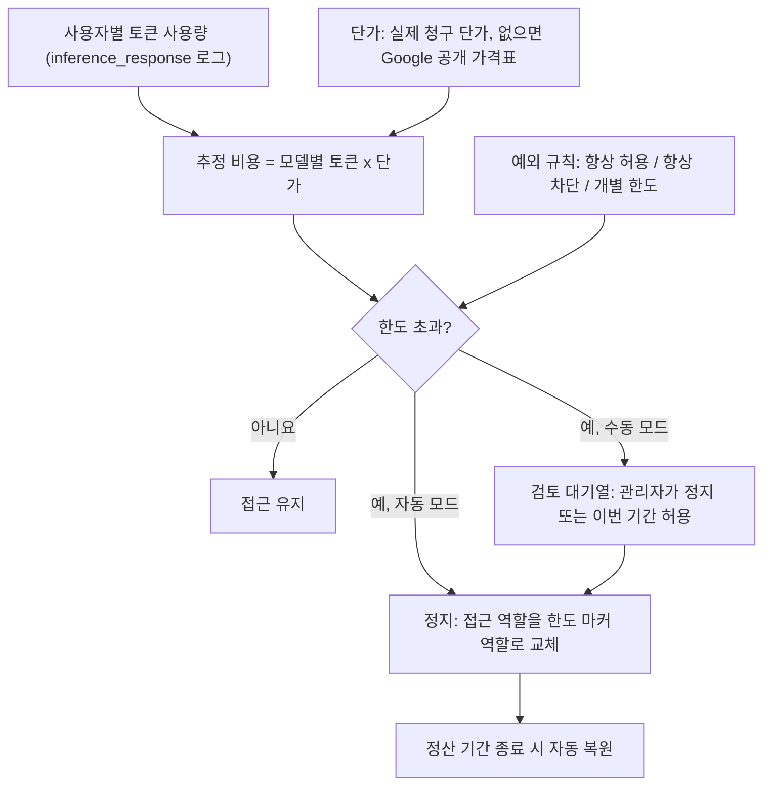

# AI Control Plane

Gemini Enterprise, Gemini Enterprise Agent Platform(Agent Gateway, Agent Registry, Agent Engine 배포, Model Armor), 모델별 토큰 사용량, NotebookLM, Antigravity, 클라우드 비용을 **하나의 관리 콘솔**에서 보고 통제하는 AI 거버넌스 대시보드입니다.

이 저장소를 내려받아 설정 파일 하나(`deploy.env`)를 채우고 스크립트 하나(`scripts/deploy.sh`)를 실행하면, 여러분의 Google Cloud 프로젝트에 바로 배포됩니다. 코드를 고칠 필요가 없습니다. 제품명, 조직명, 로고, 색상, 언어, 사용할 모듈, 추적할 모델은 모두 설정으로 바꿀 수 있습니다.

> [!IMPORTANT]
> **샘플 데이터, 데모 모드, 가짜 데이터가 전혀 없습니다.** 화면의 모든 숫자는 연결한 Google Cloud 프로젝트에서 실제로 읽은 값입니다. 데이터 소스가 없거나 권한이 없으면 값을 추정하거나 채워 넣지 않고 `—`로 비워 두며, 화면 상단 알림과 데이터 소스 상태 패널에 원인과 해결 방법을 표시합니다.

> [!NOTE]
> 이 저장소는 Google Cloud 고객 환경에서 운영하도록 만든 관리 솔루션이며, Google이 공식 지원하는 제품이 아닙니다. English: [README.en.md](README.en.md)

---

## 목차

1. [무엇을 할 수 있나요](#1-무엇을-할-수-있나요)
2. [아키텍처](#2-아키텍처)
3. [빠른 시작: 명령 한 번으로 배포](#3-빠른-시작-명령-한-번으로-배포)
4. [deploy.env 설정 항목 전체](#4-deployenv-설정-항목-전체)
5. [로그인과 권한](#5-로그인과-권한)
6. [데이터 소스 연결](#6-데이터-소스-연결)
7. [화면별 기능과 계산 방법](#7-화면별-기능과-계산-방법)
8. [Antigravity 사용자별 한도와 정지](#8-antigravity-사용자별-한도와-정지)
9. [설정 구조 (config.yaml, 환경 변수, 화면 설정)](#9-설정-구조-configyaml-환경-변수-화면-설정)
10. [Terraform으로 배포 (선택)](#10-terraform으로-배포-선택)
11. [로컬에서 실행](#11-로컬에서-실행)
12. [보안 모델](#12-보안-모델)
13. [비용](#13-비용)
14. [운영과 문제 해결](#14-운영과-문제-해결)
15. [삭제](#15-삭제)
16. [개발자 가이드](#16-개발자-가이드)
17. [라이선스](#17-라이선스)

---

## 1. 무엇을 할 수 있나요

### 1.1 설계 원칙

| 원칙 | 의미 |
|---|---|
| 실측 데이터만 표시 | 추정치, 예시 값, 데모 데이터를 넣지 않습니다. 읽지 못한 값은 `—`와 원인으로 표시합니다. |
| 하드코딩 없음 | 모델 목록과 버전을 코드에 두지 않습니다. 결제 SKU, Cloud Monitoring, Antigravity 로그에서 자동으로 발견하므로 새 모델이 나와도 배포 없이 추적됩니다. |
| 스키마 적응형 | BigQuery 테이블과 컬럼은 `INFORMATION_SCHEMA`로 확인한 뒤 존재하는 것만 조회합니다. 날짜 분할(sharded) 테이블과 파티션 테이블을 모두 지원합니다. |
| 모든 기능은 켜고 끔 | 모듈, 모델, 커넥터 단위로 켜고 끕니다. 꺼진 모듈은 데이터 소스를 조회하지 않습니다. |
| 통제 기능은 안전장치 우선 | IAM 변경은 시뮬레이션, 안전 게이트, 변경 예산, etag 기반 원자적 갱신, 감사 로그를 거칩니다. |
| 최소 권한 | 조회 기능은 읽기 역할만 씁니다. IAM 쓰기 역할은 통제 기능을 켤 때만 부여합니다. 서비스 계정 키를 쓰지 않습니다. |

### 1.2 모듈

| 메뉴 | 모듈 ID | 제공 기능 | 데이터 소스 |
|---|---|---|---|
| 개요 | `overview` | 전체 KPI와 이전 기간 대비 증감, 비용 추이, 모델별 토큰, 보안 현황, 에이전트 수명 주기, 최근 거버넌스 조치 | 각 모듈 |
| Gemini Enterprise | `gemini_enterprise` | 활성 사용자, 프롬프트, 에이전트별 호출, 라이선스 좌석 할당과 휴면 좌석, 업로드 파일 | BigQuery(Gemini Enterprise 로그), Discovery Engine API |
| NotebookLM | `notebooklm` | 활성 노트북, 사용자, 프롬프트 | BigQuery `cloudaudit_googleapis_com_data_access` |
| Agent Gateway | `agent_gateway` | AI 서비스 호출 주체, 서비스와 메서드, 성공/거부/제한/오류, 실패 이력, 모델 호출 | BigQuery 감사 로그, Cloud Monitoring |
| Agent Registry | `agent_registry` | Agent Engine과 Gemini Enterprise 에이전트 통합 카탈로그, 휴면과 폐기 권고, 생성 이력 | Vertex AI API, Discovery Engine API, 감사 로그 |
| 에이전트 배포 | `agent_deployments` | Agent Engine 런타임, 실행 ID(서비스 계정), 호출량, ID별 모델 사용량, 런타임 비용 | Vertex AI API, 감사 로그, 결제 내보내기 |
| Model Armor | `model_armor` | 판정 추이, 필터 일치, 애플리케이션과 사용자별 차단, 이벤트 상세 | BigQuery `modelarmor_googleapis_com_sanitize_operations` |
| 모델 및 토큰 | `model_usage` | 모델 자동 탐지, 모델별 입력/출력/캐시 토큰, 호출 수, 오류율, 비용, 카탈로그 관리 | Cloud Monitoring, 결제 내보내기, Antigravity 로그 |
| 비용 및 FinOps | `finops` | 총 비용, 크레딧, 순 비용, 서비스와 SKU별 비용, 급증 감지와 AI 원인 분석 | 결제 내보내기 |
| 사용자 및 액세스 | `users` | 사용자 360 뷰(서비스 전체 사용량), Antigravity IAM 상태, 개별 허용과 차단 | 전체 소스, Resource Manager IAM |
| Antigravity 통제 | `antigravity` | 사용자별 비용/토큰/요청 한도, 자동 또는 수동 정지, 예외 규칙, 정산 기간, 안전 게이트, 클라우드에서 에이전트가 실행한 작업, 감사 로그 | Cloud Logging 또는 BigQuery, IAM, 결제 내보내기, Cloud Billing Catalog API |
| 텔레메트리 확장 | `telemetry` | 새 로그 소스 자동 발견, 커넥터 등록, 표준 대시보드, 싱크 필터 생성 | BigQuery, Cloud Logging |
| AI 애널리스트 | `analyst` | 자연어 질문, 검증된 읽기 전용 SQL, 결과 표와 차트, 요약 | BigQuery, Vertex AI Gemini |

공통 기능: 라이트/다크 테마, 한국어/영어 전환, 명령 팔레트(Ctrl/Cmd+K), 기간 선택(프리셋과 직접 지정), 표 검색/정렬/CSV 내보내기, 데이터 소스 상태 패널.

크레딧은 결제 내보내기에 실제 크레딧 행이 있을 때만 표시합니다. Gemini Code Assist와 Duet AI SKU는 모든 집계에서 제외됩니다.

---

## 2. 아키텍처

### 2.1 구성



- **단일 컨테이너**: Python 표준 라이브러리 HTTP 서버가 정적 SPA(`src/web`)와 REST API(`/api/v1`)를 함께 제공합니다. 웹 프레임워크와 프런트엔드 빌드 단계가 없어 감사와 수정이 쉽습니다. 런타임 의존성은 6개입니다(`requirements.txt`).
- **프런트엔드**: 의존성 없는 ES Module SPA입니다. `innerHTML`을 쓰지 않고 텍스트 노드로만 렌더링합니다.
- **데이터 접근**: BigQuery는 매개변수화된 쿼리만 사용하고 쿼리마다 `maximum_bytes_billed`로 비용 상한을 둡니다. REST API는 Application Default Credentials(런타임 서비스 계정)와 quota project 헤더로 호출합니다.
- **설정 저장소**: 화면에서 바꾼 설정, 예외 규칙, 정지 기록은 변경분만 Cloud Storage 버킷에 저장합니다. 여러 인스턴스가 30초 주기로 다시 읽어 일관성을 유지합니다.
- **캐시**: 엔드포인트와 조회 조건 단위 TTL 캐시(기본 120초)를 쓰고, 설정이 바뀌면 즉시 무효화합니다.

### 2.2 저장소 구조

```text
.
|-- deploy.env.example          # 배포 설정 템플릿 (복사해서 deploy.env로 사용, Git 제외)
|-- config.yaml                 # 기본 설정 (자리표시자만 포함)
|-- config.local.yaml.example   # 로컬 개발용 설정 템플릿 (복사해서 config.local.yaml로 사용, Git 제외)
|-- requirements.txt            # 버전 고정 의존성
|-- Dockerfile                  # 비루트 사용자로 실행되는 컨테이너 이미지
|-- .dockerignore, .gcloudignore
|-- scripts/
|   |-- deploy.sh               # 명령 한 번 배포 (다시 실행해도 안전)
|   `-- teardown.sh             # 배포한 리소스 삭제
|-- terraform/                  # Terraform 배포 (IAP 방식, 선택)
|-- src/
|   |-- backend_server.py       # 진입점
|   |-- controlplane/           # 백엔드
|   |   |-- app.py              # 라우트 등록과 서버 기동
|   |   |-- config.py           # 기본값, 계층형 로딩, 설정 검증
|   |   |-- auth.py             # Google 로그인, 로그인 브리지, 세션
|   |   |-- security.py         # 인증 모드, IAP/OIDC 검증, 권한, 속도 제한, PII 마스킹
|   |   |-- httpkit.py          # 응답 봉투, 보안 헤더, CSRF, 정적 파일
|   |   |-- schema.py           # 스키마 적응형 BigQuery 접근
|   |   |-- settings_store.py   # 설정 저장소 (gcs, file, memory)
|   |   |-- gcp.py, ai.py, cache.py, timeutil.py
|   |   `-- services/           # 모듈별 서비스 (governance, pricing, gemini_enterprise, ...)
|   `-- web/                    # 프런트엔드 SPA (index.html, login.html, assets/)
|-- tests/unit/                 # 단위 테스트 (232개)
`-- .github/workflows/tests.yml # 푸시마다 단위 테스트 실행
```

---

## 3. 빠른 시작: 명령 한 번으로 배포

### 3.1 준비물

| 항목 | 내용 |
|---|---|
| Google Cloud 프로젝트 | 관제할 프로젝트. 결제가 연결되어 있어야 합니다. |
| 권한 | 배포하는 계정에 프로젝트 `Owner`(또는 서비스 사용 설정, IAM, Cloud Run, Cloud Build, Artifact Registry, Storage, Secret Manager, Logging, BigQuery 관리 권한) |
| 도구 | [Google Cloud SDK](https://cloud.google.com/sdk/docs/install) 최신 버전(`gcloud`, `bq` 포함), `python3`, `bash` |
| 로그인 | `gcloud auth login` 후 `gcloud config set project PROJECT_ID` |

macOS, Linux, Cloud Shell에서 그대로 실행됩니다. Cloud Shell에는 필요한 도구가 모두 설치되어 있습니다.

### 3.2 배포

```bash
git clone https://github.com/ldu1225/ai-control-plane.git
cd ai-control-plane

cp deploy.env.example deploy.env
# deploy.env에서 최소 3개 값을 바꿉니다: PROJECT_ID, REGION, ADMIN_EMAILS

scripts/deploy.sh --dry-run    # 실행될 명령만 미리 확인 (아무것도 바꾸지 않음)
scripts/deploy.sh              # 실제 배포 (보통 3~8분)
```

스크립트가 하는 일:

| 단계 | 내용 |
|---|---|
| 1. API 사용 설정 | Cloud Run, Cloud Build, Artifact Registry, BigQuery, Logging, Monitoring, Discovery Engine, Vertex AI, Resource Manager, IAM, Storage, Secret Manager, Cloud Billing(가격표), Service Usage, 필요하면 IAP와 Cloud Scheduler |
| 2. 컨테이너 이미지 | Artifact Registry 저장소(`ai-control-plane`)를 만들고 Cloud Build로 이미지를 빌드합니다. `IMAGE`를 지정하면 빌드를 건너뜁니다. |
| 3. 런타임 서비스 계정 | 전용 서비스 계정을 만들고 읽기 역할만 부여합니다. `ENABLE_GOVERNANCE_ACTIONS=true`이면 IAM 쓰기 역할을 추가합니다([6.6](#66-런타임-서비스-계정-권한)). |
| 4. 설정 버킷 | 비공개(공개 접근 차단), 버전 관리되는 Cloud Storage 버킷을 만듭니다. 화면에서 바꾼 설정, 예외 규칙, 정지 기록이 저장됩니다. |
| 5. 세션 서명 키 | Secret Manager에 임의 키를 만들고 서비스 계정에 읽기 권한을 줍니다. |
| 6. 감사 로그 라우팅 | BigQuery 데이터셋과 Log Router 싱크를 만듭니다(`CREATE_LOG_SINK=true`). 선택하면 Data Access 감사 로그도 켭니다. |
| 7. Cloud Run 배포 | 대시보드를 배포하고 로그인 방식(`ACCESS_MODE`)을 구성합니다. |
| 8. 자동 집행 일정 | `ENFORCEMENT_SCHEDULE`을 지정하면 Cloud Scheduler 작업을 만듭니다. |

- **다시 실행해도 안전합니다.** 없는 것은 만들고 있는 것은 갱신합니다. 설정을 바꾸고 다시 실행하면 그대로 반영됩니다.
- `deploy.env`가 서비스 설정의 기준입니다. 실행할 때마다 Cloud Run 환경 변수와 시크릿을 `deploy.env` 기준으로 다시 씁니다.
- 끝나면 접속 주소가 출력됩니다. 기본 주소는 `https://SERVICE_NAME-PROJECT_NUMBER.REGION.run.app` 형식입니다.

### 3.3 첫 로그인

1. 출력된 주소의 `/login`으로 접속해 **Google 계정으로 로그인**을 누릅니다.
2. `ADMIN_EMAILS`에 있는 계정은 바로 관리자로 들어갑니다.
3. 승인되지 않은 계정은 접근 요청으로 기록됩니다. 관리자가 **설정 > 액세스 제어**에서 viewer 또는 admin으로 승인합니다.

### 3.4 배포 후 확인

1. 상단 바의 **데이터 소스**를 눌러 연결 상태를 확인합니다. 빨간색 항목에 원인(권한, 테이블 없음 등)이 표시됩니다.
2. **설정 > 워크스페이스 및 데이터 소스**에서 결제 내보내기, 감사 로그 데이터셋, Gemini Enterprise 위치를 확인하거나 바꿉니다.
3. 감사 로그 싱크를 새로 만들었다면 테이블은 해당 로그가 처음 발생할 때 생깁니다. 처음 몇 분에서 몇 시간 동안은 일부 지표가 비어 있을 수 있습니다.
4. Antigravity 사용자별 한도를 쓰려면 [8장](#8-antigravity-사용자별-한도와-정지)을 따릅니다.

---

## 4. deploy.env 설정 항목 전체

`deploy.env`는 bash가 읽는 `KEY="value"` 형식입니다. 공백이 있는 값은 따옴표로 감쌉니다. 이 파일은 `.gitignore`에 포함되어 Git에 올라가지 않습니다.

### 4.1 필수

| 변수 | 예시 | 설명 |
|---|---|---|
| `PROJECT_ID` | `my-project` | 관제하고 배포할 프로젝트 |
| `REGION` | `asia-northeast3` | Cloud Run, Artifact Registry, 설정 버킷, Scheduler 리전 |
| `ADMIN_EMAILS` | `admin@example.com,*@security.example.com` | 관리자. 쉼표로 구분하고 `*@도메인` 형식을 쓸 수 있습니다. |

### 4.2 서비스와 표시

| 변수 | 기본값 | 설명 |
|---|---|---|
| `SERVICE_NAME` | `ai-control-plane` | Cloud Run 서비스 이름. 서비스 계정, 버킷, 시크릿, 싱크, 스케줄러 작업 이름에도 쓰입니다. |
| `ORGANIZATION_NAME` | `Your Organization` | 헤더와 로그인 화면에 표시할 조직명 |
| `DEFAULT_LOCALE` | `en` (템플릿은 `ko`) | 기본 언어 `ko` 또는 `en`. 사용자는 화면에서 바꿀 수 있습니다. |
| `WORKSPACE_TIMEZONE` | `UTC` (템플릿은 `Asia/Seoul`) | 날짜 표시, 일별 집계, 스케줄러 시간대 |
| `PRODUCT_NAME` | 비어 있음 | 제품명 변경(화이트라벨). 비우면 `AI Control Plane` |

### 4.3 로그인 방식

| 변수 | 기본값 | 설명 |
|---|---|---|
| `ACCESS_MODE` | `google` | `google`, `google_oauth`, `iap` 중 하나([5장](#5-로그인과-권한)) |
| `ALLOWED_USERS` | 비어 있음 | Google 로그인 방식에서 미리 승인할 viewer. 예: `*@example.com,partner@example.org` |
| `IAP_MEMBERS` | 비어 있음 | `iap` 방식에서 접속을 허용할 주체. 예: `group:ai-governance@example.com,user:a@example.com` |
| `OAUTH_CLIENT_JSON` | 비어 있음 | `google_oauth` 방식에서 내려받은 OAuth 클라이언트 JSON 경로(커밋 금지) |
| `BRIDGE_MEMBERS` | `allAuthenticatedUsers` | `google` 방식에서 로그인 브리지를 통과할 수 있는 주체. 조직 정책이 막으면 `domain:example.com` |
| `PUBLIC_BASE_URL` | 비어 있음 | 사용자 지정 도메인. 예: `https://ai-governance.example.com` |

### 4.4 데이터 소스

| 변수 | 기본값 | 설명 |
|---|---|---|
| `AUDIT_DATASET` | `ge_analytics` | 감사 로그가 들어오는 BigQuery 데이터셋 |
| `CREATE_LOG_SINK` | `true` | 데이터셋과 Log Router 싱크 생성. 이미 싱크가 있으면 `false` |
| `DATASET_LOCATION` | `US` | 새로 만드는 데이터셋 위치 |
| `ENABLE_DATA_ACCESS_LOGS` | `false` | Vertex AI, Discovery Engine, Model Armor의 Data Access 감사 로그 켜기(로그 양과 비용 증가) |
| `BILLING_PROJECT_ID` | 비어 있음 | 결제 내보내기가 있는 프로젝트(비우면 `PROJECT_ID`) |
| `BILLING_DATASET` | 비어 있음 | 결제 내보내기 데이터셋. 예: `billing_detailed_usage` |
| `BILLING_TABLE` | 비어 있음 | `gcp_billing_export_resource_v1_XXXXXX_XXXXXX_XXXXXX` |
| `BILLING_ACCOUNT_ID` | 비어 있음 | `XXXXXX-XXXXXX-XXXXXX` |
| `DISCOVERY_ENGINE_LOCATIONS` | `global` | Gemini Enterprise 위치(쉼표 구분: `global,us,eu`) |
| `AGENT_ENGINE_REGIONS` | `REGION` | Agent Engine 리전(쉼표 구분) |

결제 값은 배포 후 **설정 > 워크스페이스 및 데이터 소스**에서 입력해도 됩니다.

### 4.5 거버넌스

| 변수 | 기본값 | 설명 |
|---|---|---|
| `ENABLE_GOVERNANCE_ACTIONS` | `false` | IAM 쓰기 역할 부여. 한도 초과 사용자 정지, 복원, 개별 허용/차단, 마커 역할 생성에 필요 |
| `ENFORCEMENT_SCHEDULE` | 비어 있음 | 자동 집행 일정(cron). 예: `*/15 * * * *`. `ENABLE_GOVERNANCE_ACTIONS=true`와 `google` 또는 `google_oauth` 방식이 필요합니다. |

### 4.6 기타

| 변수 | 기본값 | 설명 |
|---|---|---|
| `AI_DEFAULT_MODEL` | 비어 있음 | AI 애널리스트 기본 모델(비우면 `config.yaml` 값) |
| `IMAGE` | 비어 있음 | 미리 빌드한 이미지. 비우면 Cloud Build로 빌드 |
| `MEMORY`, `CPU` | `1Gi`, `1` | Cloud Run 리소스 |
| `MIN_INSTANCES`, `MAX_INSTANCES` | `0`, `3` | 인스턴스 수. 0이면 요청이 없을 때 비용이 들지 않습니다. |
| `AR_REPOSITORY` | `ai-control-plane` | Artifact Registry 저장소 이름 |
| `SERVICE_ACCOUNT_ID` | `SERVICE_NAME-sa` | 런타임 서비스 계정 ID |
| `SETTINGS_BUCKET` | `PROJECT_ID-SERVICE_NAME-settings` | 설정 버킷 이름(전역 고유, 63자 이하) |
| `SESSION_SECRET_NAME` | `SERVICE_NAME-session-secret` | 세션 서명 키 시크릿 이름 |
| `OAUTH_SECRET_NAME` | `SERVICE_NAME-oauth-client-secret` | OAuth 클라이언트 보안 비밀 시크릿 이름 |

---

## 5. 로그인과 권한

### 5.1 로그인 방식 선택

| `ACCESS_MODE` | 동작 | 언제 쓰나요 |
|---|---|---|
| `google` (권장) | 대시보드 자체 로그인 화면(`/login`)에서 Google 계정으로 로그인합니다. OAuth 클라이언트를 만들 필요가 없습니다. IAP 뒤에 있는 작은 로그인 브리지 서비스가 Google 계정을 확인하고, 대시보드는 승인된 계정만 들여보냅니다. | 대부분의 경우 |
| `google_oauth` | 같은 로그인 화면을 직접 만든 OAuth 클라이언트로 운영합니다. | 브리지 서비스를 두고 싶지 않거나 OAuth 동의 화면을 직접 관리하려는 경우 |
| `iap` | Identity-Aware Proxy가 대시보드 앞에서 로그인을 처리합니다. 앱은 IAP 서명 헤더를 검증합니다. | 이미 IAP와 그룹 기반 접근 관리를 쓰는 조직 |



`google_oauth` 방식 준비(한 번만):

1. Google Cloud 콘솔 > Google Auth Platform > 브랜딩: 앱 이름과 지원 이메일을 입력합니다.
2. 대상: 조직 계정만 쓰면 `내부`, 외부 Google 계정도 쓰면 `외부`(게시하거나 테스트 사용자 추가).
3. 클라이언트 > 클라이언트 만들기 > 웹 애플리케이션. 승인된 리디렉션 URI에 `https://대시보드주소/auth/google/callback`을 넣습니다.
4. 만든 직후 JSON을 내려받아 `OAUTH_CLIENT_JSON`에 경로를 적습니다(보안 비밀은 이때만 보입니다). 스크립트가 보안 비밀을 Secret Manager에 저장하며 화면에 출력하지 않습니다.

### 5.2 역할

| 역할 | 할 수 있는 일 |
|---|---|
| admin | 모든 화면, 설정 변경, 사용자 승인, 한도 정책, 정지/복원, 예외 규칙, 커넥터 관리 |
| viewer | 모든 화면 조회. 이메일은 서버에서 마스킹되고(`ad***@example.com`), Model Armor 원문과 업로드 파일명은 제공되지 않습니다. |

- 관리자 = `ADMIN_EMAILS` + `config.yaml`의 `security.admins` + 화면에서 추가한 관리자.
- viewer = `ALLOWED_USERS` + `security.allowed_users` + 화면에서 승인한 사용자.
- 설정 파일이나 환경 변수로 지정한 계정은 화면에서 지울 수 없습니다(고정). 화면에서 추가한 계정은 화면에서 지울 수 있고, 지우면 그 계정의 기존 세션도 즉시 끊깁니다.
- 세션 기본 유효 시간은 12시간입니다(`SESSION_HOURS`, 1~168).

---

## 6. 데이터 소스 연결

데이터 소스가 많을수록 볼 수 있는 화면이 늘어납니다. 연결하지 않은 소스의 지표는 `—`로 표시되고 원인이 안내됩니다.

### 6.1 감사 로그 싱크 (BigQuery)

`scripts/deploy.sh`가 `CREATE_LOG_SINK=true`일 때 자동으로 만듭니다. 직접 만들 때는 아래와 같습니다.

```bash
bq --location=US mk --dataset PROJECT_ID:ge_analytics

gcloud logging sinks create ai-control-plane-ai-logs \
  bigquery.googleapis.com/projects/PROJECT_ID/datasets/ge_analytics \
  --use-partitioned-tables --project=PROJECT_ID \
  --log-filter='
(
  logName="projects/PROJECT_ID/logs/cloudaudit.googleapis.com%2Fdata_access" OR
  logName="projects/PROJECT_ID/logs/cloudaudit.googleapis.com%2Factivity"
) AND protoPayload.serviceName=(
  "aiplatform.googleapis.com" OR "discoveryengine.googleapis.com" OR
  "modelarmor.googleapis.com" OR "businessaicode.googleapis.com" OR
  "notebooklm.googleapis.com" OR "geminidataanalytics.googleapis.com" OR
  "generativelanguage.googleapis.com"
)
OR logName="projects/PROJECT_ID/logs/discoveryengine.googleapis.com%2Fgemini_enterprise_user_activity"
OR logName="projects/PROJECT_ID/logs/discoveryengine.googleapis.com%2Fgen_ai_user_message"
OR logName="projects/PROJECT_ID/logs/modelarmor.googleapis.com%2Fsanitize_operations"
OR logName="projects/PROJECT_ID/logs/businessaicode.googleapis.com%2Finference_response"'

gcloud logging sinks describe ai-control-plane-ai-logs --project=PROJECT_ID --format='value(writerIdentity)'
```

출력된 writer identity(대개 프로젝트 공용 Logging 서비스 에이전트 `service-PROJECT_NUMBER@gcp-sa-logging.iam.gserviceaccount.com`)에 **이 데이터셋에만** BigQuery 데이터 편집자 권한을 줍니다. BigQuery 콘솔 > 데이터셋 > 공유 > 권한 > 주 구성원 추가에서 부여합니다. `scripts/deploy.sh`는 이 작업을 데이터셋 수준으로 자동 처리하며, 프로젝트 수준 권한은 바꾸지 않습니다.

싱크가 만드는 테이블과 쓰는 화면:

| 테이블 | 사용하는 화면 |
|---|---|
| `cloudaudit_googleapis_com_activity` | Agent Registry(생성 이력), Agent Gateway, 클라우드에서 에이전트가 실행한 작업(변경) |
| `cloudaudit_googleapis_com_data_access` | Agent Gateway, NotebookLM, 에이전트 배포, 사용자, 클라우드에서 에이전트가 실행한 작업(조회) |
| `discoveryengine_googleapis_com_gen_ai_user_message` | Gemini Enterprise(프롬프트, 업로드 파일 이름) |
| `discoveryengine_googleapis_com_gemini_enterprise_user_activity` | Gemini Enterprise(프롬프트, 에이전트 호출, 업로드), Model Armor 사용자 연결 |
| `modelarmor_googleapis_com_sanitize_operations` | Model Armor |
| `businessaicode_googleapis_com_inference_response` | Antigravity(없으면 Cloud Logging API로 직접 조회) |

테이블은 해당 로그가 처음 기록될 때 생깁니다. 없는 테이블은 그 지표만 비고 경고가 표시됩니다.

### 6.2 Data Access 감사 로그

Agent Gateway, NotebookLM, 에이전트 배포, ID별 모델 사용량은 Data Access 감사 로그를 씁니다. `ENABLE_DATA_ACCESS_LOGS=true`로 다시 배포하거나, 콘솔의 **IAM 및 관리자 > 감사 로그**에서 아래 서비스의 `Data Read`, `Data Write`를 켭니다.

- Vertex AI API (`aiplatform.googleapis.com`)
- Discovery Engine API (`discoveryengine.googleapis.com`)
- Model Armor API (`modelarmor.googleapis.com`)

Data Access 로그는 양이 많을 수 있고 Cloud Logging 수집 비용이 생깁니다. 스크립트는 IAM 정책의 etag를 그대로 써서 갱신하므로 동시에 다른 변경이 있으면 덮어쓰지 않고 실패합니다.

### 6.3 Gemini Enterprise 로그

Gemini Enterprise 관리 콘솔에서 **사용자 활동 로깅**과 **메시지(프롬프트) 로깅**을 켭니다. 활동 로그만 있으면 프롬프트 수, 에이전트 호출, 업로드 건수는 보이지만 업로드 파일 이름은 보이지 않습니다(활동 로그에 파일 이름이 기록되지 않음). 라이선스 좌석은 Discovery Engine API로 읽으므로 `DISCOVERY_ENGINE_LOCATIONS`에 실제 위치(`global`, `us`, `eu`)를 넣습니다.

집계 기준(실제 로그로 검증한 규칙):

- 같은 `insertId`와 시각을 가진 중복 전달 행은 한 건으로 셉니다.
- **프롬프트**: 메시지 로그가 있으면 메시지 로그를, 없으면 활동 로그의 어시스턴트 호출(`StreamAssist` 등) 중 사용자 입력이 있는 호출을 셉니다. 제품이 자동으로 하는 세션 요약(`session_to_summarize`), 컨텍스트 주입, 예약 실행은 프롬프트가 아닙니다.
- **에이전트 호출**: 특정 에이전트를 지정한 어시스턴트 호출(`agentsSpec`)이며 예약 실행을 포함합니다. 에이전트 페이지 조회와 수정은 호출이 아닙니다. 에이전트 이름은 로그의 이름, Discovery Engine 에이전트 목록 순서로 찾습니다.
- **업로드**: 활동 로그에는 업로드 한 건이 요청과 응답 두 줄로 남으므로 파일 ID가 있는 응답만 셉니다.

### 6.4 결제 내보내기

**결제 > 결제 내보내기**에서 **상세 사용량 비용(Detailed usage cost)** 내보내기를 BigQuery로 켭니다. 생성되는 `gcp_billing_export_resource_v1_...` 테이블 이름과 결제 계정 ID를 `deploy.env`(또는 화면 설정)에 넣습니다. 내보내기는 켠 시점부터 쌓이며, 데이터가 처음 들어오기까지 몇 시간이 걸릴 수 있습니다.

결제 내보내기를 쓰는 기능: 비용 및 FinOps, 모델별 비용, 에이전트 런타임 비용(resource 수준 내보내기 필요), Antigravity 1인당 비용 한도의 실제 단가.

### 6.5 Antigravity 추론 로그

Antigravity 사용자별 토큰 사용량은 Antigravity for organizations가 프로젝트에 기록하는 `businessaicode.googleapis.com/inference_response` 로그에서 읽습니다. BigQuery 싱크 테이블이 있으면 BigQuery를, 없으면 Cloud Logging API를 씁니다(`usage_source: auto`). 개인 환경에서 쓰는 코딩 에이전트(예: Jetski)는 이 로그를 남기지 않습니다. 이런 에이전트가 사용자 자격 증명으로 호출한 Google Cloud API는 Antigravity 통제 화면의 **클라우드에서 에이전트가 실행한 작업**에 감사 로그 기준으로 표시됩니다.

### 6.6 런타임 서비스 계정 권한

`scripts/deploy.sh`와 Terraform이 자동으로 부여합니다. 직접 구성할 때도 같은 기준을 따릅니다.

**조회 (항상 필요)**

| 역할 | 용도 |
|---|---|
| `roles/bigquery.jobUser` | 매개변수화된 쿼리 실행 |
| `roles/bigquery.dataViewer` | 감사 로그와 결제 내보내기 조회(결제 데이터셋이 다른 프로젝트면 그 프로젝트에도) |
| `roles/logging.viewer` | Antigravity 추론 로그, 거버넌스 감사 로그, 로그 소스 발견 |
| `roles/monitoring.viewer` | 모델별 토큰과 호출 지표 |
| `roles/discoveryengine.viewer` | 라이선스, 엔진, 어시스턴트, 에이전트 |
| `roles/aiplatform.user` | Agent Engine 조회, AI 애널리스트(Gemini) 호출 |
| `roles/iam.securityReviewer` | 프로젝트 IAM 정책 조회(Antigravity 상태 분류) |
| `roles/serviceusage.serviceUsageConsumer` | 모든 호출에 quota project 헤더 사용 |
| `roles/storage.objectAdmin` (설정 버킷에만) | 화면 설정, 예외 규칙, 정지 기록 저장 |
| `roles/secretmanager.secretAccessor` (시크릿에만) | 세션 서명 키, OAuth 클라이언트 보안 비밀 |

**통제 기능 (`ENABLE_GOVERNANCE_ACTIONS=true`일 때만)**

| 역할 | 용도 |
|---|---|
| `roles/resourcemanager.projectIamAdmin` | 한도 초과 정지와 복원, 개별 허용과 차단(etag 기반 `setIamPolicy`) |
| `roles/logging.logWriter` | 거버넌스 감사 로그 기록 |
| `roles/iam.roleAdmin` | 마커 역할 생성(처음 한 번) |

**상속 바인딩 확인 (선택)**: 조직 수준 `roles/iam.securityReviewer`를 주면 폴더와 조직에서 상속된 Antigravity 접근 권한까지 판별합니다(Terraform `organization_id`). 주지 않으면 해당 사용자는 `UNKNOWN / ANCESTOR_UNCHECKED`로 분류되고 변경 대상에서 빠집니다.

---

## 7. 화면별 기능과 계산 방법

### 7.1 개요

각 모듈의 핵심 KPI를 한 화면에 모으고 이전 같은 길이 기간과 비교한 증감을 보여 줍니다. 꺼진 모듈의 KPI는 "모듈 비활성"으로 표시됩니다.

### 7.2 Gemini Enterprise

활성 사용자, 프롬프트, 에이전트별 호출, 업로드 파일, 라이선스 좌석(할당, 사용, 휴면 좌석)을 보여 줍니다. 집계 기준은 [6.3](#63-gemini-enterprise-로그)을 따릅니다.

### 7.3 NotebookLM

NotebookLM Data Access 감사 로그에서 활성 노트북, 사용자, 프롬프트를 셉니다.

### 7.4 Agent Gateway

`gateway.services`에 등록한 AI 서비스의 호출 주체, 서비스와 메서드, 결과(성공, 거부, 제한, 오류), 실패 이력, 모델 호출을 감사 로그와 Cloud Monitoring으로 보여 줍니다.

### 7.5 Agent Registry와 에이전트 배포

- **Agent Registry**: Agent Engine(Vertex AI)과 Gemini Enterprise 에이전트를 하나의 카탈로그로 합칩니다. 마지막 호출 이후 `agent_lifecycle.idle_days`(기본 14일)가 지나면 휴면, `deprecation_days`(기본 50일)가 지나면 폐기 권고로 분류합니다.
- **에이전트 배포**: Agent Engine 런타임별 실행 ID(서비스 계정), 호출량, ID별 모델 사용량, 런타임 비용(resource 수준 결제 내보내기)을 보여 줍니다.

### 7.6 Model Armor

판정 추이, 필터 일치(프롬프트 인젝션, 민감 정보 등), 애플리케이션과 사용자별 차단, 이벤트 상세를 보여 줍니다. viewer에게는 원문을 제공하지 않습니다.

### 7.7 모델 및 토큰

- 모델은 결제 SKU, Cloud Monitoring `model_user_id`, Antigravity `model_id`에서 자동으로 발견됩니다. SKU 설명에서 모델 계열 단어(Gemini, Claude, Llama 등)를 찾고 리전, 모달리티, 입출력, 컨텍스트 구간 같은 수식어를 빼서 하나의 키(예: `gemini-3.8-flash`)로 묶습니다. Vertex AI 형식(`Gemini 3.8 Flash Global Text Input`), Gemini API 형식, Monitoring 모델 ID가 같은 모델로 합쳐집니다.
- 모델별 토큰은 Cloud Monitoring `publisher/online_serving/token_count`(Vertex AI)를 기준으로 하고, Monitoring에 잡히지 않는 Gemini API 결제 토큰을 더합니다. Monitoring 지표가 없는 모델은 결제 SKU의 토큰 사용량을 씁니다. 호출 수와 오류율은 `model_invocation_count`에서 계산합니다.
- 제품이 모델 사용량을 자체 SKU로 다시 청구하는 경우 "제품별 사용량" 카드에 따로 표시하고, 같은 토큰이 기반 모델에도 청구되므로 모델 토큰 합계에는 더하지 않습니다.
- 새 모델이 처음 발견되면 "새 모델 감지" 알림이 뜹니다. `auto_enable_new_models: true`이면 바로 추적하고, `false`이면 관리자가 켤 때까지 합계에서 뺍니다.
- 카탈로그 관리(또는 설정 > 모델 카탈로그)에서 모델별 추적을 끌 수 있습니다.

### 7.8 비용 및 FinOps

결제 내보내기로 총 비용, 크레딧, 순 비용, 서비스와 SKU별 비용, AI 비중을 계산합니다. 전일 대비 `finops.spike_threshold_pct`(기본 50%) 이상, `spike_min_delta` 이상 늘어난 날을 급증으로 표시하고, 원인 분석을 누르면 Gemini가 SKU 변화를 근거로 원인을 요약합니다.

### 7.9 사용자 및 액세스

사용자별로 Gemini Enterprise, NotebookLM, Agent Gateway, Antigravity 등 모든 서비스 사용량을 한 줄로 모읍니다. 사용자를 누르면 상세 화면에서 서비스별 사용량, Antigravity IAM 상태, 한도 사용률, 정지 정보, 개별 허용/차단 버튼을 볼 수 있습니다.

### 7.10 텔레메트리 확장

새 에이전트나 모델 제품의 텔레메트리를 코드 수정 없이 연결합니다.

1. **자동 발견**: 감사 로그 데이터셋과 `workspace.telemetry_datasets`의 테이블, 프로젝트의 로그 이름을 주기적으로 확인해 아직 연결하지 않은 소스를 보여 줍니다.
2. **싱크 생성기**: 로그를 고르면 `gcloud logging sinks create` 명령과 필터를 만들어 줍니다.
3. **커넥터 등록**: 테이블(또는 로그 필터)을 고르고 시간, 사용자, 모델, 토큰, 작업, 상태 필드를 매핑합니다. 컬럼 이름으로 매핑을 자동 제안합니다.
4. **표준 대시보드**: 커넥터마다 이벤트, 사용자, 토큰 추이와 상위 작업, 사용자, 모델, 최근 이벤트 화면이 생깁니다.

### 7.11 AI 애널리스트

자연어 질문을 BigQuery SQL로 바꿔 실행하고 표, 차트, 요약을 보여 줍니다. 생성된 SQL은 실행 전에 검증합니다. 주석과 문자열을 제거한 뒤 단일 `SELECT`/`WITH` 문인지 확인하고, DML/DDL을 거부하고, 참조 테이블이 허용된 데이터셋(감사 로그, 결제, 등록된 커넥터)에 속하는지 확인합니다. 실행에는 `analyst.max_bytes_billed`와 `analyst.max_rows` 상한이 적용됩니다. 요약은 결과 행만 근거로 쓰며, 결과 데이터 안의 지시문은 따르지 않습니다.

---

## 8. Antigravity 사용자별 한도와 정지

사람별로 금액(예: 1인당 100만 원)이나 토큰, 요청 수 한도를 두고, 넘은 사용자의 Antigravity 접근을 정산 기간이 끝날 때까지 막습니다. 관리자는 **금액만 정하면 됩니다.** 토큰 단가와 환율은 시스템이 찾습니다.

### 8.1 동작 개요



### 8.2 시작하기

1. `ENABLE_GOVERNANCE_ACTIONS="true"`로 배포합니다. 자동 정지를 쓰려면 `ENFORCEMENT_SCHEDULE="*/15 * * * *"`도 지정합니다.
2. **Antigravity 통제 > 집행 사전 요구 사항**에서 마커 역할과 권한을 확인하고, 마커 역할이 없으면 **마커 역할 생성**을 누릅니다.
3. **한도 정책 > 정책 편집**에서 정합니다.
   - 1인당 비용 한도: `₩100만`, `₩200만`, `₩300만` 버튼 또는 직접 입력
   - 통화: 기본은 결제 계정 통화. `KRW`를 고르면 원화로 표시하고 비교합니다.
   - 정산 기간: 일별, 주별, 월별, 최근 90일 / 창: 달력 기준(고정 초기화) 또는 이동 창 / 초기화 시간대(예: 매월 1일 00:00 Asia/Seoul)
   - 토큰 한도, 요청 한도(0이면 꺼짐)
4. 사람마다 금액을 다르게 주려면 **한도 대비 사용량** 표의 **비용 한도** 열에서 연필 버튼을 누릅니다(`기본값 사용`, `비용 한도 없음`, 프리셋, 직접 입력).
5. 상단 **집행** 카드에서 **자동 정지** 또는 **수동 검토**를 고릅니다. 기본은 수동 검토입니다.
6. **시뮬레이션**으로 IAM을 바꾸지 않고 결과를 미리 본 뒤 **지금 집행 실행**을 누릅니다.

### 8.3 추정 비용과 단가

- 사용자별 비용 = 모델별로 입력(프롬프트) 토큰 x 입력 단가 + 나머지 토큰(응답, thinking) x 출력 단가.
- 단가는 모델과 방향(입력/출력)별로 다음 순서로 찾습니다.
  1. **실제 청구 단가**: 최근 30일 결제 내보내기에서 해당 모델 표준 텍스트 토큰 SKU의 `SUM(cost) / SUM(usage.amount)`. 협상 가격이 반영되며 크레딧은 빼지 않습니다. batch, flex, priority, 캐시, 장문 컨텍스트, 튜닝, 오디오/이미지/비디오 같은 변형 SKU는 제외합니다.
  2. **Google 공개 가격표**: 청구 기록이 없는 모델은 Cloud Billing Catalog API(Vertex AI, Gemini API)의 공개 가격을 씁니다.
- 통화가 다르면 Google이 가격표에 게시하는 환율로 환산합니다. 화면에 `1 USD = ₩1,359 (Google 환율, 날짜)`처럼 근거를 표시합니다.
- 단가는 6시간 동안 캐시됩니다. 한도 정책 카드의 **이번 기간에 사용한 모델 단가** 표에 모델별 단가와 출처(청구 단가, Google 가격표, 단가 없음)가 표시됩니다.
- 어느 쪽에서도 단가를 찾지 못한 모델은 "단가 없음"으로 표시되고 그 토큰은 비용에 들어가지 않습니다. 비용 한도만 켠 상태에서 비용을 계산할 수 없는 사용자는 한도 사용률이 0%가 아니라 `—`로 표시되고 정지되지 않습니다.
- 결제 내보내기에는 사용자 정보가 없으므로 사람별 비용은 실제 청구액이 아니라 토큰 기반 추정치입니다. 화면에도 추정 비용으로 표시합니다.
- 계약 단가를 직접 넣고 싶은 조직은 설정 > 거버넌스 정책에서 토큰 단가를 `직접 입력`으로 바꾸거나 `config.yaml`의 `model_prices`를 씁니다(선택).

### 8.4 집행 모드

| 모드 | 한도를 넘으면 | 복원 |
|---|---|---|
| 수동 검토 (기본) | 검토 대기열에 올라갑니다. 관리자가 사용자별(또는 일괄)로 **정지**하거나 **이번 기간 허용**합니다. 새 대기 사용자가 생기면 웹훅으로 알립니다. | 정산 기간이 끝나면 자동 |
| 자동 정지 | 집행 실행마다 정지됩니다. | 정산 기간이 끝나면 자동 |

- **집행 실행**은 **지금 집행 실행** 버튼 또는 Cloud Scheduler 작업(`ENFORCEMENT_SCHEDULE`)으로 일어납니다. 스케줄러 작업은 권한이 없는 전용 서비스 계정의 Google OIDC 토큰으로 `POST /api/v1/governance/antigravity/enforce`를 호출하고, 앱은 발급자, 대상(`PUBLIC_BASE_URL` + 경로), 이메일 검증, 허용 목록(`SCHEDULER_INVOKERS`)을 확인합니다. 인증 없는 호출과 다른 토큰은 401입니다.
- 정지 = 접근 역할(`roles/discoveryengine.agentspaceUser`)을 한도 마커 역할(`CustomAntigravityCapBlocked`)로 바꾸는 하나의 etag 기반 `setIamPolicy`입니다. 정지 기록(시작, 종료 예정, 사유, 실행 주체)이 설정 버킷에 남고, 기간이 끝나면 텔레메트리가 없어도 복원됩니다. 단, 새 기간 사용량이 이미 한도를 넘었으면 유지됩니다.

### 8.5 예외 규칙

| 규칙 | 효과 | 기간 |
|---|---|---|
| 항상 허용 | 한도를 넘어도 정지하지 않습니다. 정지된 사용자는 바로 복원됩니다. | 이번 정산 기간만 / 만료 없음 |
| 개별 한도 | 이 사용자에게만 다른 비용/토큰/요청 한도를 적용합니다. 비워 둔 항목은 기본 한도를 따릅니다. | 이번 정산 기간만 / 만료 없음 |
| 항상 차단 | 관리자 차단 마커 역할(`CustomAntigravityAdminBlocked`)로 바로 차단하고, 규칙을 지울 때까지 유지합니다. | 만료 없음 |

규칙은 두 집행 모드 모두에 적용되며, 추가/변경/삭제는 모두 감사 로그에 남습니다.

### 8.6 IAM 상태와 안전 게이트

| 상태 | 의미 | 자동 정지 | 자동 복원 |
|---|---|:---:|:---:|
| `ENFORCEABLE_ALLOWED` | 직접 `user:` 바인딩으로만 접근 권한이 있음 | 예 | - |
| `CAPPED_BY_TOOL` | 한도 초과로 정지됨 | - | 예 |
| `BLOCKED_BY_ADMIN` | 관리자가 차단함 | - | 아니요 |
| `NOT_ENFORCEABLE` | 그룹, 도메인, 상속 바인딩, 상위 역할 등으로 접근해 개별 통제 불가 | 아니요 | 아니요 |
| `NO_ACCESS` | 접근 경로 없음 | 아니요 | 아니요 |
| `UNKNOWN` | 정책을 읽지 못해 판단 불가 | 아니요 | 아니요 |

`NOT_ENFORCEABLE`과 `UNKNOWN` 사용자는 절대 바꾸지 않고, 사유별 조치 방법과 함께 "수동 조치 필요" 목록에 보여 줍니다.

| 게이트 | 조건 | 동작 |
|---|---|---|
| `G1_POLICY_READABLE` | 프로젝트 IAM 정책을 읽지 못함 | 적용 중단 |
| `G2_ANY_DETERMINATE` | 판단 가능한 사용자가 없음 | 적용 중단 |
| `G3_TELEMETRY_HEALTHY` | 사용량 조회 실패 또는 0건 | 정지만 적용, 사용량 기반 복원 보류(기간 종료 복원은 진행) |
| `G4_CHANGE_BUDGET` | 계획된 변경이 `max(change_budget_min, ceil(change_budget_ratio x 대상 인원))` 초과 | 적용 중단 |
| `G5_NON_USER_GRANT_ABSENT` | 접근 역할에 그룹 또는 도메인 바인딩 존재 | 경고 |

동시 변경으로 etag가 충돌하면 계획을 다시 계산해 한 번 재시도합니다.

### 8.7 감사, 알림, 영속성

- 모든 집행 실행, 검토 결정, 예외 규칙, 허용/차단은 Cloud Logging 감사 로그(`projects/PROJECT_ID/logs/agy-admin%2Fadmin_actions`)에 기록되고 **관리 감사 로그** 카드에 표시됩니다. [agy-admin-cli](https://github.com/terrychahn/agy-admin-cli)와 같은 마커 역할과 감사 로그를 쓰므로 함께 운영할 수 있습니다. 함께 쓸 때는 두 도구의 실행 시각이 겹치지 않게 합니다.
- `governance.antigravity.webhook_url`(Slack `hooks.slack.com` 또는 Google Chat `chat.googleapis.com`, HTTPS만)을 지정하면 새 검토 대기 사용자와 집행 결과를 보냅니다.
- 예외 규칙과 정지 기록은 설정 버킷에 저장되어 재시작 후에도 남습니다. 설정 버킷 없이 Cloud Run에서 실행하면 메모리에만 저장되며 화면에 경고가 표시됩니다.

---

## 9. 설정 구조 (config.yaml, 환경 변수, 화면 설정)

### 9.1 로딩 순서

뒤의 값이 앞의 값을 덮어씁니다.

1. 내장 기본값
2. `config.yaml` (`CONFIG_PATH`로 경로 지정 가능)
3. `config.local.yaml` (같은 디렉터리, 선택, Git 제외)
4. 환경 변수 (`scripts/deploy.sh`가 `deploy.env`로 설정)
5. 화면에서 저장한 설정 (설정 버킷)

화면에서 바꾼 항목에는 "변경됨" 표시가 붙고, 섹션별로 **기본값으로 재설정**할 수 있습니다. 일부 보안 항목(예: 스케줄러 허용 목록)은 화면에서 바꿀 수 없고 설정 파일이나 환경 변수로만 바꿉니다.

### 9.2 주요 설정

| 섹션 | 키 | 설명 |
|---|---|---|
| `product` | `name`, `tagline` | 제품명과 태그라인(화이트라벨) |
| `branding` | `organization_name`, `logo_url`, `accent_color`, `default_locale`, `default_theme` | 조직 아이덴티티. 로고는 HTTPS URL 또는 `/assets/` 경로 |
| `workspace` | `project_id`, `quota_project_id`, `timezone`, `default_range_days`, `audit_dataset` | 관제 대상과 기본 조회 조건 |
| `workspace.billing` | `project_id`, `dataset`, `table`, `account_id` | 결제 내보내기 위치 |
| `workspace` | `discovery_engine_locations`, `agent_engine_regions`, `telemetry_datasets` | API 조회 위치와 추가 텔레메트리 데이터셋 |
| `security` | `auth_mode`, `admins`, `allowed_users`, `google_client_id`, `public_base_url`, `session_hours`, `sign_in_bridge_url`, `iap_audience`, `mask_pii_for_viewers` | 인증과 권한 |
| `storage` | `backend`, `gcs_bucket`, `gcs_object`, `file_path` | 설정 저장소 |
| `bigquery` | `max_bytes_billed` | 쿼리당 비용 상한(기본 20 GB) |
| `ai_engine` | `default_model`, `models`, `discover_models`, `restrict_to_allowed`, `location` | AI 애널리스트와 급증 분석 모델 |
| `modules` | 모듈 ID별 `true`/`false` | 모듈 켜고 끄기 |
| `model_catalog` | `auto_enable_new_models`, `disabled_models`, `excluded_sku_patterns` | 모델 추적 정책 |
| `gateway` | `services` | Agent Gateway에서 관제할 서비스 |
| `agent_lifecycle` | `idle_days`, `deprecation_days` | 휴면과 폐기 권고 기준 |
| `finops` | `spike_threshold_pct`, `spike_min_delta` | 비용 급증 기준 |
| `governance.antigravity` | `cost_cap`, `currency`, `pricing_source`, `token_cap`, `request_cap`, `period`, `window`, `reset_timezone`, `enforcement_mode`, 마커 역할, 변경 예산, `webhook_url` | Antigravity 한도 정책 |
| `analyst` | `max_bytes_billed`, `max_rows` | AI 애널리스트 쿼리 상한 |

### 9.3 환경 변수

| 변수 | 대응 설정 |
|---|---|
| `PROJECT_ID`, `QUOTA_PROJECT_ID` | `workspace.project_id`, `workspace.quota_project_id` |
| `AUDIT_DATASET_ID` | `workspace.audit_dataset` |
| `BILLING_PROJECT_ID`, `BILLING_DATASET_ID`, `BILLING_TABLE_ID`, `BILLING_ACCOUNT_ID` | `workspace.billing.*` |
| `WORKSPACE_TIMEZONE` | `workspace.timezone` |
| `DISCOVERY_ENGINE_LOCATIONS`, `AGENT_ENGINE_REGIONS` | 쉼표 구분 목록 |
| `ORGANIZATION_NAME`, `PRODUCT_NAME`, `DEFAULT_LOCALE` | `branding.organization_name`, `product.name`, `branding.default_locale` |
| `AUTH_MODE`, `ADMIN_EMAILS`, `ALLOWED_USERS` | `security.auth_mode`, `security.admins`, `security.allowed_users` |
| `GOOGLE_OAUTH_CLIENT_ID`, `GOOGLE_OAUTH_CLIENT_SECRET` | Google 로그인(OAuth 클라이언트 방식). 보안 비밀은 Secret Manager로 주입 |
| `PUBLIC_BASE_URL`, `SESSION_HOURS`, `SESSION_SECRET` | 대시보드 공개 주소, 세션 시간, 세션 서명 키(Secret Manager로 주입, 32자 이상) |
| `SIGN_IN_BRIDGE_URL`, `BRIDGE_RETURN_URL` | 로그인 브리지 주소(대시보드 쪽), 돌아갈 대시보드 주소(브리지 쪽) |
| `IAP_AUDIENCE` | IAP 서명 헤더의 audience |
| `SETTINGS_BUCKET` | `storage.gcs_bucket` |
| `SCHEDULER_INVOKERS` | 집행 엔드포인트를 호출할 수 있는 서비스 계정(쉼표 구분) |
| `AI_DEFAULT_MODEL`, `AI_LOCATION` | `ai_engine.default_model`, `ai_engine.location` |
| `HOST`, `PORT` | `server.host`, `server.port` |

`workspace.project_id`가 비어 있거나 `your-`로 시작하면 데이터 API는 `not_configured`를 반환하고 화면에 설정 안내가 나옵니다.

### 9.4 화면 설정

| 탭 | 내용 |
|---|---|
| 일반 | 제품명, 조직명, 로고, 강조 색상, 기본 언어와 테마 |
| 워크스페이스 및 데이터 소스 | 프로젝트, 시간대, 감사 로그 데이터셋, 결제 내보내기, API 위치, 데이터 소스 상태 |
| 모듈 | 모듈 켜고 끄기(즉시 모든 사용자에게 적용) |
| 모델 카탈로그 | 새 모델 자동 추적, 모델별 추적 끄기 |
| AI 엔진 | 기본 모델, 허용 모델, 연결 테스트 |
| 거버넌스 정책 | Antigravity 한도 정책, 마커 역할, 변경 예산, 웹훅, 에이전트 수명 주기, 비용 급증 기준 |
| 액세스 제어 | 승인된 계정, 역할, 접근 요청 승인과 거절 |
| 정보 | 버전, 워크스페이스 프로젝트, Cloud Run 서비스와 리비전, 설정 저장소 영속 여부와 마지막 변경, 데이터 처리 방식 |

---

## 10. Terraform으로 배포 (선택)

인프라를 코드로 관리하는 조직을 위해 `terraform/`을 제공합니다. IAP 방식(`auth_mode = "iap"`)으로 서비스 계정, 최소 권한 IAM, 필요한 API, 비공개 설정 버킷, Cloud Run, Cloud Run 직접 IAP를 만듭니다. Google provider 7.x가 필요합니다. Google 로그인 방식과 자동 집행 스케줄러는 `scripts/deploy.sh`를 씁니다.

```bash
# 1. 이미지 빌드
gcloud artifacts repositories create ai-control-plane --repository-format=docker --location=REGION --project=PROJECT_ID
gcloud builds submit --project=PROJECT_ID --region=REGION \
  --tag REGION-docker.pkg.dev/PROJECT_ID/ai-control-plane/ai-control-plane:2.0.0 .

# 2. 변수 파일 작성 후 적용 (terraform.tfvars는 Git 제외)
cd terraform
cp terraform.tfvars.example terraform.tfvars
terraform init
terraform plan
terraform apply
```

| 주요 변수 | 기본값 | 설명 |
|---|---|---|
| `project_id`, `region`, `service_name` | -, `us-central1`, `ai-control-plane` | 배포 위치와 서비스 이름 |
| `container_image` | - | 빌드한 이미지 |
| `audit_dataset_id`, `billing_*`, `quota_project_id` | `ge_analytics` 등 | 데이터 소스 |
| `organization_name`, `product_name`, `default_locale`, `workspace_timezone` | `Your Organization`, `AI Control Plane`, `en`, `UTC` | 표시 |
| `discovery_engine_locations`, `agent_engine_regions` | `["global"]`, `["us-central1"]` | API 위치 |
| `auth_mode`, `enable_iap`, `iap_members`, `iap_audience` | `iap`, `true`, `[]`, 자동 계산 | 인증 |
| `admin_emails` | `[]` | 관리자 |
| `ai_default_model`, `ai_location` | `gemini-3.8-flash`, `global` | AI 엔진 |
| `enable_governance_actions` | `false` | 통제 기능 쓰기 역할 |
| `organization_id` | `""` | 상속 바인딩 확인용 조직 ID |
| `cpu`, `memory`, `min_instances`, `max_instances`, `ingress` | `1`, `1Gi`, `0`, `3`, `INGRESS_TRAFFIC_ALL` | 런타임 리소스 |

출력값: `service_url`, `service_account_email`, `settings_bucket`, `iap_audience`. 조직이 없는 프로젝트는 OAuth 클라이언트를 코드로 만들 수 없으므로 처음 한 번 Cloud Run 콘솔의 보안 탭에서 IAP를 켠 뒤 적용합니다.

---

## 11. 로컬에서 실행

```bash
python3 -m venv .venv
source .venv/bin/activate
pip install -r requirements.txt

cp config.local.yaml.example config.local.yaml   # project_id 등 실제 값 입력 (Git 제외)
gcloud auth application-default login            # 본인 계정으로 실제 데이터 조회

python3 src/backend_server.py
```

`http://127.0.0.1:8088`에 접속합니다. 로컬 모드(`auth_mode: auto`, Cloud Run 밖)에서는 루프백 주소에서 접속한 경우에만 관리자 권한이 주어집니다. 로컬에서도 화면에는 연결한 프로젝트의 실제 데이터만 표시됩니다. 설정은 `data/settings.json`(Git 제외)에 저장됩니다.

컨테이너로 실행(조회 확인용):

```bash
docker build -t ai-control-plane .
docker run --rm -p 8080:8080 -e PROJECT_ID=my-project -e AUTH_MODE=local \
  -e GOOGLE_APPLICATION_CREDENTIALS=/creds/adc.json \
  -v "$HOME/.config/gcloud/application_default_credentials.json:/creds/adc.json:ro" \
  ai-control-plane
```

컨테이너 안에서는 브라우저 요청이 루프백 주소로 보이지 않으므로 viewer로 접속됩니다. 설정을 바꾸려면 위의 `python3` 실행이나 Cloud Run 배포를 씁니다.

---

## 12. 보안 모델

- **인증**: Google 로그인(브리지 또는 OAuth 클라이언트), IAP 서명 헤더(JWT) 검증, 로컬 개발용 루프백 관리자 중 하나를 씁니다. 세션은 목적별로 파생한 키로 HMAC-SHA256 서명한 토큰이며 `__Host-` 쿠키(HttpOnly, Secure, SameSite=Lax)에 담깁니다. 승인 목록에서 지운 계정의 세션은 즉시 무효가 됩니다.
- **권한**: admin과 viewer 두 역할입니다. 모든 쓰기 API는 관리자 전용입니다.
- **CSRF**: 이중 제출 쿠키(`__Host-cp_csrf`, HttpOnly, SameSite=Strict)와 `X-CSRF-Token` 헤더를 상수 시간 비교로 검증합니다. `Sec-Fetch-Site: cross-site` 쓰기 요청은 거부합니다. 스케줄러 경로만 CSRF 대신 Google OIDC 토큰으로 인증합니다.
- **브라우저 보호**: nonce 기반 Content-Security-Policy(인라인 스크립트와 스타일 금지), `frame-ancestors 'none'`, `nosniff`, `Referrer-Policy`, `Permissions-Policy`, HTTPS에서 HSTS.
- **개인정보 최소화**: viewer에게 이메일을 서버에서 마스킹하고, Model Armor 원문과 업로드 파일명을 주지 않습니다. 호출자 IP의 마지막 옥텟을 가립니다. 로그에는 토큰, 쿠키, CSRF 값, 프롬프트 원문을 남기지 않습니다.
- **쿼리 안전성**: BigQuery 값은 모두 매개변수로 전달하고, 테이블과 컬럼 식별자는 정규식 검증 후에만 씁니다. 쿼리마다 `maximum_bytes_billed`를 적용합니다.
- **속도 제한**: 사용자별 일반 요청 분당 240회, AI 요청 분당 20회, 거버넌스 쓰기 분당 10회, 데이터 소스 강제 재점검 분당 6회.
- **IAM 변경 보호**: 안전 게이트, 변경 예산, etag 기반 원자적 갱신, 통제 불가 사용자 비변경, 감사 로그.
- **비밀 정보**: 서비스 계정 키를 쓰지 않습니다. 세션 서명 키와 OAuth 보안 비밀은 Secret Manager에 있고, 고객 값은 `deploy.env`, `config.local.yaml`(둘 다 Git 제외) 또는 환경 변수에 둡니다. 컨테이너는 비루트 사용자(UID 10001)로 실행됩니다.

---

## 13. 비용

이 대시보드가 만드는 비용은 대부분 작습니다. 실제 금액은 사용량에 따라 다릅니다.

| 항목 | 비용이 생기는 지점 | 줄이는 방법 |
|---|---|---|
| Cloud Run | 요청을 처리하는 동안 | `MIN_INSTANCES=0`(기본)이면 사용하지 않을 때 비용 없음 |
| BigQuery | 화면 조회 쿼리 스캔량 | 쿼리당 상한 `bigquery.max_bytes_billed`(기본 20 GB), 결과 캐시 120초, 감사 로그 테이블 파티션 만료 |
| Cloud Logging | Data Access 감사 로그 수집량 | 필요한 서비스만 켜기(`ENABLE_DATA_ACCESS_LOGS`) |
| Cloud Build, Artifact Registry | 배포할 때 빌드 시간, 이미지 저장 | 오래된 이미지 정리 |
| Cloud Scheduler, Secret Manager, Cloud Storage | 작업, 시크릿, 설정 파일 | 매우 적음 |
| Vertex AI Gemini | AI 애널리스트 질문, 급증 원인 분석 | 사용하지 않으면 비용 없음, 모듈 끄기 가능 |

감사 로그 테이블 보존 기간 제한 예(120일):

```bash
bq update --time_partitioning_expiration 10368000 PROJECT_ID:ge_analytics.discoveryengine_googleapis_com_gen_ai_user_message
bq update --time_partitioning_expiration 10368000 PROJECT_ID:ge_analytics.discoveryengine_googleapis_com_gemini_enterprise_user_activity
bq update --time_partitioning_expiration 10368000 PROJECT_ID:ge_analytics.modelarmor_googleapis_com_sanitize_operations
```

---

## 14. 운영과 문제 해결

### 14.1 데이터 소스 상태

상단 바의 **데이터 소스**는 BigQuery 감사 로그, 결제 내보내기, Discovery Engine, Agent Engine, Cloud Monitoring, Cloud Logging, IAM 정책, AI 엔진, 설정 저장소의 연결 상태와 지연 시간을 보여 줍니다. 각 화면 상단 알림은 어떤 소스 때문에 어떤 값이 비었는지 알려 줍니다.

### 14.2 자주 발생하는 상황

| 증상 | 확인할 점 |
|---|---|
| `deploy.sh`가 Cloud Build 단계에서 실패 | 새 프로젝트는 Compute Engine 기본 서비스 계정으로 빌드합니다. 스크립트가 출력하는 명령으로 `roles/cloudbuild.builds.builder`를 부여하고 다시 실행합니다. |
| 로그인 브리지 IAP 권한 부여 실패 | 조직 정책(도메인 제한 공유)이 `allAuthenticatedUsers`를 막습니다. `BRIDGE_MEMBERS="domain:example.com"`으로 바꿉니다. |
| `--no-invoker-iam-check` 배포 실패 | 조직 정책 `run.managed.requireInvokerIam`이 켜져 있습니다. 예외를 받거나 `ACCESS_MODE=iap`를 씁니다. |
| IAP 배포 실패(조직 없는 프로젝트) | Cloud Run 콘솔의 보안 탭에서 IAP를 한 번 켠 뒤 다시 실행합니다. |
| 로그인 후 "승인되지 않은 계정" | 관리자가 설정 > 액세스 제어에서 요청을 승인하거나 `ALLOWED_USERS`에 추가합니다. |
| 모든 요청이 401 (`iap` 방식) | 사용자에게 `roles/iap.httpsResourceAccessor`가 있는지(`IAP_MEMBERS`) 확인합니다. |
| 화면에 설정 안내만 표시 | `PROJECT_ID`가 비었거나 예시 값입니다. |
| 특정 지표만 비어 있음 | 해당 BigQuery 테이블이 있는지(싱크 필터, 로그 발생 여부), Data Access 감사 로그가 켜져 있는지 |
| 모델별 토큰이 비어 있음 | `roles/monitoring.viewer`, 결제 내보내기 토큰 SKU 존재 여부 |
| 라이선스 좌석이 비어 있음 | `roles/discoveryengine.viewer`, `DISCOVERY_ENGINE_LOCATIONS` |
| Antigravity 사용자가 0명 | `inference_response` 로그가 프로젝트에 있는지(Antigravity for organizations). 개인 환경의 에이전트는 이 로그를 남기지 않습니다. |
| Antigravity 상태가 모두 `UNKNOWN` | `resourcemanager.projects.getIamPolicy` 권한(`roles/iam.securityReviewer`) |
| 정지/복원 버튼이 거부됨 | `ENABLE_GOVERNANCE_ACTIONS=true`로 다시 배포했는지, 마커 역할이 있는지, 게이트 결과 |
| 비용 한도가 적용되지 않음 | 한도 정책 카드의 토큰 단가에 "단가를 찾지 못함" 또는 모델별 "단가 없음"이 있는지. `cloudbilling.googleapis.com` 사용 설정과 결제 내보내기 연결을 확인합니다. |
| "예외 규칙이 영구 저장되지 않습니다" 경고 | `SETTINGS_BUCKET`이 없습니다. `deploy.sh`로 배포하면 자동으로 만듭니다. |

### 14.3 업그레이드

새 버전을 받은 뒤 같은 `deploy.env`로 `scripts/deploy.sh`를 다시 실행합니다. 화면 설정, 예외 규칙, 정지 기록은 설정 버킷에 있으므로 그대로 유지됩니다.

---

## 15. 삭제

```bash
scripts/teardown.sh                 # 서비스, 스케줄러, 서비스 계정, IAM 바인딩, 시크릿 삭제
scripts/teardown.sh --delete-data   # 설정 버킷(화면 설정, 예외 규칙, 정지 기록)과 로그 싱크까지 삭제
```

BigQuery 감사 로그 데이터셋, Artifact Registry 저장소, Data Access 감사 로그 설정은 자동으로 지우지 않고 삭제 명령만 안내합니다. 대시보드가 정지한 사용자가 있다면 삭제 전에 Antigravity 통제 화면에서 복원합니다.

---

## 16. 개발자 가이드

### 16.1 테스트

```bash
python3 -m unittest discover -s tests/unit -v
```

단위 테스트는 코드 동작을 검증하기 위한 것이며 Google Cloud에 접속하지 않습니다. 테스트 입력값은 예약 도메인(`example.com` 등)만 쓰고, 컨테이너 이미지에는 포함되지 않습니다. GitHub Actions(`.github/workflows/tests.yml`)가 푸시마다 실행합니다.

### 16.2 API 계약

- 모든 응답은 `{"data": ..., "meta": {"generatedAt", "cached", "range", "sources", "warnings"}}` 형식입니다. 오류는 `{"error": {"code", "message"}}`이며 스택 트레이스나 SQL 오류 원문을 담지 않습니다.
- 데이터를 읽지 못한 필드는 `null`이고, 원인은 `meta.warnings`에 들어갑니다. 0과 "모름"을 구분합니다.
- 주요 엔드포인트:

| 경로 | 설명 |
|---|---|
| `GET /api/v1/bootstrap`, `GET /api/v1/session` | 화면 초기화 정보, 세션과 CSRF 토큰 |
| `GET /api/v1/health` | 데이터 소스 상태 |
| `GET/POST /api/v1/settings`, `POST /api/v1/settings/reset` | 설정 조회, 저장, 재설정 |
| `GET /api/v1/access`, `POST /api/v1/access/users`, `.../users/delete`, `.../requests/dismiss` | 계정 승인과 역할 |
| `GET /api/v1/overview/summary` | 개요 |
| `GET /api/v1/gemini-enterprise/summary`, `/licenses`, `/file-uploads` | Gemini Enterprise |
| `GET /api/v1/notebooklm/summary` | NotebookLM |
| `GET /api/v1/models/usage`, `/catalog` | 모델 및 토큰 |
| `GET /api/v1/agent-platform/gateway`, `/registry`, `/deployments` | Agent Platform |
| `GET /api/v1/model-armor/summary`, `/events` | Model Armor |
| `GET /api/v1/users`, `/users/detail` | 사용자 |
| `GET /api/v1/governance/antigravity/status` | Antigravity 한도 상태, 단가, 검토 대기열, 정지, 예외 규칙 |
| `POST /api/v1/governance/antigravity/cap`, `/enforce`, `/review`, `/exceptions`, `/exceptions/delete`, `/user-action`, `/setup` | Antigravity 통제(관리자) |
| `GET /api/v1/governance/audit-log`, `/governance/antigravity/agent-activity` | 감사 로그, 에이전트 작업 |
| `GET /api/v1/finops/summary`, `POST /api/v1/finops/spikes/analyze` | FinOps |
| `GET /api/v1/telemetry/discover`, `/connectors`, `/connectors/data`, `POST /connectors`, `/connectors/delete` | 텔레메트리 확장 |
| `POST /api/v1/analyst/chat` | AI 애널리스트 |

### 16.3 화면 추가와 다국어

- 프런트엔드는 빌드 단계가 없습니다. 페이지는 `src/web/assets/js/pages/`의 모듈이며 `main.js`의 `ROUTES`에 등록합니다.
- 문자열은 영어 원문을 키로 쓰고 `src/web/assets/js/i18n/ko.js`에 한국어를 추가합니다.
- API는 로그와 지원 대응의 일관성을 위해 항상 영어로 응답합니다. 화면에서는 `src/web/assets/js/core/messages.js`가 고정 문장은 사전으로, 숫자나 식별자가 들어간 문장은 패턴으로 번역합니다. 백엔드에 새 메시지를 추가하면 `ko.js`(필요하면 `messages.js` 패턴)에도 추가합니다.
- 화이트라벨: 제품명, 조직명, 로고, 색상, 기본 언어와 테마는 설정 > 일반에서 바꾸고, 파비콘은 `src/web/assets/img/favicon.svg`를 교체합니다.

---

## 17. 라이선스

[Apache License 2.0](LICENSE)
