<div align="center">


# AI Control Plane

Google Cloud의 생성형 AI 사용 현황, 비용, 보안, 접근 통제를 하나의 콘솔에서 관리하는 거버넌스 대시보드

Gemini Enterprise · Gemini Platform · Gemini Notebook · Antigravity · Model Armor · FinOps

[](https://github.com/ldu1225/ai-control-plane/actions/workflows/tests.yml)
[](https://github.com/ldu1225/ai-control-plane/releases/tag/v2.2.1)
[](LICENSE)
[](#3-빠른-시작-명령-한-번으로-배포)
[](#2-아키텍처)

**한국어** &nbsp;|&nbsp; [English](README.en.md)

[설치](#설치) &nbsp;·&nbsp; [주요 기능](#주요-기능) &nbsp;·&nbsp; [화면](#화면) &nbsp;·&nbsp; [아키텍처](#2-아키텍처) &nbsp;·&nbsp; [전체 목차](#목차)

</div>

<br/>

<p align="center">
  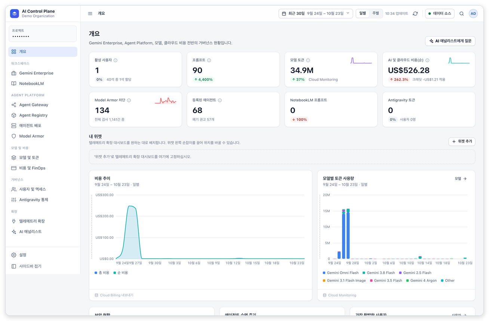
</p>

## 개요

AI Control Plane은 고객의 Google Cloud 프로젝트 안에 Cloud Run 서비스로 배포되어, 이미 수집되고 있는 감사 로그, 결제 내보내기, Cloud Monitoring, Discovery Engine API 데이터를 그 자리에서 읽습니다. 데이터를 외부로 복사하지 않으며, 여러 프로젝트를 하나의 화면에서 통합하거나 프로젝트별로 나누어 볼 수 있습니다.

| 영역 | 제공 기능 |
|---|---|
| 가시성 | Gemini Enterprise, Gemini Notebook, Gemini Platform, Antigravity 사용량과 모델별 토큰·호출량, 멀티 프로젝트 현황 |
| 보안 | Model Armor 프롬프트 인젝션·민감 정보 차단(사람 입력과 자동 실행 구분), Agent Gateway 인가 정책, 휴면 에이전트 폐기 권고 |
| 거버넌스 | Gemini Enterprise 앱별 기능·모델 일괄 제어, Antigravity 사용자별 비용·토큰 한도와 실시간 정지, 5단계 안전 게이트 |
| 비용 | 결제 내보내기 기반 청구액, 미연결 시 공식 단가 기반 역산 추정, 사람·프로젝트·조직별 비용 정산, 비용 급증 원인 분석 |
| 분석 | 자연어 질문을 검증된 읽기 전용 BigQuery SQL로 변환해 표·차트·요약으로 답하는 AI 애널리스트 |

> [!IMPORTANT]
> 샘플 데이터나 데모 모드가 없습니다. 화면의 모든 값은 연결된 Google Cloud 프로젝트에서 읽은 실측값입니다. 읽을 수 없는 값은 임의로 채우지 않고 `—`와 원인으로 표시하며, 결제 내보내기가 없을 때의 비용은 실측 토큰 × 공식 공개 단가로 계산한 추정치임을 화면에 명시합니다.

> [!NOTE]
> Google Cloud 고객 환경에서 운영하도록 만든 관리 솔루션이며, Google이 공식 지원하는 제품이 아닙니다.

---

## 설치

Cloud Shell 또는 macOS/Linux 터미널에서 실행합니다. 신규 프로젝트와 기존 프로젝트 모두 지원하며, 설치 스크립트가 API 활성화, 결제 연결 확인, 전용 서비스 계정과 최소 권한 IAM, 설정 버킷, BigQuery 감사 로그 싱크, Data Access 로그, Gemini Enterprise 프롬프트 로깅, 컨테이너 빌드, Cloud Run 배포, Cloud Scheduler와 Pub/Sub 실시간 집행 구성을 순서대로 처리합니다.

```bash
# 대화형 설치 (Enter로 기본값 사용)
bash <(curl -fsSL https://github.com/ldu1225/ai-control-plane/raw/main/scripts/install.sh)

# 단일 프로젝트 바로 배포 (--link-projects로 여러 프로젝트 통합)
bash <(curl -fsSL https://github.com/ldu1225/ai-control-plane/raw/main/scripts/install.sh) \
  --project YOUR_PROJECT_ID
```

[](https://ssh.cloud.google.com/cloudshell/editor?cloudshell_git_repo=https://github.com/ldu1225/ai-control-plane.git&cloudshell_tutorial=TUTORIAL.md)

멀티 프로젝트 허브, 조회 전용 모드(`--read-only`), 거부 정책 집행(`--enforcement-backend iam_deny`), 조직 정책 대응 등 전체 옵션은 [3. 빠른 시작](#3-빠른-시작-명령-한-번으로-배포)을 참고하세요.

---

## 주요 기능

| 화면 | 설명 |
|---|---|
| 개요 | 활성 사용자, 프롬프트, 모델 토큰, 순 비용, Model Armor 차단, 등록 에이전트, Gemini Notebook, Antigravity 핵심 지표와 추이 |
| Gemini Enterprise | 사용량·라이선스 좌석, 모든 앱의 기능 스위치와 모델 선택 매트릭스(일괄 변경, 검토 후 적용), AI 개발자 도구와 Antigravity 허용 모델 |
| Gemini Notebook | Data Access 감사 로그 기반 노트북·사용자·프롬프트 활동 |
| Agent Gateway · Registry · 배포 | 게이트웨이 인벤토리와 인가 정책, 통합 에이전트 카탈로그, Agent Engine 런타임·리비전·평가·트레이스 |
| Model Armor | 판정 추이, 필터별 차단, 애플리케이션·사용자별 이벤트 |
| 모델 및 토큰 | 결제 SKU, Cloud Monitoring, Antigravity 로그에서 모델을 자동 발견하고 입력·출력·캐시 토큰과 비용을 추적 |
| 비용 및 FinOps · 정산 | 서비스·SKU별 비용, 크레딧, 공식 단가·환율 동기화, 급증 원인 분석, 사람·프로젝트·조직별 배부와 월 마감 |
| 사용자 및 액세스 · Antigravity 통제 | 사용자 360 뷰, 사용자별 기간 한도와 자동 정지, 허용·거부 정책 집행, 예외 규칙, 월간 리포트 |
| 텔레메트리 확장 · AI 애널리스트 | 기존 로그 자동 프로파일링과 비용 제어형 라우팅, 자연어 기반 BigQuery 분석 |

공통: 프로젝트 전환(전체·개별), 라이트·다크 테마, 한국어·영어, 명령 팔레트(Ctrl/Cmd+K), 기간 선택, 표 검색·정렬·CSV 내보내기, 데이터 소스 상태 확인.

---

## 화면

<table>
  <tr>
    <td width="50%" valign="top">
      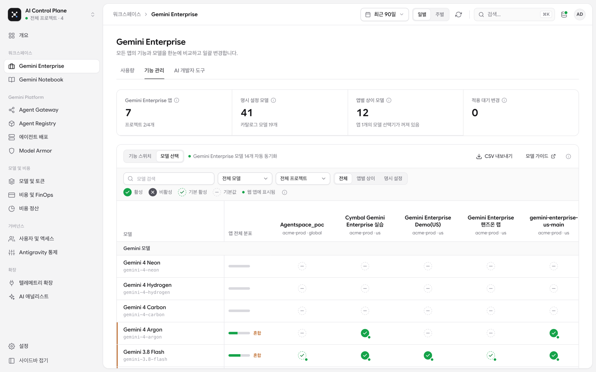
      <p><b>Gemini Enterprise 기능 관리</b><br/><sub>모든 앱의 모델 선택 상태를 한 화면에서 비교하고 일괄 변경</sub></p>
    </td>
    <td width="50%" valign="top">
      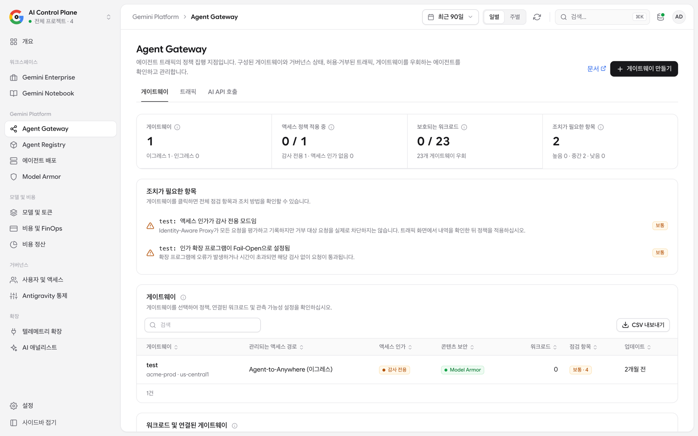
      <p><b>Agent Gateway</b><br/><sub>AI API 트래픽, 호출 주체, 인가 판정과 IAP 액세스 정책</sub></p>
    </td>
  </tr>
  <tr>
    <td width="50%" valign="top">
      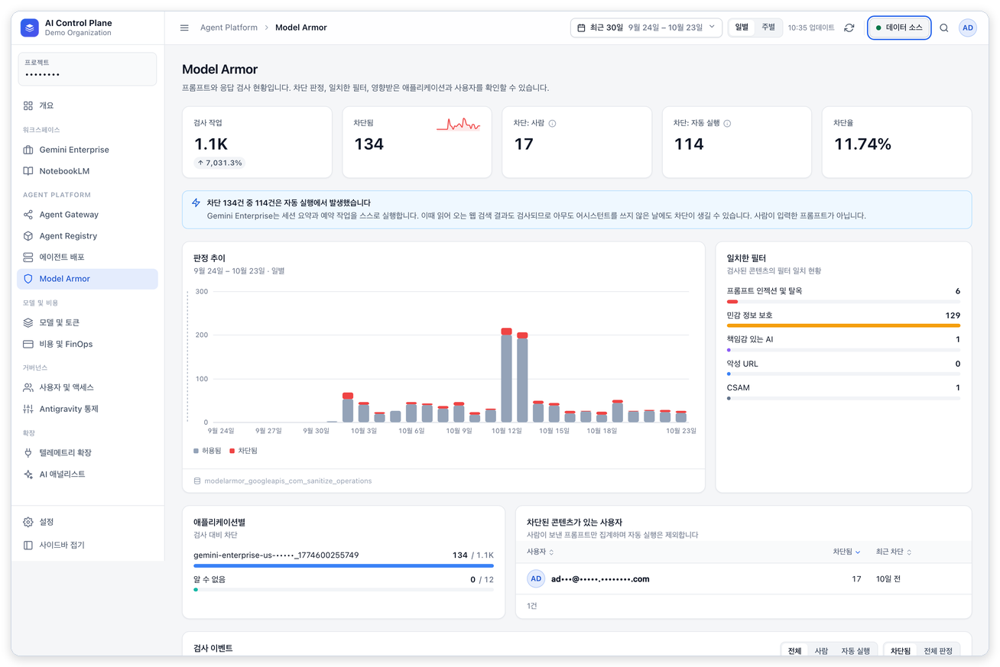
      <p><b>Model Armor</b><br/><sub>프롬프트 인젝션·민감 정보 차단 추이와 필터별 집계</sub></p>
    </td>
    <td width="50%" valign="top">
      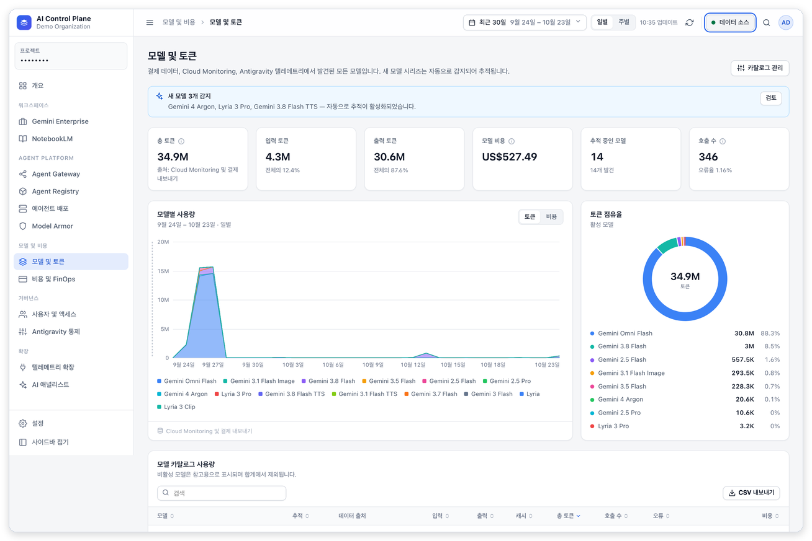
      <p><b>모델 및 토큰</b><br/><sub>신규 모델 자동 발견, 모델별 토큰과 비용</sub></p>
    </td>
  </tr>
  <tr>
    <td width="50%" valign="top">
      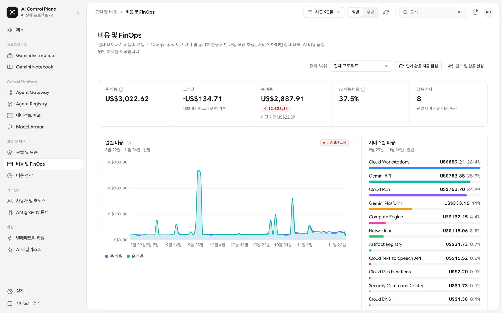
      <p><b>비용 및 FinOps</b><br/><sub>일별 비용, 서비스별 비중, 크레딧과 급증 감지</sub></p>
    </td>
    <td width="50%" valign="top">
      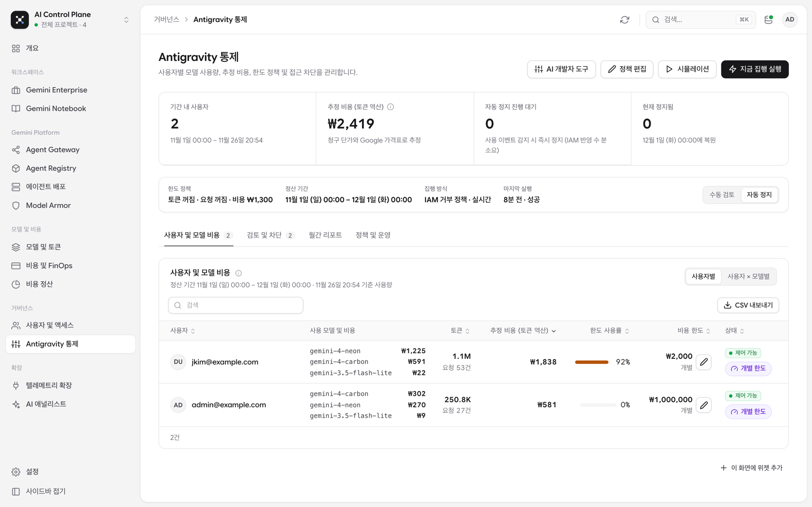
      <p><b>Antigravity 통제</b><br/><sub>사용자별 모델 비용, 한도 사용률, 정산 기간과 집행 방식</sub></p>
    </td>
  </tr>
  <tr>
    <td width="50%" valign="top">
      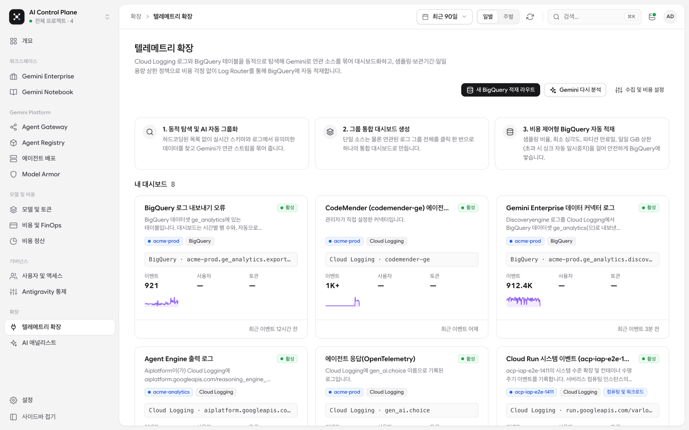
      <p><b>텔레메트리 확장</b><br/><sub>기존 로그 자동 발견과 비용 한도 기반 BigQuery 라우팅</sub></p>
    </td>
    <td width="50%" valign="top">
      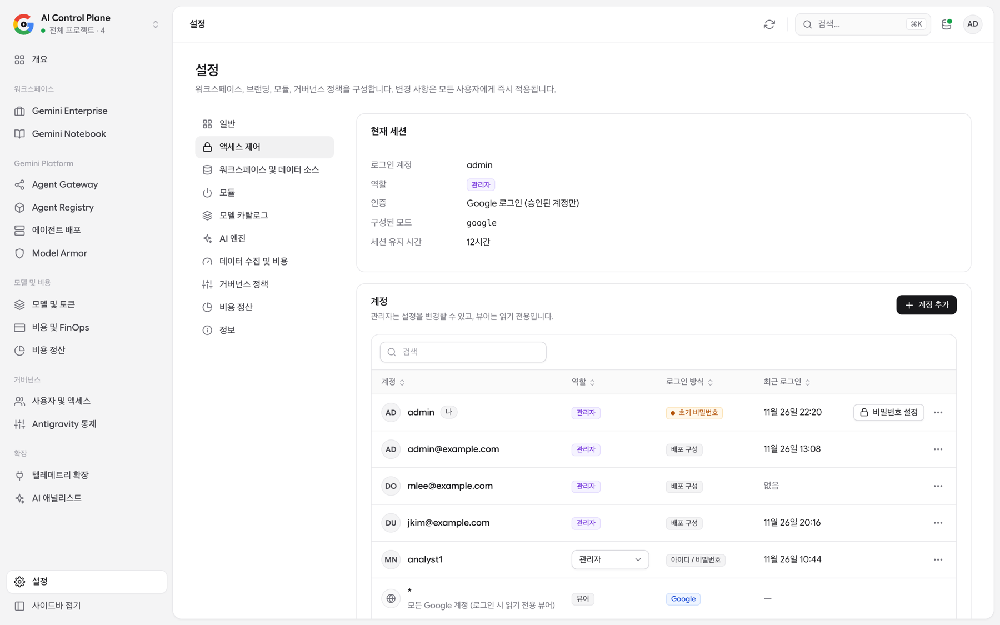
      <p><b>액세스 제어</b><br/><sub>계정·역할 관리와 Google 로그인 방식(IAP, OAuth 클라이언트)</sub></p>
    </td>
  </tr>
</table>

<details>
<summary><b>기능 소개 영상 (2분 52초, 이전 버전 UI)</b></summary>

<br/>

<a href="https://github.com/ldu1225/ai-control-plane/releases/download/v2.2.1/AI_Control_Plane_Feature_Tour.mp4">
  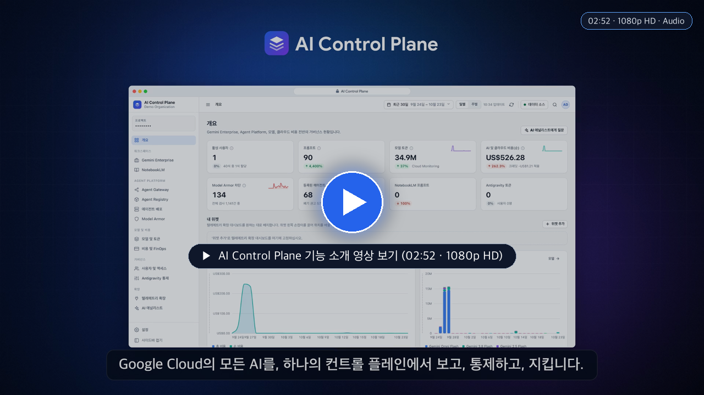
</a>

[전체 영상 (1080p, 한국어 나레이션·자막)](https://github.com/ldu1225/ai-control-plane/releases/download/v2.2.1/AI_Control_Plane_Feature_Tour.mp4) &nbsp;·&nbsp;
[자막 파일 (.srt)](https://github.com/ldu1225/ai-control-plane/releases/download/v2.2.1/AI_Control_Plane_Feature_Tour.srt) &nbsp;·&nbsp;
[릴리스 노트 (v2.2.1)](https://github.com/ldu1225/ai-control-plane/releases/tag/v2.2.1)

| 시각 | 챕터 |
|---|---|
| `0:00` | 소개 |
| `0:17` | 로그인과 접근 제어 |
| `0:23` | 개요 |
| `0:36` | Gemini Enterprise |
| `0:46` | Gemini Notebook |
| `0:51` | Agent Gateway |
| `0:57` | Agent Registry |
| `1:03` | 에이전트 배포 |
| `1:08` | Model Armor |
| `1:19` | 모델 및 토큰 |
| `1:30` | 비용 및 FinOps |
| `1:39` | 사용자 및 액세스 |
| `1:46` | Antigravity 통제 |
| `2:04` | 텔레메트리 확장 |
| `2:13` | 위젯 |
| `2:17` | AI 애널리스트 |
| `2:28` | 설정 |
| `2:34` | 배포 |

</details>

---

## 목차

1. [무엇을 할 수 있나요](#1-무엇을-할-수-있나요)
2. [아키텍처](#2-아키텍처)
3. [빠른 시작: 명령 한 번으로 배포](#3-빠른-시작-명령-한-번으로-배포)
4. [deploy.env 설정 항목 전체](#4-deployenv-설정-항목-전체)
5. [로그인과 권한](#5-로그인과-권한)
6. [데이터 소스 연결](#6-데이터-소스-연결)
7. [화면별 기능과 계산 방법](#7-화면별-기능과-계산-방법)
8. [Antigravity 사용자별 한도와 정지](#8-antigravity-사용자별-한도와-정지)
9. [설정 구조 (config.yaml, 환경 변수, 화면 설정)](#9-설정-구조-configyaml-환경-변수-화면-설정)
10. [Terraform으로 배포 (선택)](#10-terraform으로-배포-선택)
11. [로컬에서 실행](#11-로컬에서-실행)
12. [보안 모델](#12-보안-모델)
13. [비용](#13-비용)
14. [운영과 문제 해결](#14-운영과-문제-해결)
15. [삭제](#15-삭제)
16. [개발자 가이드](#16-개발자-가이드)
17. [라이선스](#17-라이선스)

---

## 1. 무엇을 할 수 있나요

### 1.1 설계 원칙

| 원칙 | 의미 |
|---|---|
| 실측 텔레메트리만 표시 | 예시 값이나 데모 데이터를 넣지 않습니다. 읽지 못한 값은 `—`와 원인으로 표시하며, 결제 내보내기가 없는 경우에만 실측 토큰 × 공식 공개 단가로 역산한 비용임을 명시해 보여 줍니다. |
| 하드코딩 없음 | 모델 목록과 버전을 코드에 두지 않습니다. 결제 SKU, Cloud Monitoring, Antigravity 로그에서 자동으로 발견하므로 Gemini 4 Carbon, Gemini 4 Argon 등 새 모델이 나와도 배포 없이 추적됩니다. |
| 스키마 적응형 | BigQuery 테이블과 컬럼은 `INFORMATION_SCHEMA`로 확인한 뒤 존재하는 것만 조회합니다. 날짜 분할(sharded) 테이블과 파티션 테이블을 모두 지원합니다. |
| 모든 기능은 켜고 끔 | 모듈, 모델, 커넥터 단위로 켜고 끕니다. 꺼진 모듈은 데이터 소스를 조회하지 않습니다. |
| 통제 기능은 안전장치 우선 | IAM 변경은 시뮬레이션, 안전 게이트, 변경 예산, etag 기반 원자적 갱신, 감사 로그를 거칩니다. |
| 최소 권한 | 조회 기능은 읽기 역할만 씁니다. IAM 쓰기 역할은 통제 기능을 켤 때만 부여합니다. 서비스 계정 키를 쓰지 않습니다. |

### 1.2 모듈

| 메뉴 | 모듈 ID | 제공 기능 | 데이터 소스 |
|---|---|---|---|
| 개요 | `overview` | 전체 KPI와 이전 기간 대비 증감, 비용 추이, 모델별 토큰, 보안 현황, 에이전트 수명 주기, 최근 거버넌스 조치 | 각 모듈 |
| Gemini Enterprise | `gemini_enterprise` | 활성 사용자, 프롬프트, 에이전트별 호출, 라이선스 좌석 할당과 휴면 좌석, 업로드 파일. **기능 관리**: 모든 프로젝트·위치의 앱별 기능 스위치 매트릭스, 앱 간 비교, 여러 앱 일괄 변경(검토 후 적용, 감사 로그) | BigQuery(Gemini Enterprise 로그), Discovery Engine API(`engines.list`·`engines.patch`) |
| Gemini Notebook | `notebooklm` | 활성 노트북, 사용자, 프롬프트 | BigQuery `cloudaudit_googleapis_com_data_access` |
| Agent Gateway | `agent_gateway` | 게이트웨이 인벤토리와 거버넌스 점검, 생성·수정·삭제, Identity-Aware Proxy 액세스 인가 설정 및 감사 전용↔적용 전환, 연결 워크로드(Agent Runtime·Gemini Enterprise), 게이트웨이 요청·인가 판정·MCP 트래픽, AI API 호출 감사 로그 | Network Services API, Network Security API, Cloud Logging, Cloud Monitoring, BigQuery 감사 로그 |
| Agent Registry | `agent_registry` | Agent Engine과 Gemini Enterprise 에이전트 통합 카탈로그, 휴면과 폐기 권고, 생성 이력 | Gemini Platform API, Discovery Engine API, 감사 로그 |
| 에이전트 배포 | `agent_deployments` | Agent Engine 런타임, 실행 ID(서비스 계정), 호출량, ID별 모델 사용량, 런타임 비용. 에이전트별 상세(텔레메트리, 모델 및 도구, 트레이스, 토폴로지, 리비전, 평가, 플레이그라운드) | Gemini Platform API, 감사 로그, 결제 내보내기, Cloud Monitoring, Cloud Trace |
| Model Armor | `model_armor` | 판정 추이, 필터 일치, 애플리케이션과 사용자별 차단, 이벤트 상세 | BigQuery `modelarmor_googleapis_com_sanitize_operations` |
| 모델 및 토큰 | `model_usage` | 모델 자동 탐지, 모델별 입력/출력/캐시 토큰, 호출 수, 오류율, 비용, 카탈로그 관리 | Cloud Monitoring, 결제 내보내기, Antigravity 로그, 공개 가격표 |
| 비용 및 FinOps | `finops` | 총 비용, 크레딧, 순 비용, 서비스·SKU별 청구액 또는 모델별 토큰 역산 비용, 자정(`00:00`, 설정 가능) 공식 단가·다중 통화 환율 동기화 및 변동 알림, 급증 감지와 AI 원인 분석 | 결제 내보내기 (미연결 시 실측 토큰 × 공식 공개 단가·환율 역산) |
| 비용 정산 | `chargeback` | 사람·프로젝트·조직(HR CSV 트리)별 Antigravity 사용 금액과 좌석 비용 배부, 미지정 목록, 월 마감(불변 스냅샷, 선택적 BigQuery 사본), 조직·프로젝트 월 예산, Google 지출 상한 | Antigravity 로그(월간 사용 리포트와 같은 장부), Discovery Engine 라이선스 API, Resource Manager 프로젝트 라벨, Cloud Billing Budget API |
| 사용자 및 액세스 | `users` | 사용자 360 뷰(서비스 전체 사용량), Antigravity IAM 상태, Antigravity 허용과 차단, 전체 AI 접근 차단과 복원 | 전체 소스, Resource Manager IAM |
| Antigravity 통제 | `antigravity` | 사용자별 기간 한도(비용/토큰/요청) 또는 크레딧 한도, 자동(실시간) 또는 수동 정지, 집행 방식(허용 정책 교체, 거부 정책, 알림만), 예외 규칙, 정산 기간, 안전 게이트, 월간 사용 리포트, 클라우드에서 에이전트가 실행한 작업, 감사 로그 | Cloud Logging 또는 BigQuery, Pub/Sub(실시간 집행), IAM 허용·거부 정책, 결제 내보내기, Cloud Billing Catalog API |
| 텔레메트리 확장 | `telemetry` | 스키마·필드 통계 + Gemini 기반 동적 로그·테이블 분석 및 그룹 묶음 대시보드, 비용 제어형(샘플링·심각도·제외 필터·보존 기간·일일 GiB 한도 자동 일시 중지/재개) Log Router → BigQuery 자동 라우팅 | BigQuery, Cloud Logging, Cloud Monitoring, Gemini on Gemini Platform |
| AI 애널리스트 | `analyst` | 자연어 질문, 검증된 읽기 전용 SQL, 결과 표와 차트, 요약 | BigQuery, Gemini on Gemini Platform |

공통 기능: 멀티 프로젝트 통합/개별 전환 선택기, 라이트/다크 테마, 한국어/영어 전환, 비용 화면의 통화 전환(USD와 표시 통화), 명령 팔레트(Ctrl/Cmd+K), 기간 선택(프리셋과 직접 지정), 표 검색/정렬/CSV 내보내기, 데이터 소스 상태 패널.

크레딧은 결제 내보내기에 실제 크레딧 행이 있을 때만 표시합니다. Gemini Code Assist와 Duet AI SKU는 모든 집계에서 제외됩니다.

---

## 2. 아키텍처

### 2.1 구성

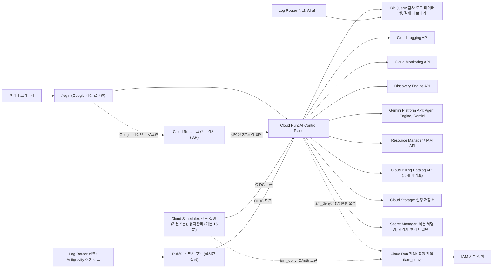

- **단일 컨테이너**: Python 표준 라이브러리 HTTP 서버가 정적 SPA(`src/web`)와 REST API(`/api/v1`)를 함께 제공합니다. 웹 프레임워크와 프런트엔드 빌드 단계가 없어 감사와 수정이 쉽습니다. 런타임 의존성은 6개입니다(`requirements.txt`).
- **프런트엔드**: 의존성 없는 ES Module SPA입니다. `innerHTML`을 쓰지 않고 텍스트 노드로만 렌더링합니다.
- **데이터 접근**: BigQuery는 매개변수화된 쿼리만 사용하고 쿼리마다 `maximum_bytes_billed`로 비용 상한을 둡니다. REST API는 Application Default Credentials(런타임 서비스 계정)와 quota project 헤더로 호출합니다.
- **설정 저장소**: 화면에서 바꾼 설정, 예외 규칙, 정지 기록은 변경분만 Cloud Storage 버킷에 저장합니다. 여러 인스턴스가 30초 주기로 다시 읽어 일관성을 유지합니다. 사람별 위젯 배치는 같은 버킷의 `users/` 폴더에 사람마다 문서 하나로 저장하며, 파일 이름은 이메일이 아닌 해시입니다.
- **캐시**: 엔드포인트와 조회 조건 단위 TTL 캐시(기본 120초)를 쓰고, 설정이 바뀌면 즉시 무효화합니다.
- **정기 작업과 실시간 집행**: Cloud Scheduler가 Antigravity 한도 집행(`SERVICE_NAME-enforce`, 기본 5분)과 유지관리(`SERVICE_NAME-maintenance`, 기본 15분: 공식 단가·환율 일일 동기화, 텔레메트리 라우팅 예산 점검)를 OIDC 토큰으로 호출합니다. Antigravity 추론 로그는 Pub/Sub 푸시로 들어와 자동 집행 모드에서 한도 초과를 바로 집행합니다([8.2](#82-시작하기)). 거부 정책 방식(`iam_deny`)에서는 같은 이미지로 만든 Cloud Run 작업 `SERVICE_NAME-enforcer`가 집행합니다([8.9](#89-거부-정책-집행과-집행-작업)).

### 2.2 저장소 구조

```text
.
|-- deploy.env.example          # 배포 설정 템플릿 (선택 — CLI 옵션만으로도 바로 배포 가능)
|-- TUTORIAL.md                 # Open in Cloud Shell 대화형 설치 튜토리얼
|-- config.yaml                 # 기본 설정 (자리표시자만 포함)
|-- config.local.yaml.example   # 로컬 개발용 설정 템플릿 (복사해서 config.local.yaml로 사용, Git 제외)
|-- requirements.txt            # 버전 고정 의존성
|-- Dockerfile                  # 비루트 사용자로 실행되는 컨테이너 이미지
|-- .dockerignore, .gcloudignore
|-- scripts/
|   |-- install.sh              # 원클릭 / 명령 한 줄 자동 부트스트랩 설치기 (단일·멀티 프로젝트 허브·개별 배포)
|   |-- prepare.sh              # 배포 전 준비: 로그 수집 시작 (싱크, Data Access, Gemini Enterprise 로그)
|   |-- deploy.sh               # 명령 한 번 무중단 배포 (빈 프로젝트 기반 구성부터 헬스체크까지)
|   |-- teardown.sh             # 배포한 리소스 삭제
|   |-- test.sh                 # 오프라인 전체 검증, 선택형 라이브 검증 (16.1)
|   |-- caps_drill.py           # Antigravity 한도 한 달 드릴 (8.8)
|   |-- lib/common.sh           # install / prepare / deploy 공통 자동화 모듈
|   |-- prepublish_scan.py      # 배포 전 검사: 비밀 정보와 배포 식별자 (CI에서도 실행)
|   `-- git-hooks/pre-push      # 푸시마다 검사를 실행하는 선택형 훅
|-- terraform/                  # Terraform 배포 (IAP 방식, 선택)
|-- src/
|   |-- backend_server.py       # 진입점
|   |-- controlplane/           # 백엔드
|   |   |-- app.py              # 라우트 등록과 서버 기동
|   |   |-- config.py           # 기본값, 계층형 로딩, 설정 검증
|   |   |-- auth.py             # Google 로그인, 로그인 브리지, 세션
|   |   |-- security.py         # 인증 모드, IAP/OIDC 검증, 권한, 속도 제한, PII 마스킹
|   |   |-- identity.py         # 주체 식별 (Google 계정, Workforce ID, 서비스 계정)
|   |   |-- httpkit.py          # 응답 봉투, 보안 헤더, CSRF, 정적 파일
|   |   |-- schema.py           # 스키마 적응형 BigQuery 접근
|   |   |-- settings_store.py   # 설정 저장소 (gcs, file, memory)
|   |   |-- enforce_job.py      # 거부 정책 집행 작업 진입점 (Cloud Run 작업, 8.9)
|   |   |-- caps_drill.py       # 집행 엔진 드릴 (8.8)
|   |   |-- gcp.py, ai.py, cache.py, timeutil.py
|   |   `-- services/           # 모듈별 서비스
|   |       |-- governance.py   # Antigravity 한도, 정산 기간, 안전 게이트, 집행 실행
|   |       |-- enforcers.py    # 집행 방식 (허용 정책 교체, 거부 정책, 알림만)
|   |       |-- jobs.py         # 집행 작업 실행 요청과 최근 실행 상태
|   |       |-- usage_events.py # Pub/Sub 푸시 실시간 집행
|   |       |-- budgets.py, spend_caps.py     # 조직·프로젝트 월 예산, Google 지출 상한
|   |       |-- chargeback.py, org_model.py   # 비용 정산, 조직 CSV 트리
|   |       |-- scope.py        # 워크스페이스 범위 (프로젝트, 폴더, 조직)
|   |       |-- agent_detail.py, agent_gateway.py, users.py, maintenance.py, pricing_sync.py
|   |       `-- ...             # 그 밖의 모듈 (gemini_enterprise, telemetry, analyst 등)
|   `-- web/                    # 프런트엔드 SPA (index.html, login.html, assets/)
|       `-- assets/fonts/       # Google Sans Flex 웹 글꼴과 OFL.txt (17장)
|-- eval/analyst/               # AI 애널리스트 골든 데이터셋과 평가 하네스 (16.1)
|-- tests/unit/                 # 단위 테스트 (1,000개 이상)
`-- .github/workflows/tests.yml # 푸시마다 단위 테스트, 배포 전 검사, 데이터셋 검증 실행
```

---

## 3. 빠른 시작: 명령 한 번으로 배포

### 3.1 준비물

| 항목 | 내용 |
|---|---|
| Google Cloud 프로젝트 | 프로젝트 **ID**(소문자, 숫자, 하이픈. 표시 이름이 아님). 방금 생성한 빈(깡통) 프로젝트도 그대로 사용 가능합니다. 결제가 미연결 상태여도 열려 있는 결제 계정이 1개이거나 같은 폴더 내 다른 프로젝트에 결제가 연결되어 있으면 자동으로 연결합니다(`--billing-account ID` 직접 지정도 가능). |
| 권한 | 배포하는 계정에 프로젝트 `Owner`(또는 IAM 관리자 권한이 있으면 누락된 세부 배포 역할을 스크립트가 스스로 부여). 거부 정책 집행(`iam_deny`)의 조직 역할을 배포가 부여하려면 조직 관리자 권한도 필요합니다([8.9](#89-거부-정책-집행과-집행-작업)). |
| 실행 환경 | **Google Cloud Shell 권장** (`gcloud`, `bq`, `python3`, `git`, `docker` 모두 기본 내장). macOS / Linux 터미널에서도 동일하게 동작합니다. |

### 3.2 배포 (원클릭 / 명령 한 줄)

**방법 A — 설정 파일 없이 Cloud Shell에서 대화형 원클릭 설치 (Enter만 눌러 진행)**
```bash
bash <(curl -fsSL https://github.com/ldu1225/ai-control-plane/raw/main/scripts/install.sh)
```

**방법 B — 단일 프로젝트 무인(Non-interactive) 명령 한 줄 배포**
```bash
bash <(curl -fsSL https://github.com/ldu1225/ai-control-plane/raw/main/scripts/install.sh) --project my-project-id
```

**방법 C — 여러 프로젝트를 하나의 대시보드에서 통합 관제 (멀티 프로젝트 허브, 권장)**
```bash
bash <(curl -fsSL https://github.com/ldu1225/ai-control-plane/raw/main/scripts/install.sh) \
  --project hub-project-id --link-projects project-b,project-c
```
*(대표 프로젝트 `hub-project-id`에 대시보드 1개를 배포하고, 연동 프로젝트(`project-b,project-c`)에 읽기 전용 IAM 및 감사 로그 싱크를 자동 연결합니다. 화면 상단 프로젝트 선택기에서 **전체 프로젝트 합산** 또는 **개별 프로젝트**를 클릭 한 번으로 전환해 볼 수 있습니다. `--link-projects`가 없어도 런타임 서비스 계정이 읽을 수 있는 다른 프로젝트를 자동으로 찾습니다(모두 합쳐 최대 25개, 끄려면 `--no-auto-discover-projects`). 만약 프로젝트마다 별도의 독립된 Cloud Run 대시보드를 각각 배포하려면 `--projects project-a,project-b` 옵션을 사용하세요.)*

*(공통 참고: `--admins admin@example.org --viewers viewer@example.org`를 추가해 계정을 지정할 수 있으며, 처음 설치할 때 `--admins`를 생략하면 현재 로그인된 `gcloud` 계정이 관리자로 등록됩니다. 기존에 예전 `~/ai-control-plane` 폴더나 잘못된 `deploy.env`가 남아 있어도 위 명령 한 줄이 자동으로 최신 코드로 갱신하고, 기존 `deploy.env`는 `deploy.env.bak`으로 분리하며, 프로젝트별 설정 스냅샷(`deploy.<PROJECT_ID>.env`)은 그대로 둡니다.)*

**방법 D — 저장소 클론 후 직접 실행 (`deploy.env` 또는 CLI 옵션)**
```bash
git clone https://github.com/ldu1225/ai-control-plane.git
cd ai-control-plane

scripts/deploy.sh --project my-project-id --link-projects project-b,project-c
# 또는 cp deploy.env.example deploy.env 편집 후 scripts/deploy.sh 실행
```

스크립트가 빈 프로젝트에서 자동으로 처리하는 8단계:

| 단계 | 내용 |
|---|---|
| 0. 사전 권한·결제 점검 | 기반 제어 API를 먼저 켜고, 호출자 IAM 권한 확인 및 자동 보강(Self-bootstrap), 결제 계정 연결 확인·자동 연결, 조직 정책·VPC Service Controls 사전 점검([14.4](#144-고객-프로젝트-사전-점검-조직-정책vpc-service-controls))을 수행합니다. |
| 1. 필수 API & 서비스 에이전트 | Cloud Run, Cloud Build, Artifact Registry, BigQuery, Logging, Monitoring, Cloud Trace, Discovery Engine, Gemini Platform, Model Armor, Storage, Secret Manager, IAP, Cloud Scheduler, Cloud Billing Budget, 실시간 집행용 Pub/Sub 등 API와 Google 관리형 서비스 에이전트(`service-PROJECT_NUMBER@...`)를 즉시 생성합니다. |
| 2. 설정 버킷 | 공개 접근이 차단되고 버전 관리가 켜진 Cloud Storage 버킷을 생성합니다. |
| 3. 전용 서비스 계정 & IAM | 런타임 SA, 로그인 브리지 SA, **전용 Cloud Build 빌더 SA**(Compute Engine 기본 SA에 의존하지 않음), `iam_deny`이면 집행 작업 SA를 만들고 최소 권한(`CustomAiControlPlaneLicenseReader` 포함)을 부여합니다([6.6](#66-런타임-서비스-계정-권한)). 통제 기능(`ENABLE_GOVERNANCE_ACTIONS=true`, 기본)이면 IAM 쓰기 역할과 Antigravity 마커 역할(`CustomAntigravityCapBlocked`, `CustomAntigravityAdminBlocked`), Gemini Enterprise 기능 관리 커스텀 역할(`CustomAiControlPlaneGeFeatureManager`), Agent Gateway 관리 커스텀 역할(`CustomAiControlPlaneGatewayManager`)을 만듭니다. `--link-projects`로 지정한 연동 프로젝트에도 읽기 전용 스캔 권한과 기능 관리 역할(통제 기능 사용 시)을 자동 부여하며, BigQuery 결제 내보내기 테이블이 있으면 자동으로 탐지합니다. |
| 4. 컨테이너 이미지 | Artifact Registry 저장소를 만들고 전용 빌더 SA로 Cloud Build 이미지를 빌드합니다(리전 워커 제한 시 글로벌 Cloud Build -> Cloud Shell/로컬 Docker로 3단계 자동 전환). |
| 5. 시크릿 | 세션 서명 키, 기본 `admin` 계정의 무작위 초기 비밀번호, 화면에서 연결할 OAuth 클라이언트 보안 비밀 자리(`google`, `password` 방식)를 리전 제한 조직 정책(`constraints/gcp.resourceLocations`)에 맞춰 Secret Manager에 만듭니다. |
| 6. 데이터 소스 일괄 활성화 | BigQuery 데이터셋(`ge_analytics`)과 파티션 Log Router 싱크 생성, **AI 서비스 Data Access 감사 로그 활성화**, 모든 Gemini Enterprise 앱의 **사용 로그 + 프롬프트·사용자 식별 로깅 활성화**, 연동 프로젝트 로그 싱크 온보딩(권한 보유 시), 조직명 및 Gemini Platform 엔드포인트 자동 탐지를 수행합니다. |
| 7. Cloud Run & 인증 자동 대응 | 로그인 브리지(IAP)와 대시보드를 배포하고, `ENFORCEMENT_BACKEND=iam_deny`이면 같은 이미지로 집행 작업(Cloud Run 작업 `SERVICE_NAME-enforcer`)도 배포합니다. 도메인 제한 공유(`iam.allowedPolicyMemberDomains`)나 비인증 호출 차단 조직 정책이 있어도 `--no-invoker-iam-check` -> `--allow-unauthenticated` -> **Direct Cloud Run IAP** 또는 내장 ID/비밀번호 로그인으로 자동 전환하여 실패 없이 배포합니다. |
| 8. 스케줄, 실시간 집행 & 헬스체크 | Cloud Scheduler에 한도 집행 작업(`SERVICE_NAME-enforce`, 기본 5분마다. `iam_deny`면 집행 작업을 실행하는 `SERVICE_NAME-enforcer`)과 유지관리 작업(`SERVICE_NAME-maintenance`, 기본 15분마다: 공식 단가·환율 일일 동기화(`00:00`, 설정 가능), 텔레메트리 BigQuery 라우팅 일일 예산 점검·다음 날 자동 재개)을 등록합니다. 실시간 집행용 Pub/Sub 토픽·로그 싱크(`SERVICE_NAME-agy-usage`)와 푸시 구독(`SERVICE_NAME-agy-usage-push`)을 만들고, 엔드포인트 응답(`HTTP 200/302/401`)을 확인한 뒤 접속 주소, 관리자 비밀번호 확인 명령, Antigravity 준비 상태를 출력합니다. IAP 방식에서는 대시보드를 호출하는 스케줄러와 Pub/Sub 푸시를 만들지 않습니다. |

- **다시 실행해도 안전합니다(멱등성 보장).** 없는 것은 만들고 있는 것은 최신 설정으로 갱신합니다.
- `install.sh`는 배포할 때 설정을 프로젝트별 스냅샷 `deploy.<PROJECT_ID>.env`(Git 제외)에 저장합니다(리전, 관리자·뷰어, 연동 프로젝트 `SCAN_PROJECTS`, 지정한 옵션). 이후 `install.sh`를 다시 실행하거나 `scripts/deploy.sh --project PROJECT_ID`를 실행하면 옵션으로 새 값을 주지 않는 한 저장된 값을 씁니다. 새 값은 `install.sh`만 파일에 저장하고, 파일에 직접 추가한 줄은 그대로 둡니다([14.3](#143-업그레이드)).

### 3.3 첫 로그인

1. 출력된 주소의 `/login`으로 접속해 **Google 계정으로 로그인**을 누릅니다(Direct IAP로 자동 전환된 조직 환경에서는 주소 접속 즉시 Google IAP 로그인이 실행됩니다).
2. `--admins`(`ADMIN_EMAILS`)로 지정한 계정은 즉시 관리자로, `--viewers`(`ALLOWED_USERS`)로 지정한 계정은 즉시 뷰어로 접속됩니다.
3. 추가 사용자는 **설정 > 액세스 제어** 화면에서 이메일 또는 도메인을 바로 등록·승인할 수 있습니다.
4. 기본 관리자 계정 `admin`에는 공용 기본 비밀번호가 없습니다. 처음 배포할 때(시크릿에 버전이 없을 때) 무작위 초기 비밀번호를 만들어 Secret Manager(`SERVICE_NAME-admin-password`)에 저장하고, 배포 마지막에 출력되는 `Admin password:` 명령(`gcloud secrets versions access latest --secret=ai-control-plane-admin-password --project=PROJECT_ID`)으로 확인합니다. Google 로그인을 쓸 수 없는 조직(ID/비밀번호 로그인으로 자동 전환)에서는 이 계정으로 들어온 뒤 **설정 > 액세스 제어**에서 비밀번호를 바꾸세요. 로그인 화면에는 계정이나 비밀번호 안내가 표시되지 않습니다.

### 3.4 배포 후 확인

1. 왼쪽 위 **워크스페이스 전환기**(제품 이름 아래 `전체 프로젝트 · N`)를 눌러 대표 프로젝트, 연동 프로젝트, 자동 탐지 프로젝트 중 하나로 좁히거나 **전체 프로젝트**로 통합 조회합니다. 한 프로젝트로 좁히면 각 화면 제목 옆에 프로젝트 칩이 표시되고, 칩을 누르면 전체 보기로 돌아갑니다.
2. 상단 바 오른쪽의 **데이터 소스** 아이콘(점 색상이 상태)을 눌러 연결 상태를 확인합니다. 빨간색 항목에 원인(권한, 테이블 없음 등)이 표시됩니다.
3. 결제 내보내기(Billing Export)가 아직 연결되지 않아도 토큰 기반 역산 비용이 즉시 표시되며, 추후 **설정 > 워크스페이스 및 데이터 소스**에서 결제 내보내기를 연결하면 자동으로 실제 청구액 모드로 전환됩니다.
4. 감사 로그 싱크를 새로 만들었다면 테이블은 해당 로그가 처음 발생할 때 생깁니다. 처음 몇 분에서 몇 시간 동안은 일부 지표가 비어 있을 수 있습니다.
5. Antigravity 사용자별 한도를 쓰려면 [8장](#8-antigravity-사용자별-한도와-정지)을 따릅니다.

### 3.5 배포 전에 로그부터 쌓기 (선택)

로그는 켠 시점부터 쌓입니다. 대시보드를 아직 배포하지 않고 로그 수집만 먼저 켜 두려면 Cloud Shell에서 아래 명령 한 줄만 실행합니다.

```bash
bash <(curl -fsSL https://github.com/ldu1225/ai-control-plane/raw/main/scripts/install.sh) \
  --prepare-only --project PROJECT_ID
```

| 단계 | 내용 |
|---|---|
| 1. API 사용 설정 | Logging, BigQuery, Monitoring, Discovery Engine, Gemini Platform, Model Armor 등 필수 API 및 서비스 에이전트 생성 |
| 2. 로그 라우팅 | BigQuery 데이터셋(`ge_analytics`)과 Log Router 싱크(`ai-control-plane-ai-logs`)를 만듭니다([6.1](#61-감사-로그-싱크-bigquery)). Antigravity 로그도 포함되어 있어, Antigravity를 쓰기 시작하면 따로 할 일 없이 쌓입니다. |
| 3. Gemini Enterprise 사용·프롬프트 로그 | `global`, `us`, `eu`의 모든 Gemini Enterprise 앱에서 관측 가능성(사용 로그와 사용자·프롬프트 로깅)을 기본으로 켭니다([6.3](#63-gemini-enterprise-로그)). |
| 4. Data Access 감사 로그 | AI 서비스 5개(Gemini Platform, Discovery Engine(Gemini Enterprise·Gemini Notebook), Model Armor, Antigravity, Gemini Data Analytics)의 Data Access 감사 로그(`ADMIN_READ`, `DATA_READ`, `DATA_WRITE`)를 기본으로 켭니다([6.2](#62-data-access-감사-로그), 제외하려면 `--no-data-access-logs`). |
| 5. 확인 | 최근 30일 동안 Gemini Enterprise, Model Armor, Antigravity 로그가 들어왔는지 보여 줍니다. |

- 다시 실행해도 안전하고, `--dry-run`으로 바뀔 내용만 먼저 볼 수 있습니다. 여러 프로젝트를 한 번에 준비하려면 `--projects proj-a,proj-b`를 지정합니다.
- 이후 대시보드를 배포할 때 `install.sh` 또는 `scripts/deploy.sh`는 같은 이름의 데이터셋과 싱크를 찾아 그대로 재사용합니다.
- `--prepare-only`는 로그 수집 옵션(`--dataset`, `--dataset-location`, `--ge-locations`, `--service-name`, `--[no-]data-access-logs`, `--[no-]log-prompts`)만 쓰고 그 밖의 배포 옵션은 무시하며, 설정 스냅샷도 저장하지 않습니다.

---

## 4. deploy.env 설정 항목 전체

`deploy.env`는 bash가 읽는 `KEY="value"` 형식입니다. 공백이 있는 값은 따옴표로 감쌉니다. 이 파일은 `.gitignore`에 포함되어 Git에 올라가지 않습니다. 템플릿은 `deploy.env.example`입니다.

`scripts/deploy.sh`는 설정 파일을 하나만 읽습니다. `--config FILE`이 있으면 그 파일, `--project PROJECT_ID`가 있으면 `deploy.<PROJECT_ID>.env`(있을 때만), 둘 다 없으면 `deploy.env`입니다. CLI 옵션이 파일 값보다 우선하고, 지정하지 않은 항목은 아래 기본값을 씁니다. `install.sh`도 같은 옵션을 받아 `deploy.sh`에 넘기며, `--config`, `--skip-preflight-blockers`, `--dry-run`을 뺀 값은 `deploy.<PROJECT_ID>.env`에 저장해 다음 실행에도 씁니다([3.2](#32-배포-원클릭--명령-한-줄)).

### 4.1 필수 및 멀티 프로젝트

| 변수 | 기본값 / 예시 | 설명 |
|---|---|---|
| `PROJECT_ID` | 활성 `gcloud` 프로젝트 (예: `my-project-id`) | 대시보드를 배포할 대표 Google Cloud 프로젝트 ID(`--project`) |
| `SCAN_PROJECTS` | 비어 있음 (예: `project-b,project-c`) | 하나의 대시보드에 함께 묶어 통합 관제할 추가 프로젝트 ID 목록(`--link-projects`). `none`(대소문자 무관)은 빈 목록이라 `deploy.env`나 설정 스냅샷의 목록을 비웁니다(빈 값은 거절) |
| `SCAN_ALL_PROJECTS` | `true` | 런타임 서비스 계정이 볼 수 있는 다른 프로젝트를 자동 탐지해 프로젝트 선택기에 표시(대표·연동 프로젝트 포함 최대 25개, `--no-auto-discover-projects`면 `false`). 폴더·조직 단위 범위는 [7.12](#712-비용-정산-사람프로젝트조직) |
| `PREPARE_LINKED_PROJECTS` | `true` | 배포 시 `SCAN_PROJECTS` 대상 프로젝트에도 감사 로그 싱크, Data Access 로그, Gemini Enterprise 로그, 실시간 집행 로그 싱크를 가능한 범위에서 자동 구성(`--no-prepare-linked-projects`면 `false`) |
| `REGION` | `asia-northeast3` | Cloud Run, Artifact Registry, 설정 버킷, Secret Manager, Cloud Scheduler 리전(`--region`) |
| `ADMIN_EMAILS` | 활성 `gcloud` 계정 | 관리자 이메일(쉼표 구분, `*@도메인` 형식 허용, `--admins`) |

### 4.2 서비스와 표시

| 변수 | 기본값 | 설명 |
|---|---|---|
| `SERVICE_NAME` | `ai-control-plane` | Cloud Run 서비스 이름(`--service-name`). 서비스 계정, 버킷, 시크릿, 싱크, Pub/Sub, 스케줄러 작업, 집행 작업 이름에도 쓰입니다. |
| `ORGANIZATION_NAME` | `Your Organization`(GCP 조직/프로젝트 이름 자동 탐지) | 헤더와 로그인 화면에 표시할 조직명(`--org-name`) |
| `DEFAULT_LOCALE` | `ko` | 기본 언어 `ko` 또는 `en`. 사용자는 화면에서 바꿀 수 있습니다. |
| `WORKSPACE_TIMEZONE` | `Asia/Seoul` | 날짜 표시, 일별 집계, Antigravity 정산 기간, 집행 스케줄러 시간대 |
| `PRODUCT_NAME` | 비어 있음 | 제품명 변경(화이트라벨). 비우면 `AI Control Plane` |
| `DISABLED_MODULES` | 비어 있음 | 배포할 때 숨길 모듈(쉼표 구분). 설정 > 모듈에서 다시 켤 수 있습니다. 모듈 ID: `overview`, `gemini_enterprise`, `notebooklm`, `model_usage`, `agent_gateway`, `agent_registry`, `agent_deployments`, `model_armor`, `users`, `antigravity`, `finops`, `chargeback`, `telemetry`, `analyst` |

### 4.3 로그인 방식

| 변수 | 기본값 | 설명 |
|---|---|---|
| `ACCESS_MODE` | `google` | `google`, `google_oauth`, `iap`, `password` 중 하나([5장](#5-로그인과-권한), `--access-mode`) |
| `ALLOWED_USERS` | 비어 있음 | Google 로그인 방식에서 미리 승인할 viewer(`--viewers`, `none`이면 목록을 비움). 예: `*@example.com,partner@example.org` |
| `IAP_MEMBERS` | 비어 있음(`iap` 방식이면 배포 계정) | `iap` 방식에서 접속을 허용할 주체. 예: `group:ai-governance@example.com,user:a@example.com` |
| `OAUTH_CLIENT_JSON` | 비어 있음 | `google_oauth` 방식에서 내려받은 OAuth 클라이언트 JSON 경로(커밋 금지) |
| `BRIDGE_MEMBERS` | `allAuthenticatedUsers` | `google` 방식에서 로그인 브리지를 통과할 수 있는 주체. 도메인 제한 공유 조직 정책이 있으면 배포가 `allUsers`·`allAuthenticatedUsers`를 빼고 조직·관리자 도메인을 대신 허용합니다([5.4](#54-google-로그인이-iap-화면에서-막힐-때)). 예: `domain:example.com` |
| `PUBLIC_BASE_URL` | 비어 있음 | 사용자 지정 도메인. 예: `https://ai-governance.example.com`. 스케줄러와 Pub/Sub 푸시 토큰의 대상(audience)도 이 주소로 정해집니다. |
| `GUEST_ACCESS` | `false` | 데모 전용. `true`면 링크만 있으면 로그인 없이 읽기 전용 게스트로 볼 수 있습니다([5.3](#53-게스트-접속-데모-전용)). `google`, `google_oauth`, `password` 방식에서만 |
| `GUEST_REDACT_TERMS` | `.prepublish-terms` 내용 | 데모 전용. 게스트 화면에서 가릴 단어(프로젝트, 조직, 고객 이름 등, 쉼표 구분) |

### 4.4 데이터 소스

| 변수 | 기본값 | 설명 |
|---|---|---|
| `AUDIT_DATASET` | `ge_analytics` | 감사 로그가 들어오는 BigQuery 데이터셋(`--dataset`) |
| `CREATE_LOG_SINK` | `true` | 데이터셋과 Log Router 싱크를 만들고, 이미 있으면 최신 필터로 갱신. 직접 관리하는 다른 싱크를 쓰면 `false` |
| `DATASET_LOCATION` | 비어 있음(`REGION`) | 새로 만드는 데이터셋 위치(`--dataset-location`). 비우면 `REGION`을 따르고, 이미 있는 데이터셋은 옮기지 않습니다. 예전 설정 스냅샷에 그때 리전과 같은 값이 있으면 `--region`으로 다시 실행할 때 새 리전을 따르고, `US`처럼 다른 값이나 `--dataset-location`은 유지합니다. |
| `ENABLE_DATA_ACCESS_LOGS` | `true` | AI 서비스 5개(Gemini Platform, Discovery Engine, Model Armor, Antigravity, Gemini Data Analytics)의 Data Access 감사 로그 켜기([6.2](#62-data-access-감사-로그), `--no-data-access-logs`면 `false`) |
| `ENABLE_GE_OBSERVABILITY` | `true` | `DISCOVERY_ENGINE_LOCATIONS`의 모든 Gemini Enterprise 앱에서 사용 로그(관측 가능성) 켜기. Owner 또는 Gemini Enterprise 관리자 권한이 필요하며, 권한이 없으면 경고만 남깁니다. |
| `GE_PROMPT_LOGGING` | `true` | 사용자 이메일(`userIamPrincipal`), 프롬프트·응답 원문, 업로드 파일 이름이 `<elided>`로 가려지지 않도록 함께 기록합니다. `--no-log-prompts`로 끌 수 있습니다. |
| `BILLING_PROJECT_ID` | 비어 있음(자동 탐지) | 결제 내보내기가 있는 프로젝트. 비우면 `PROJECT_ID`에서 결제 내보내기 테이블을 찾습니다. |
| `BILLING_DATASET` | 비어 있음(자동 탐지) | 결제 내보내기 데이터셋. 예: `billing_detailed_usage` |
| `BILLING_TABLE` | 비어 있음(자동 탐지) | `gcp_billing_export_resource_v1_XXXXXX_XXXXXX_XXXXXX`(없으면 토큰 기반 역산 비용 자동 적용) |
| `BILLING_ACCOUNT_ID` | 비어 있음(프로젝트의 결제 연결에서 자동 탐지) | `XXXXXX-XXXXXX-XXXXXX`(`--billing-account`와 같음. 결제가 연결되지 않은 프로젝트에는 이 계정을 연결) |
| `DISCOVERY_ENGINE_LOCATIONS` | 비어 있음(자동 감지) | Gemini Enterprise 위치(쉼표 구분, 예: `global,us`, `--ge-locations`). 비워 두면 배포할 때 `global`, `us`, `eu` 중 Gemini Enterprise 앱이나 라이선스가 있는 위치를 찾아 쓰고, 하나도 없으면 `global`을 씁니다. |
| `AGENT_ENGINE_REGIONS` | 비어 있음(자동 감지) | Agent Engine 리전(쉼표 구분). 비우면 `REGION`과 `us-central1` 중 응답하는 리전을 씁니다. |

결제 값은 배포 후 **설정 > 워크스페이스 및 데이터 소스**에서 입력해도 됩니다.

### 4.5 거버넌스 및 스케줄

| 변수 | 기본값 | 설명 |
|---|---|---|
| `ENABLE_GOVERNANCE_ACTIONS` | `true` | IAM 쓰기 역할 부여(`--read-only`면 `false`, `--no-read-only`면 `true`). 한도 초과 사용자 정지, 복원, 개별 허용/차단, 마커 역할 생성, Gemini Enterprise 기능 관리, Agent Gateway 관리에 필요 |
| `ENFORCEMENT_BACKEND` | `iam_allow_swap` | 정지 적용 방식: `iam_allow_swap`, `iam_deny`, `notify_only`([8.9](#89-거부-정책-집행과-집행-작업), `--enforcement-backend`) |
| `DENY_ATTACHMENT` | `projects` | `iam_deny` 거부 정책 부착점: `projects`, `scope`(`--deny-attachment`) |
| `ENFORCEMENT_JOB_REGION` | 비어 있음(`REGION`) | `iam_deny` 집행 작업과 그 스케줄러의 리전(`--enforcement-job-region`) |
| `GRANT_ORG_ROLES` | `false` | `iam_deny`에 필요한 조직 역할(Deny Admin, Deny Reviewer)을 배포가 부여할지(`--grant-org-roles`, `--no-grant-org-roles`). `false`면 조직 관리자가 실행할 명령만 출력 |
| `ENFORCEMENT_SCHEDULE` | `*/5 * * * *` | Antigravity 한도 집행 일정(cron, `WORKSPACE_TIMEZONE` 기준, `--enforcement-schedule`). 정산 기간이 끝나면 정지된 사용자를 복원하고 실시간 이벤트를 놓친 항목을 잡는 안전망이므로 기본으로 켜져 있습니다. `off`(또는 `--no-enforcement-schedule`)면 끄고 이전 배포의 스케줄러 작업도 지우며, 그러면 기간이 끝난 뒤 관리자가 **지금 집행 실행**을 눌러야 접근이 돌아옵니다. `iam_allow_swap`·`notify_only`는 대시보드의 집행 엔드포인트를 호출하므로 IAP 방식에서는 만들지 않고, `iam_allow_swap`은 `--read-only`에서도 만들지 않습니다(두 경우 모두 값을 직접 지정하면 배포가 멈춤). `iam_deny`는 Cloud Run Admin API로 집행 작업을 실행하므로 IAP 방식과 `--read-only`에서도 만듭니다. |
| `REALTIME_ENFORCEMENT` | `true` | 실시간 집행. Antigravity 추론 로그(`businessaicode.googleapis.com/inference_response`)를 Log Router 싱크 → Pub/Sub → 푸시 구독으로 `POST /api/v1/governance/antigravity/usage-event`에 전달해, 자동 집행 모드에서 스케줄을 기다리지 않고 바로 집행합니다([8.2](#82-시작하기)). `--no-realtime-enforcement`로 끄면 이전 배포가 만든 구독, 로그 싱크, 토픽을 지웁니다. IAP 방식, `notify_only`, `iam_allow_swap`의 `--read-only` 설치에서는 자동으로 꺼집니다. |
| `MAINTENANCE_SCHEDULE` | `*/15 * * * *` | 유지관리 작업(`SERVICE_NAME-maintenance`) 주기(cron, UTC). 실행마다 텔레메트리 BigQuery 라우팅의 일일 GiB 한도를 점검·재개하고, 하루 한 번 `PRICING_SYNC_TIME`에 공식 단가·다중 통화 환율을 동기화하며, 집행 방식을 바꾼 뒤의 마커 역할 인계도 맡습니다([8.9](#89-거부-정책-집행과-집행-작업)). `--maintenance-schedule CRON`으로 바꾸고, `off`(또는 `--no-maintenance-schedule`)면 만들지 않으며 이전 배포의 작업도 지웁니다(예전 변수 `PRICING_SYNC_SCHEDULE="off"`도 같음). IAP 방식에서는 만들지 않고 인스턴스가 떠 있는 동안 내부에서 실행합니다. |
| `PRICING_SYNC_TIME` | 비어 있음(`00:00`) | 공식 단가·환율 일일 동기화 시각(`HH:MM`, `WORKSPACE_TIMEZONE` 기준). 설정 > 데이터 수집 및 비용에서도 바꿉니다. |
| `PRICING_CURRENCY` | 비어 있음(Antigravity 비용 한도 통화, 없으면 `USD`) | 토큰 기반 추정 비용의 표시 통화(ISO 4217 코드, 예: `KRW`) |

### 4.6 기타

| 변수 | 기본값 | 설명 |
|---|---|---|
| `AI_DEFAULT_MODEL` | 비어 있음 | AI 애널리스트 기본 모델(비우면 `config.yaml` 값) |
| `AI_LOCATION` | 비어 있음(자동 감지) | Gemini Platform 모델 엔드포인트 위치. 비우면 `global`, 응답이 없으면 `REGION` |
| `TELEMETRY_AI_MODEL` | 비어 있음(`gemini-4-argon`) | 텔레메트리 소스를 설명하고 묶는 Gemini 모델 |
| `TELEMETRY_DATASET` | 비어 있음(`telemetry_routed`) | 텔레메트리 라우팅 BigQuery 데이터셋(위치는 `DATASET_LOCATION`) |
| `IMAGE` | 비어 있음 | 미리 빌드한 이미지(`--image`, 이번 실행에만 적용). 비우면 Cloud Build로 빌드(제한 시 로컬 Docker 자동 전환) |
| `BUILD_SOURCE` | `auto` | Cloud Build 소스 전달 방식: `git`(공개 Git 저장소의 현재 커밋을 Cloud Build가 직접 받음, Cloud Storage 업로드 없음 — VPC-SC가 Storage를 제한해도 통과), `upload`(설정 버킷에 업로드), `auto`(공개 저장소의 깨끗한 체크아웃은 `git`, 로컬 수정본·private pool은 `upload`) |
| `CLOUD_BUILD_WORKER_POOL` | 비어 있음(기본 풀) | 이미지 빌드에 쓸 Cloud Build private pool(`--worker-pool`, `projects/P/locations/R/workerPools/NAME` 또는 현재 리전의 풀 이름) |
| `MEMORY`, `CPU` | `1Gi`, `1` | Cloud Run 리소스(집행 작업도 같은 값) |
| `MIN_INSTANCES`, `MAX_INSTANCES` | `0`, `3` | 인스턴스 수. 0이면 요청이 없을 때 인스턴스가 내려가고, 정기 작업 호출 때만 잠깐 실행됩니다([13장](#13-비용)). |
| `AR_REPOSITORY` | `ai-control-plane` | Artifact Registry 저장소 이름 |
| `SERVICE_ACCOUNT_ID` | `SERVICE_NAME-sa`(서비스 이름 앞 27자) | 런타임 서비스 계정 ID |
| `SETTINGS_BUCKET` | `PROJECT_ID-SERVICE_NAME-settings` | 설정 버킷 이름(전역 고유, 63자 이하) |
| `SESSION_SECRET_NAME` | `SERVICE_NAME-session-secret` | 세션 서명 키 시크릿 이름 |
| `ADMIN_SECRET_NAME` | `SERVICE_NAME-admin-password` | 기본 `admin` 계정 초기 비밀번호 시크릿 이름 |
| `OAUTH_SECRET_NAME` | `SERVICE_NAME-oauth-client-secret` | `google_oauth` 방식 OAuth 클라이언트 보안 비밀 시크릿 이름 |
| `OAUTH_CONNECT_SECRET_NAME` | `SERVICE_NAME-oauth-connected-secret` | 화면에서 연결하는 OAuth 클라이언트 보안 비밀 시크릿 이름([5.4](#54-google-로그인이-iap-화면에서-막힐-때)) |
| `GOOGLE_OAUTH_CLIENT_ID`, `GOOGLE_OAUTH_REDIRECT_URI`, `GOOGLE_OAUTH_START_URL` | 비어 있음 | 고급. 이미 만든 OAuth 클라이언트를 쓸 때의 클라이언트 ID(보안 비밀은 `OAUTH_SECRET_NAME` 시크릿에 있어야 함)와 리디렉션 URI, 인가 시작 주소 재정의 |
| `VPC_NETWORK`, `VPC_SUBNET` | 비어 있음 | Cloud Run 이그레스를 보낼 VPC와 서브넷(`--vpc-network`, `--vpc-subnet`, [14.4](#144-고객-프로젝트-사전-점검-조직-정책vpc-service-controls)) |
| `PREFLIGHT_STRICT` | `true` | `false`면 조직 정책 사전 점검이 차단 항목을 찾아도 계속(`--skip-preflight-blockers`) |
| `ENABLE_LINKED_TELEMETRY_ROUTING` | `true` | 연동 프로젝트에 `roles/logging.configWriter`를 부여해 그 프로젝트의 로그도 화면에서 BigQuery로 라우팅 |

별칭도 받습니다: `ADMIN_EMAILS` = `INITIAL_ADMINS`, `ADMINS`, `ADMIN_EMAIL` / `ALLOWED_USERS` = `INITIAL_VIEWERS`, `VIEWERS`, `VIEWER_EMAILS` / `SCAN_PROJECTS` = `LINKED_PROJECTS`, `WORKSPACE_PROJECTS` / `SCAN_ALL_PROJECTS` = `AUTO_DISCOVER_PROJECTS`.

---

## 5. 로그인과 권한

### 5.1 로그인 방식 선택

| `ACCESS_MODE` | 동작 | 언제 쓰나요 |
|---|---|---|
| `google` (권장) | 대시보드 자체 로그인 화면(`/login`)에서 Google 계정으로 로그인합니다. OAuth 클라이언트를 만들 필요가 없습니다. IAP 뒤에 있는 작은 로그인 브리지 서비스가 Google 계정을 확인하고, 대시보드는 승인된 계정만 들여보냅니다. 조직 밖 계정(협력사, 다른 조직 계열사, Gmail)까지 Google로 받으려면 나중에 설정 > 접근 제어에서 OAuth 클라이언트를 연결합니다(재배포 없음, [5.4](#54-google-로그인이-iap-화면에서-막힐-때)). | 대부분의 경우 |
| `google_oauth` | 같은 로그인 화면을 직접 만든 OAuth 클라이언트로 운영합니다. | 브리지 서비스를 두고 싶지 않거나 OAuth 동의 화면을 직접 관리하려는 경우 |
| `iap` | Identity-Aware Proxy가 대시보드 앞에서 로그인을 처리합니다. 앱은 IAP 서명 헤더를 검증합니다. IAP가 Cloud Scheduler와 Pub/Sub의 OIDC 호출을 막으므로 대시보드를 호출하는 집행 스케줄과 실시간 집행은 만들지 않습니다(유지관리는 인스턴스 안에서 실행). | 이미 IAP와 그룹 기반 접근 관리를 쓰는 조직 |
| `password` | 대시보드 로그인 화면에서 ID/비밀번호로만 로그인합니다. 기본 `admin` 계정의 초기 비밀번호는 처음 배포할 때 무작위로 만들어 Secret Manager에 저장합니다([3.3](#33-첫-로그인)). 나중에 화면에서 OAuth 클라이언트를 연결하면 Google 로그인도 켜집니다. | Google 로그인이나 IAP를 쓸 수 없는 환경 |

그 밖의 `security.auth_mode` 값(`config.yaml` 또는 `AUTH_MODE` 환경 변수로만 설정, 화면에서는 바꿀 수 없음):

- `local`: 컴퓨터 한 대에서 개발할 때 씁니다([11](#11-로컬에서-실행)). 이 컴퓨터(루프백 주소)에서 직접 온 요청만 관리자로 받고, 다른 컴퓨터에서 온 요청과 프록시를 거친 요청(`X-Forwarded-For`, `Forwarded`, `X-Real-IP`)은 거부합니다. Cloud Run에서는 시작 단계에서 이 모드를 거부합니다. `auto`는 Cloud Run에서는 `iap`가 되고, 그 밖에서는 서버가 루프백 주소(`127.0.0.1`, `::1`, `localhost`)에서 대기할 때만 `local`이 되며, 다른 주소에 바인딩하면 시작을 멈추고 `google` 또는 `iap`를 고르라고 안내합니다.

기본 설정에는 익명 접속 모드가 없습니다. 승인된 Google 계정만 대시보드를 열 수 있습니다. 데모에서만 쓰는 예외로 게스트 접속을 켤 수 있습니다([5.3](#53-게스트-접속-데모-전용)).

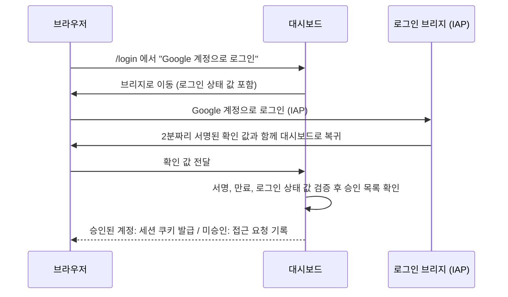

`google_oauth` 방식 준비(한 번만):

1. Google Cloud 콘솔 > Google Auth Platform > 브랜딩: 앱 이름과 지원 이메일을 입력합니다.
2. 대상: 조직 계정만 쓰면 `내부`, 외부 Google 계정도 쓰면 `외부`(게시하거나 테스트 사용자 추가).
3. 클라이언트 > 클라이언트 만들기 > 웹 애플리케이션. 승인된 리디렉션 URI에 `https://대시보드주소/auth/google/callback`을 넣습니다.
4. 만든 직후 JSON을 내려받아 `OAUTH_CLIENT_JSON`에 경로를 적습니다(보안 비밀은 이때만 보입니다). 스크립트가 보안 비밀을 Secret Manager에 저장하며 화면에 출력하지 않습니다.

### 5.2 역할

| 역할 | 할 수 있는 일 |
|---|---|
| admin | 모든 화면, 설정 변경, 사용자 승인, 한도 정책, 정지/복원, 예외 규칙, 커넥터 관리 |
| viewer | 모든 화면 조회. 이메일은 서버에서 마스킹되고(`ad***@example.com`), Model Armor 원문과 업로드 파일명은 제공되지 않습니다. AI 애널리스트는 관리자가 허용한 경우에만 쓸 수 있습니다(`analyst.allow_viewers`). 설정은 읽기 전용이며, 배포 식별자(설정 버킷, OAuth 클라이언트 ID, IAP audience, 결제 계정 ID)는 `***`로 표시되고, 프로젝트별 Google 지출 상한(예산 이름, 계획)과 사용자 조치 버튼은 보이지 않습니다. |
| guest (데모 전용) | `GUEST_ACCESS=true`일 때 세션 없이 들어온 방문자. viewer와 같은 화면을 보되, 더 많이 가려지고 아무것도 바꿀 수 없습니다([5.3](#53-게스트-접속-데모-전용)). |

- 관리자 = `ADMIN_EMAILS` + `config.yaml`의 `security.admins` + 화면에서 추가한 관리자.
- viewer = `ALLOWED_USERS` + `security.allowed_users` + 화면에서 승인한 사용자.
- 설정 파일이나 환경 변수로 지정한 계정은 화면에서 지울 수 없습니다(고정). 화면에서 추가한 계정은 화면에서 지울 수 있고, 지우면 그 계정의 기존 세션도 즉시 끊깁니다.
- 세션 기본 유효 시간은 12시간입니다(`SESSION_HOURS`, 1~168).

### 5.3 게스트 접속 (데모 전용)

데모처럼 누구나 링크로 바로 봐야 할 때만 켭니다. 고객 배포에서는 끕니다(기본값 `false`).

- 켜는 법: `deploy.env`에 `GUEST_ACCESS="true"`를 넣고 다시 배포합니다(`security.guest_access`, 화면에서는 바꿀 수 없음). `google`, `google_oauth`, `password` 방식에서만 동작합니다(`iap` 제외).
- 세션이 없는 방문자는 로그인 화면 대신 대시보드로 바로 들어오고, 로그인 화면에는 **게스트로 둘러보기**가 표시됩니다. 관리자는 지금처럼 `/login`에서 로그인합니다.
- 게스트는 읽기 전용입니다. 설정, 위젯 배치, 정책 같은 변경 요청은 모두 거부되고, 허용되는 POST는 비용 급증 AI 분석과 AI 애널리스트뿐입니다. AI 애널리스트는 관리자가 viewer에게 허용한 경우에만 쓸 수 있습니다(`analyst.allow_viewers`). AI 호출은 게스트별 한도와 함께 전체 게스트 공용 한도(분당 30회)를 둡니다.
- 게스트가 받는 모든 응답에는 viewer 마스킹에 더해 다음이 적용됩니다: 이메일 도메인 전체, 결제 계정 ID, 12자리 프로젝트 번호, 주민번호·전화번호·카드번호 형식, `GUEST_REDACT_TERMS`의 단어(대소문자 무시). 단어를 비워 두면 배포 스크립트가 `.prepublish-terms`의 단어를 씁니다.
- 실제 프로젝트 데이터(지표, 에이전트 이름, 비용)는 그대로 보이므로, 공개해도 되는 데모 프로젝트에서만 켭니다.

### 5.4 Google 로그인이 IAP 화면에서 막힐 때

`google` 방식의 Google 로그인은 로그인 브리지 앞의 IAP(Identity-Aware Proxy)를 먼저 통과해야 합니다. IAP가 막으면 대시보드가 아니라 Google의 "You don't have access" 화면이 나오고, 대시보드에는 접근 요청도 남지 않습니다. IAP가 계정을 통과시키는 조건은 두 가지입니다.

1. **IAP 허용 목록**: 브리지 서비스의 `roles/iap.httpsResourceAccessor`가 그 계정을 포함해야 합니다(`allAuthenticatedUsers`, `domain:회사도메인`, `user:이메일`, 그룹). 도메인 제한 공유(`iam.allowedPolicyMemberDomains`) 조직 정책이 있으면 IAM이 `allAuthenticatedUsers`와 허용되지 않은 고객(Workspace/Cloud Identity)의 계정을 거부합니다.
2. **OAuth 클라이언트**: Cloud Run IAP는 기본으로 Google 관리형 OAuth 클라이언트를 쓰고, 이 클라이언트는 **이 프로젝트가 속한 조직의 계정만** 로그인시킵니다. 다른 조직의 계열사 계정, 협력사 계정, 개인 Gmail은 IAP 허용 목록에 있어도 막힙니다.

배포 스크립트가 하는 일:

- 도메인 제한 공유가 없으면 브리지에 `allAuthenticatedUsers`를 허용합니다(관리형 OAuth이므로 실제로는 조직 계정만 통과).
- 도메인 제한 공유가 있으면 조직 기본 도메인, `ADMIN_EMAILS`·`ALLOWED_USERS`의 도메인, 프로젝트 IAM 구성원의 도메인, Gemini Enterprise 라이선스 사용자의 도메인을 `domain:`으로 허용합니다(공용 메일 도메인과 google.com 제외).
- `ADMIN_EMAILS`·`ALLOWED_USERS`는 `user:`로도 허용합니다.
- 거부된 항목을 숨기지 않습니다. 배포 마지막의 **Google 로그인(IAP) 점검**에 통과 가능한 도메인·계정, 거부된 항목과 이유, OAuth 클라이언트 종류가 나옵니다.
- 대시보드 서비스 계정에 `roles/iap.admin`을 줍니다. 이후 화면에서 승인한 계정도 IAP에 자동으로 추가됩니다.

화면(설정 > 접근 제어 > **Google 로그인 (Identity-Aware Proxy)**):

- IAP가 지금 허용하는 도메인·계정과 OAuth 클라이언트 종류를 보여 줍니다(**다시 확인**).
- **Google 로그인 허용**에 회사 도메인(예: `cymbal.example.com`)이나 계정을 넣으면 IAP에 허용합니다. 도메인을 허용하면 그 도메인 사람은 Google로 로그인할 수 있고, 아직 승인되지 않은 사람은 접근 요청으로 들어옵니다.
- 계정을 승인하면 IAP에도 추가되고, 계정마다 결과가 표시됩니다: `Google 로그인 가능`, `IAP 미허용`, `조직 정책으로 차단`. **승인 계정 동기화**는 승인된 계정 전체를 다시 반영합니다.
- 반영까지 몇 분 걸릴 수 있습니다.
- 로그인 화면은 Google 버튼 아래에 어떤 계정이 되는지와, "You don't have access"가 나올 때 할 일(다른 계정 선택, ID/비밀번호 요청)을 안내합니다.

조직 밖 계정이 들어와야 할 때:

1. **Google OAuth 클라이언트 연결** (권장, 재배포 없음): 이 프로젝트에 OAuth 클라이언트를 한 번 만들고 대시보드에 연결합니다. 그 뒤로 Google 로그인은 IAP를 거치지 않고 이 클라이언트로 처리되므로, 승인 목록(계정 또는 `*@도메인`)에 있는 Google 계정이면 어느 조직이든(협력사, 다른 조직 계열사, Gmail, google.com) 로그인할 수 있습니다. Google은 이런 클라이언트를 만드는 API를 제공하지 않아 만드는 단계만 콘솔에서 합니다.
   1. Google Cloud 콘솔 > Google 인증 플랫폼 > **브랜딩**: 앱 이름(예: 대시보드 이름)과 지원 이메일을 넣고 저장합니다.
   2. **대상**: `외부`를 고르고 **앱 게시**를 눌러 상태를 `프로덕션 단계`로 만듭니다. `내부`는 조직 계정만, `테스트`는 등록한 테스트 사용자만 받습니다. 기본 로그인 범위(openid, email, profile)만 쓰므로 Google 인증 심사는 필요 없습니다.
   3. **클라이언트** > 클라이언트 만들기 > 웹 애플리케이션 > 승인된 리디렉션 URI에 `https://대시보드주소/auth/google/callback`(화면과 배포 마지막 안내에 정확한 주소가 나옵니다) > 만들기. 클라이언트 ID와 클라이언트 보안 비밀을 복사합니다(보안 비밀은 이때 한 번만 보입니다).
   4. 대시보드 설정 > 접근 제어 > **Google OAuth 클라이언트** > **OAuth 클라이언트 연결**에 두 값을 넣고 **연결**합니다. 저장하기 전에 Google에 ID와 보안 비밀이 맞는지, 리디렉션 URI가 등록됐는지 확인하고, 틀리면 무엇을 고칠지 알려 줍니다(그때는 아무것도 바뀌지 않습니다).
   - 모든 대시보드 인스턴스에 30초 안팎으로 반영됩니다. 사람 승인은 지금처럼 계정 목록에서 합니다.
   - 보안 비밀은 Secret Manager(`<서비스이름>-oauth-connected-secret`)에만 저장되고 화면, API, 로그, 설정 저장소에는 남지 않습니다. 대시보드 서비스 계정은 이 보안 비밀 하나의 버전만 추가, 읽기, 파기할 수 있습니다. 클라이언트를 교체하거나 연결을 해제하면 이전 버전은 파기됩니다.
   - **연결 해제**하면 IAP 브리지 로그인으로 돌아갑니다. 보안 비밀을 읽지 못하면(권한 제거 등) 자동으로 IAP 브리지 로그인으로 돌아가고 화면에 경고가 나옵니다.
   - `ACCESS_MODE`가 `google`, `password`인 배포에서 쓸 수 있습니다(`password`에서는 연결하면 Google 로그인이 켜집니다). 배포 스크립트가 보안 비밀 자리와 권한을 만듭니다. 이 기능이 없던 버전으로 배포한 환경은 `scripts/deploy.sh`를 한 번 다시 실행합니다.
2. **ID/비밀번호 계정** (바로 됨): 설정 > 접근 제어 > 계정 추가에서 ID와 비밀번호를 만들어 전달합니다. 도메인 제한 공유와 OAuth 클라이언트 제약을 받지 않습니다.
3. **배포 때 OAuth 클라이언트 지정**: `ACCESS_MODE=google_oauth`와 `OAUTH_CLIENT_JSON`으로 배포합니다([5.1](#51-로그인-방식-선택)의 준비 단계). 이 경우 화면의 Google OAuth 클라이언트는 읽기 전용입니다. IAP에 맞춤 OAuth 클라이언트를 다는 방법도 있지만, 도메인 제한 공유가 있으면 조직 밖 계정을 IAP 허용 목록에 넣을 수 없어 효과가 없습니다.

대시보드 자체가 IAP 뒤에 배포된 경우(도메인 제한 공유와 `run.managed.requireInvokerIam`이 함께 있을 때, 배포 마지막에 안내): IAP 허용 목록이 곧 접근 목록입니다. ID/비밀번호 로그인은 쓸 수 없으므로 사람을 화면이나 `gcloud iap web add-iam-policy-binding`으로 추가합니다.

---

## 6. 데이터 소스 연결

데이터 소스가 많을수록 볼 수 있는 화면이 늘어납니다. 연결하지 않은 소스의 지표는 `—`로 표시되고 원인이 안내됩니다.

### 6.1 감사 로그 싱크 (BigQuery)

`scripts/prepare.sh`와 `scripts/deploy.sh`(`CREATE_LOG_SINK=true`)가 자동으로 만들고, 이미 있으면 아래 필터로 갱신합니다. 직접 만들 때는 콘솔의 **로깅 > 로그 라우터 > 싱크 만들기**에서 대상으로 BigQuery 데이터셋을 고르고 **파티션을 나눈 테이블 사용**을 체크한 뒤, 포함 필터에 아래 내용을 그대로 넣습니다.

```text
(
  (log_id("cloudaudit.googleapis.com/activity") OR log_id("cloudaudit.googleapis.com/data_access"))
  AND protoPayload.serviceName=("aiplatform.googleapis.com" OR "discoveryengine.googleapis.com" OR "modelarmor.googleapis.com" OR "businessaicode.googleapis.com" OR "notebooklm.googleapis.com" OR "geminidataanalytics.googleapis.com" OR "generativelanguage.googleapis.com")
)
OR log_id("discoveryengine.googleapis.com/gemini_enterprise_user_activity")
OR log_id("discoveryengine.googleapis.com/gen_ai_user_message")
OR log_id("modelarmor.googleapis.com/sanitize_operations")
OR log_id("businessaicode.googleapis.com/inference_response")
```

Cloud Logging은 `OR`을 `AND`보다 먼저 묶습니다. 감사 로그 조건을 바깥 괄호로 감싸지 않으면 Gemini Enterprise, Model Armor, Antigravity 로그도 감사 로그여야 한다는 조건이 되어 하나도 들어오지 않습니다. v2.1.0 이전의 `deploy.sh`가 만든 싱크에 이 문제가 있었으며, `CREATE_LOG_SINK=true`로 다시 실행하면 고쳐집니다.

명령으로 만들 때는 위 필터를 `ai-log-filter.txt`로 저장한 뒤 실행합니다.

```bash
bq --location=US mk --dataset PROJECT_ID:ge_analytics

gcloud logging sinks create ai-control-plane-ai-logs \
  bigquery.googleapis.com/projects/PROJECT_ID/datasets/ge_analytics \
  --use-partitioned-tables --project=PROJECT_ID --log-filter="$(cat ai-log-filter.txt)"

gcloud logging sinks describe ai-control-plane-ai-logs --project=PROJECT_ID --format='value(writerIdentity)'
```

출력된 writer identity(대개 프로젝트 공용 Logging 서비스 에이전트 `service-PROJECT_NUMBER@gcp-sa-logging.iam.gserviceaccount.com`)에 **이 데이터셋에만** BigQuery 데이터 편집자 권한을 줍니다. BigQuery 콘솔 > 데이터셋 > 공유 > 권한 > 주 구성원 추가에서 부여합니다. 콘솔에서 Owner 계정으로 싱크를 만들면 이 권한은 자동으로 설정됩니다. `scripts/prepare.sh`와 `scripts/deploy.sh`는 이 작업을 데이터셋 수준으로 자동 처리하며, 프로젝트 수준 권한은 바꾸지 않습니다.

싱크가 만드는 테이블과 쓰는 화면:

| 테이블 | 사용하는 화면 |
|---|---|
| `cloudaudit_googleapis_com_activity` | Agent Registry(생성 이력), Agent Gateway, 클라우드에서 에이전트가 실행한 작업(변경) |
| `cloudaudit_googleapis_com_data_access` | Agent Gateway, Gemini Notebook, 에이전트 배포, 사용자, 클라우드에서 에이전트가 실행한 작업(조회) |
| `discoveryengine_googleapis_com_gen_ai_user_message` | Gemini Enterprise(프롬프트, 업로드 파일 이름) |
| `discoveryengine_googleapis_com_gemini_enterprise_user_activity` | Gemini Enterprise(프롬프트, 에이전트 호출, 업로드), Model Armor 사용자 연결 |
| `modelarmor_googleapis_com_sanitize_operations` | Model Armor |
| `businessaicode_googleapis_com_inference_response` | Antigravity(없으면 Cloud Logging API로 직접 조회) |

테이블은 해당 로그가 처음 기록될 때 생깁니다. 없는 테이블은 그 지표만 비고 경고가 표시됩니다.

### 6.2 Data Access 감사 로그

Agent Gateway, Gemini Notebook, 에이전트 배포, ID별 모델 사용량은 Data Access 감사 로그를 씁니다. `scripts/prepare.sh --data-access-logs`를 실행하거나 `ENABLE_DATA_ACCESS_LOGS=true`로 다시 배포하거나, 콘솔의 **IAM 및 관리자 > 감사 로그**에서 아래 서비스의 `Admin Read`, `Data Read`, `Data Write`를 켭니다. 스크립트는 프로젝트가 받지 않는 서비스 이름을 건너뜁니다.

- Gemini Platform API (`aiplatform.googleapis.com`)
- Discovery Engine API (`discoveryengine.googleapis.com`, Gemini Enterprise와 Gemini Notebook)
- Model Armor API (`modelarmor.googleapis.com`)
- Antigravity (`businessaicode.googleapis.com`)
- Gemini Data Analytics API (`geminidataanalytics.googleapis.com`)

Data Access 로그는 양이 많을 수 있고 Cloud Logging 수집 비용이 생깁니다. 스크립트는 IAM 정책의 etag를 그대로 써서 갱신하므로 동시에 다른 변경이 있으면 덮어쓰지 않고 실패합니다.

### 6.3 Gemini Enterprise 로그

사용 현황은 Gemini Enterprise 앱마다 관측 가능성(사용 로그)을 켜야 기록됩니다. `scripts/prepare.sh`와 `scripts/deploy.sh`(`ENABLE_GE_OBSERVABILITY=true`, `GE_PROMPT_LOGGING=true`)가 모든 앱에서 아래 두 설정을 자동으로 켭니다. 콘솔에서 직접 켤 때는 **Gemini Enterprise > 앱 > 구성(Configurations) > 관측 가능성(Observability)**에서 두 항목을 모두 켭니다.

- **Enable instrumentation of OpenTelemetry traces and logs**: 기본 사용 로그(`observabilityEnabled`).
- **Enable logging of prompt inputs and response outputs**: 사용자 이메일(`userIamPrincipal`), 프롬프트·응답 원문, 업로드 파일 이름 기록(`sensitiveLoggingEnabled`). 이 항목을 켜지 않으면 사용자 식별자와 응답이 `<elided>`로 마스킹되어 기록됩니다.

라이선스 좌석은 위치(`global`, `us`, `eu`)별로 배분되므로, `DISCOVERY_ENGINE_LOCATIONS`의 위치마다 Discovery Engine API로 읽어 합산합니다. 비워 두면 `scripts/deploy.sh`가 앱이나 라이선스가 있는 위치를 모두 찾아 넣습니다.

집계 기준(실제 로그로 검증한 규칙):

- 같은 `insertId`와 시각을 가진 중복 전달 행은 한 건으로 셉니다.
- **프롬프트**: 메시지 로그가 있으면 메시지 로그를, 없으면 활동 로그의 어시스턴트 호출(`StreamAssist` 등) 중 사용자 입력이 있는 호출을 셉니다. 제품이 자동으로 하는 세션 요약(`session_to_summarize`), 컨텍스트 주입, 예약 실행은 프롬프트가 아닙니다.
- **에이전트 호출**: 특정 에이전트를 지정한 어시스턴트 호출(`agentsSpec`)이며 예약 실행을 포함합니다. 에이전트 페이지 조회와 수정은 호출이 아닙니다. 에이전트 이름은 로그의 이름, Discovery Engine 에이전트 목록 순서로 찾습니다.
- **업로드**: 활동 로그에는 업로드 한 건이 요청과 응답 두 줄로 남으므로 파일 ID가 있는 응답만 셉니다.

### 6.4 결제 내보내기

**결제 > 결제 내보내기**에서 **상세 사용량 비용(Detailed usage cost)** 내보내기를 BigQuery로 켭니다. 생성되는 `gcp_billing_export_resource_v1_...` 테이블 이름과 결제 계정 ID를 `deploy.env`(또는 화면 설정)에 넣습니다. 내보내기는 켠 시점부터 쌓이며, 데이터가 처음 들어오기까지 몇 시간이 걸릴 수 있습니다.

결제 내보내기를 쓰는 기능: 비용 및 FinOps, 모델별 비용, 에이전트 런타임 비용(resource 수준 내보내기 필요), Antigravity 1인당 비용 한도의 실제 단가.

결제 내보내기가 구성되어 있으면 비용 및 FinOps, 모델별 비용, 에이전트 런타임 비용, Antigravity 1인당 비용 한도에 실제 청구 단가와 할인 내역이 반영됩니다. 결제 내보내기가 구성되지 않은 프로젝트에서는 Cloud Monitoring 및 추론 로그의 토큰 사용량에 Google Cloud 공식 공개 단가(Cloud Billing Catalog API + 공식 가격 문서 + 별칭/수동 단가)와 실시간 다중 통화 환율을 곱해 비용을 자동 역산하며, 매일 자정(`00:00`, 변경 가능) 공식 단가와 환율을 동기화하고 변동 시 알림을 표시합니다(수동 동기화 지원).

### 6.5 Antigravity 추론 로그

Antigravity 사용자별 토큰 사용량은 Antigravity for organizations가 프로젝트에 기록하는 `businessaicode.googleapis.com/inference_response` 로그에서 읽습니다. **이 로그는 Gemini Enterprise > 설정 > AI developer tools > 규정 준수의 메타데이터 로깅(Metadata logging)을 켜야 기록됩니다. 기본값은 꺼짐입니다**([공식 문서](https://cloud.google.com/gemini/enterprise/docs/ai-developer-tools-track-token-usage)). 프롬프트·응답 로깅은 켤 필요가 없습니다. 배포 요약이 로그 유무를 점검해 알려 줍니다. 로그 싱크가 만들어진 뒤의 기록부터 BigQuery에 쌓이고(만료 없음), 그 전 기록은 Cloud Logging에 기본 30일까지만 남습니다. 사용량은 BigQuery 싱크 테이블에서 읽고, 테이블이 생기기 전 구간(예: 설치 전에 메타데이터 로깅을 켠 경우)과 싱크 테이블이 없는 프로젝트는 Cloud Logging에서 읽어 합칩니다(`usage_source: auto`, 같은 기록을 두 번 세지 않음). 그래서 설치 직후 첫 주 한도와 첫 달 리포트에도 빠지는 호출이 없습니다. 다만 Cloud Logging 보관 기간(기본 30일)이 지난 설치 전 기록은 읽을 수 없습니다. 싱크 테이블이 없으면 Cloud Logging API만 씁니다. 사용자는 로그의 `labels.user_id`(IAM 주체 형식, 예: `user:alice@example.com`)에서 `user:`를 뺀 이메일로 집계해 프로젝트 IAM의 `user:` 바인딩과 맞추며, 서비스 계정 등 사용자가 아닌 주체는 사용자 목록과 한도에서 제외합니다. 코딩 에이전트가 사용자 자격 증명으로 호출한 Google Cloud API 작업은 Antigravity 통제 화면의 **클라우드에서 에이전트가 실행한 작업**에 감사 로그 기준으로 표시됩니다.

**로그인 방식에 따라 남는 기록이 다릅니다** (ADC 행은 테스트 프로젝트에서 Antigravity CLI 1.5.12로 확인):

| 개발자 로그인 | 호출 경로 | `inference_response` (사람별 토큰) | Antigravity 권한 거부로 정지 |
|---|---|---|---|
| 구독(Subscriptions): **Use a Google Cloud project**(CLI) 또는 **Use Business Account**(앱) → 라이선스 선택 | `businessaicode.googleapis.com` | 기록됨(메타데이터 로깅 켬) | 됨 |
| ADC(`AGY_ADC_AUTH=true`) 또는 종량제 | Gemini Platform 직접 호출(`aiplatform.googleapis.com`, `PredictionService.StreamGenerateContent`) | 없음 | 안 됨 |

- **메타데이터 로깅은 위치(`global`, `us`, `eu`)마다 별도 설정입니다.** `us`나 `eu`에서 켰더라도 `global`이 꺼져 있으면, `locations/global`로 라우팅되는 호출(예: Gemini 4·프리뷰 모델, 기본 Antigravity CLI 라우팅)은 `inference_response` 로그를 남기지 않습니다. 대시보드의 Antigravity 전제 조건 화면은 스캔 대상 프로젝트의 `devToolsConfig`(`global`, `us`, `eu`)를 자동으로 조회해 AI developer tools가 켜진 위치 중 메타데이터 로깅이 꺼진 곳을 바로 경고합니다.
- ADC·종량제 호출은 Gemini Platform의 Data Access 감사 로그에 사용자와 모델만 남고 토큰 수는 없습니다. 사용자 에이전트(`protoPayload.requestMetadata.callerSuppliedUserAgent`)에 `antigravity/cli/...; auth_method=adc`가 남으므로 Logs Explorer에서 `protoPayload.serviceName="aiplatform.googleapis.com" AND protoPayload.requestMetadata.callerSuppliedUserAgent:"antigravity/"`로 찾을 수 있습니다.
- Gemini Enterprise 사용자 역할(`roles/discoveryengine.agentspaceUser`)에는 `aiplatform.*` 권한이 없습니다. 그래서 ADC 경로는 Gemini Platform 호출 권한(예: `roles/aiplatform.user`)을 따로 받은 사람만 쓸 수 있습니다. 막으려면 개발자에게 그 권한을 주지 않거나, 정지된 사람에게는 8.9의 `deny_agent_platform`을 켭니다.

### 6.6 런타임 서비스 계정 권한

`scripts/deploy.sh`가 자동으로 부여합니다. Terraform은 이 중 시크릿 권한, `roles/bigquery.user`, `roles/logging.configWriter`, `roles/iap.admin`, 커스텀 역할(라이선스 읽기, Gemini Enterprise 기능 관리, Agent Gateway 관리)을 부여하지 않습니다([10장](#10-terraform으로-배포-선택)). 직접 구성할 때도 같은 기준을 따릅니다.

**조회 (항상 필요)**

| 역할 | 용도 |
|---|---|
| `roles/bigquery.jobUser`, `roles/bigquery.user` | 매개변수화된 쿼리 실행, 텔레메트리 라우팅 데이터셋 생성 |
| `roles/bigquery.dataViewer` | 감사 로그와 결제 내보내기 조회. 결제 데이터셋이 다른 프로젝트에 있으면 그 데이터셋에만 읽기 권한을 줍니다. |
| `roles/logging.viewer`, `roles/logging.privateLogViewer` | Antigravity 추론 로그, Data Access 감사 로그, 거버넌스 감사 로그, 로그 소스 발견 |
| `roles/logging.configWriter` | 텔레메트리 확장의 Log Router → BigQuery 라우팅 싱크 생성, 일시 중지, 재개 |
| `roles/monitoring.viewer` | 모델별 토큰과 호출 지표, 텔레메트리 확장의 로그별 최근 기록 건수 |
| `roles/discoveryengine.viewer` + `CustomAiControlPlaneLicenseReader` | 엔진, 어시스턴트, 에이전트 및 라이선스 배정 현황(`listUserLicenses` 읽기 전용 커스텀 역할 자동 생성) |
| `roles/aiplatform.user` | Agent Engine 조회, AI 애널리스트(Gemini) 호출, 에이전트 플레이그라운드 |
| `roles/iam.securityReviewer` | 프로젝트 IAM 정책 조회(Antigravity 상태 분류) |
| `roles/serviceusage.serviceUsageConsumer` | 모든 호출에 quota project 헤더 사용 |
| `roles/logging.logWriter` | 거버넌스 감사 로그 기록(집행 실행, 시험 실행, 검토 결정, 예외 변경). 통제 기능 사용 여부와 관계없이 부여 |
| `roles/storage.objectAdmin` (설정 버킷에만) | 화면 설정, 예외 규칙, 정지 기록, 사람별 위젯 배치 저장 |
| `roles/secretmanager.secretAccessor` (시크릿에만) | 세션 서명 키, 관리자 초기 비밀번호, OAuth 클라이언트 보안 비밀. 화면에서 연결하는 OAuth 클라이언트의 시크릿에는 `roles/secretmanager.secretVersionManager`도 받습니다. |
| `roles/run.invoker` (대시보드 서비스에만) | 유지관리 스케줄러와 Pub/Sub 푸시가 런타임 서비스 계정의 OIDC 토큰으로 대시보드를 호출 |
| `roles/iap.admin` | 화면에서 승인한 계정을 IAP 허용 목록에 추가(`google`, `iap` 방식) |
| 선택: `roles/modelarmor.viewer`, `roles/cloudtrace.user`, `roles/networkservices.viewer`, `roles/networksecurity.viewer` | Model Armor, 에이전트 트레이스·토폴로지, Agent Gateway 조회. 부여하지 못해도 배포는 계속됩니다. |

**통제 기능 (`ENABLE_GOVERNANCE_ACTIONS=true`일 때만)**

| 역할 | 용도 |
|---|---|
| `roles/resourcemanager.projectIamAdmin` | 한도 초과 정지와 복원, 개별 허용과 차단, 전체 AI 접근 차단(etag 기반 `setIamPolicy`) |
| `roles/iam.roleAdmin` | 마커 역할 생성과 갱신 |
| `CustomAiControlPlaneGatewayManager` | Agent Gateway 생성·수정·삭제와 액세스 인가 전환([7.4](#74-agent-gateway)) |
| `CustomAiControlPlaneGeFeatureManager` | Gemini Enterprise 앱 기능 스위치·모델 선택 변경 및 AI 개발자 도구 조회(`discoveryengine.engines.get/list/update`, `widgetConfigs.get`, `devToolsConfigs.get`, [7.2](#72-gemini-enterprise)). 연동 프로젝트에도 부여 |

**거부 정책 집행 (`ENFORCEMENT_BACKEND=iam_deny`일 때만)**: 런타임 서비스 계정은 조직의 Deny Reviewer와 집행 작업의 `roles/run.jobsExecutor`·`roles/run.viewer`를 받고, 거부 정책 쓰기(Deny Admin)는 집행 작업 서비스 계정만 받습니다([8.9](#89-거부-정책-집행과-집행-작업)).

**연동 프로젝트 (`SCAN_PROJECTS`, `scripts/deploy.sh`)**: `roles/bigquery.dataViewer`, `roles/logging.viewer`, `roles/logging.privateLogViewer`, `roles/monitoring.viewer`, `roles/aiplatform.viewer`, `roles/discoveryengine.viewer`와 `CustomAiControlPlaneLicenseReader`, `roles/iam.securityReviewer`, `roles/modelarmor.viewer`, `roles/networkservices.viewer`, `roles/networksecurity.viewer`, `roles/cloudtrace.user`를 받고, `ENABLE_LINKED_TELEMETRY_ROUTING=true`(기본)이면 `roles/logging.configWriter`를, `ENABLE_GOVERNANCE_ACTIONS=true`(기본)이면 `CustomAiControlPlaneGeFeatureManager`도 받습니다. `iam_deny`이면 집행 작업 서비스 계정도 읽기 역할을 받습니다.

**로그인 브리지 (`google` 방식)**: 브리지는 별도 서비스 계정(`SERVICE_NAME-signin`, 서비스 이름은 앞 23자까지)으로 실행됩니다. 프로젝트 역할이 없고 세션 서명 키만 읽을 수 있습니다.

**상속 바인딩 확인 (선택)**: 조직 수준 `roles/iam.securityReviewer`를 주면 폴더와 조직에서 상속된 Antigravity 접근 권한까지 판별합니다(Terraform `organization_id`). 주지 않으면 해당 사용자는 `UNKNOWN / ANCESTOR_UNCHECKED`로 분류되고 변경 대상에서 빠집니다.

---

## 7. 화면별 기능과 계산 방법

### 7.1 개요

각 모듈의 핵심 KPI를 한 화면에 모으고 이전 같은 길이 기간과 비교한 증감을 보여 줍니다. 꺼진 모듈의 KPI는 "모듈 비활성"으로 표시됩니다.

**내 위젯**: 텔레메트리 확장에서 만든 대시보드를 개요에 고정해 사람마다 원하는 대로 배치할 수 있습니다.

- **위젯 추가**를 누르고 대시보드, 보여줄 내용(요약, 일별 건수, 항목별 분포, 상태별 분포, 최근 로그), 크기(작게, 보통, 넓게)를 고릅니다. 대시보드 화면의 **개요에 추가** 버튼으로도 고정할 수 있습니다.
- 위젯 왼쪽 손잡이를 끌어 놓으면 순서가 바뀝니다. 키보드로는 손잡이에서 화살표 키를, 메뉴에서는 앞으로·뒤로 이동을 씁니다.
- 다른 화면(Gemini Enterprise, 사용자 및 액세스 등)도 아래쪽의 **이 화면에 위젯 추가**로 같은 위젯을 둘 수 있습니다.
- 배치는 사람마다 따로 저장됩니다(`GET/POST /api/v1/layouts`). 설정 버킷의 `users/<사용자 해시>.json`에 저장되며 파일 이름에 이메일을 쓰지 않습니다. 로그인한 사람은 자기 배치만 저장합니다.
- 위젯 데이터는 텔레메트리 확장 대시보드와 같은 API를 쓰므로 기간 선택, 캐시, 뷰어 마스킹이 똑같이 적용됩니다.

### 7.2 Gemini Enterprise

활성 사용자, 프롬프트, 에이전트별 호출, 업로드 파일, 라이선스 좌석(할당, 사용, 휴면 좌석)을 보여 줍니다. 집계 기준은 [6.3](#63-gemini-enterprise-로그)을 따릅니다. 라이선스 좌석은 `DISCOVERY_ENGINE_LOCATIONS`의 모든 위치를 합산하고, 위치가 둘 이상이면 표에 위치 열을 표시합니다.

**기능 관리 및 모델 선택** (`#/gemini-enterprise/features`, `#/gemini-enterprise/features/models`, 화면 위쪽 **기능 관리** 탭): 프로젝트마다 Gemini Enterprise 앱이 여러 개여도 모든 앱의 **기능 스위치**(`Engine.features`)와 **모델 선택**(`Engine.modelConfigs`)을 한 화면에서 비교하고 여러 앱에 일괄 적용합니다.

- **기능 스위치**: 열은 선택한 프로젝트와 `DISCOVERY_ENGINE_LOCATIONS`의 모든 Gemini Enterprise 앱(`appType=APP_TYPE_INTRANET`이거나 스위치·모델 설정이 있는 엔진), 행은 Discovery Engine v1 레퍼런스의 모든 기능 키입니다(에이전트 갤러리, 노코드 에이전트 빌더, 에이전트 마켓플레이스·예약 실행·프리뷰 에이전트, 플러그인, 스킬 보안 스캔, 모델 선택기, Gemini Notebook, 코드 추출, Canvas·앱 공유, 음악·음성 생성, 메모리 등). 레퍼런스에 없지만 앱에 설정된 키도 **기타 기능**에 나옵니다.
- **모델 선택**: 상단 세그먼트에서 **모델 선택**을 고르면 Discovery Engine `WidgetConfig` 관리자 뷰(`GET .../widgetConfigs/default_search_widget_config?modelInfoView=ADMIN`)에서 Gemini Enterprise에 실제 존재하는 전체 모델 목록(Gemini 4/3.x/2.5, 이미지 생성, Anthropic Claude 서드파티 모델)과 기본 활성·고정 여부(`enabledByDefault`, `adminOverridable`), 지원 리전(`regions`)을 수동 입력 없이 실시간 동기화해 매트릭스로 관리합니다. 일반 `WidgetConfig` 조회(`resolvedModels`)도 함께 읽어 현재 웹 앱 모델 선택기에 활성 표시되는 모델을 녹색 점으로 나타냅니다. 서드파티 Claude 모델은 Cloud Console에서 종량제(PAYG) 초과 사용 활성화와 프로젝트별 1회 이용약관 동의가 필요합니다.
- **상태**: 기능은 **켜짐**(`FEATURE_STATE_ON`)/`꺼짐`(`FEATURE_STATE_OFF`)/`기본값`, 모델은 **사용**(`MODEL_ENABLED`)/`사용 안 함`(`MODEL_DISABLED`)/`기본값`(키 없음 = 제품 기본 동작). `disable-`로 시작하는 기능 키는 **제한 항목**이라 켜면 그 기능이 차단됩니다(값을 뒤집어 보여 주지 않습니다). `*`(마스터 스위치)가 설정된 앱은 다른 기능 스위치가 무시되므로 열 머리글에 표시하고 셀을 흐리게 보여 줍니다.
- **찾기 및 일괄 변경 (관리자)**: 검색, 분류 칩, **앱별 상이만**, **명시 설정만**, 프로젝트 선택, **CSV 내보내기**. 셀 클릭, 행 메뉴(표시된 모든 앱 일괄 설정), 열 메뉴(기준 앱 복사·기본값 재설정)로 기능과 모델 변경을 함께 대기시킨 뒤 **검토 후 적용**에서 변경 전→후를 확인하고 한 번에 적용합니다(최대 100개 앱).
- **적용 방식**: `POST /api/v1/gemini-enterprise/features/apply`가 앱마다 엔진을 다시 읽고(`GET .../engines/{id}`), 바꾼 기능 키와 모델 ID만 현재 맵에 병합해 `PATCH https://{위치}-discoveryengine.googleapis.com/v1/projects/{프로젝트}/locations/{위치}/collections/default_collection/engines/{앱}?updateMask=features,modelConfigs`로 보냅니다(`global`은 `discoveryengine.googleapis.com`). 변경된 맵만 `updateMask`에 포함하며, 그사이 콘솔에서 바뀐 다른 설정을 덮어쓰지 않습니다. 적용마다 거버넌스 감사 로그에 `ge_features_update` 항목(기능 변경 및 `modelChanges`)을 기록합니다. 뷰어는 읽기만 할 수 있습니다.
- **새로 만든 앱과 새로고침**: 목록은 서버에서 60초 동안 캐시합니다. 상단의 **새로고침**으로 캐시를 건너뛰고 즉시 다시 읽습니다(`?refresh=1`). 변경을 적용하면 캐시는 자동으로 비워집니다.
- **읽지 못한 프로젝트**: 연동 프로젝트를 읽지 못하면 상단에 경고가 표시됩니다(`unreadableProjects`). Discovery Engine API가 꺼진 프로젝트는 경고하지 않습니다.
- **권한**: 조회는 `roles/discoveryengine.viewer`, 변경은 `discoveryengine.engines.update`가 필요합니다. `ENABLE_GOVERNANCE_ACTIONS=true`(기본) 배포 시 최소 권한 커스텀 역할 `CustomAiControlPlaneGeFeatureManager`(`discoveryengine.engines.get`, `.list`, `.update`, `widgetConfigs.get`, `devToolsConfigs.get`)를 대표·연동 프로젝트에 부여합니다.

**AI 개발자 도구 및 Antigravity 모델 선택** (`#/gemini-enterprise/dev-tools`, 화면 위쪽 **AI 개발자 도구** 탭 — **Antigravity 통제** 화면 상단의 **AI 개발자 도구** 버튼에서도 바로 이동):

- **실시간 멀티 프로젝트·위치 감사**: 모든 워크스페이스 프로젝트와 위치(`global`, `us`, `eu` 및 `DISCOVERY_ENGINE_LOCATIONS`)의 Discovery Engine `v1alpha` `DevToolsConfig` 리소스를 실시간으로 조회합니다.
- **Antigravity 허용 모델 (`modelConfig`)**: 위치별 Google(Gemini) 모델 허용 정책(**전체 Gemini 기본값** vs **사용자 지정 허용 목록**)과 서드파티 모델(`Anthropic Claude Opus 5.5`, `Claude Sonnet 5.5`, PAYG) 허용 현황을 **정책 요약** 표와 **모델 매트릭스** 두 가지 보기로 비교합니다.
- **AI 개발자 도구 설정**: 활성화 여부(`devToolsEnabled`), 컴플라이언스 로깅(`metadataLoggingEnabled`, `promptAndResponseLoggingEnabled`), 보안 정책(작업공간 외부 파일 접근 `Deny`/`Always ask`/`Allow`, 터미널 자동 실행 `Require review`/`Proceed in sandbox`/`Always proceed`, 샌드박스 모드), 외부 웹 접근(브라우저 접근, JavaScript 자동 실행), MCP 서버 및 허용 서버 JSON 구성(`mcpAllowlist` 모달 검사), 플러그인/마켓플레이스 제한, PAYG 초과 사용 설정을 매트릭스로 비교하고 CSV로 내보냅니다.
- **쓰기 제약(Google Cloud Console 연동)**: 현재 Google Cloud는 `DevToolsConfigService.UpdateDevToolsConfig` 쓰기 API를 Google Cloud Console 퍼스트파티 클라이언트로만 제한하고 있어 외부 REST 호출 시 `404 Method not found`를 반환합니다. 대시보드는 모든 프로젝트·위치 설정을 실시간 읽기 전용으로 감사하고, 각 프로젝트 행에서 **콘솔에서 편집** 버튼으로 Google Cloud Console로 바로 이동할 수 있습니다.

- **API 요약**:

  | 엔드포인트 | 권한 | 내용 |
  |---|---|---|
  | `GET /api/v1/gemini-enterprise/features[?project=ID][&refresh=1]` | 로그인 | `apps[]`(앱 메타, `features{키: on\|off}`, `allFeatures`, `models{모델ID: on\|off}`, `resolvedModels[]`, `defaultModelId`), `keys`, `modelKeys`, `resolvedModelMeta`, `otherEngines`, `complete`, `unreadableProjects` |
  | `POST /api/v1/gemini-enterprise/features/apply` | 관리자, CSRF, 거버넌스 속도 제한 | 본문 `{"changes": [{"project", "location", "engineId", "set"?: {...}, "setModels"?: {"gemini-4-argon": "on", "claude-opus-5-5": "default"}}]}`(최대 100개 앱, 앱당 기능 64개·모델 64개). 응답 `results[]`, `updated`, `unchanged`, `failed`, `auditLogged` |
  | `GET /api/v1/gemini-enterprise/dev-tools[?project=ID][&refresh=1]` | 로그인 | `configs[]`(프로젝트·위치별 `devToolsEnabled`, `logging`, `agent`, `browser`, `mcp`, `plugins`, `models`, `overage`, `features`), `observedModels`, `observedThirdPartyModels`, `writeSupported: false`, `complete`, `unreadableProjects` |

### 7.3 Gemini Notebook

Gemini Notebook Data Access 감사 로그에서 활성 노트북, 사용자, 프롬프트를 셉니다.

### 7.4 Agent Gateway

세 가지 보기(`#/gateway`, `#/gateway/traffic`, `#/gateway/api`)로 에이전트 트래픽의 정책 집행 지점을 관제하고 제어합니다.

- **게이트웨이(`#/gateway`)**: 워크스페이스의 Google 관리형 및 자체 관리형 `agentGateways` 리소스, 연결된 인가 정책(`authzPolicies`)·인가 확장 프로그램(`authzExtensions`)·텔레메트리 정책(`telemetryPolicies`), 연결된 워크로드(Agent Runtime 에이전트와 Gemini Enterprise 앱, 미연결 우회 워크로드 포함), 감사 로그 내보내기 싱크를 점검하고 심각도별 거버넌스 점검 항목(기본 거부 상태, 감사 전용 모드, Fail-Open, 미등록 Agent Registry 등)을 표시합니다. 관리자는 Google 관리형 게이트웨이를 생성·수정·삭제하고, `AGENT_TO_ANYWHERE` 이그레스 게이트웨이에 Identity-Aware Proxy(통합 액세스 정책 V2) 인가 확장 프로그램과 인가 정책을 구성하거나 **감사 전용(DRY_RUN) ↔ 강제 적용(ENFORCED)** 모드를 전환할 수 있습니다. 삭제 시 워크로드 연결 여부를 캐시 없이 재확인하여 사용 중인 게이트웨이의 정책이 먼저 삭제되어 트래픽이 차단되는 사고를 막습니다.
- **트래픽(`#/gateway/traffic`)**: 게이트웨이 요청 로그(`networkservices.googleapis.com/gateway_requests`), Identity-Aware Proxy 데이터 액세스 감사 로그(`egressViaIAP`), Cloud Monitoring 지표(`https/request_count`, `https/total_latencies`, `extension/invocation_count`, `extension/failed_open_count`), Model Armor 및 시맨틱 거버넌스 판정 로그를 결합해 허용·거부 추이, 감사 전용 모드에서 차단 예정인 에이전트 ID·대상 쌍, 주요 호출 호스트와 Agent Registry 매칭 여부, MCP 메서드·도구 호출, 최근 거부 요청(Cloud Trace 링크 포함)을 보여 줍니다.
- **AI API 호출(`#/gateway/api`)**: 게이트웨이 경유 여부와 관계없이 `gateway.services`에 등록한 AI 서비스 API 호출 주체, 서비스와 메서드, 결과(성공, 거부, 제한, 오류), 실패 이력, 모델 호출을 BigQuery 감사 로그와 Cloud Monitoring으로 보여 줍니다.
- **권한 및 필수 API**: 조회에는 `networkservices.googleapis.com`, `networksecurity.googleapis.com` API와 `roles/networkservices.viewer`, `roles/networksecurity.viewer`가 필요합니다(`scripts/deploy.sh`가 대표·연동 프로젝트에 선택 역할로 부여). 생성·수정·삭제 및 액세스 인가 전환은 `ENABLE_GOVERNANCE_ACTIONS=true`(기본값) 배포 시 최소 권한 커스텀 역할 `CustomAiControlPlaneGatewayManager`가 대표 프로젝트에 부여됩니다(`iap.googleapis.com`, `agentregistry.googleapis.com` 함께 사용 권장). Terraform으로 배포했거나 연동 프로젝트의 게이트웨이를 관리하려면 해당 프로젝트에서 런타임 서비스 계정에 같은 권한(또는 `roles/networkservices.editor`, `roles/networksecurity.editor`)을 직접 부여합니다.

### 7.5 Agent Registry와 에이전트 배포

- **Agent Registry**: Agent Engine(Gemini Platform)과 Gemini Enterprise 에이전트를 하나의 카탈로그로 합칩니다. 마지막 호출 이후 `agent_lifecycle.idle_days`(기본 14일)가 지나면 휴면, `deprecation_days`(기본 50일)가 지나면 폐기 권고로 분류합니다.
- **에이전트 배포**: Agent Engine 런타임별 실행 ID(서비스 계정), 호출량, ID별 모델 사용량, 런타임 비용(resource 수준 결제 내보내기)을 보여 줍니다.
- **에이전트 상세**: 에이전트 배포 표의 행(또는 Agent Registry의 Agent Engine 항목)을 열고 **에이전트 상세 열기**를 누르면 배포 하나를 일곱 가지 보기로 살펴봅니다. 주소는 `#/deployments/<프로젝트>/<리전>/<엔진 ID>/<보기>`이고, 워크스페이스가 목록에 보여 주는 엔진만 열 수 있습니다.

| 보기 | 내용 | 데이터 소스 |
|---|---|---|
| 텔레메트리 | 요청 수, 오류율, 지연 시간 백분위수(p50/p95/p99), CPU·메모리 할당, 응답 코드, 저장된 세션 수. 에이전트가 직접 보고하는 호출 수, 지연 시간, 토큰 | Cloud Monitoring `aiplatform.googleapis.com/reasoning_engine/*`, `prometheus.googleapis.com/gen_ai.*`, Gemini Platform Sessions |
| 모델 및 도구 | 모델별 호출 수, 오류 유형, 지연 시간, 토큰. 도구별 호출 수, 실패, 지연 시간. 호출당 모델·도구 호출 수 | Cloud Monitoring `prometheus.googleapis.com/gen_ai.*` |
| 트레이스 | 최근 트레이스 100개와 트레이스별 스팬 타임라인(에이전트, 모델, 도구) | Cloud Trace API |
| 토폴로지 | 최근 트레이스 25개로 그린 호출 그래프(클라이언트, 에이전트, 하위 에이전트, 도구, 모델)와 연결별 호출 수 | Cloud Trace API |
| 리비전 | 런타임 리비전 목록, 상태, 트래픽 분할 | Gemini Platform API v1beta1 `runtimeRevisions`(프리뷰) |
| 평가 | 온라인 모니터, 지표별 평균 점수와 추이, 이 에이전트를 호출한 평가 실행 | Gemini Platform API `onlineEvaluators`, `evaluationRuns`, Cloud Monitoring `aiplatform.googleapis.com/online_evaluator/*` |
| 플레이그라운드 | 배포된 에이전트에 메시지를 보내고 답변, 도구 호출, 도구 결과를 확인 | Gemini Platform API `streamQuery` |

  - **에이전트가 보고하는 지표**(호출, 모델, 도구, 토큰)는 에이전트를 Agent Development Kit 2.6 이상으로 만들고 `GOOGLE_CLOUD_AGENT_ENGINE_ENABLE_TELEMETRY=true`로 배포해야 생깁니다. **트레이스**도 이 변수를 켜고 배포한 에이전트만 남깁니다. 없으면 런타임 지표(요청, 지연 시간, CPU·메모리)만 표시하고 그 이유를 화면에 알립니다.
  - **토폴로지**는 Google Cloud 콘솔의 Topology 탭(App Topology API)과 다른 방식입니다. 에이전트가 남긴 트레이스에서 호출 관계를 집계하므로, 선택한 기간에 트레이스가 있어야 그려집니다.
  - **프롬프트와 응답은 보여 주지 않습니다.** 트레이스에서는 시간, 구조, 에이전트·모델·도구 이름, 토큰 수, 오류 유형만 통과시키고 메시지 본문과 도구 인자·결과는 서버 밖으로 내보내지 않습니다. 사용자 ID는 viewer 마스킹 설정을 따릅니다.
  - **플레이그라운드는 관리자 전용**입니다. 메시지를 보내면 실제 배포가 실행되어(모델·도구 호출) 토큰 비용이 들고, 에이전트에 연결된 시스템의 데이터가 바뀔 수 있습니다. 로그인한 관리자의 계정이 사용자 ID로 전달되고, AI 요청 속도 제한(분당 20회)을 받으며, 호출마다 메시지 본문 없이 거버넌스 감사 로그(`agent_playground_query`)에 기록됩니다(오류가 나도 기록하고 결과는 `failed`). 대시보드는 메시지를 검사하지 않으므로 프롬프트·응답 검사(Model Armor 등)는 에이전트 쪽 구성을 따릅니다. 스트리밍 쿼리 메서드를 제공하는 에이전트(Agent Development Kit)만 호출할 수 있습니다.
  - **권한**: 지표는 `roles/monitoring.viewer`, 리비전·평가·세션은 Gemini Platform 읽기 권한으로 읽습니다. 트레이스와 토폴로지는 `roles/cloudtrace.user`가 필요합니다. `scripts/deploy.sh`는 대표 프로젝트(선택 역할)와 연동 프로젝트에, Terraform은 대표 프로젝트에 이 역할을 부여합니다. 그 밖의 프로젝트에 있는 에이전트는 그 프로젝트에 직접 부여합니다. 플레이그라운드는 `aiplatform.reasoningEngines.query` 권한(`roles/aiplatform.user`)이 필요하고, 연동 프로젝트에는 읽기 역할(`roles/aiplatform.viewer`)만 부여하므로 그 프로젝트의 에이전트는 호출할 수 없습니다. 권한이 없는 보기는 데이터 소스 알림과 함께 비어 보입니다.

### 7.6 Model Armor

판정 추이, 필터 일치(프롬프트 인젝션, 민감 정보 등), 애플리케이션과 사용자별 차단, 이벤트 상세를 보여 줍니다. viewer에게는 원문을 제공하지 않습니다.

### 7.7 모델 및 토큰

- 모델은 결제 SKU, Cloud Monitoring `model_user_id`, Antigravity 추론 로그의 `model` 라벨(이전 형식 `model_id`)에서 자동으로 발견됩니다. SKU 설명에서 모델 계열 단어(Gemini, Claude, Llama 등)를 찾고 리전, 모달리티, 입출력, 컨텍스트 구간 같은 수식어를 빼서 하나의 키(예: `gemini-3.8-flash`)로 묶습니다. Gemini Platform 형식(`Gemini 3.8 Flash Global Text Input`), Gemini API 형식, Monitoring 모델 ID가 같은 모델로 합쳐집니다.
- 모델별 토큰은 Cloud Monitoring `publisher/online_serving/token_count`(Gemini Platform)를 기준으로 하고, Monitoring에 잡히지 않는 Gemini API 결제 토큰을 더합니다. Monitoring 지표가 없는 모델은 결제 SKU의 토큰 사용량을 씁니다. 호출 수와 오류율은 `model_invocation_count`에서 계산합니다.
- 제품이 모델 사용량을 자체 SKU로 다시 청구하는 경우 "제품별 사용량" 카드에 따로 표시하고, 같은 토큰이 기반 모델에도 청구되므로 모델 토큰 합계에는 더하지 않습니다.
- Gemini 4 Carbon, Gemini 4 Argon처럼 새 모델이 처음 발견되면 "새 모델 감지" 알림이 뜹니다. `auto_enable_new_models: true`이면 바로 추적하고, `false`이면 관리자가 켤 때까지 합계에서 뺍니다.
- 카탈로그 관리(또는 설정 > 모델 카탈로그)에서 모델별 추적을 끌 수 있습니다.

### 7.8 비용 및 FinOps

결제 내보내기(Billing Export)가 연결된 프로젝트에서는 총 비용, 크레딧, 순 비용, 서비스와 SKU별 실제 청구 비용, AI 비중을 계산합니다. 결제 내보내기가 아직 연결되지 않은 프로젝트에서는 관측된 토큰 사용량(Cloud Monitoring 및 추론 로그)에 Google 공식 공개 단가(Cloud Billing Catalog API + 공식 가격 문서 + 모델 별칭/관리자 단가 재정의)와 선택한 표시 통화의 실시간 환율(`USD/<통화>`)을 곱해 모델·서비스별 비용을 자동 역산합니다. 공식 단가와 환율은 워크스페이스 시간대 기준 매일 자정(`00:00`, **설정 > 데이터 수집 및 비용**에서 변경 가능) 자동 동기화되며 가격 변동이나 미등록 모델이 감지되면 배너로 안내합니다. 전일 대비 `finops.spike_threshold_pct`(기본 50%) 이상, `spike_min_delta` 이상 늘어난 날을 급증으로 표시하고, 원인 분석을 누르면 Gemini가 변화를 근거로 원인을 요약합니다.

### 7.9 사용자 및 액세스

사용자별로 Gemini Enterprise, Gemini Notebook, Agent Gateway, Antigravity 등 모든 서비스 사용량을 한 줄로 모읍니다(사용자별 또는 사용자·모델별 보기). 사용자를 누르면 상세 화면이 열립니다. 아래 조치 버튼은 관리자에게만 보입니다.

- **사용량**: 서비스별 활동 추이, Antigravity와 Gemini Platform의 모델별 토큰과 비용, 에이전트와 업로드 파일. viewer에게는 원문과 파일 이름을 주지 않습니다.
- **Antigravity 접근(IAM)**: IAM 상태와 사유, 예외 규칙, 정산 기간, 한도 사용률 또는 크레딧 장부, 접근이 돌아오는 시각, **Antigravity 허용**(정지된 사용자는 **지금 복원**)과 **Antigravity 차단**. Gemini Enterprise 웹 채팅은 그대로 둡니다.
- **AI 서비스와 워크스페이스 접근**: **전체 AI 접근 차단**은 이 프로젝트에서 그 사용자의 직접 AI IAM 역할(Gemini Enterprise, Gemini Notebook, Antigravity, Gemini Platform, 마커 역할)을 모두 빼고, 대시보드 세션을 끊고 다시 로그인하지 못하게 합니다. **AI 접근 복원**은 대시보드 로그인과 뺐던 역할(없으면 기본 Gemini Enterprise 접근 역할)을 돌려줍니다. 대시보드 관리자, 자기 계정, `roles/owner`·`roles/editor`·`roles/resourcemanager.projectIamAdmin`을 가진 사용자는 차단하지 않습니다. 통제 기능(`ENABLE_GOVERNANCE_ACTIONS=true`)이 필요합니다.

### 7.10 텔레메트리 확장

하드코딩된 로그 카탈로그 없이, 프로젝트에 쌓이는 Cloud Logging 스트림과 BigQuery 테이블을 실시간 스키마·필드 통계와 Gemini 프로파일링으로 분석해 동적으로 대시보드화하고 비용 제어 정책과 함께 BigQuery로 자동 라우팅합니다.

1. **동적 탐지 및 스키마 분석**: 프로젝트의 Cloud Logging 로그와 BigQuery 테이블(`workspace.audit_dataset`, `telemetry.routing.dataset`, `workspace.telemetry_datasets`)을 자동 탐지하고, 최근 기록 건수·수집 바이트(`logging.googleapis.com/log_entry_count`, `byte_count`)와 샘플 필드 통계(카디널리티, 타임스탬프·사용자·모델·상태·수치·메시지 후보 열)를 추출합니다.
2. **Gemini 자동 프로파일링 및 그룹 묶기**: Gemini(기본 `gemini-4-argon`, 변경 가능)가 실제 필드 구조만을 근거로 소스별 설명, 권장 집계 차원, 민감 텍스트 포함 여부, 의미 있는 **기능 그룹**을 생성해 캐시합니다. 관리자는 소스별 이름·그룹·필드 매핑·숨김 여부를 직접 재정의할 수 있습니다.
3. **단일 또는 그룹 통합 대시보드**: 개별 소스를 클릭 한 번으로 추가하거나, 같은 그룹의 여러 로그를 **통합 대시보드로 묶기**로 한 번에 시각화합니다(일별 건수, 주요 차원 분포, 상태 분포, 상위 사용자·모델, 최근 로그).
4. **비용 제어형 Log Router → BigQuery 자동 라우팅**: 대용량 로그나 그룹 전체를 화면에서 바로 파티션된 BigQuery 데이터셋(`telemetry_routed`, 변경 가능)으로 라우팅합니다. 무제한 적재로 인한 비용 급증을 막기 위해 경로마다 **샘플링 비율**(`sample(insertId, rate)`), **최소 심각도**, **제외 필터**, **파티션 보존 일수**, **경로별·전체 일일 GiB 한도**와 생성 전 **월간 예상 적재·보관 비용**을 계산합니다. 일일 한도를 초과한 싱크는 자동으로 일시 중지(`disabled=true`)되고 다음 날 자정 이후 예산 범위 안에서 자동 재개됩니다(권한이 없을 때는 동일한 조건의 `gcloud` / `bq` 명령을 제공).

### 7.11 AI 애널리스트

자연어 질문을 BigQuery SQL로 바꿔 실행하고 표, 차트, 요약을 보여 줍니다. 생성된 SQL은 실행 전에 검증합니다. 주석과 문자열을 제거한 뒤 단일 `SELECT`/`WITH` 문인지 확인하고, DML/DDL을 거부하고, 참조 테이블이 허용된 데이터셋(감사 로그, 결제, 등록된 커넥터)에 속하는지 확인합니다. 실행에는 `analyst.max_bytes_billed`와 `analyst.max_rows` 상한이 적용됩니다. 요약은 결과 행만 근거로 쓰며, 결과 데이터 안의 지시문은 따르지 않습니다.

쿼리 결과에는 프롬프트 같은 원문 열이 포함될 수 있어, 뷰어 마스킹(`security.mask_pii_for_viewers`)이 켜져 있으면 기본적으로 관리자만 AI 애널리스트를 쓸 수 있습니다. 뷰어에게도 허용하려면 **설정 > 거버넌스 정책 > AI 애널리스트 제한**에서 **뷰어도 AI 애널리스트 사용 허용**을 켭니다(`analyst.allow_viewers`). 뷰어의 결과는 이메일만 마스킹되므로, 원문이 담긴 테이블이 데이터셋에 있는지 먼저 확인하세요.

### 7.12 비용 정산 (사람·프로젝트·조직)

Antigravity 사용 금액을 사람, 프로젝트, 조직 계층으로 나누고 월마다 마감합니다. 금액은 **계산값**(토큰 × 단가, 8.3과 같은 장부)이며 청구서 줄이 아닙니다. Google 청구서는 프로젝트 단위이고 사용자 정보가 없기 때문입니다. 크레딧을 공유 풀로 적용하는 Google 방식 때문에 사람별 합계는 실제 청구액보다 크거나 같을 수 있습니다. 배부 방식, 조직 단위를 나타내는 프로젝트 라벨, 좌석 단가, 마감 사본 데이터셋은 **설정 > 비용 정산**에서 바꿉니다.

- **배부 방식**(`chargeback.allocation_mode`): `credit_share`(기본)는 사람마다 사용한 포함 크레딧을 뺀 금액(월간 사용 리포트의 청구 금액), `list`는 크레딧을 빼지 않은 정가 금액입니다.
- **프로젝트 배분**: 사람의 금액을 그 사람이 사용한 프로젝트(추론 로그의 `logName`)별로 나눕니다. 크레딧은 프로젝트별 Gemini 금액 비율로 나눕니다.
- **조직 귀속 우선순위**: ① 조직 CSV의 사람 매핑 → ② CSV의 `project:` 매핑 → ③ 프로젝트 라벨(`chargeback.project_unit_label`, 라벨 값이 조직의 cost center 또는 조직 ID와 같을 때. 라벨로만 귀속된 금액은 정지·검토를 일으키지 않음, 8.10) → ④ 미지정. 한 사람이 여러 조직에 걸리면 사람 표에 `혼합`으로 표시합니다.
- **조직 CSV**: 헤더 `principal,unit_path,cost_center`. principal은 이메일, `user:EMAIL`, Workforce 주체 URI, `project:PROJECT_ID`, 또는 빈 값(조직만 정의)입니다. 상위 조직은 자동으로 만들어집니다. 상한은 5 MB, 200,000행, 깊이 10, 조직 20,000개입니다. 시험 실행으로 오류(행 번호)와 변경 내용을 확인한 뒤 적용하며, 원본 파일은 저장하지 않고 SHA-256만 기록합니다.

  ```csv
  principal,unit_path,cost_center
  alice@example.com,Company/DivisionA/Team1,CC-1001
  project:division-b-ge,Company/DivisionB,CC-2000
  ```

- **좌석 비용**(선택): `chargeback.seat_prices`에 `SUBSCRIPTION_TIER_ENTERPRISE=21`처럼 구독 등급별 월 단가(USD)를 넣으면 현재 라이선스 배정 기준으로 사람마다 좌석 비용을 더합니다. 단가는 계약서나 결제 내보내기에서 확인해 입력합니다. 과거 달의 배정 이력은 API로 알 수 없어 현재 배정(마감 시점)을 씁니다.
- **합계 일치**: 사람 합계 = 조직 합계 = 프로젝트 합계 = 총액이 센트 단위까지 같습니다. 모두 같은 정수 센트 행의 합입니다. 단가가 없는 모델을 쓴 사람은 사용량만 표시하고 금액은 `—`로 둡니다.
- **월 마감**: 지난달만 마감할 수 있습니다. 마감한 달은 스냅샷을 그대로 보여 주고, 다시 마감하면 새 마감 ID로 저장합니다(이전 마감 보존, 감사 로그 기록). `chargeback.close_dataset`을 지정하면 `<dataset>.chargeback_close` 테이블에도 행을 추가합니다(런타임 서비스 계정에 그 데이터셋의 `roles/bigquery.dataEditor` 필요).
- **조직·프로젝트 월 예산**: **비용 정산 > 월 예산**에서 조직 단위와 프로젝트마다 월 유료 예산을 두고, 소진되면 할 일(조직 단위: 정지·검토·알림, 프로젝트: 알림·하드 캡. 하드 캡은 워크스페이스 프로젝트만)을 고릅니다(8.10).
- **API**: `GET /api/v1/chargeback/summary?month=YYYY-MM`, `GET /api/v1/chargeback/report?month=YYYY-MM&level=user|unit|project`, `POST /api/v1/chargeback/close`, `GET /api/v1/org/tree`, `POST /api/v1/org/import`, `GET /api/v1/scope/projects`, `GET /api/v1/scope/candidates?kind=project|folder|organization&query=`, `GET`·`POST /api/v1/budgets`.

여러 프로젝트, 외부 IdP, 에디션을 다루는 기반 설정입니다.

- **범위**: `workspace.scope_type`을 `folder` 또는 `organization`으로 바꾸고 `workspace.scope_ids`에 숫자 ID를 넣으면 하위 프로젝트(중첩 폴더 포함)를 `workspace.scope_max_projects`(기본 300)까지 찾습니다. `workspace.scope_filter: gemini_enterprise`(기본)는 Gemini Enterprise 라이선스 구성이 배포된 프로젝트만 남기며, 권한 문제로 확인할 수 없는 프로젝트는 빼지 않습니다. 런타임 서비스 계정에 범위(폴더·조직) 수준 `roles/browser`가 필요합니다. 범위는 고객이 직접 고릅니다: **설정 > 워크스페이스 및 데이터 소스 > 워크스페이스 범위**에서 서비스 계정이 볼 수 있는 프로젝트·폴더·조직을 이름이나 ID로 검색해 추가하거나(한 번에 최대 500건, 더 있으면 검색어로 좁힘), ID를 직접 입력합니다.
- **중앙 감사 데이터셋**: 조직·폴더 집계 싱크로 모든 프로젝트의 로그를 한 데이터셋에 모으면 `workspace.audit_project`(`AUDIT_PROJECT`)에 그 프로젝트를 지정합니다. 그 데이터셋 하나만 읽고, 프로젝트를 선택하면 `logName`으로 거릅니다. VPC Service Controls 경계 안이면 싱크 서비스 계정의 인그레스 규칙이 필요합니다.
- **Workforce ID(외부 IdP) 사용자**: 사용량과 금액은 집계합니다. 기본 집행 방식(`iam_allow_swap`)은 직접 `user:` 바인딩을 교체하므로 Workforce 주체는 정지할 수 없어 `NOT_ENFORCEABLE`(`WORKFORCE_IDENTITY`)로 표시합니다. 거부 정책 집행(`iam_deny`, 8.9)을 쓰면 정지할 수 있습니다. 이때 거부 정책에는 로그에 남은 주체를 그대로 쓰고(Google은 subject의 대소문자를 구분), 예전 버전이 소문자로 쓴 항목은 다음 실행에서 고쳐 씁니다. 한계: 기간 안에 사용 기록이 없는 Workforce 주체(예: 아직 Antigravity를 쓰지 않은 사람의 항상 차단 규칙)는 첫 요청이 기록될 때까지 소문자 형태로 올라가고, 대소문자만 다른 subject는 한 사람으로 셉니다.
- **에디션별 월 크레딧**: `governance.antigravity.credit_source: license`(기본)이면 라이선스 배정의 구독 등급으로 사람별 월 크레딧을 정합니다(`credit_by_tier`, 기본 Standard 10 / Plus 15 / Standard 신흥 시장·종량제 0). 등급을 모르거나 라이선스를 읽지 못하면 `credit_per_user_month`를 쓰고, 개별 한도 규칙에 월 크레딧이 있으면 규칙이 우선합니다. 한도 판단과 리포트가 같은 값을 씁니다.
- **라이선스 조회 상한**: `workspace.license_max_pages`(기본 200페이지 × 500건 = 프로젝트·위치당 100,000건).

폴더 범위로 운영할 때 조직·폴더 관리자가 한 번 실행하는 명령입니다(조직이면 `--organization=ORG_ID`, `gcloud organizations add-iam-policy-binding`).

```bash
# 런타임 서비스 계정이 폴더 아래 프로젝트를 찾도록 (프로젝트별 부여 대신 상속)
gcloud resource-manager folders add-iam-policy-binding FOLDER_ID \
  --member="serviceAccount:RUNTIME_SA_EMAIL" --role="roles/browser"
# 폴더 아래 모든 프로젝트의 AI 로그를 중앙 데이터셋 하나로 (필터는 6.1과 같은 텍스트)
gcloud logging sinks create ai-control-plane-org-logs \
  bigquery.googleapis.com/projects/AUDIT_PROJECT/datasets/ge_analytics \
  --folder=FOLDER_ID --include-children --use-partitioned-tables --log-filter="$(cat ai-log-filter.txt)"
gcloud logging sinks describe ai-control-plane-org-logs --folder=FOLDER_ID --format='value(writerIdentity)'
```

출력된 싱크 작성자 ID에 그 데이터셋의 BigQuery Data Editor를 주고, `AUDIT_PROJECT`를 `workspace.audit_project`에 넣습니다. 라이선스 읽기 커스텀 역할(14.5)을 폴더에 부여하려면 역할을 조직 수준에 만들어야 합니다.

---

## 8. Antigravity 사용자별 한도와 정지

기본 한도 방식은 **기간별 고정 한도**입니다. 정한 정산 기간(기본: **매월 1일 00:00 ~ 말일**, 작업 공간 시간대) 동안 1인당 비용·토큰·요청 한도를 적용하고, 기간 중간에 한도를 다 쓰면 **그 기간이 끝날 때까지 정지**한 뒤 다음 기간이 시작될 때 자동으로 복원합니다. 매주 월요일 같은 주간 초기화는 없습니다(정산 주기를 직접 **매주**로 고른 경우에만 매주 초기화).

Gemini Enterprise 라이선스에는 Antigravity 크레딧(1인당 월 Standard $10, Plus $15)이 들어 있고, Google은 이 크레딧을 **7일마다 월 크레딧 ÷ 4씩** 공유 풀로 적용합니다. 크레딧은 **Gemini 모델에만** 쓰이고, **Claude 같은 타사 모델은 처음부터 종량제**입니다([공식 문서](https://cloud.google.com/gemini/enterprise/docs/quotas-and-pay-as-you-go-usage)). 이 주기를 그대로 따르려면 **주간 무료 크레딧 + 월 추가 결제 한도**(크레딧 방식)를 고릅니다. 크레딧 방식은 사람마다 장부를 달러로 계산해, **무료 크레딧은 매주 다시 쓸 수 있게 두고 추가 결제만 월 한도로** 막습니다. 크레딧 방식의 금액은 모두 **USD**입니다.

### 8.1 동작 개요

#### 기간별 고정 한도 (기본)

| 항목 | 내용 |
|---|---|
| 정산 기간 | 기본 **매월**(1일 00:00 ~ 말일). **매일**, **매주**(요일 선택), **매월**(시작일 `1~31`일), **사용자 지정 주기**(`1~92`일), 고급 옵션의 **롤링 기간**도 고를 수 있습니다. |
| 한도 | 1인당 예상 비용(`cost_cap`, 예: `1,000,000 KRW`), 토큰(`token_cap`), 요청(`request_cap`). `0`이면 끕니다(설치 직후 모두 `0`). |

- **정지**: 기간 안의 사용량이 한도에 닿으면 정지합니다(자동 정지 모드는 다음 집행 실행, 수동 검토 모드는 검토 대기열).
- **복원**: 그 **기간이 끝나는 시각**(다음 기간 시작)에 자동으로 복원됩니다. 중간에 매주 월요일에 풀리지 않습니다.
- 예시(매월 1일 시작, 월 한도 100만 원): 11일에 100만 원을 다 쓰면 정지 → 말일까지 계속 정지 → 다음 달 1일 00:00에 자동 복원되고 100만 원 한도가 새로 생깁니다.
- 한도를 올리거나 **이번 기간 허용** 예외 규칙을 주면 기간이 끝나기 전에도 다음 집행 실행에서 복원됩니다.
- **롤링 기간**(고급 옵션)에는 고정 초기화 시각이 없습니다. 최근 24시간·7일·30일·주기 일수(**최근 90일** 옵션은 90일) 동안의 사용량으로 판단하고, 그 사용량이 한도 아래로 내려가면 다음 집행 실행에서 복원합니다.

#### 크레딧 방식 (선택)

사람마다 두 가지 금액을 관리합니다.

| 항목 | 내용 |
|---|---|
| 이번 주 무료 몫 | 월 크레딧 ÷ 4 (Standard $2.50, Plus $3.75). Gemini 사용분에서만 차감되고, 남아도 다음 주로 넘어가지 않습니다. |
| 월 추가 결제 한도 | Claude 사용액 전부 + 무료 몫을 넘은 Gemini 사용액. 예: `$100`. `크레딧만`($0)이나 `제한 없음`(설치 직후 기본값)도 고를 수 있습니다. |

- **정지**: 월 추가 결제 한도를 다 썼고 **지금 무료로 쓸 수 있는 것이 없을 때**만 정지합니다. 즉 이번 주 무료 몫까지 다 썼거나, 한도를 다 쓴 뒤 이번 주에 또 유료로 썼을 때(예: Claude)입니다. 다음 집행 실행(기본 5분 이내)에 정지됩니다.
- **복원**: **주간 초기화**(새 무료 몫)와 **매월 1일**(새 한도) 가운데 먼저 오면서 실제로 정지를 푸는 시각에 자동으로 복원됩니다. **영구 정지는 없습니다.**
- 예시(월 한도 $100, Standard): 1주차에 무료 $2.50과 추가 $100을 쓰면 정지 → 2주차 초기화 때 자동 복원 → 무료 $2.50을 다 쓰거나 Claude를 쓰면 다음 실행에서 정지 → 3·4주차도 같음 → 다음 달 1일에 $100 한도가 다시 생깁니다.
- IAM 권한은 모델을 구분하지 못합니다(`businessaicode.locations.generateContent` 하나). 그래서 정지는 Antigravity 전체에 걸리고, 한도를 다 쓴 사람이 Claude를 쓰면 그 주에 남은 무료 크레딧도 함께 막힙니다. 한도를 다 쓴 사람에게는 Gemini만 쓰도록 안내하세요.
- **조직 전체 월 추가 결제 한도**(선택): 모두의 추가 결제 합계가 이 금액에 닿으면 다음 달 1일까지 전원이 `크레딧만`으로 바뀝니다.
- Google 청구서는 프로젝트 단위이고 크레딧을 공유 풀로 적용하므로(덜 쓴 사람의 크레딧이 많이 쓴 사람을 덮음) 실제 청구액은 사람별 추가 결제 합계보다 적을 수 있습니다. 사람별 금액은 사내 정산(차지백) 기준입니다.

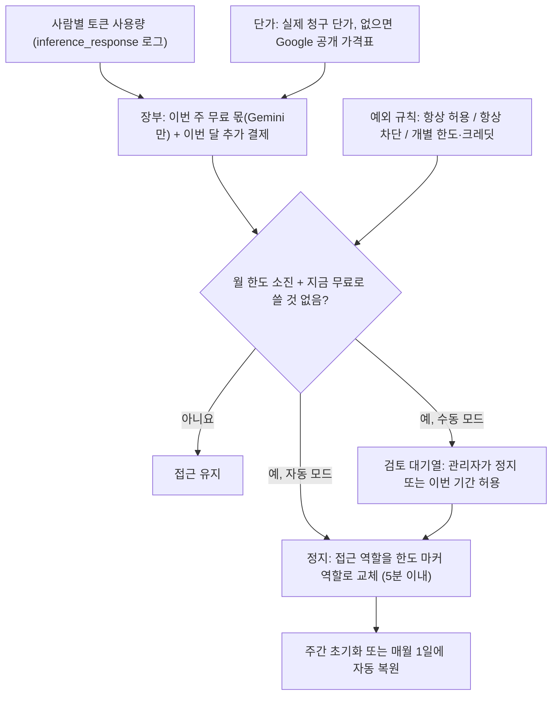

### 8.2 시작하기

1. 기본 설치(`ENABLE_GOVERNANCE_ACTIONS="true"`)면 준비가 끝납니다. 설치가 다음을 자동으로 합니다.
   - **마커 역할 생성**: Gemini Enterprise User 역할에서 `businessaicode.*`만 뺀 `CustomAntigravityCapBlocked`, `CustomAntigravityAdminBlocked`([공식 문서의 AI developer tools 제한용 커스텀 역할](https://cloud.google.com/gemini/enterprise/docs/ai-developer-tools-creating-custom-roles)과 같은 방식). 정지된 사용자는 Gemini Enterprise 앱은 계속 쓰고 Antigravity만 막힙니다.
   - **실시간 자동 집행(Pub/Sub 푸시)**: 기본으로 켜집니다(`REALTIME_ENFORCEMENT="true"`). Antigravity 추론 로그(`businessaicode.googleapis.com/inference_response`)를 Log Router 싱크(대표 프로젝트, `PREPARE_LINKED_PROJECTS`이면 연동 프로젝트도) → Pub/Sub 토픽 → 푸시 구독(`POST /api/v1/governance/antigravity/usage-event`, 런타임 서비스 계정 OIDC 토큰 인증)으로 전달해 **자동 정지 모드에서 한도를 넘자마자 집행을 시작**합니다. 수동 검토 모드와 `notify_only`에서는 이벤트를 받기만 하고 집행하지 않습니다. `iam_deny`에서는 집행 작업 실행을 요청하고, 그 밖에는 대시보드가 바로 한 번 집행합니다(인스턴스마다 30초에 한 번까지). 자동 모드에서 관리자가 한도 정책이나 예외 규칙을 저장/삭제할 때도 즉시 집행을 트리거합니다. 한도에 닿은 요청과 진행 중이던 요청은 끝까지 처리되고, IAM 변경이 반영되기까지 보통 1~2분, 드물게 7분 이상 걸립니다.
   - **집행 스케줄러**: 5분마다 집행 실행(`ENFORCEMENT_SCHEDULE` 기본값 `*/5 * * * *`). 초기화 시각이 지나면 정지된 사용자를 **자동으로 복원**하고(수동 검토 모드에서도) 실시간 이벤트를 놓친 항목의 안전망 역할을 합니다. 끄려면 `--no-enforcement-schedule`, 주기를 바꾸려면 `--enforcement-schedule "CRON"`. IAP 접근 모드에서는 만들지 않고, `iam_allow_swap`의 `--read-only` 설치에서도 만들지 않습니다(`iam_deny`는 집행 작업을 실행하므로 항상 만듭니다, [8.9](#89-거부-정책-집행과-집행-작업)).
   - 2시간 넘게 스케줄 실행이 없으면 화면에 **자동 집행이 멈췄습니다** 경고가 뜹니다.
2. Gemini Enterprise 관리자가 **메타데이터 로깅**을 켭니다(6.5). 사용량은 그때부터 집계됩니다.
3. **한도 정책 > 정책 편집**에서 정합니다. 설치 직후에는 모든 한도가 꺼져 있어(`0`) 누구도 정지되지 않습니다.
   - 한도 방식: **기간별 고정 한도**(기본 — 매월 1일~말일, 기간별 비용·토큰·요청 한도) 또는 **주간 무료 크레딧 + 월 추가 결제 한도**(크레딧 방식). 이전 버전에서 방식을 고르지 않고 추가 결제 한도만 설정해 둔 설치는 관리자가 바꿀 때까지 크레딧 방식을 유지합니다. 크레딧 방식에서 기간별 고정 한도로 바꾸면 저장된 정산 기간(기본 매월)으로 시작하고, 크레딧 방식의 주간 초기화는 넘어오지 않습니다.
   - **고정 기간 한도 정산 주기**: **매일**(일별), **매주**(초기화 요일 선택), **매월**(기본, 초기화 일자 `1~31`일 선택 — 예: 매월 1일 시작이면 11일에 한도 초과 시 말일까지 차단 후 다음 달 1일 자동 복원; 2월 등 짧은 달은 말일로 자동 보정), **사용자 지정 주기**(`1~92`일 간격 + 기준 시작일 `YYYY-MM-DD`), 고급 옵션의 **롤링 기간**까지 지원하며, 편집 대화상자에서 현재 기간·차단 해제 시각·다음 기간을 실시간 미리보기(`GET /api/v1/governance/antigravity/period-preview`, 저장하지 않은 값으로 집행과 같은 규칙으로 계산)로 확인합니다.
   - 크레딧 방식 설정: 1인 월 크레딧(`Standard $10` / `Plus $15`), 1인 월 추가 결제 한도(`제한 없음` / `크레딧만` / `월 한도`), 조직 전체 월 추가 결제 한도, 주간 초기화 요일·시각·시간대, 선택적 주간 토큰·요청 한도.
4. 사람마다 한도를 다르게 주려면 **사용자별 사용량과 한도** 표에서 연필 버튼을 누릅니다. 기간별 고정 한도는 **비용 한도** 열, 크레딧 방식은 **추가 결제 한도** 열(`기본값`, `크레딧만`, `개별 한도`)입니다. 크레딧 방식에서 Plus 라이선스처럼 크레딧이 다른 사람은 예외 규칙의 **개별 한도**에서 월 크레딧을 15로 줍니다.
5. 상단 **집행** 카드에서 **자동 정지** 또는 **수동 검토**를 고릅니다. 기본은 수동 검토입니다.
6. **시뮬레이션**으로 IAM을 바꾸지 않고 결과를 미리 본 뒤 **지금 집행 실행**을 누릅니다.

### 8.3 금액 계산과 단가

- 사용자별 금액 = 모델별로 (입력 토큰 − 캐시 토큰) x 입력 단가 + 캐시 토큰(`cachedContentTokenCount`) x 캐시 단가 + 나머지 토큰(응답, thinking) x 출력 단가. Antigravity 세션은 입력 대부분이 프롬프트 캐시에서 나오므로(공식 예시: 입력 70,825 중 69,079), 캐시 단가를 쓰지 않으면 금액이 크게 부풀려집니다. 캐시 단가를 모르는 모델은 입력 단가로 계산해 낮게 잡히지 않게 합니다. 캐시 쓰기 토큰은 로그에 따로 없어 입력으로 계산합니다.
- 무료 몫은 사용한 순서대로 Gemini 금액에 먼저 적용합니다(모델 ID가 `gemini`로 시작하는 모델, `credit_model_prefixes`). 한 주가 두 달에 걸치면(예: 월요일 초기화인데 1일이 수요일) 그 주의 무료 몫 하나를 두 달이 나눠 쓰고, 추가 결제는 사용한 날짜의 달로 계산합니다.
- 단가는 모델과 방향(입력/출력)별로 다음 순서로 찾습니다.
  1. **실제 청구 단가**: 최근 30일 결제 내보내기에서 해당 모델 표준 텍스트 토큰 SKU의 `SUM(cost) / SUM(usage.amount)`. 협상 가격이 반영되며 크레딧은 빼지 않습니다. batch, flex, priority, 캐시, 장문 컨텍스트, 튜닝, 오디오/이미지/비디오 같은 변형 SKU는 제외합니다.
  2. **Google 공개 가격표**: 청구 기록이 없는 모델은 Cloud Billing Catalog API(Gemini Platform, Gemini API)의 공개 가격을 씁니다.
- 크레딧 한도는 USD로 계산합니다. 청구 통화가 다르면 Google이 가격표에 게시하는 환율로 환산하고, 화면에 `1 USD = ₩1,359 (Google 환율, 날짜)`처럼 근거를 표시합니다.
- 단가는 6시간 동안 캐시됩니다. 한도 정책 카드의 **이번 기간에 사용한 모델 단가** 표에 모델별 단가와 출처(청구 단가, Google 가격표, 단가 없음)가 표시됩니다.
- 어느 쪽에서도 단가를 찾지 못한 모델은 "단가 없음"으로 표시되고, 그 사람의 금액을 계산할 수 없으면 한도 사용률이 `—`로 표시되고 정지되지 않습니다.
- 결제 내보내기에는 사용자 정보가 없으므로 사람별 금액은 토큰 기반 계산입니다. 토큰 수 자체는 Google이 호출마다 기록한 실측값입니다.
- **월간 사용 리포트**(Antigravity 통제 화면): 달을 고르면 사람별 요청 수, 토큰, Gemini 금액, Claude 등 타사 모델 금액, 적용된 무료 크레딧, **청구 금액**(= Claude + 주간 무료 몫을 넘은 Gemini), 추가 결제 한도를 보여 주고 CSV로 내려받습니다(`GET /api/v1/governance/antigravity/billing-report?month=YYYY-MM`). 정지 판단과 같은 장부를 쓰므로 화면의 숫자와 리포트가 일치합니다.
- 계약 단가를 직접 넣고 싶은 조직은 설정 > 거버넌스 정책에서 토큰 단가를 `직접 입력`으로 바꾸거나 `config.yaml`의 `model_prices`를 씁니다(선택).

### 8.4 집행 모드

| 모드 | 정지 조건을 만족하면 | 복원 |
|---|---|---|
| 수동 검토 (기본) | 검토 대기열에 올라갑니다. 관리자가 사용자별(또는 일괄)로 **정지**하거나 **이번 기간 허용**합니다. 새 대기 사용자가 생기면 웹훅으로 알립니다. | 설정된 초기화 시각(주간/월간/일간/사용자 지정)에 자동 |
| 자동 정지 | 실시간 사용 이벤트(`REALTIME_ENFORCEMENT`) 또는 정책 변경 직후 즉시 집행을 시작하며, 스케줄러가 안전망으로 동작합니다. | 설정된 초기화 시각(주간/월간/일간/사용자 지정)에 자동 |

- **집행 실행**은 **실시간 사용 이벤트(Pub/Sub 푸시)**, **관리자 정책 변경(자동 모드)**, **지금 집행 실행** 버튼, 또는 **Cloud Scheduler 작업(`ENFORCEMENT_SCHEDULE`)**으로 일어납니다. 스케줄러와 Pub/Sub 푸시는 각각 지정된 서비스 계정의 Google OIDC 토큰을 사용하며, 앱은 발급자·대상(`PUBLIC_BASE_URL` + 경로)·이메일 검증·허용 목록(`SCHEDULER_INVOKERS` / `RUNTIME_SERVICE_ACCOUNT`)을 확인합니다. 인증 없는 호출과 다른 토큰은 401/403입니다. 집행은 항상 캐시를 쓰지 않고 최신 로그(현재 분의 Cloud Logging 테일 포함)를 읽습니다.
- 정지 = 접근 역할(`roles/discoveryengine.agentspaceUser`)을 한도 마커 역할(`CustomAntigravityCapBlocked`)로 바꾸는 하나의 etag 기반 `setIamPolicy`(또는 `iam_deny` 백엔드의 IAM 거부 정책)입니다. 정지 기록(시작, 복원 예정 시각, 사유, 실행 주체)이 설정 버킷에 남고, 복원 시각이 지나면 첫 집행 실행이 텔레메트리가 없어도 복원합니다. 기본 스케줄(5분)이면 초기화 후 5분 안에 복원되고, 스케줄을 끈 경우에만 초기화될 때마다 집행을 실행해야 합니다.
- **영구 정지는 없습니다.** 한도 정지는 항상 설정된 다음 초기화 시각에 풀리고, 계속 막는 것은 관리자가 건 **항상 차단** 규칙뿐입니다. 대시보드를 삭제할 때도 `teardown.sh`가 집행을 먼저 멈추고 한도로 정지된 사용자를 복원합니다(15장).

### 8.5 예외 규칙

| 규칙 | 효과 | 기간 |
|---|---|---|
| 항상 허용 | 한도를 넘어도 정지하지 않습니다. 정지된 사용자는 바로 복원됩니다. | 이번 정산 기간만 / 만료 없음 |
| 개별 한도 | 이 사용자에게만 다른 월 추가 결제 한도(0 = 크레딧만), 월 크레딧(예: Plus 15), 주간 토큰/요청 한도를 적용합니다. 비워 둔 항목은 기본값을 따릅니다. 한도를 늘리면 다음 집행 실행에서 바로 복원됩니다. | 이번 정산 기간만 / 만료 없음 |
| 항상 차단 | 관리자 차단 마커 역할(`CustomAntigravityAdminBlocked`)로 바로 차단하고, 규칙을 지울 때까지 유지합니다. | 만료 없음 |

규칙은 두 집행 모드 모두에 적용되며, 추가/변경/삭제는 모두 감사 로그에 남습니다.

### 8.6 IAM 상태와 안전 게이트

| 상태 | 의미 | 자동 정지 | 자동 복원 |
|---|---|:---:|:---:|
| `ENFORCEABLE_ALLOWED` | 직접 `user:` 바인딩으로만 접근 권한이 있음 | 예 | - |
| `CAPPED_BY_TOOL` | 한도 초과로 정지됨 | - | 예 |
| `BLOCKED_BY_ADMIN` | 관리자가 차단함 | - | 아니요 |
| `NOT_ENFORCEABLE` | 그룹, 도메인, 상속 바인딩, 상위 역할 등으로 접근해 개별 통제 불가 | 아니요 | 아니요 |
| `NO_ACCESS` | 접근 경로 없음 | 아니요 | 아니요 |
| `UNKNOWN` | 정책을 읽지 못해 판단 불가 | 아니요 | 아니요 |

`NOT_ENFORCEABLE`과 `UNKNOWN` 사용자는 절대 바꾸지 않고, 사유별 조치 방법과 함께 "수동 조치 필요" 목록에 보여 줍니다.

| 게이트 | 조건 | 동작 |
|---|---|---|
| `G1_POLICY_READABLE` | 프로젝트 IAM 정책을 읽지 못함 | 적용 중단 |
| `G2_ANY_DETERMINATE` | 판단 가능한 사용자가 없음 | 적용 중단 |
| `G3_TELEMETRY_HEALTHY` | 사용량 조회 실패, 0건, 또는 Cloud Logging 읽기가 `max_log_entries`(기본 20,000건)에서 잘림 | 정지만 적용, 사용량 기반 복원 보류(복원 예정 시각이 지난 정지는 그대로 복원). 잘린 집계는 하한값이므로 한도 초과 판정은 유효합니다. 사용자가 많으면 추론 로그를 BigQuery로 내보내세요. 사용량을 읽지 못한 달의 장부로는 아무도 정지하지 않습니다. |
| `G4_CHANGE_BUDGET` | 한 번의 실행에서 정지할 인원이 `max(change_budget_min, ceil(change_budget_ratio x 대상 인원))`(기본 최소 10명, 20%)을 넘음 | 가장 많이 넘은 사람부터 그 인원만 정지하고 나머지는 다음 실행에서 정지합니다(복원은 인원 제한 없음). 조직 한도가 소진되는 순간처럼 여러 명이 한꺼번에 넘어도 몇 번의 실행(5분 간격) 안에 모두 정지되고, 잘못된 데이터 하나로 한 번에 많은 사람이 막히는 일은 막습니다. |
| `G5_NON_USER_GRANT_ABSENT` | 접근 역할에 그룹 또는 도메인 바인딩 존재 | 경고 |
| `G6_DENY_CAPACITY` (`iam_deny`) | 부착점의 거부 주체가 2,000명 이상이거나, 이번 실행으로 2,500명을 넘게 됨 | 2,000명부터 경고하고, 2,500명을 넘게 하는 신규 정지는 보류합니다(복원은 진행). |
| `G7_SURGE_GUARD` (`iam_deny`) | 한 번에 `surge_guard_min`(기본 10)명 이상이면서 대상 인원의 `surge_guard_ratio`(기본 50%) 이상을 새로 정지하게 됨 | 자동 정지를 모두 검토 대기열로 보냅니다(관리자가 승인한 정지와 항상 차단은 적용). |

동시 변경으로 etag가 충돌하면 계획을 다시 계산해 한 번 재시도합니다.

### 8.7 감사, 알림, 영속성

- 모든 집행 실행, 검토 결정, 예외 규칙, 허용/차단은 Cloud Logging 감사 로그(`projects/PROJECT_ID/logs/agy-admin%2Fadmin_actions`)에 기록되고 **관리 감사 로그** 카드에 표시됩니다. 이를 위해 서비스 계정에 `roles/logging.logWriter`가 항상 부여됩니다. 그래도 기록에 실패하면 변경은 유지되고 API 응답에 `auditLogged: false`로 표시됩니다. [agy-admin-cli](https://github.com/terrychahn/agy-admin-cli)와 같은 마커 역할과 감사 로그를 쓰므로 함께 운영할 수 있습니다. 함께 쓸 때는 두 도구의 실행 시각이 겹치지 않게 합니다.
- `governance.antigravity.webhook_url`(Slack `hooks.slack.com` 또는 Google Chat `chat.googleapis.com`, HTTPS만)을 지정하면 새 검토 대기 사용자와 집행 결과를 보냅니다. 보내는 글의 `<`와 `>`는 비슷한 모양의 `‹`, `›`로 바꿔 조직 CSV의 단위 이름 등이 Slack·Google Chat 멘션이나 링크가 되지 않게 하고, 다른 문자는 그대로 보냅니다.
- 예외 규칙과 정지 기록은 설정 버킷에 저장되어 재시작 후에도 남습니다. 설정 버킷 없이 Cloud Run에서 실행하면 메모리에만 저장되며 화면에 경고가 표시됩니다.

### 8.8 자동 검증 (드릴)

사람이 손으로 확인하지 않아도 되도록, **실제 집행 엔진을 그대로 돌리는 한 달 시뮬레이션**이 들어 있습니다. Google Cloud 접속 없이 몇 초 만에 끝납니다.

```bash
python3 scripts/caps_drill.py                                  # 월 한도 $100, Standard 크레딧 ($10)
python3 scripts/caps_drill.py --budget 0                       # 크레딧만
python3 scripts/caps_drill.py --org-budget 300 --crowd 30      # 조직 한도 + 30명이 한꺼번에 넘는 경우
python3 scripts/caps_drill.py --weekday 2 --at 14:00 --tz America/Los_Angeles   # 프로젝트의 7일 주기
python3 scripts/caps_drill.py --lang en                        # 영어 보고서
python3 scripts/caps_drill.py --backend iam_deny               # 거부 정책 집행(8.9)
python3 scripts/caps_drill.py --backend iam_deny --unit-budget 60   # 조직 단위 예산 $60(8.10)
```

- 가짜 시계로 5분마다 스케줄 실행을 흉내 내고, 프로젝트 IAM 정책과 공식 스키마의 추론 로그(BigQuery 싱크 테이블)를 시뮬레이션합니다. 대시보드 코드는 운영과 똑같이 돕니다. 시뮬레이션 사용자는 접근 권한이 있을 때만 호출에 성공합니다.
- 사람별 주차별 Gemini·Claude·무료 적용·추가 결제 금액, 모든 정지·복원 시각과 사유, 그리고 실행마다 검사한 규칙 결과(PASS/FAIL)가 나옵니다.
  - R1 한도나 무료 크레딧이 남은 사람은 정지되지 않는다
  - R2 한도를 넘은 사람은 다음 실행(5분 이내)에 정지된다 (변경 예산을 넘는 대량 정지는 몇 번의 실행에 나눠서)
  - R3 모든 정지는 주간 초기화나 월 초에 풀린다 (영구 정지 0건)
  - R4 한도 초과분은 복원 1회당 실행 간격(5분) 사용량 이내 (개인·조직 한도 모두)
  - R5 항상 허용·그룹 권한 사용자는 정지되지 않는다
  - R6 월간 리포트 금액 = 호출 단위 독립 계산 (센트 단위)
  - R7 소진된 조직 단위 예산은 같은 실행에서 그 단위의 사람을 정지한다 (`--unit-budget`)
  - R8 거부 정책에는 기록된 정지 대상만 있고, Antigravity 권한만 거부한다 (정책 ID와 부착점 포함, `--backend iam_deny`)
  - R9 복원 시각이 지나면 거부 정책에 남는 사람이 없다
  - R10 비용 정산 배분의 합계가 맞고, 사람별 청구 금액이 독립 계산과 같다 (±1센트)
- 같은 드릴이 단위 테스트(`tests/unit/test_caps_drill.py`)로 `scripts/test.sh`에서 매번 돕니다. 엔진을 일부러 망가뜨린 변형(무료 크레딧이 갱신되지 않음, 정지하지 않음, Claude를 크레딧으로 계산, 변경 예산을 넘으면 아무도 정지하지 않음, 조직 단위 예산 무시, 거부 권한 추가, 복원 후 거부 항목 남김)에서는 드릴이 반드시 FAIL해야 테스트가 통과합니다.

### 8.9 거부 정책 집행과 집행 작업

기본 집행 방식(`iam_allow_swap`)은 대표 프로젝트 허용 정책의 직접 `user:` 바인딩만 바꿀 수 있어서, 그룹·상위 폴더·Workforce로 접근하는 사람은 정지할 수 없습니다(8.6의 `NOT_ENFORCEABLE`). **거부 정책 집행(`iam_deny`)**은 정지할 사람을 IAM 거부 정책에 올립니다. IAM은 거부 정책을 허용 정책보다 **먼저** 확인하므로, 거부된 사람은 역할을 어떤 경로(그룹, 상속, Workforce)로 받았든 그 권한을 쓸 수 없습니다([공식 문서](https://cloud.google.com/iam/docs/deny-overview)).

| 집행 방식 (`enforcement_backend`) | 동작 | 막는 범위 |
|---|---|---|
| `iam_allow_swap` (기본) | 대시보드가 접근 역할을 마커 역할로 바꿉니다(8.4). | 직접 `user:` 바인딩 |
| `iam_deny` | 집행 작업이 부착점마다 고정 ID 거부 정책 `ai-control-plane-caps` 하나를 관리합니다. 규칙은 하나: 정지·차단된 사람 × 허용 목록 권한(`businessaicode.googleapis.com/locations.generateContent`). | 그룹·상속·Workforce 접근 포함 |
| `notify_only` | 계획과 알림만 만들고 접근은 바꾸지 않습니다. 쓰기 역할이 필요 없습니다. | 없음 |

- 부착점(`deny_attachment`): `projects`(기본, 작업 공간 프로젝트마다) 또는 `scope`(작업 공간 범위가 폴더·조직이면 그 폴더·조직, 아니면 프로젝트마다). 거부 정책은 부착점 아래의 모든 리소스에 상속됩니다.
- 추가 거부 권한(선택, 기본 꺼짐): `deny_ge_app`은 Gemini Enterprise 어시스턴트(`discoveryengine.googleapis.com/assistants.assist`), `deny_agent_platform`은 Gemini Platform 모델 호출(`aiplatform.googleapis.com/endpoints.predict`)도 함께 거부합니다. ADC·종량제로 로그인한 Antigravity는 Gemini Platform을 직접 호출해 기본 권한으로는 막히지 않습니다(6.5). `deny_agent_platform`을 켜면 정지된 사람은 부착점 안의 모든 Gemini Platform 모델 호출(본인이 만든 앱·스크립트 포함)을 쓸 수 없습니다.
- 정책에는 사람(`principal://goog/subject/EMAIL`, 로그에 남은 그대로의 Workforce 주체, 7.12)만 올라가고 서비스 계정과 그룹은 올라가지 않습니다. 관리자의 **항상 차단** 규칙도 같은 정책으로 적용됩니다.
- IAM이 찾지 못하는 계정(삭제된 계정, 잘못 적은 주소)이 하나라도 있으면 IAM은 그 쓰기 전체를 400(`The principal ... was not found`)으로 거절합니다(테스트 프로젝트에서 확인). 그래서 그런 계정은 빼고 나머지 사람에게 적용하며, 빠진 사람은 실패와 이유로 표시합니다.
- 적용 전에 불변 조건(정책 ID 접두사 `ai-control-plane-`, 권한 = 허용 목록, 주체 = 사람, 부착점 = 설정에서 계산한 목록, 신규 정지 수 ≤ 변경 예산, 최신 etag)을 확인하고, 하나라도 어기면 아무것도 바꾸지 않습니다.
- 거부 정책 방식에 더해지는 게이트: G1(부착점 하나라도 거부 정책을 읽지 못하거나, 같은 ID의 정책이 대시보드 밖에서 다른 모양으로 바뀌었으면 중단), G6(부착점별 주체 2,000명부터 경고, 2,500명을 넘게 되면 신규 정지 보류), G7(한 번에 `surge_guard_min`명 이상이면서 대상 인원의 `surge_guard_ratio` 이상을 새로 정지하게 되면 모두 검토 대기열로 보냄).

**역할 (조직에서만 부여 가능)**

Deny Admin(`roles/iam.denyAdmin`)과 Deny Reviewer(`roles/iam.denyReviewer`)는 **조직 수준에서만** 부여할 수 있습니다. 그래서 조직이 없는 프로젝트에서는 `iam_deny`를 쓸 수 없고, 배포가 그렇게 안내합니다. Deny Admin은 집행 작업의 서비스 계정 하나만 받습니다.

| 계정 | 역할 | 범위 |
|---|---|---|
| 집행 작업 (`ai-control-plane-enforcer@PROJECT_ID.iam.gserviceaccount.com`) | Deny Admin | 조직 |
| | 사용량·로그·BigQuery·라이선스 읽기, 감사 로그 쓰기(`roles/logging.logWriter`). 프로젝트 IAM 쓰기 역할은 없습니다. | 대표·연동 프로젝트 |
| | Storage Object Admin(설정·정지 기록) | 설정 버킷 |
| 대시보드 (런타임 서비스 계정) | Deny Reviewer(집행 상태 표시) | 조직 |
| | Cloud Run Jobs Executor(`roles/run.jobsExecutor`, 지금 집행 실행), Cloud Run Viewer(`roles/run.viewer`, 실행 상태) | 집행 작업 하나 |
| 스케줄러 (`ai-control-plane-scheduler@PROJECT_ID.iam.gserviceaccount.com`) | Cloud Run Jobs Executor | 집행 작업 하나 |

- `GRANT_ORG_ROLES="true"`(또는 `--grant-org-roles`)면 배포가 두 조직 역할을 부여합니다. 배포하는 계정에 조직의 IAM 정책을 바꿀 권한(조직 관리자, `resourcemanager.organizations.setIamPolicy`)이 필요합니다.
- 기본값(`false`)이면 아무것도 부여하지 않고, 조직 관리자가 실행할 명령을 그대로 출력합니다.

```bash
gcloud organizations add-iam-policy-binding ORGANIZATION_ID \
  --member=serviceAccount:ai-control-plane-enforcer@PROJECT_ID.iam.gserviceaccount.com \
  --role=roles/iam.denyAdmin --condition=None
gcloud organizations add-iam-policy-binding ORGANIZATION_ID \
  --member=serviceAccount:ai-control-plane-sa@PROJECT_ID.iam.gserviceaccount.com \
  --role=roles/iam.denyReviewer --condition=None
```

- 역할을 받기 전까지 집행 작업은 거부 정책을 읽지 못해 G1에서 멈추고 아무것도 바꾸지 않습니다.

**한도**

| 항목 | 한도 | 이 도구의 대응 |
|---|---|---|
| 리소스당 거부 주체 | 그 리소스에 붙은 모든 거부 정책을 합쳐 2,500명. 같은 사람도 나올 때마다 따로 셉니다([IAM 할당량과 한도](https://cloud.google.com/iam/quotas)). | G6. 다른 도구가 같은 리소스에 붙인 거부 정책도 같은 한도를 씁니다. |
| 리소스당 거부 정책과 규칙 | 정책 500개, 규칙 합계 500개 | 부착점마다 정책 1개, 규칙 1개만 씁니다. |
| IAM 정책 API 호출 | 기본 할당량: 호출하는 쪽 할당량 프로젝트당 분당 정책 읽기 10회, 쓰기 10회(Service Usage의 `iam.googleapis.com` "Policy Read/Write Requests"). 테스트 프로젝트에서 확인했고, 부착점 2곳으로도 429가 한 번 났습니다. | 실행마다 부착점 수만큼 읽습니다. 일시적인 429·5xx는 1초, 2초 뒤 다시 읽습니다. 집행 작업은 429를 받으면 그보다 먼저 20초, 40초 기다렸다 다시 읽어 다음 1분 할당량으로 넘어갑니다(대시보드 화면은 기다리지 않음). 배포된 테스트 환경에서 예약 실행과 대시보드 조회가 같은 1분에 겹쳐 G1에서 멈춘 것을 보고 넣은 동작입니다. 집행 상태 화면은 60초 캐시하며, 부착점이 5곳을 넘으면 경고합니다. **프로젝트가 많으면 `scope`(폴더·조직) 부착을 쓰세요.** 예를 들어 24개 프로젝트를 `projects`로 부착하면 기본 할당량으로는 한 번에 다 읽지 못해 G1에서 멈출 수 있습니다(할당량 상향 요청 가능). |
| 반영 시간 | 최종 일관성(eventual consistency). 정지와 복원이 실제로 적용되기까지 몇 분 걸릴 수 있습니다([접근 변경 전파](https://cloud.google.com/iam/docs/access-change-propagation)). | 그동안의 사용량도 장부에 들어가 다음 실행의 판단에 반영됩니다. |

**집행 작업과 스케줄러**

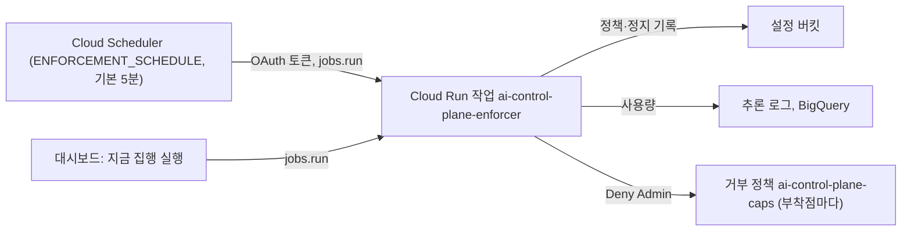

- `ENFORCEMENT_BACKEND="iam_deny"`로 배포하면 `scripts/deploy.sh`가 같은 이미지로 Cloud Run 작업 `ai-control-plane-enforcer`(`python -m controlplane.enforce_job`, 작업 시간 제한 600초, 재시도 없음)를 만들고 전용 서비스 계정으로 실행합니다. 서비스와 같은 설정과 설정 버킷을 쓰고, 요청을 받지 않으므로 보안 비밀은 받지 않습니다.
- Cloud Scheduler 작업 `ai-control-plane-enforcer`가 `ENFORCEMENT_SCHEDULE`(기본 `*/5 * * * *`)마다 스케줄러 서비스 계정의 OAuth 토큰으로 `POST https://run.googleapis.com/v2/projects/PROJECT_ID/locations/REGION/jobs/ai-control-plane-enforcer:run`을 호출합니다. 대시보드를 거치지 않으므로 IAP 접근 모드와 `--read-only` 설치에서도 만듭니다.
- 웹 집행 엔드포인트를 부르는 스케줄러(`ai-control-plane-enforce`)는 만들지 않고, 예전 배포에 있으면 지웁니다. 집행 주체는 항상 하나입니다.
- 대시보드의 **지금 집행 실행**은 작업 실행을 요청하고, 집행 상태 카드에 최근 실행(시작·완료 시각, 성공·실패)을 보여 줍니다. 작업이 설정되지 않은 설치(로컬 실행 등)에서는 대시보드가 직접 적용하므로, 대시보드를 실행하는 계정에 Deny Admin이 있어야 합니다.
- 실행마다 Cloud Logging에 JSON 한 줄(건수만, 이메일 없음)을 남깁니다. 종료 코드는 `0`(적용·변경 없음·시험 실행·안전 게이트 중단), `1`(변경 실패나 예기치 않은 오류, 다음 실행이 다시 시도), `2`(설정 오류: 작업 공간 미설정, Antigravity 모듈 꺼짐, 설정 버킷 없음, 집행 방식이 `iam_allow_swap` 등, `reason`에 이유)입니다.
- 지금 한 번 실행: `gcloud run jobs execute ai-control-plane-enforcer --region REGION --project PROJECT_ID --wait`

**설정과 전환**

| deploy.env (설치 옵션) | 화면 설정 키 | 기본값 | 설명 |
|---|---|---|---|
| `ENFORCEMENT_BACKEND` (`--enforcement-backend`) | `governance.antigravity.enforcement_backend` | `iam_allow_swap` | `iam_allow_swap` / `iam_deny` / `notify_only` |
| `DENY_ATTACHMENT` (`--deny-attachment`) | `governance.antigravity.deny_attachment` | `projects` | `projects` / `scope` |
| `ENFORCEMENT_JOB_REGION` (`--enforcement-job-region`) | - | `REGION` | 작업과 스케줄러의 리전 |
| `GRANT_ORG_ROLES` (`--grant-org-roles`) | - | `false` | 두 조직 역할을 배포가 부여할지 |
| `ENFORCEMENT_SCHEDULE` | - | `*/5 * * * *` | 작업 실행 주기(`off`면 지금 집행 실행으로만) |
| 배포가 설정(`ENFORCEMENT_JOB`) | `governance.antigravity.enforcement_job`(화면에서 바꿀 수 없음) | - | 대시보드가 실행을 요청할 작업 |

- 정책 ID는 `governance.antigravity.deny_policy_id`(기본 `ai-control-plane-caps`)이며 `config.yaml`에서만 바꿀 수 있고 `ai-control-plane-`로 시작해야 합니다.
- 화면(설정 > 거버넌스 정책)에서 저장한 값이 deploy.env보다 우선합니다(9.1). 한쪽을 바꾸면 다른 쪽도 같은 값으로 맞추세요(화면에서는 기본값으로 재설정해도 됩니다). 작업, 스케줄러, 조직 역할은 배포만 만들므로 `iam_deny`로 바꿀 때는 먼저 배포합니다.
- `iam_allow_swap`에서 다른 방식으로 바꿀 때 이미 마커 역할로 정지·차단된 사람은 대시보드의 유지관리 실행(기본 15분마다)이 넘겨받습니다. 새 방식이 그 사람을 더 막을 필요가 없어지면 접근 역할을 돌려줍니다: `iam_deny`는 거부 정책에 올라갔거나, 항상 차단 규칙·진행 중인 정지가 없고 한도 안일 때, `notify_only`는 진행 중인 정지가 끝났고 항상 차단 규칙이 없을 때입니다. 이 작업은 대시보드 서비스 계정의 프로젝트 IAM 쓰기 역할(`ENABLE_GOVERNANCE_ACTIONS="true"`)로 하므로 모두 넘겨받을 때까지 그 역할을 유지하세요. 남은 인원과 오류는 집행 상태에 표시되고, 돌려준 사람은 감사 로그(`marker_release`)에 남습니다.

```bash
scripts/deploy.sh --project PROJECT_ID --enforcement-backend iam_deny                    # 조직 역할 명령을 출력
scripts/deploy.sh --project PROJECT_ID --enforcement-backend iam_deny --grant-org-roles  # 조직 관리자가 배포할 때
```

- `scripts/install.sh`도 같은 옵션을 받고 `deploy.PROJECT_ID.env`에 저장해 다음 배포에 씁니다.
- Terraform(10장): `enforcement_backend = "iam_deny"`, 조직 역할은 `grant_org_roles = true`와 `organization_id`로 부여하고, 아니면 출력 `organization_role_commands`의 명령을 조직 관리자가 실행합니다.

**되돌리기**

1. `iam_deny`를 유지한 채 정지를 풉니다. 한도 정지는 정산 기간이 끝날 때(기본 매월 1일, 크레딧 방식은 주간 초기화나 매월 1일) 자동으로 풀립니다. 바로 풀려면 **항상 허용** 규칙이나 더 높은 개별 한도를 주고 **항상 차단** 규칙을 지웁니다. 정책에 남은 사람이 없으면 다음 작업 실행이 관리 정책을 삭제합니다(빈 정책은 남기지 않습니다).
2. 집행 방식을 되돌립니다. 화면에서 `iam_allow_swap`을 고르고 `ENFORCEMENT_BACKEND="iam_allow_swap"`(또는 `--enforcement-backend iam_allow_swap`)으로 다시 배포합니다. 다시 배포하면 작업의 스케줄이 지워지고 웹 집행 스케줄러가 돌아오며, 대시보드는 작업을 더 이상 부르지 않습니다. 작업과 그 서비스 계정은 쓰이지 않은 채 남고 `teardown.sh`가 지웁니다. 화면만 바꾸고 다시 배포하기 전에는 작업 실행이 종료 코드 2(`backend_not_supported`)로 끝나고 아무것도 바꾸지 않습니다.
3. 바로 모두 풀어야 하면 관리 정책을 직접 삭제합니다(조직의 Deny Admin 필요). 정책을 지우면 그 정책에 있는 정지와 차단이 한 번에 모두 풀리고, `iam_allow_swap`에서는 다음 집행 실행이 아직 한도를 넘은 사람을 허용 정책 방식으로 다시 정지합니다. 부착점마다(대표 프로젝트, 연동 프로젝트, `scope`면 폴더나 조직) 실행합니다.

```bash
gcloud iam policies get ai-control-plane-caps \
  --attachment-point=cloudresourcemanager.googleapis.com/projects/PROJECT_ID --kind=denypolicies --format=json
gcloud iam policies delete ai-control-plane-caps \
  --attachment-point=cloudresourcemanager.googleapis.com/projects/PROJECT_ID --kind=denypolicies
# scope 부착: cloudresourcemanager.googleapis.com/folders/FOLDER_ID 또는 .../organizations/ORGANIZATION_ID
```

- `teardown.sh`는 작업의 스케줄과 작업을 먼저 지운 다음 대표·연동 프로젝트, 화면에서 추가한 프로젝트, 워크스페이스 범위의 폴더·조직에서 관리 정책을 삭제하고(관리자 차단도 함께 풀립니다), 조직 역할을 회수하거나 회수 명령을 출력합니다(15장). 지우지 못한 정책과 그 밖의 위치에 붙은 정책은 출력되는 명령으로 지웁니다.

### 8.10 조직·프로젝트 예산, 관리자 결정, 알림만 방식

**조직·프로젝트 월 예산** (비용 정산 > 월 예산)

개인 한도와 조직 전체 한도(`org_paid_budget_month`)에 더해, 조직 단위(7.12의 조직 구조)와 프로젝트마다 월 유료 예산(USD)을 둘 수 있습니다. 본부별로 나뉜 여러 프로젝트를 화면 한 곳에서 같은 방식으로 관리하는 용도입니다.

| 대상 | 동작 | 예산이 소진되면 |
|---|---|---|
| 조직 단위 | 사용자 정지(`suspend`) | 그 단위와 하위 단위에 귀속된 사람은 다음 달 1일까지 무료로 쓸 몫이 없는 동안 정지됩니다(조직 전체 한도와 같은 규칙). 주간 무료 크레딧 방식에서는 매주 돌아오는 무료 크레딧을 계속 쓸 수 있고, 기간 방식에서는 이번 달 유료 사용이 있는 사람이 다음 달 1일까지 정지됩니다. |
| 조직 단위 | 검토 대기열로 보내기(`review`) | 자동 모드에서도 그 사람들을 검토 대기열에 올리고 관리자 결정을 기다립니다. |
| 조직 단위, 프로젝트 | 알림만(`notify`) | 임계값 알림만 보냅니다. |
| 프로젝트 | 하드 캡(`hard_cap`, 워크스페이스 프로젝트만) | 알림에 더해, Google 지출 상한을 켜 두면 그 프로젝트의 Gemini Platform 사용을 Google이 멈춥니다(아래). |

- **사용액**: 그 달 비용 정산 행의 청구 금액(무료 크레딧을 넘은 금액)을 정수 센트로 더합니다. 조직 단위는 하위 단위를 포함하고, 프로젝트는 그 프로젝트에 기록된 사용만 셉니다. 사용액이 예산에 도달하면 소진이고, 0은 유료 사용을 전혀 허용하지 않습니다.
- **계산 방식**: 주간 무료 크레딧 방식은 실행마다 집행 장부(8.3)로, 기간 방식은 그 달 비용 정산 리포트(5분 캐시)로 계산합니다. 예산은 USD라서 리포트 통화가 USD일 때만 적용하고, 아니면 경고만 표시합니다.
- 정지 사유는 `unit_budget`으로 표시되고, 안전 게이트와 변경 예산(8.6, 8.9)을 그대로 거칩니다. 항상 허용 규칙이 있는 사람은 정지하지 않습니다.
- 프로젝트 라벨(`chargeback.project_unit_label`)로만 조직에 귀속된 사용액은 상태, 리포트, 알림에는 들어가지만 정지나 검토는 일으키지 않습니다. 라벨은 프로젝트 소유자가 붙이므로 정지·검토는 조직 CSV의 사람·`project:` 매핑만 따릅니다.
- **알림**: 임계값(기본 50, 80, 100%)마다 한 달에 한 번 웹훅(`AI Control Plane budgets: ...`, 이메일 없음)으로 알리고 감사 로그(`budget_alert`)에 남깁니다. 적용 실행(스케줄, 지금 집행 실행)이 보내므로 알림만 방식에서도 갑니다.
- 예산은 최대 5,000개, 조직 단위·프로젝트마다 1개입니다. 저장하면 목록 전체를 바꾸고 감사 로그(`budgets_save`, 건수만)에 남깁니다.
- API: `GET /api/v1/budgets`, `POST /api/v1/budgets`(관리자, `{"nodes": [...]}`).

**Google 지출 상한 (프로젝트 하드 캡)**

- Cloud Billing Budget API의 지출 상한(spend cap) 예산을 씁니다. 프로젝트의 Gemini Platform 서비스 비용이 금액에 도달하면 Google이 그 프로젝트의 새 Gemini Platform 사용을 그 달 말까지 멈추고, 다음 달 초에 Google이 풉니다. 관리자가 먼저 풀 수도 있습니다(**상한 해제**, Google 안내 기준 약 1시간 안에 재개).
- Google 제약: 프로젝트 1개, 서비스 1개, 달력 월, 크레딧 제외, 임계값 50·80·100% 고정. 즉시 멈추지 않으므로 조금 넘을 수 있습니다.
- **측정 차이**: Google은 그 프로젝트의 모든 Gemini Platform 사용을 정가(크레딧 적용 전)로 재고, 대시보드 예산은 그 프로젝트에 귀속된 유료 몫만 셉니다. 그래서 Gemini Platform으로 청구되는 사용은 대시보드 예산이 소진될 때보다 늦지 않게 멈춥니다. **다른 서비스로 청구되는 사용(예: Gemini API)과 구독 비용은 막지 못합니다. Antigravity 사용이 어느 서비스로 청구되는지 결제 내보내기에서 먼저 확인하세요.**
- 준비: 설정 > 거버넌스 정책 > 집행 > **Google 지출 상한 관리**(`governance.antigravity.spend_caps`)를 켜고, 결제 계정 ID(`workspace.billing.account_id`)를 넣습니다. 대시보드 프로젝트에 Cloud Billing Budget API(`billingbudgets.googleapis.com`)가 사용 설정되어 있어야 하고(`scripts/deploy.sh`가 사용 설정을 시도), 런타임 서비스 계정에 결제 계정의 예산 권한과 `billing.budgets.configureSpendCap`이 필요합니다(예: 결제 계정 관리자 `roles/billing.admin`, 또는 이 권한을 넣은 커스텀 역할). 배포는 결제 계정 역할을 부여하지 않습니다. 리셀러 결제 계정은 지원하지 않습니다.
- **범위**: 하드 캡은 워크스페이스 프로젝트(대표 프로젝트, 설정한 프로젝트, 자동 탐지나 범위에서 찾은 프로젝트)에만 둘 수 있습니다. 다른 프로젝트에 하드 캡을 저장하면 검증 오류가 나고, 이미 있는 워크스페이스 밖 상한은 **워크스페이스 밖 프로젝트**로 표시할 뿐 만들거나 바꾸지 않습니다(해제는 됨). 프로젝트 목록을 읽지 못하면 아무것도 만들거나 바꾸지 않고 하드 캡 저장도 거절합니다.
- 적용: 비용 정산 > 월 예산 > **Google 지출 상한** 카드에서 **변경 미리 보기**로 확인한 뒤 **지출 상한 적용**을 누릅니다. 집행 실행은 지출 상한을 바꾸지 않습니다. 대시보드가 만든 예산(표시 이름 `AI Control Plane cap: PROJECT_ID`)만 바꾸고, 더 필요 없는 상한은 지우지 않고 표시만 합니다(Cloud 콘솔에서 삭제). 바꾸거나 해제하기 전에는 그 예산이 정확히 그 프로젝트(프로젝트 번호)와 Gemini Platform만 대상으로 하고 지출 상한이 있는지 확인하고, 아니면 **컨트롤 플레인 관리 대상 아님**(`not_owned`)으로 표시하고 그대로 둡니다. 이를 위해 Resource Manager(프로젝트 번호)와 Cloud Billing Catalog(서비스)를 읽어 24시간 캐시하므로, 해제에도 런타임 서비스 계정에 그 프로젝트의 `resourcemanager.projects.get` 권한이 필요합니다. 적용 실행은 감사 로그(`spend_caps_apply`)에 상태별 건수와 프로젝트별 변경(프로젝트, 작업, 상태, 금액, 최대 200건)을 남깁니다. 결제 계정 통화가 USD가 아니면 환율 때문에 멈추는 시점이 달라지지 않도록 만들지 않습니다.
- API: `GET /api/v1/budgets/spend-caps`, `POST /api/v1/budgets/spend-caps/apply`(`{"dryRun": true}`가 기본), `POST /api/v1/budgets/spend-caps/lift`(`{"project": "PROJECT_ID"}`).
- 테스트 환경 확인: 제품 코드로 테스트 프로젝트에 지출 상한 예산(높은 금액)을 만들었습니다. Google에 저장된 모양은 프로젝트 1개(프로젝트 번호), Gemini Platform 서비스(`services/C7E2-9256-1C43`), `EXCLUDE_ALL_CREDITS`, 달력 월, 임계값 0.5·0.8·1.0, `spendCap.outputState=CONFIGURED`였습니다. 같은 계획을 다시 돌리면 변경 없음(`none`)이었고, 확인 뒤 예산을 지웠습니다. 실제로 사용이 멈추는 순간(ENFORCED)은 확인하지 않았습니다.

**거부 정책 방식의 관리자 결정**

`iam_deny`에서는 관리자 결정(검토 대기열의 정지·허용, 항상 허용·차단 규칙, 사용자 화면의 허용·차단)을 먼저 설정 버킷에 기록하고, 거부 정책은 집행 실행이 씁니다. 집행 작업이 있으면 대시보드는 작업 실행만 요청하고 결과를 `queued`(적용 중)로 표시하며, 대시보드 서비스 계정은 거부 정책을 쓰지 않습니다. 작업이 없으면 대시보드가 바로 한 번 실행합니다. 어느 쪽이든 IAM에 반영되기까지 몇 분 걸릴 수 있습니다(8.9의 한도 표).

- 검토 대기열에서 승인한 정지는 수동 모드에서도 적용되고 이번 정산 기간(주간 무료 크레딧 방식은 다음 주간 초기화)까지 유지됩니다. 승인했지만 아직 적용되지 않은 정지는 **허용**으로 취소됩니다.
- 항상 차단 규칙을 지울 때 접근을 복원하면 다음 실행이 거부 항목을 지웁니다(그 사람이 그사이 다시 한도를 넘었으면 정지 유지). 복원하지 않으면 이번 정산 기간이 끝날 때까지 정지가 유지됩니다.
- 한도로 정지된 사람을 허용하면 이번 정산 기간 동안 항상 허용 규칙이 생깁니다.

**알림만 (`notify_only`)**

- 수동 검토 모드처럼 계산해 검토 대기열을 보여 주고 예산 알림과 웹훅을 보내지만, 아무도 정지하거나 복원하지 않습니다(허용 정책을 읽거나 바꾸지 않고 거부 항목도 쓰지 않음). 쓰기 역할이 필요 없습니다. 예외는 예전 `iam_deny` 때 남은 거부 정책의 정리뿐입니다(아래).
- 정지 결정과 사용자 화면의 허용·차단은 거절되고(설정 > 거버넌스 정책에서 집행 방식을 바꾸라는 안내), 예외 규칙은 기록만 됩니다.
- `iam_deny`에서 다른 방식으로 바꾸면 예전에 쓴 거부 정책이 남아 있는 동안 집행 상태에 경고를 표시하고, 적용 실행이 지우기를 시도합니다(관리자 실행은 매번, 스케줄 실행은 1시간에 한 번). 대시보드를 실행하는 계정에 Deny Admin이 없으면 지우지 못하므로 8.9의 명령으로 직접 삭제합니다. 정책 ID를 바꾼 경우에도 직접 삭제합니다.

**집행 상태 API**: `GET /api/v1/governance/antigravity/enforcement`는 집행 방식, 부착 위치, 정책 ID, 거부 권한, 서지 가드 기준, 집행 작업의 최근 실행, 부착점별 거부 주체 수(한도 2,500명 대비 비율, 읽기 오류, 외부 변경 여부), 남은 이전 정책, 허용 정책 방식에서 넘어온 마커 역할 보유자 수(8.9), 지출 상한 상태를 돌려줍니다. 읽기만 하며 60초 동안 캐시합니다. 관리자 결정이나 지금 집행 실행 때 캐시를 비우지만, 집행 작업이 나중에 적용한 결과는 최대 60초 늦게 보일 수 있습니다.

---

## 9. 설정 구조 (config.yaml, 환경 변수, 화면 설정)

### 9.1 로딩 순서

뒤의 값이 앞의 값을 덮어씁니다.

1. 내장 기본값
2. `config.yaml` (`CONFIG_PATH`로 경로 지정 가능)
3. `config.local.yaml` (같은 디렉터리, 선택, Git 제외)
4. 환경 변수 (`scripts/deploy.sh`가 `deploy.env`로 설정)
5. 화면에서 저장한 설정 (설정 버킷)

화면에서 바꾼 항목에는 "변경됨" 표시가 붙고, 섹션별로 **기본값으로 재설정**할 수 있습니다. 배포가 정하는 항목(`security.auth_mode`, `iap_audience`, `google_client_id`, `public_base_url`, `sign_in_bridge_url`, `bridge_return_url`, `guest_access`, `guest_redact_terms`와 `governance.antigravity.scheduler_invokers`, `enforcement_job`, `deny_policy_id`, `usage_events_subscription`)은 화면에서 바꿀 수 없고 설정 파일이나 환경 변수로만 바꿉니다.

### 9.2 주요 설정

| 섹션 | 키 | 설명 |
|---|---|---|
| `product` | `name`, `tagline` | 제품명과 태그라인(화이트라벨) |
| `branding` | `organization_name`, `logo_url`, `accent_color`, `default_locale`, `default_theme` | 조직 아이덴티티. 로고는 HTTPS URL 또는 `/assets/` 경로 |
| `workspace` | `project_id`, `projects`, `scan_all_projects`, `quota_project_id`, `timezone`, `default_range_days`, `audit_dataset` | 대표·연동 관제 프로젝트, 자동 탐지 여부, 기본 조회 조건 |
| `workspace` | `scope_type`(`projects` 기본 / `folder` / `organization`), `scope_ids`, `scope_max_projects`(기본 300), `scope_filter`, `audit_project`, `license_max_pages` | 폴더·조직 범위와 중앙 감사 데이터셋([7.12](#712-비용-정산-사람프로젝트조직)) |
| `workspace.billing` | `project_id`, `dataset`, `table`, `account_id` | 결제 내보내기 위치 |
| `workspace` | `discovery_engine_locations`, `agent_engine_regions`, `telemetry_datasets` | API 조회 위치와 추가 텔레메트리 데이터셋 |
| `security` | `auth_mode`, `admins`, `allowed_users`, `google_client_id`, `public_base_url`, `session_hours`, `sign_in_bridge_url`, `bridge_return_url`, `iap_audience`, `mask_pii_for_viewers`, `guest_access`, `guest_redact_terms` | 인증과 권한 |
| `storage` | `backend`, `gcs_bucket`, `gcs_object`, `file_path` | 설정 저장소 |
| `bigquery` | `max_bytes_billed` | 쿼리당 비용 상한(기본 20 GB) |
| `ai_engine` | `default_model`, `models`, `fallback_models`, `discover_models`, `restrict_to_allowed`, `location` | AI 애널리스트와 급증 분석 모델 |
| `modules` | 모듈 ID별 `true`/`false` | 모듈 켜고 끄기 |
| `model_catalog` | `auto_enable_new_models`, `disabled_models`, `excluded_sku_patterns`, `ai_grouping` | 모델 추적 정책 |
| `gateway` | `services` | Agent Gateway에서 관제할 서비스 |
| `agent_lifecycle` | `idle_days`, `deprecation_days` | 휴면과 폐기 권고 기준 |
| `finops` | `spike_threshold_pct`, `spike_min_delta` | 비용 급증 기준 |
| `pricing` | `currency`, `sync_time`(기본 `00:00`), `sync_timezone`, `model_aliases`, `model_overrides`, `alert_price_change_pct`, `alert_fx_change_pct`, `public_sources`, `fx_sources` | 공식 단가·환율 동기화와 토큰 기반 추정 비용 |
| `governance.antigravity` | `cap_model`(`period` 기본 / `credit_budget`). 기간 방식: `period`(`daily` / `weekly` / `monthly` 기본 / `custom` / `all`=최근 90일), `window`(`calendar` 기본 / `rolling`), `reset_day`(기본 `1`), `reset_weekday`(기본 `0`=월요일), `reset_time`(기본 `00:00`), `reset_timezone`(비우면 작업 공간 시간대), `cycle_days`, `cycle_start`, `cost_cap`·`token_cap`·`request_cap`(`0`=끔), `currency`. 크레딧 방식: `credit_per_user_month`, `credit_source`(`license` 기본)·`credit_by_tier`, `paid_budget_month`(-1 제한 없음, 0 크레딧만), `org_paid_budget_month`, `credit_model_prefixes`. 공통: `enforcement_mode`(`manual` 기본 / `auto`), `pricing_source`, `model_prices`, 마커 역할, 변경 예산(`change_budget_min` 10, `change_budget_ratio` 0.2), `max_log_entries`, `webhook_url`, 집행 방식 `enforcement_backend`·`deny_attachment`·`deny_policy_id`·`deny_ge_app`·`deny_agent_platform`·`surge_guard_min`·`surge_guard_ratio`(8.9), `spend_caps`(8.10), 배포 설정 `scheduler_invokers`·`enforcement_job`·`usage_events_subscription` | Antigravity 한도 정책 |
| `chargeback` | `allocation_mode`(`credit_share` 기본 / `list`), `project_unit_label`, `seat_prices`, `close_dataset` | 비용 정산([7.12](#712-비용-정산-사람프로젝트조직)) |
| `telemetry` | `discovery.*`, `ai.*`(`model` 기본 `gemini-4-argon`), `inference.*`, `routing.*`(데이터셋 `telemetry_routed`, 샘플링, 최소 심각도, 보존 기간, 일일 GiB 한도) | 텔레메트리 확장 |
| `analyst` | `max_bytes_billed`, `max_rows`, `allow_viewers` | AI 애널리스트 쿼리 상한(기본 10 GB, 500행), 뷰어 사용 허용 여부(기본 `false`) |

### 9.3 환경 변수

`scripts/deploy.sh`가 Cloud Run에 설정하는 값과 직접 실행할 때 쓰는 값입니다.

| 변수 | 대응 설정 |
|---|---|
| `PROJECT_ID`, `QUOTA_PROJECT_ID` | `workspace.project_id`, `workspace.quota_project_id` |
| `SCAN_PROJECTS`, `SCAN_ALL_PROJECTS` | `workspace.projects`(쉼표 구분), `workspace.scan_all_projects`(`true`/`false`) |
| `SCOPE_TYPE`, `SCOPE_IDS`, `AUDIT_PROJECT` | `workspace.scope_type`, `workspace.scope_ids`(쉼표 구분), `workspace.audit_project` |
| `AUDIT_DATASET_ID` | `workspace.audit_dataset` |
| `BILLING_PROJECT_ID`, `BILLING_DATASET_ID`, `BILLING_TABLE_ID`, `BILLING_ACCOUNT_ID` | `workspace.billing.*` |
| `WORKSPACE_TIMEZONE` | `workspace.timezone` |
| `DISCOVERY_ENGINE_LOCATIONS`, `AGENT_ENGINE_REGIONS` | 쉼표 구분 목록 |
| `DISABLED_MODULES` | 쉼표로 구분한 모듈을 끔(`modules.<모듈 ID>: false`) |
| `ORGANIZATION_NAME`, `PRODUCT_NAME`, `DEFAULT_LOCALE` | `branding.organization_name`, `product.name`, `branding.default_locale` |
| `AUTH_MODE`, `ADMIN_EMAILS`, `ALLOWED_USERS` | `security.auth_mode`, `security.admins`, `security.allowed_users` |
| `GOOGLE_OAUTH_CLIENT_ID`, `GOOGLE_OAUTH_CLIENT_SECRET` | Google 로그인(OAuth 클라이언트 방식). 보안 비밀은 Secret Manager로 주입 |
| `GOOGLE_OAUTH_REDIRECT_URI`, `GOOGLE_OAUTH_START_URL` | OAuth 리디렉션 URI와 인가 시작 주소 재정의(고급) |
| `OAUTH_CONNECT_SECRET` | 화면에서 연결하는 OAuth 클라이언트 보안 비밀을 담을 Secret Manager 시크릿(`projects/PROJECT_ID/secrets/NAME`) |
| `ADMIN_INITIAL_PASSWORD` | 기본 `admin` 계정의 초기 비밀번호(Secret Manager로 주입). 없으면 화면에서 정할 때까지 비밀번호로 로그인할 수 없습니다. |
| `PUBLIC_BASE_URL`, `SESSION_HOURS`, `SESSION_SECRET` | 대시보드 공개 주소, 세션 시간, 세션 서명 키(Secret Manager로 주입, 32자 이상) |
| `SIGN_IN_BRIDGE_URL`, `BRIDGE_RETURN_URL` | 로그인 브리지 주소(대시보드 쪽), 돌아갈 대시보드 주소(브리지 쪽) |
| `IAP_AUDIENCE` | IAP 서명 헤더의 audience |
| `IAP_ACCESS_RESOURCE`, `IAP_ORG_DOMAIN`, `IAP_OAUTH_CLIENT` | 화면에서 관리하는 IAP 리소스(로그인 브리지), 조직 기본 도메인, IAP OAuth 클라이언트 종류(배포가 설정) |
| `GUEST_ACCESS`, `GUEST_REDACT_TERMS` | `security.guest_access`, `security.guest_redact_terms` |
| `SETTINGS_BUCKET` | `storage.gcs_bucket` |
| `SCHEDULER_INVOKERS` | `governance.antigravity.scheduler_invokers`: 스케줄러 경로(집행, 유지관리, 단가 동기화, 라우팅 점검, 사용 이벤트)를 OIDC 토큰으로 호출할 수 있는 서비스 계정(쉼표 구분) |
| `RUNTIME_SERVICE_ACCOUNT` | 이 배포의 런타임 서비스 계정. 유지관리, 단가 동기화, 라우팅 점검, 사용 이벤트 경로에서 추가로 허용합니다(없으면 Cloud Run 메타데이터 서버 값). |
| `ENFORCEMENT_BACKEND`, `DENY_ATTACHMENT` | `governance.antigravity.enforcement_backend`, `governance.antigravity.deny_attachment` |
| `ENFORCEMENT_JOB`, `USAGE_EVENTS_SUBSCRIPTION` | `governance.antigravity.enforcement_job`(`projects/P/locations/R/jobs/J`), `governance.antigravity.usage_events_subscription`(`projects/P/subscriptions/S`) |
| `PRICING_CURRENCY`, `PRICING_SYNC_TIME` | `pricing.currency`, `pricing.sync_time` |
| `TELEMETRY_AI_MODEL`, `TELEMETRY_DATASET`, `TELEMETRY_DATASET_LOCATION` | `telemetry.ai.model`, `telemetry.routing.dataset`, `telemetry.routing.dataset_location` |
| `AI_DEFAULT_MODEL`, `AI_LOCATION` | `ai_engine.default_model`, `ai_engine.location` |
| `HOST`, `PORT` | `server.host`, `server.port` |
| `CONFIG_PATH`, `LOG_LEVEL` | `config.yaml` 경로, 로그 수준(기본 `INFO`) |

`workspace.project_id`가 비어 있거나 `your-`로 시작하면 데이터 API는 `not_configured`를 반환하고 화면에 설정 안내가 나옵니다.

### 9.4 화면 설정

| 탭 | 내용 |
|---|---|
| 일반 | 제품명, 조직명, 로고, 강조 색상, 기본 언어와 테마 |
| 액세스 제어 | 승인된 계정과 역할, 접근 요청 승인과 거절, ID/비밀번호 계정, Google 로그인(IAP) 허용 목록, Google OAuth 클라이언트 연결 |
| 워크스페이스 및 데이터 소스 | 프로젝트, 워크스페이스 범위(프로젝트·폴더·조직 검색 선택), 시간대, 감사 로그 데이터셋, 결제 내보내기, API 위치, 데이터 소스 상태 |
| 모듈 | 모듈 켜고 끄기(즉시 모든 사용자에게 적용) |
| 모델 카탈로그 | 새 모델 자동 추적, 모델별 추적 끄기 |
| AI 엔진 | 기본 모델, 대체 모델 순서, 허용 모델, 연결 테스트 |
| 데이터 수집 및 비용 | 공식 단가·환율 동기화 시각 및 통화, 모델 단가·별칭 재정의, 텔레메트리 탐지 한도, Gemini 텔레메트리 분석 설정, 필드 힌트 및 서비스 표시 이름, BigQuery 라우팅 비용 제어 정책 |
| 거버넌스 정책 | Antigravity 한도 정책(한도 방식, 정산 기간, 집행 모드), 집행 방식(허용 정책 교체, 거부 정책, 알림만)과 Google 지출 상한, 마커 역할, 변경 예산, 웹훅, AI 애널리스트 제한, 에이전트 수명 주기, 비용 급증 기준 |
| 비용 정산 | 배부 방식, 조직 단위를 나타내는 프로젝트 라벨, 에디션별 좌석 단가, 월 마감 사본 BigQuery 데이터셋 |
| 정보 | 버전, 워크스페이스 프로젝트, Cloud Run 서비스와 리비전, 설정 저장소 영속 여부와 마지막 변경, 데이터 처리 방식 |

---

## 10. Terraform으로 배포 (선택)

인프라를 코드로 관리하는 조직을 위해 `terraform/`을 제공합니다. IAP 방식(`auth_mode = "iap"`)으로 서비스 계정, 최소 권한 IAM, 필요한 API, 비공개 설정 버킷, Cloud Run, Cloud Run 직접 IAP를 만들고, `enforcement_backend = "iam_deny"`이면 집행 작업과 그 Cloud Scheduler 작업도 만듭니다. Google provider 7.x가 필요합니다. Google 로그인 방식과 그 시크릿, `iam_allow_swap`·`notify_only`의 집행 스케줄러, 유지관리 스케줄러는 `scripts/deploy.sh`만 만들고, 감사 로그 싱크, Data Access 로그, Gemini Enterprise 로그는 `scripts/prepare.sh`로 켭니다. 커스텀 역할(마커 역할은 Antigravity 통제 화면의 **마커 역할 생성**으로 만듦, 라이선스 읽기, Agent Gateway 관리, Gemini Enterprise 기능 관리 `CustomAiControlPlaneGeFeatureManager`)과 연동 프로젝트·워크스페이스 범위의 권한도 만들지 않습니다. 기능 관리 역할이 없으면 기능 매트릭스는 읽기만 됩니다. 라이선스 읽기 역할이 없으면 Gemini Enterprise 좌석이 보이지 않습니다([14.5](#145-gemini-enterprise가-다른-프로젝트에-있을-때)).

```bash
# 1. 이미지 빌드
gcloud artifacts repositories create ai-control-plane --repository-format=docker --location=REGION --project=PROJECT_ID
gcloud builds submit --project=PROJECT_ID --region=REGION \
  --tag REGION-docker.pkg.dev/PROJECT_ID/ai-control-plane/ai-control-plane:2.2.0 .

# 2. 변수 파일 작성 후 적용 (terraform.tfvars는 Git 제외)
cd terraform
cp terraform.tfvars.example terraform.tfvars
terraform init
terraform plan
terraform apply
```

| 주요 변수 | 기본값 | 설명 |
|---|---|---|
| `project_id`, `region`, `service_name` | -, `us-central1`, `ai-control-plane` | 배포 위치와 서비스 이름 |
| `container_image` | - | 빌드한 이미지 |
| `audit_dataset_id`, `billing_*`, `quota_project_id` | `ge_analytics` 등 | 데이터 소스 |
| `organization_name`, `product_name`, `default_locale`, `workspace_timezone` | `Your Organization`, `AI Control Plane`, `en`, `UTC` | 표시 |
| `discovery_engine_locations`, `agent_engine_regions` | `["global"]`, `["us-central1"]` | API 위치 |
| `auth_mode`, `enable_iap`, `iap_members`, `iap_audience` | `iap`(`iap` 또는 `auto`만 허용), `true`, `[]`, 자동 계산 | 인증 |
| `admin_emails` | `[]` | 관리자 |
| `ai_default_model`, `ai_location` | `gemini-3.8-flash`, `global` | AI 엔진 |
| `enable_governance_actions` | `false` | 통제 기능 쓰기 역할 |
| `organization_id` | `""` | 상속 바인딩 확인과 조직 역할 부여에 쓰는 조직 ID |
| `enforcement_backend`, `deny_attachment`, `enforcement_job_region`, `enforcement_schedule` | `iam_allow_swap`, `projects`, `""`(`region`), `*/5 * * * *` | 집행 방식과 `iam_deny` 집행 작업([8.9](#89-거부-정책-집행과-집행-작업)) |
| `grant_org_roles` | `false` | `iam_deny` 조직 역할 부여(`false`면 출력 `organization_role_commands`의 명령을 조직 관리자가 실행) |
| `realtime_enforcement` | `false` | 실시간 집행(Pub/Sub 푸시). `enable_iap = false`(IAP를 둔 외부 부하 분산기 뒤)이고 `enable_governance_actions = true` 또는 `iam_deny`일 때만 만듭니다. 연동 프로젝트의 로그 싱크는 만들지 않습니다. |
| `public_base_url` | `""`(run.app 주소) | 부하 분산기 주소 등 대시보드 공개 주소. 지정했거나 실시간 집행을 켜면 `PUBLIC_BASE_URL`로 설정되어 Pub/Sub 푸시 토큰의 대상(audience)이 됩니다. |
| `enable_optional_apis` | `true` | Cloud Trace, Model Armor, Network Services, Network Security, Cloud Billing Budget API도 켜기. 조직 정책이 막으면 `false` |
| `settings_bucket_name`, `settings_bucket_location` | `""`(`PROJECT_ID-control-plane-settings`), `""`(`region`) | 설정 버킷. 기본 이름이 `scripts/deploy.sh`(`PROJECT_ID-SERVICE_NAME-settings`)와 다릅니다. |
| `cpu`, `memory`, `min_instances`, `max_instances`, `ingress` | `1`, `1Gi`, `0`, `3`, `INGRESS_TRAFFIC_ALL` | 런타임 리소스 |

출력값: `service_url`, `service_account_email`, `settings_bucket`, `iap_audience`, `enforcement_job`, `enforcer_service_account_email`, `usage_events_subscription`, `organization_role_commands`. 조직이 없는 프로젝트는 OAuth 클라이언트를 코드로 만들 수 없으므로 처음 한 번 Cloud Run 콘솔의 보안 탭에서 IAP를 켠 뒤 적용합니다.

---

## 11. 로컬에서 실행

```bash
python3 -m venv .venv
source .venv/bin/activate
pip install -r requirements.txt

cp config.local.yaml.example config.local.yaml   # project_id 등 실제 값 입력 (Git 제외)
gcloud auth application-default login            # 본인 계정으로 실제 데이터 조회

python3 src/backend_server.py
```

`http://127.0.0.1:8088`에 접속합니다. 로컬 모드(`auth_mode: auto`, Cloud Run 밖)에서는 이 컴퓨터(루프백 주소)에서 접속한 경우만 관리자로 허용합니다. 로컬에서도 화면에는 연결한 프로젝트의 실제 데이터만 표시됩니다. 설정은 `data/settings.json`(Git 제외)에 저장됩니다.

컨테이너로 실행(이미지가 뜨는지 확인용):

```bash
docker build -t ai-control-plane .
docker run --rm -p 127.0.0.1:8080:8080 -e PROJECT_ID=my-project -e AUTH_MODE=local \
  -e GOOGLE_APPLICATION_CREDENTIALS=/creds/adc.json \
  -v "$HOME/.config/gcloud/application_default_credentials.json:/creds/adc.json:ro" \
  ai-control-plane
```

`curl http://127.0.0.1:8080/healthz`로 확인하면 `{"status": "ok"}`가 나옵니다. Cloud Run에서 가동 시간 확인(uptime check)을 걸 때는 `/health`를 씁니다. Cloud Run은 `z`로 끝나는 경로(`/healthz`)를 앱에 전달하지 않습니다. 컨테이너 안에서는 브라우저 요청이 루프백 주소로 보이지 않으므로 로컬 모드가 거부합니다. 대시보드는 위의 `python3` 실행이나 Cloud Run 배포로 씁니다. `-p 127.0.0.1:8080:8080`은 이 컴퓨터에만 포트를 엽니다.

---

## 12. 보안 모델

- **인증**: Google 로그인(브리지 또는 OAuth 클라이언트), IAP 서명 헤더(JWT) 검증, 로컬 개발용 루프백 관리자 중 하나를 씁니다. 루프백 관리자는 Cloud Run에서 거부되며, 익명 접속 모드는 없습니다. 세션은 목적별로 파생한 키로 HMAC-SHA256 서명한 토큰이며 `__Host-` 쿠키(HttpOnly, Secure, SameSite=Lax)에 담깁니다. 승인 목록에서 지운 계정의 세션은 즉시 무효가 됩니다.
- **권한**: admin과 viewer 두 역할입니다(데모용 guest는 [5.3](#53-게스트-접속-데모-전용)). 모든 쓰기 API는 관리자 전용이며, 예외는 OIDC 토큰으로 인증하는 스케줄러와 Pub/Sub 경로뿐입니다([16.2](#162-api-계약)).
- **CSRF**: 이중 제출 쿠키(`__Host-cp_csrf`, HttpOnly, SameSite=Strict)와 `X-CSRF-Token` 헤더를 상수 시간 비교로 검증합니다. `Sec-Fetch-Site: cross-site` 쓰기 요청은 거부합니다. 스케줄러·Pub/Sub 경로(집행, 유지관리, 단가 동기화, 라우팅 점검, 사용 이벤트)만 CSRF 대신 Google OIDC 토큰(발급자, 대상 주소, 이메일 확인, 허용된 서비스 계정)으로 인증하며, 사용 이벤트 경로는 세션으로 호출할 수 없습니다.
- **브라우저 보호**: nonce 기반 Content-Security-Policy(인라인 스크립트와 스타일 금지), `frame-ancestors 'none'`, `nosniff`, `Referrer-Policy`, `Permissions-Policy`, HTTPS에서 HSTS.
- **개인정보 최소화**: viewer에게 이메일을 서버에서 마스킹하고, Model Armor 원문과 업로드 파일명을 주지 않습니다. 호출자 IP의 마지막 옥텟을 가립니다. 로그에는 토큰, 쿠키, CSRF 값, 프롬프트 원문을 남기지 않고, 상위 서비스 오류 메시지는 따옴표 안의 값과 이메일 주소를 지운 뒤에만 기록합니다. viewer는 설정을 읽기 전용으로 보며 배포 식별자는 보이지 않습니다. viewer와 게스트는 집행 상태에서 Google 지출 상한의 켜짐, 구성 여부, 오류만 보고, 프로젝트별 상한, 예산 이름(결제 계정 ID 포함), 계획은 관리자만 봅니다. 사용자 상세의 조치 정보(`iam.actions`)도 viewer에게 주지 않습니다.
- **쿼리 안전성**: BigQuery 값은 모두 매개변수로 전달하고, 테이블과 컬럼 식별자는 정규식 검증 후에만 씁니다. 쿼리마다 `maximum_bytes_billed`를 적용합니다.
- **속도 제한**: 사용자별 일반 요청 분당 240회, AI 요청 분당 20회, 거버넌스 쓰기 분당 10회, 데이터 소스 강제 재점검 분당 6회, 로그인 시도 IP별 분당 120회, 게스트 전체 AI 요청 분당 30회, Pub/Sub 사용 이벤트 분당 6,000회.
- **에이전트 상세**: 프로젝트, 리전, 엔진 ID는 형식을 검증한 뒤 워크스페이스가 나열한 엔진과 대조하므로, 대시보드의 서비스 계정으로 목록에 없는 프로젝트나 엔진을 조회할 수 없습니다. 트레이스는 허용 목록에 있는 속성만 반환하고(프롬프트, 응답, 도구 인자·결과 제외), 다른 워크로드의 트레이스 ID는 "찾을 수 없음"으로 답합니다. 플레이그라운드는 관리자 전용이며 호출마다 감사 로그를 남깁니다.
- **IAM 변경 보호**: 안전 게이트(G1~G7), 변경 예산, etag 기반 원자적 갱신, 통제 불가 사용자 비변경, 감사 로그. 거부 정책은 집행 작업 서비스 계정만 쓰고, 적용 전에 불변 조건(정책 ID 접두사 `ai-control-plane-`, 허용 목록 권한, 사람만)을 확인합니다([8.9](#89-거부-정책-집행과-집행-작업)).
- **비밀 정보**: 서비스 계정 키를 쓰지 않습니다. 세션 서명 키, 관리자 초기 비밀번호, OAuth 보안 비밀은 Secret Manager에 있고, 고객 값은 `deploy.env`, `config.local.yaml`(둘 다 Git 제외) 또는 환경 변수에 둡니다. 컨테이너는 비루트 사용자(UID 10001)로 실행됩니다.

---

## 13. 비용

이 대시보드가 만드는 비용은 대부분 작습니다. 실제 금액은 사용량에 따라 다릅니다.

| 항목 | 비용이 생기는 지점 | 줄이는 방법 |
|---|---|---|
| Cloud Run | 요청을 처리하는 동안. 집행 스케줄(기본 5분), 유지관리(기본 15분), 실시간 사용 이벤트도 인스턴스를 짧게 실행합니다. | `MIN_INSTANCES=0`(기본)이면 요청이 없을 때 인스턴스가 내려갑니다. `ENFORCEMENT_SCHEDULE`, `MAINTENANCE_SCHEDULE` 주기를 늘리면 호출이 줄어듭니다. |
| Cloud Run 작업 (`iam_deny`) | 집행 작업 실행마다(기본 5분) | `ENFORCEMENT_SCHEDULE` 주기 조정 |
| BigQuery | 화면 조회 쿼리 스캔량, 텔레메트리 라우팅 적재·보관 | 쿼리당 상한 `bigquery.max_bytes_billed`(기본 20 GB), 결과 캐시 120초, 감사 로그 테이블 파티션 만료, 라우팅 경로별 샘플링·보존 기간·일일 GiB 한도 |
| Cloud Logging | Data Access 감사 로그 수집량 | 필요한 서비스만 켜기(`ENABLE_DATA_ACCESS_LOGS`) |
| Pub/Sub | 실시간 집행: Antigravity 요청마다 메시지 하나 | `REALTIME_ENFORCEMENT=false`면 만들지 않음 |
| Cloud Build, Artifact Registry | 배포할 때 빌드 시간, 이미지 저장 | 오래된 이미지 정리 |
| Cloud Scheduler, Secret Manager, Cloud Storage | 작업(한도 집행, 유지관리), 시크릿, 설정 파일 | 매우 적음 |
| Gemini on Gemini Platform | AI 애널리스트 질문, 급증 원인 분석, 텔레메트리 소스 분석, 에이전트 플레이그라운드(배포된 에이전트 실행) | 사용하지 않으면 비용 없음, 모듈이나 `telemetry.ai.enabled` 끄기 가능 |

감사 로그 테이블 보존 기간 제한 예(120일):

```bash
bq update --time_partitioning_expiration 10368000 PROJECT_ID:ge_analytics.discoveryengine_googleapis_com_gen_ai_user_message
bq update --time_partitioning_expiration 10368000 PROJECT_ID:ge_analytics.discoveryengine_googleapis_com_gemini_enterprise_user_activity
bq update --time_partitioning_expiration 10368000 PROJECT_ID:ge_analytics.modelarmor_googleapis_com_sanitize_operations
```

---

## 14. 운영과 문제 해결

### 14.1 데이터 소스 상태

상단 바의 **데이터 소스** 아이콘은 BigQuery 감사 로그, 결제 내보내기, Discovery Engine, Agent Engine, Cloud Monitoring, Cloud Logging, IAM 정책, AI 엔진, 설정 저장소의 연결 상태와 지연 시간을 보여 줍니다. 각 화면 상단 알림은 어떤 소스 때문에 어떤 값이 비었는지 알려 줍니다.

### 14.2 자주 발생하는 상황

| 증상 | 확인할 점 |
|---|---|
| `deploy.sh`가 Cloud Build 단계에서 제한됨 | 스크립트는 전용 빌더 SA(`SERVICE_NAME-build`)로 리전 Cloud Build -> 글로벌 Cloud Build -> Cloud Shell/로컬 Docker 순서로 자동 전환합니다. 세 경로가 모두 막힌 환경이면 미리 빌드한 이미지를 `IMAGE`에 지정합니다. |
| 로그인 브리지 IAP 권한 부여 실패 | 배포 마지막 **Google 로그인(IAP) 점검**에 거부된 항목과 이유가 나옵니다. 도메인 제한 공유가 `allAuthenticatedUsers`를 막으면 조직·관리자·프로젝트 구성원·Gemini Enterprise 사용자 도메인을 대신 허용합니다. 더 필요하면 설정 > 접근 제어 > Google 로그인에서 도메인을 추가하거나 `BRIDGE_MEMBERS="domain:example.com"`으로 지정합니다([5.4](#54-google-로그인이-iap-화면에서-막힐-때)). |
| Google 로그인하면 Google의 "You don't have access" 화면 | IAP가 막은 것입니다. 그 계정(도메인)이 설정 > 접근 제어 > Google 로그인 목록에 있는지, 조직 밖 계정(다른 조직의 계열사, 협력사, 개인 Gmail)인지 확인합니다. 조직 밖 계정은 설정 > 접근 제어에서 Google OAuth 클라이언트를 연결하거나(재배포 없음) ID/비밀번호 계정을 줍니다([5.4](#54-google-로그인이-iap-화면에서-막힐-때)). 브라우저에 다른 Google 계정으로 로그인되어 있으면 로그인 화면의 **다른 Google 계정으로 로그인**을 누릅니다. |
| `--no-invoker-iam-check` 배포 실패 | 조직 정책이 비인증 진입을 막으면 스크립트가 자동으로 Direct Cloud Run IAP 모드로 전환해 배포합니다. |
| IAP 배포 실패(조직 없는 프로젝트) | Cloud Run 콘솔의 보안 탭에서 IAP를 한 번 켠 뒤 다시 실행하거나 `ACCESS_MODE=password`를 씁니다. |
| 로그인 후 "승인되지 않은 계정" | 관리자가 설정 > 액세스 제어에서 요청을 승인하거나 `ALLOWED_USERS`에 추가합니다. |
| 모든 요청이 401 (`iap` 방식) | 사용자에게 `roles/iap.httpsResourceAccessor`가 있는지(`IAP_MEMBERS`) 확인합니다. |
| 화면에 설정 안내만 표시 | `PROJECT_ID`가 비었거나 예시 값입니다. |
| 특정 지표만 비어 있음 | 해당 BigQuery 테이블이 있는지(싱크 필터, 로그 발생 여부), Data Access 감사 로그가 켜져 있는지 |
| Gemini Enterprise·Model Armor 화면만 비어 있음 | v2.1.0 이전 `deploy.sh`가 만든 싱크의 필터 문제입니다([6.1](#61-감사-로그-싱크-bigquery)). `CREATE_LOG_SINK=true`로 `deploy.sh`를 다시 실행하거나 `scripts/prepare.sh`를 실행하면 고쳐지고, 그때부터 들어옵니다. |
| Gemini Enterprise 사용 로그를 켜지 못했다는 경고 | 실행 계정에 Owner 또는 Gemini Enterprise 관리자(`roles/discoveryengine.agentspaceAdmin`)가 필요합니다. 콘솔에서 직접 켜도 됩니다([6.3](#63-gemini-enterprise-로그)). |
| 모델별 토큰이 비어 있음 | `roles/monitoring.viewer`, 결제 내보내기 토큰 SKU 존재 여부 |
| Agent Gateway 목록을 읽지 못함 / 관리 작업이 거부됨 | 프로젝트에 `networkservices.googleapis.com`·`networksecurity.googleapis.com`이 켜져 있는지, 런타임 서비스 계정에 조회 역할(`roles/networkservices.viewer`, `roles/networksecurity.viewer`) 및 관리 커스텀 역할(`CustomAiControlPlaneGatewayManager`)이 있는지 |
| 에이전트 상세의 "에이전트 자체 보고"와 모델 및 도구가 비어 있음 | 에이전트가 Agent Development Kit 2.6 이상인지, `GOOGLE_CLOUD_AGENT_ENGINE_ENABLE_TELEMETRY=true`로 배포했는지([7.5](#75-agent-registry와-에이전트-배포)). 리비전 보기의 텔레메트리 열에 리비전별 설정이 나옵니다. |
| 에이전트 상세의 트레이스·토폴로지에 액세스 거부 알림 | 에이전트가 있는 프로젝트에서 런타임 서비스 계정에 `roles/cloudtrace.user`가 있는지, Cloud Trace API가 켜져 있는지 |
| 플레이그라운드에서 "에이전트를 호출하지 못했습니다" | 런타임 서비스 계정에 그 프로젝트의 `roles/aiplatform.user`가 있는지(연동 프로젝트에는 읽기 역할만 부여됩니다) |
| 기능 관리에 새로 만든 Gemini Enterprise 앱이 안 보임 | 목록은 60초 캐시이므로 상단 **새로고침**을 누릅니다. 그래도 없으면 앱의 위치가 `DISCOVERY_ENGINE_LOCATIONS`에 있는지, 프로젝트가 워크스페이스(대표·연동·자동 발견)에 있는지, 화면 위 "연동 프로젝트를 읽지 못했습니다" 경고가 있는지 확인합니다([7.2](#72-gemini-enterprise)) |
| 기능 적용 결과가 `실패`(권한) | 런타임 서비스 계정에 그 프로젝트의 `discoveryengine.engines.update`가 없습니다. `ENABLE_GOVERNANCE_ACTIONS=true`로 `scripts/deploy.sh`를 다시 실행해 `CustomAiControlPlaneGeFeatureManager`를 부여하거나 Discovery Engine 편집자 역할을 줍니다 |
| 라이선스 좌석이 비어 있거나 적게 나옴 | `roles/discoveryengine.viewer`와 라이선스 읽기 커스텀 역할 `CustomAiControlPlaneLicenseReader`(대표·연동 프로젝트 모두), 구독을 배분한 위치가 모두 `DISCOVERY_ENGINE_LOCATIONS`에 있는지(`deploy.env`에서 비워 두고 `scripts/deploy.sh`를 다시 실행하면 다시 감지합니다) |
| `discoveryengine.*`(licenseConfigs, userLicenses, engines) 또는 `user_activity` 테이블 접근 거부 | 런타임 서비스 계정에 Gemini Enterprise가 있는 프로젝트의 권한이 없습니다. 대개 대시보드를 다른 프로젝트에 설치한 경우입니다. Gemini Enterprise 프로젝트에 설치하거나 `--link-projects`로 연동하고, 이미 설치했다면 [14.5](#145-gemini-enterprise가-다른-프로젝트에-있을-때)의 권한 부여 명령을 실행합니다. |
| Antigravity 사용자가 0명 | `inference_response` 로그가 프로젝트에 있는지(Antigravity for organizations). 개인 환경의 에이전트는 이 로그를 남기지 않습니다. |
| Antigravity 상태가 모두 `UNKNOWN` | `resourcemanager.projects.getIamPolicy` 권한(`roles/iam.securityReviewer`) |
| 정지/복원 버튼이 거부됨 | `ENABLE_GOVERNANCE_ACTIONS=true`로 다시 배포했는지, 마커 역할이 있는지, 게이트 결과 |
| 비용 한도가 적용되지 않음 | 한도 정책 카드의 토큰 단가에 "단가를 찾지 못함" 또는 모델별 "단가 없음"이 있는지. `cloudbilling.googleapis.com` 사용 설정과 단가 동기화 상태를 확인합니다. |
| 정산 기간이 끝났는데 정지된 사용자가 복원되지 않음 | 집행 스케줄(`ENFORCEMENT_SCHEDULE`)이 꺼져 있거나 IAP 방식이면 기간이 끝난 뒤 **지금 집행 실행**을 눌러야 합니다. 2시간 넘게 스케줄 실행이 없으면 화면에 **자동 집행이 멈췄습니다** 경고가 뜹니다. |
| 한도를 넘어도 바로 정지되지 않고 스케줄 때만 정지됨 | 집행 모드가 **자동 정지**인지 확인합니다(수동 검토와 `notify_only`는 실시간 집행 없음). Pub/Sub 구독 `SERVICE_NAME-agy-usage-push`와 로그 싱크 `SERVICE_NAME-agy-usage`가 있는지, IAP 방식이 아닌지 확인합니다. Antigravity 통제 화면에 마지막 사용 이벤트 시각과 실시간 집행 횟수가 나옵니다. 스케줄이나 실시간 집행 구성이 실패하거나 IAP로 전환되면 배포가 서비스에서 `USAGE_EVENTS_SUBSCRIPTION`·`SCHEDULER_INVOKERS`를 빼고 그 내용을 출력하므로, 화면에는 구성되지 않음으로 표시됩니다. |
| 거부 정책 집행이 `G1_POLICY_READABLE`에서 멈춤(권한 거부) | 조직 역할(집행 작업 서비스 계정의 Deny Admin, 런타임 서비스 계정의 Deny Reviewer)이 있는지 확인합니다. 배포 마지막에 출력된 `gcloud organizations add-iam-policy-binding` 명령을 조직 관리자가 실행합니다([8.9](#89-거부-정책-집행과-집행-작업)). |
| 거부 정책 집행이 `G1_POLICY_READABLE`에서 멈춤(429, `RESOURCE_EXHAUSTED`) | IAM 정책 API 기본 할당량(호출하는 쪽 할당량 프로젝트당 분당 정책 읽기 10회)을 넘었습니다. 부착점이 많으면 `DENY_ATTACHMENT=scope`로 폴더·조직에 붙이거나, Service Usage에서 `iam.googleapis.com`의 Policy Read Requests 할당량 상향을 요청합니다([8.9](#89-거부-정책-집행과-집행-작업)의 한도 표). |
| 일부 정지가 `The principal ... was not found`로 실패 | 삭제된 계정이나 잘못 적은 주소입니다. 대시보드는 그 계정만 빼고 나머지 사람에게 적용하고 실패와 이유를 표시합니다. 잘못 적은 항상 차단 규칙이면 지우고 바른 주소로 다시 만듭니다. |
| 집행 작업이 종료 코드 2로 끝남 | 설정 오류입니다(`reason`: 워크스페이스 미설정, Antigravity 모듈 꺼짐, 설정 버킷 없음, 집행 방식이 `iam_allow_swap` 등). 화면의 집행 방식과 `ENFORCEMENT_BACKEND`를 맞추고 다시 배포합니다. |
| Google 지출 상한 카드에 Cloud Billing Budget API 오류 | 대시보드 프로젝트(할당량 프로젝트)에서 `billingbudgets.googleapis.com`을 켭니다: `gcloud services enable billingbudgets.googleapis.com --project PROJECT_ID`. 권한 오류면 런타임 서비스 계정에 결제 계정의 예산 권한과 `billing.budgets.configureSpendCap`이 있는지 확인합니다([8.10](#810-조직프로젝트-예산-관리자-결정-알림만-방식)). |
| "예외 규칙이 영구 저장되지 않습니다" 경고 | `SETTINGS_BUCKET`이 없습니다. `deploy.sh`로 배포하면 자동으로 만듭니다. |

### 14.3 업그레이드

Cloud Shell에서 설치 명령 한 줄(`bash <(curl -fsSL https://github.com/ldu1225/ai-control-plane/raw/main/scripts/install.sh) --project PROJECT_ID`)을 다시 실행하거나, 저장소를 최신으로 받은 뒤 `scripts/deploy.sh --project PROJECT_ID`를 실행합니다. 둘 다 저장된 `deploy.<PROJECT_ID>.env`(연동 프로젝트, 리전, 관리자, 집행 옵션 등)를 그대로 쓰므로 바꿀 옵션만 붙입니다. `install.sh`에 준 옵션은 이 파일에 저장되어 다음 실행에도 쓰이고, `scripts/deploy.sh`에 준 옵션은 그 실행에만 적용됩니다. 저장된 연동 프로젝트나 viewer를 모두 빼려면 `--link-projects none`, `--viewers none`(대소문자 무관)을 붙입니다. 빈 값은 거절합니다. 화면 설정, 예외 규칙, 정지 기록, 위젯 배치는 설정 버킷에 있어 그대로 유지됩니다.

연동을 끊은 프로젝트(`none` 또는 더 짧은 목록)에는 런타임 서비스 계정의 읽기 역할과 로그 싱크 두 개가 남습니다. `SERVICE_NAME-ai-logs`는 그 프로젝트의 `ge_analytics` 데이터셋으로, `SERVICE_NAME-agy-usage`는 대표 프로젝트의 토픽으로 계속 로그를 보냅니다. `teardown.sh`는 알려 준 프로젝트만 정리하고 배포 전체를 지우므로, 그 프로젝트에 대시보드를 따로 배포하지 않았다면 아래처럼 직접 정리합니다(기본 서비스 이름 기준).

```bash
DROPPED=DROPPED_PROJECT_ID; HUB=HUB_PROJECT_ID
SA="serviceAccount:ai-control-plane-sa@${HUB}.iam.gserviceaccount.com"
# 실시간 집행 싱크의 작성자 ID가 받은 대표 프로젝트 토픽의 게시 권한을 먼저 회수합니다.
WRITER="$(gcloud logging sinks describe ai-control-plane-agy-usage --project "$DROPPED" --format='value(writerIdentity)')"
gcloud pubsub topics remove-iam-policy-binding ai-control-plane-agy-usage --project "$HUB" \
  --member "$WRITER" --role roles/pubsub.publisher
gcloud logging sinks delete ai-control-plane-agy-usage --project "$DROPPED" --quiet
gcloud logging sinks delete ai-control-plane-ai-logs --project "$DROPPED" --quiet   # 데이터셋과 쌓인 로그는 남음
for role in roles/bigquery.dataViewer roles/logging.viewer roles/logging.privateLogViewer roles/monitoring.viewer \
    roles/aiplatform.viewer roles/discoveryengine.viewer roles/iam.securityReviewer roles/modelarmor.viewer \
    roles/networkservices.viewer roles/networksecurity.viewer roles/cloudtrace.user roles/logging.configWriter \
    "projects/${DROPPED}/roles/CustomAiControlPlaneLicenseReader" \
    "projects/${DROPPED}/roles/CustomAiControlPlaneGeFeatureManager"; do
  gcloud projects remove-iam-policy-binding "$DROPPED" --member "$SA" --role "$role" --condition=None
done
```

`iam_deny`이면 집행 작업 서비스 계정(`ai-control-plane-enforcer@HUB_PROJECT_ID.iam.gserviceaccount.com`)의 `roles/bigquery.dataViewer`, `roles/logging.viewer`, `roles/logging.privateLogViewer`, `roles/discoveryengine.viewer`와 라이선스 읽기 역할도 같은 방법으로 회수합니다. 화면에서 그 프로젝트의 텔레메트리 라우팅을 만들었다면 설명이 `AI Control Plane telemetry route`인 싱크도 Logging > 로그 라우터에서 지웁니다.

### 14.4 고객 프로젝트 사전 점검 (조직 정책·VPC Service Controls)

`deploy.sh`와 `install.sh`는 리소스를 만들기 전에(0/8 단계) 프로젝트의 유효 조직 정책을 읽어 자동으로 맞추거나, 그대로는 배포할 수 없으면 아무 대시보드 리소스도 만들지 않고 바로 멈춘 뒤 조치를 안내합니다.

- 변경 없이 점검만 하려면: `scripts/deploy.sh --project PROJECT_ID --dry-run`
- 빈 프로젝트에서 정책을 읽지 못하면 안내대로 `gcloud services enable cloudresourcemanager.googleapis.com orgpolicy.googleapis.com --project PROJECT_ID`를 실행한 뒤 다시 점검합니다. 정책 조회 권한이 없으면 `roles/orgpolicy.policyViewer`를 요청합니다.

| 조직 정책 | 스크립트 동작 | 조치 |
|---|---|---|
| `gcp.resourceLocations` | 허용 리전이면 Secret Manager·버킷·BigQuery·Artifact Registry·Cloud Run을 모두 그 리전에 만듭니다. 허용되지 않으면 **중단** | `--region <허용 리전>`으로 다시 실행(BigQuery 위치를 따로 정했다면 `--dataset-location <허용 위치>`도, 점검 결과에 쓸 옵션이 표시됨) |
| `iam.allowedPolicyMemberDomains` (도메인 제한 공유) | 자동: `allUsers`/`allAuthenticatedUsers` 바인딩을 생략하고 대시보드는 자체 로그인(`--no-invoker-iam-check`)으로 공개 | 고객사 도메인 밖 계정은 IAP 로그인 브리지가 거부할 수 있으니 `admin` 계정 + Secret Manager 비밀번호로 로그인 |
| `run.managed.requireInvokerIam` | 자동: `allUsers` invoker로 공개, 도메인 제한 공유와 함께면 Cloud Run IAP로 바로 배포 | IAP 방식에서는 정기 작업이 Cloud Scheduler 대신 인스턴스 안에서 실행 |
| `run.allowedIngress` (internal만 허용) | **중단** (브라우저로 접속할 수 없음) | 이 프로젝트만 `all` 예외 요청, 또는 외부 HTTPS 부하 분산기 + IAP 뒤에 배치 |
| `run.allowedVPCEgress` (all-traffic 강제) | `--vpc-network`/`--vpc-subnet`을 주면 자동, 없으면 **중단** | 비공개 Google 액세스가 켜진 서브넷 지정 |
| `run.allowedBinaryAuthorizationPolicies` | 자동: `--binary-authorization=<정책>`으로 배포 | 정책이 이미지를 막으면 보안 담당자에게 예외 요청 |
| `gcp.restrictNonCmekServices` | **중단** (CMEK 미지원) | 이 프로젝트만 예외 요청 |
| `serviceuser.services` | 필수 API(Run, Artifact Registry, Storage, Secret Manager, BigQuery, Logging, IAM)가 금지면 **중단**, 그 밖의 API는 경고 후 해당 화면만 제한 | 허용 요청 |
| `cloudbuild.allowedWorkerPools` | `--worker-pool`을 주면 그 private pool로, 아니면 Cloud Shell의 Docker로 빌드 (둘 다 없으면 **중단**) | `--worker-pool`, `--image`, 또는 Docker가 있는 환경(Cloud Shell)에서 실행 |
| `storage.publicAccessPrevention`, `storage.uniformBucketLevelAccess`, `iam.disableServiceAccountKeyCreation`, `iam.automaticIamGrantsForDefaultServiceAccounts` | 그대로 준수 | 없음 |
| VPC Service Controls 경계 (실행 환경이 경계 밖) | **중단** | 실행 계정의 인그레스 규칙(또는 액세스 수준) 추가, 또는 경계 안의 환경에서 실행 |
| VPC Service Controls 경계 (실행 계정은 허용됨) | **자동**: 공개 저장소 체크아웃이면 GCS 업로드 없이 Git에서 직접 빌드하고, 배포 끝에 런타임 서비스 계정 차단 로그를 점검해 필요한 인그레스 규칙 YAML을 출력 | 아래 VPC Service Controls 안내대로 런타임 서비스 계정 인그레스 규칙 추가(필요 시) |

판단이 틀렸다고 확신할 때만 `--skip-preflight-blockers`로 계속합니다.

**VPC Service Controls 경계 안 프로젝트에 설치할 때**

1. **이미지 빌드**: Cloud Build 기본 풀은 VPC-SC 경계 밖에서 실행되므로, 경계가 Cloud Storage(`storage.googleapis.com`)를 제한하면 소스 아카이브를 버킷에 올려 빌드하는 방식이 막힙니다. `install.sh`처럼 공개 저장소를 그대로 받은 깨끗한 체크아웃에서는 기본 설정(`BUILD_SOURCE=auto`)이 소스를 Cloud Storage에 올리지 않고 Cloud Build가 Git에서 직접 받아 빌드하므로, 빌드 서비스 계정(`ai-control-plane-build`) 예외 규칙 없이 통과합니다. 경계가 Cloud Build나 Artifact Registry까지 제한하거나 로컬 수정본을 빌드해야 하면 `--worker-pool`(경계 안 private pool), `--image`(Docker로 직접 빌드·push한 이미지), 또는 스크립트가 출력하는 빌드 서비스 계정 인그레스 규칙 중 하나를 사용합니다.
2. **대시보드 런타임 호출**: Cloud Run이 별도 VPC 이그레스 없이 실행되면, 경계로 보호되는 API(Cloud Storage 설정 버킷, BigQuery, Discovery Engine, Gemini Platform 등)를 호출할 때 VPC-SC가 거부할 수 있습니다. 배포가 끝나면 스크립트가 `cloudaudit.googleapis.com/policy` 감사 로그를 확인해 대시보드 런타임 서비스 계정(`ai-control-plane-sa@PROJECT_ID.iam.gserviceaccount.com`)이 막히는지 점검하고, 막혔으면 대시보드가 호출하는 제한 서비스를 모두 담은 **인그레스 규칙 YAML 하나**를 그대로 출력합니다. 보안 담당자가 콘솔(**보안 > VPC Service Controls > 경계 수정 > 인그레스 정책 > 규칙 추가**)에 그 규칙 하나를 추가하면 재배포 없이 바로 동작합니다(경계 반영 최대 30분). `gcloud ... perimeters update --set-ingress-policies`는 규칙 목록 전체를 덮어쓰므로 기존 규칙을 함께 넣어야 합니다.

### 14.5 Gemini Enterprise가 다른 프로젝트에 있을 때

대시보드를 새 프로젝트에 설치했는데 Gemini Enterprise는 기존 프로젝트에서 운영 중이면, 런타임 서비스 계정에 그 프로젝트 권한이 없어 Gemini Enterprise 화면이 비고 `discoveryengine.*`·`user_activity` 접근 거부 알림이 표시됩니다. 이 경우 배포 마지막 요약에 `No Gemini Enterprise app or seats found` 경고가 나옵니다.

- **권장: Gemini Enterprise 프로젝트에 직접 설치합니다.** Antigravity 거버넌스(한도 초과 정지·복원, 개별 허용·차단), 마커 역할, IAM 조치는 모두 대표 프로젝트의 IAM 정책에 적용되고, Antigravity 사용자의 액세스 역할(`roles/discoveryengine.agentspaceUser`)도 Gemini Enterprise 프로젝트에 있습니다.

  ```bash
  scripts/deploy.sh --project GE_PROJECT_ID
  ```

- **대안: 읽기 전용으로 연동합니다.** 지금 프로젝트를 대표 프로젝트로 두고 `--link-projects`로 Gemini Enterprise 프로젝트를 연결하면 사용 현황, 라이선스 좌석, 로그를 함께 봅니다. 통제 기능은 대표 프로젝트에만 적용됩니다. 배포하는 계정에 Gemini Enterprise 프로젝트의 Owner 권한이 필요합니다.

  ```bash
  scripts/deploy.sh --project HUB_PROJECT_ID --link-projects GE_PROJECT_ID
  ```

> [!IMPORTANT]
> 설치 스크립트는 기본으로 대표 프로젝트와 연동 프로젝트의 모든 Gemini Enterprise 앱에서 관측 가능성(사용 로그)과 **프롬프트·응답 로깅**(`sensitiveLoggingEnabled`)을 켜고, Data Access 감사 로그도 켭니다. 운영 중인 Gemini Enterprise 프로젝트라면 고객 동의를 먼저 받거나 `--no-log-prompts`, `--no-data-access-logs`를 붙여 실행합니다.

이미 설치한 대시보드에 권한만 추가하려면 Gemini Enterprise 프로젝트의 Owner가 아래 명령을 실행합니다(런타임 서비스 계정 기본값 `ai-control-plane-sa`).

```bash
GE=GE_PROJECT_ID; HUB=HUB_PROJECT_ID
SA="serviceAccount:ai-control-plane-sa@${HUB}.iam.gserviceaccount.com"
# 라이선스 좌석 읽기 전용 커스텀 역할(roles/discoveryengine.viewer에는 licenseConfigs.list와 listUserLicenses가 없음).
# 역할이 이미 있으면 create 대신 update를 씁니다.
gcloud iam roles create CustomAiControlPlaneLicenseReader --project "$GE" \
  --title "AI Control Plane License Reader" --stage GA \
  --permissions discoveryengine.licenseConfigs.get,discoveryengine.licenseConfigs.list,discoveryengine.userStores.get,discoveryengine.userStores.listUserLicenses
gcloud projects add-iam-policy-binding "$GE" --member "$SA" \
  --role "projects/${GE}/roles/CustomAiControlPlaneLicenseReader" --condition=None
# (선택) 대시보드에서 이 프로젝트의 Gemini Enterprise 기능 스위치와 모델 선택까지 변경하려면 함께 부여합니다.
gcloud iam roles create CustomAiControlPlaneGeFeatureManager --project "$GE" \
  --title "AI Control Plane GE Feature Manager" --stage GA \
  --permissions discoveryengine.engines.get,discoveryengine.engines.list,discoveryengine.engines.update,discoveryengine.widgetConfigs.get,discoveryengine.devToolsConfigs.get
gcloud projects add-iam-policy-binding "$GE" --member "$SA" \
  --role "projects/${GE}/roles/CustomAiControlPlaneGeFeatureManager" --condition=None
for role in roles/discoveryengine.viewer roles/bigquery.dataViewer roles/bigquery.jobUser roles/bigquery.user \
    roles/logging.viewer roles/logging.privateLogViewer roles/logging.configWriter roles/monitoring.viewer \
    roles/aiplatform.viewer roles/iam.securityReviewer roles/modelarmor.viewer roles/serviceusage.serviceUsageConsumer \
    roles/cloudtrace.user roles/networkservices.viewer roles/networksecurity.viewer; do
  gcloud projects add-iam-policy-binding "$GE" --member "$SA" --role "$role" --condition=None
done
```

그다음 **설정 > 워크스페이스 및 데이터 소스 > 추가 스캔 프로젝트**에 Gemini Enterprise 프로젝트를 넣습니다. 그 프로젝트에 감사 로그 싱크(`ge_analytics`)가 아직 없으면 `scripts/prepare.sh --project GE_PROJECT_ID`로 만듭니다(`--no-log-prompts`, `--no-data-access-logs` 동일하게 사용 가능).

## 15. 삭제

```bash
scripts/teardown.sh --project PROJECT_ID                # 스케줄러 작업, 실시간 집행 Pub/Sub, 집행 작업, 서비스, 텔레메트리 라우팅 싱크, IAM 바인딩, 서비스 계정, 시크릿 삭제
scripts/teardown.sh --project PROJECT_ID --delete-data  # 설정 버킷(화면 설정, 예외 규칙, 정지 기록, 위젯 배치), 감사 로그 싱크, 대시보드가 만든 텔레메트리 데이터셋까지 삭제
scripts/teardown.sh --project PROJECT_ID --delete-roles # 아무 바인딩도 쓰지 않는 커스텀 역할까지 삭제
scripts/teardown.sh --project PROJECT_ID --dry-run      # 지울 대상만 출력
```

`teardown.sh`는 `deploy.<PROJECT_ID>.env`(없으면 같은 프로젝트의 `deploy.env`, 또는 `--config`), 연동 프로젝트(`SCAN_PROJECTS` 또는 `--link-projects`, `none`이면 연동 프로젝트는 정리하지 않음), 설정 버킷에 저장된 화면 설정(화면에서 추가한 프로젝트, 워크스페이스 범위, 거부 정책 ID, 마커 역할)을 읽어 아래 순서로 지웁니다. 시작 전에 프로젝트 ID를 한 번 더 입력받습니다(`--yes`로 생략). 서비스와 집행 작업의 리전은 `--region`, `--enforcement-job-region`으로 바꿀 수 있습니다.

1. **집행 중지**: 다시 누군가를 정지시킬 수 있는 것부터 지웁니다. Cloud Scheduler 작업(`SERVICE_NAME-enforcer`, `SERVICE_NAME-enforce`, `SERVICE_NAME-maintenance`, 예전 `SERVICE_NAME-pricing-sync`), 실시간 집행(Pub/Sub 구독, 대표·연동 프로젝트의 로그 싱크 `SERVICE_NAME-agy-usage`, 토픽), 집행 작업(Cloud Run 작업 `SERVICE_NAME-enforcer`), Cloud Run 서비스(대시보드, 로그인 브리지).
2. **한도로 정지된 사용자 복원**: 접근 역할을 먼저 다시 주고 마커 역할을 뺍니다. 관리자가 건 항상 차단은 유지하고 목록을 보여 주며, 함께 풀려면 `--restore-blocked-users`를 붙입니다.
3. **거부 정책**(`iam_deny`로 배포했거나 집행 작업 서비스 계정이 있을 때): 대표·연동 프로젝트, 화면에서 추가한 프로젝트, 워크스페이스 범위의 폴더·조직에서 관리 거부 정책(`ai-control-plane-caps`)을 삭제합니다(관리자 차단도 함께 풀립니다). 지우지 못한 정책과 그 밖의 위치에 붙은 정책은 출력되는 명령으로 지웁니다.
4. **텔레메트리 라우팅 싱크**(설명이 `AI Control Plane telemetry route`인 싱크, 대표·연동 프로젝트).
5. 대표·연동·결제 프로젝트의 **IAM 바인딩**, 결제 데이터셋과 감사 로그 데이터셋의 공유 항목, 거부 정책 방식의 **조직 역할**(Deny Admin, Deny Reviewer. 권한이 없으면 회수 명령 출력).
6. **서비스 계정**(런타임, 빌더, 스케줄러, 로그인 브리지, 집행 작업)과 **시크릿**(세션 서명 키, OAuth 클라이언트 보안 비밀, 연결형 OAuth 보안 비밀, 관리자 비밀번호).
7. `--delete-roles`이면 아무 바인딩도 쓰지 않는 **커스텀 역할**(마커 역할, `CustomAiControlPlaneGatewayManager`, 대표·연동 프로젝트의 `CustomAiControlPlaneLicenseReader`와 `CustomAiControlPlaneGeFeatureManager`). 같은 프로젝트의 다른 대시보드가 라이선스 읽기 역할을 쓰고 있으면 마커 역할은 남깁니다.
8. `--delete-data`이면 설정 버킷, 감사 로그 싱크(`SERVICE_NAME-ai-logs`), 대시보드가 만든 텔레메트리 데이터셋(`managed-by=ai-control-plane` 라벨이 있을 때만).

BigQuery 감사 로그 데이터셋, Artifact Registry 저장소, Data Access 감사 로그 설정, 화면에서 만든 Agent Gateway 리소스는 지우지 않고 삭제 명령이나 위치를 안내합니다. Gemini Enterprise 앱의 관측 가능성(사용 로그) 설정도 그대로 두며, 필요하면 콘솔의 앱 > 구성 > 관측 가능성에서 끕니다. 사전 점검(0단계)이 배포 계정에 스스로 부여한 역할도 회수하지 않으므로 필요하면 IAM에서 직접 뺍니다. `--delete-roles`가 없으면 커스텀 역할은 남기고 삭제 명령을 안내합니다. 지운 역할 ID는 최대 37일 동안 다시 만들 수 없어, 그 사이에 다시 설치하면 마커 역할을 만들지 못하기 때문입니다.

---

## 16. 개발자 가이드

### 16.1 테스트

```bash
./scripts/test.sh                                          # 전체 오프라인 검증 (단위 테스트 + 셸 문법 + 배포 전 검사 + AI 애널리스트 검증 + Antigravity 한도 드릴)
./scripts/test.sh --live --project PROJECT_ID --mutate     # 배포된 Cloud Run 서비스 라이브 엔드투엔드 검증 (커넥터·라우팅 생성/삭제 포함)
python3 -m unittest discover -s tests/unit -v              # 단위 테스트만 단독 실행
python3 scripts/caps_drill.py                              # Antigravity 크레딧 한도 한 달 드릴 (8.8)
```

단위 테스트는 코드 동작을 검증하기 위한 것이며 Google Cloud에 접속하지 않습니다. 테스트 입력값은 예약 도메인(`example.com` 등)만 쓰고, 컨테이너 이미지에는 포함되지 않습니다. GitHub Actions(`.github/workflows/tests.yml`)가 푸시와 풀 리퀘스트마다 단위 테스트, 스크립트 `bash -n`, 배포 전 검사, AI 애널리스트 골든 데이터셋의 오프라인 검증을 실행합니다.

**배포 전 검사 (릴리스 관문).** 푸시하기 전에 실행합니다.

```bash
python3 scripts/prepublish_scan.py
```

푸시할 때마다 자동으로 실행하려면 저장소를 복제한 뒤 한 번만 `git config core.hooksPath scripts/git-hooks`로 포함된 훅을 켭니다.

Git이 공개할 파일을 검사해 비밀 정보(개인 키, API 키, OAuth 클라이언트 보안 비밀, 토큰, 웹훅), Git에서 제외된 `deploy.env`·`config.local.yaml`·`terraform/terraform.tfvars`의 값, 예시 도메인 밖의 이메일 주소, 프로젝트 번호가 들어간 Cloud Run URL, 홈 디렉터리 경로가 있으면 실패합니다. 그 밖에 절대 공개하면 안 되는 단어(예: 개인 계정 이름)는 Git에서 제외되는 `.prepublish-terms` 파일에 한 줄에 하나씩 적습니다. 공개 저장소 URL처럼 그런 단어가 들어가도 되는 공개 문구는 `!`로 시작하는 줄에 적습니다(예: `!github.com/OWNER/REPO`).

**AI 애널리스트 평가.** `eval/analyst/`에는 4단계 골든 데이터셋(정상 질문, 함정, 환각 유도, 범위 밖)과, 관리자 세션으로 어떤 배포에든 실행할 수 있는 하네스가 있습니다. 정답은 실행 시점에 고객 자신의 BigQuery 데이터로 계산하고, 결과는 Git에서 제외되는 `eval/analyst/out/`에 남습니다. 자세한 내용은 [eval/analyst/README.md](eval/analyst/README.md)를 봅니다.

### 16.2 API 계약

- 모든 응답은 `{"data": ..., "meta": {"generatedAt", "cached", "range", "sources", "warnings"}}` 형식입니다. 오류는 `{"error": {"code", "message"}}`이며 스택 트레이스나 SQL 오류 원문을 담지 않습니다.
- 데이터를 읽지 못한 필드는 `null`이고, 원인은 `meta.warnings`에 들어갑니다. 0과 "모름"을 구분합니다.
- 권한 열: **공개**는 로그인 없이, **로그인**은 승인된 모든 계정(게스트 접속을 켜면 게스트도 GET), **관리자**는 admin만, **OIDC**는 허용된 서비스 계정의 Google OIDC 토큰(집행 경로는 `SCHEDULER_INVOKERS`, 나머지 OIDC 경로는 런타임 서비스 계정도)입니다. 모듈이 꺼져 있으면 그 모듈의 경로는 `module_disabled`를 돌려줍니다.
- `src/controlplane/app.py`에 등록된 경로 전체:

| 경로 | 권한 | 설명 |
|---|---|---|
| `GET /api/v1/auth/state`, `POST /api/v1/auth/login` | 공개 | 로그인 상태(배포 후 응답 확인에도 사용), ID/비밀번호 로그인 |
| `POST /api/v1/auth/logout` | 로그인 | 로그아웃 |
| `GET /api/v1/bootstrap`, `GET /api/v1/session` | 로그인 | 화면 초기화 정보(프로젝트 목록·통화 포함), 세션과 CSRF 토큰 |
| `GET /api/v1/health` | 로그인 | 데이터 소스 상태 |
| `GET /api/v1/settings` | 로그인 | 설정 조회(viewer는 배포 식별자를 가린 읽기 전용 보기) |
| `POST /api/v1/settings`, `POST /api/v1/settings/reset` | 관리자 | 설정 저장, 섹션별 재설정 |
| `GET /api/v1/ai/models` | 로그인 | AI 엔진에서 쓸 수 있는 모델 |
| `POST /api/v1/ai/test` | 관리자 | AI 엔진 연결 테스트 |
| `GET /api/v1/access` | 관리자 | 계정, 역할, 접근 요청, Google 로그인 설정 |
| `POST /api/v1/access/users`, `.../users/delete`, `.../requests/dismiss` | 관리자 | 계정 승인과 역할, 삭제, 접근 요청 거절 |
| `POST /api/v1/access/iap`, `.../iap/sync`, `.../oauth`, `.../oauth/delete` | 관리자 | Google 로그인(IAP) 허용, 승인 계정 동기화, OAuth 클라이언트 연결과 해제 |
| `GET /api/v1/layouts`, `POST /api/v1/layouts` | 로그인 | 사람별 위젯 배치(자기 배치만) |
| `GET /api/v1/overview/summary` | 로그인 | 개요 |
| `GET /api/v1/gemini-enterprise/summary`, `/licenses`, `/file-uploads` | 로그인 | Gemini Enterprise |
| `GET /api/v1/gemini-enterprise/features` (`?refresh=1`로 캐시 건너뜀) | 로그인 | Gemini Enterprise 앱별 기능 스위치 |
| `POST /api/v1/gemini-enterprise/features/apply` | 관리자 | 여러 앱의 기능 스위치 일괄 변경(`engines.patch`, `updateMask=features`) |
| `GET /api/v1/notebooklm/summary` | 로그인 | Gemini Notebook |
| `GET /api/v1/models/usage`, `/catalog` | 로그인 | 모델 및 토큰 |
| `GET /api/v1/agent-platform/gateway`, `/registry`, `/deployments` | 로그인 | AI API 호출 감사 로그, Agent Registry, 에이전트 배포 |
| `GET /api/v1/agent-platform/gateways`, `/gateways/traffic` | 로그인 | Agent Gateway 인벤토리·거버넌스 점검, 트래픽 분석 |
| `GET /api/v1/agent-platform/gateways/operation`, `POST /api/v1/agent-platform/gateways`, `/gateways/update`, `/gateways/delete`, `/gateways/access` | 관리자 | 작업 상태 조회, 게이트웨이 생성·수정·삭제, 액세스 인가 설정 |
| `GET /api/v1/agent-platform/agent`, `/agent/telemetry`, `/agent/models`, `/agent/revisions`, `/agent/traces`, `/agent/trace`, `/agent/topology`, `/agent/evaluation` | 로그인 | 에이전트 상세(`project`, `region`, `engine`으로 배포 하나를 지정) |
| `POST /api/v1/agent-platform/agent/playground` | 관리자 | 에이전트 플레이그라운드 |
| `GET /api/v1/model-armor/summary`, `/events` | 로그인 | Model Armor |
| `GET /api/v1/users`, `/users/detail` | 로그인 | 사용자 목록과 상세(활동 기록이 없는 주소는 `part`를 지정해도 404, viewer에게는 조치 정보 없음) |
| `POST /api/v1/users/access-action` | 관리자 | 전체 AI 접근 차단과 복원 |
| `GET /api/v1/governance/antigravity/status`, `/billing-report`, `/enforcement`, `/period-preview` | 로그인 | Antigravity 한도 상태(단가, 검토 대기열, 정지, 예외 규칙), 월간 사용 리포트, 집행 상태, 정산 기간 미리 보기 |
| `GET /api/v1/governance/audit-log`, `GET /api/v1/governance/antigravity/agent-activity` | 로그인 | 감사 로그, 클라우드에서 에이전트가 실행한 작업 |
| `POST /api/v1/governance/antigravity/cap`, `/user-action`, `/setup`, `/review`, `/exceptions`, `/exceptions/delete` | 관리자 | 일괄 정지, 개별 허용·차단, 마커 역할 생성, 검토 결정, 예외 규칙 |
| `POST /api/v1/governance/antigravity/enforce` | 관리자 또는 OIDC | 집행 실행(지금 집행 실행, 집행 스케줄러) |
| `POST /api/v1/governance/antigravity/usage-event` | OIDC | Pub/Sub 푸시 실시간 사용 이벤트(세션으로는 호출할 수 없음) |
| `GET /api/v1/finops/summary`, `GET /api/v1/finops/pricing` | 로그인 | 비용 및 FinOps, 공식 단가·환율 상태 |
| `POST /api/v1/finops/pricing/sync` | 관리자 또는 OIDC | 공식 단가·환율 동기화 |
| `POST /api/v1/finops/pricing/ack` | 관리자 | 단가·환율 변동 알림 확인 |
| `POST /api/v1/finops/spikes/analyze` | 로그인(게스트 포함) | 비용 급증 AI 분석 |
| `GET /api/v1/chargeback/summary`, `GET /api/v1/chargeback/report`, `GET /api/v1/org/tree`, `GET /api/v1/budgets` | 로그인 | 비용 정산, 조직 트리, 월 예산 상태 |
| `POST /api/v1/chargeback/close`, `POST /api/v1/org/import`, `POST /api/v1/budgets` | 관리자 | 월 마감, 조직 CSV 가져오기(본문 최대 8 MB), 예산 저장 |
| `GET /api/v1/budgets/spend-caps`, `POST /api/v1/budgets/spend-caps/apply`, `POST /api/v1/budgets/spend-caps/lift` | 관리자 | Google 지출 상한 조회, 적용, 해제 |
| `GET /api/v1/scope/projects` | 로그인 | 워크스페이스 범위의 프로젝트 |
| `GET /api/v1/scope/candidates` | 관리자 | 범위 선택용 프로젝트·폴더·조직 검색 |
| `GET /api/v1/telemetry/discover`, `/connectors`, `/connectors/data`, `/routing` | 로그인 | 텔레메트리 확장 소스 탐지, 대시보드, 데이터, 라우팅 상태 |
| `POST /api/v1/telemetry/connectors`, `/connectors/delete`, `/sources/override`, `/profiles/refresh`, `/groups/dashboard`, `/sinks`, `/routing/estimate`, `/routing/routes`, `/routing/routes/action` | 관리자 | 대시보드와 소스 관리, Gemini 분석 갱신, 라우팅 비용 추정과 경로 생성·변경 |
| `POST /api/v1/telemetry/routing/enforce` | 관리자 또는 OIDC | 라우팅 일일 예산 점검 |
| `POST /api/v1/system/maintenance` | 관리자 또는 OIDC | 유지관리 실행 |
| `POST /api/v1/analyst/chat` | 관리자(viewer와 게스트는 `analyst.allow_viewers`일 때) | AI 애널리스트 |

화면 경로(`/login`, `/auth/google/start`, `/auth/google/callback`)와 가동 확인 경로(`/health`, 로컬의 `/healthz`)는 API 밖에 있습니다.

### 16.3 화면 추가와 다국어

- 프런트엔드는 빌드 단계가 없습니다. 페이지는 `src/web/assets/js/pages/`의 모듈이며 `main.js`의 `ROUTES`에 등록합니다.
- 문자열은 영어 원문을 키로 쓰고 `src/web/assets/js/i18n/ko.js`에 한국어를 추가합니다.
- API는 로그와 지원 대응의 일관성을 위해 항상 영어로 응답합니다. 화면에서는 `src/web/assets/js/core/messages.js`가 고정 문장은 사전으로, 숫자나 식별자가 들어간 문장은 패턴으로 번역합니다. 백엔드에 새 메시지를 추가하면 `ko.js`(필요하면 `messages.js` 패턴)에도 추가합니다.
- 화이트라벨: 제품명, 조직명, 로고, 색상, 기본 언어와 테마는 설정 > 일반에서 바꾸고, 파비콘은 `src/web/assets/img/favicon.svg`를 교체합니다.

---

## 17. 라이선스

[Apache License 2.0](LICENSE)

대시보드가 자체 호스팅하는 웹 글꼴 Google Sans Flex(가변 굵기 400~700, latin·latin-ext WOFF2, `src/web/assets/fonts/`)는 SIL Open Font License 1.1([OFL.txt](src/web/assets/fonts/OFL.txt))을 따르고, 이 프로젝트의 코드는 위 Apache License 2.0을 따릅니다.
